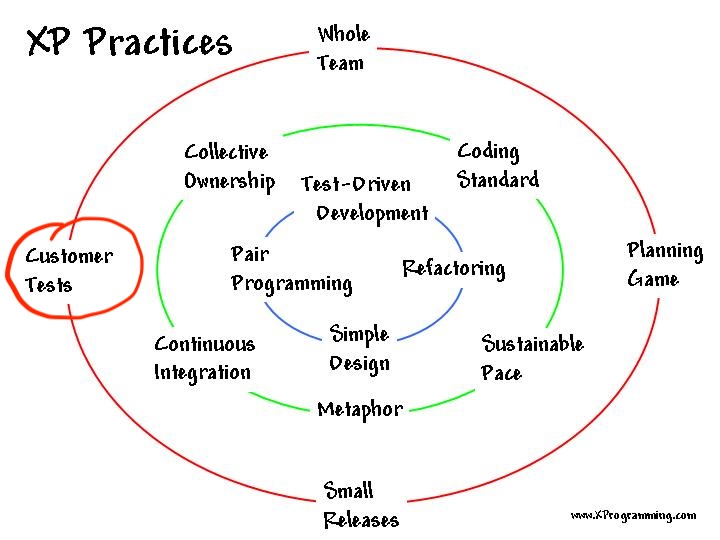
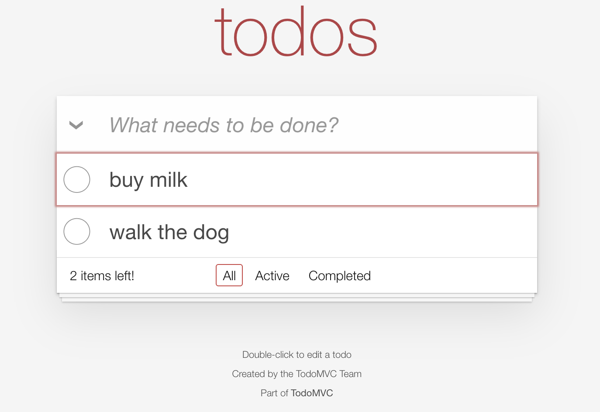
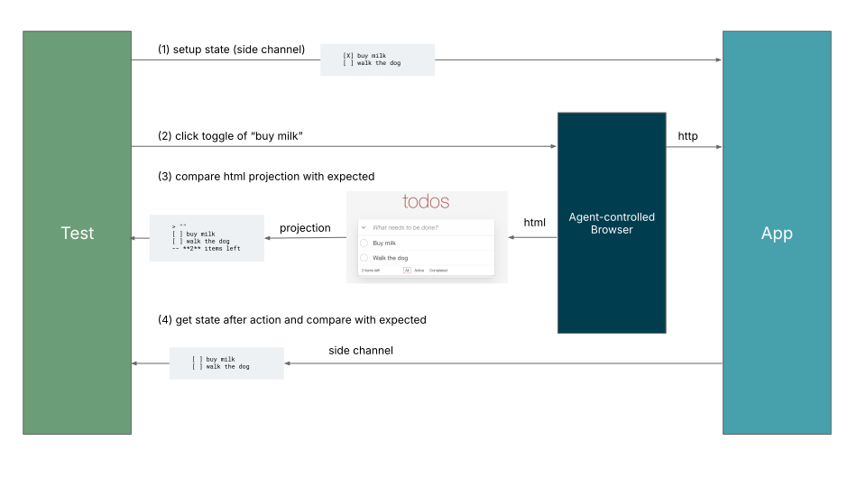
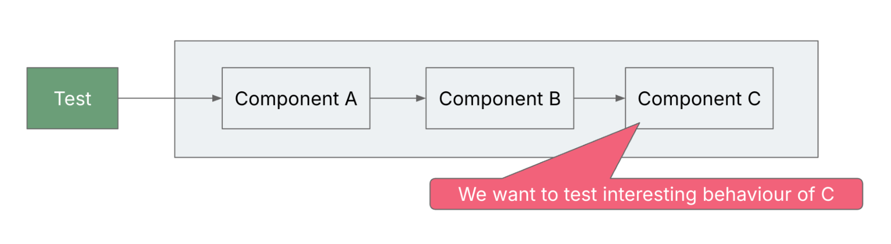

# 测试即数据

确保 AI 生成的代码做我们想要的事

<i>在 AI 编程助手时代，自动化测试变得棘手起来：当 AI 智能体同时编写生产代码和测试代码时，开发者有可能失去自动化测试所提供的、防范功能错误的保障。
我提出三个主张：(1) 当 AI 编写代码时，开发者就成了它的客户；(2) 因此，客户测试而非开发者测试，成为人与 AI 之间的主要契约；(3) 把这份契约从测试代码转移到测试数据中，更容易保护它不被编程智能体意外修改。
所有这些都指向同一个目标：让测试对人类可读，从而在人与其 AI 之间建立契约。
过去，编写和维护 DSL 解析器和自定义测试运行器成本高昂，如今 AI 让它们变得廉价。
本文建立在既有实践之上：极限编程中面向客户的验收测试、来自 Fit 与实例化需求的测试 DSL、来自 Go 的表格化测试，以及来自认可测试的可读文本化应用状态表示。</i>

|Matteo Vaccari| |
|:---|---:|
| | Matteo 是 Thoughtworks Italia 的开发者兼技术负责人（Technical Principal）。当极限编程帮助团队和企业取得成功时，他会由衷地高兴。|
| [原文](https://martinfowler.com/articles/tests-as-data.html) |2026/11/11|

---
内容
* [引言](#引言)
  - [AI 生成代码的问题](#ai-生成代码的问题)
  - [AI 生成测试的问题](#ai-生成测试的问题)
  - [AI 生成规约的问题](#ai-生成规约的问题)
  - [我的提议](#我的提议)
* [核心技术](#核心技术)
  - [客户测试](#客户测试)
  - [关注真正重要的部分](#关注真正重要的部分)
  - [并非所有测试都能放进表格](#并非所有测试都能放进表格)
* [建立在既有传统之上](#建立在既有传统之上)
  - [Fit 与实例化需求](#fit-与实例化需求)
  - [Go 中的测试实践](#go-中的测试实践)
  - [认可测试](#认可测试)
  - [已认可场景与已认可日志](#已认可场景与已认可日志)
* [实现提示](#实现提示)
  - [不必总是端到端](#不必总是端到端)
  - [面向 UI 的客户测试](#面向-ui-的客户测试)
  - [应对外部系统](#应对外部系统)
  - [保护测试 Harness](#保护测试-harness)
  - [验证测试](#验证测试)
  - [超越基于示例的测试](#超越基于示例的测试)
* [适用性的局限](#适用性的局限)
* [结论](#结论)
* [免责声明](#免责声明)
* [致谢](#致谢)
* [重要修订](#重要修订)

边栏
- [用测试表格取代一次性场景](#side-bar-1)
- [表格拯救一切](#side-bar-2)
- [内部资源与侧信道](#side-bar-3)
- [这不就是 Gherkin 和 Cucumber 吗？](#side-bar-4)
- [内部 DSL](#side-bar-5)

## 引言

### AI 生成代码的问题

2026 年初，我对某家大力投入 “使用 AI 编程智能体进行开发” 的组织中的 26 名开发者做了一系列访谈。
我的问题之一是：“你信任我们的测试吗？”
毕竟，这些开发者来自 Thoughtworks，而 Thoughtworks 一向以测试的质量和彻底性为傲。
遗憾的是，开发者们的回答无一例外都是：“*呃……我不太信任我们的测试！因为即使我在测试初次生成时审查过它们，随着新功能的加入，AI 会同时重构既有代码和既有测试，所以我不再有信心这些测试仍然在保障正确的行为。*”

这让我开始思考。
随着我们学会从编程智能体那里完成更多工作，AI 编写大部分（即便不是全部）测试，正变得自然而然。

开发者编写自动化测试的实践，是 20 世纪末软件工程的一项重大突破。
其中最实用的做法是先写测试再写代码（测试先行），并且一次只写一个测试并让它通过（测试驱动开发）。
这一实践使开发业务软件的团队能够以远低于形式化规约和形式化证明的成本，交付几乎无缺陷的代码。

2026 年，大量代码由 AI 编程智能体编写，而这些智能体即使不被要求也会生成测试，
所以人们或许会期望我们能达到人类程序员在 TDD 下享有的同等正确性。
遗憾的是，经验表明事实并非如此。
事实上，2026 年初已有多份报告显示，各组织部署的代码质量正在变差。

我无法确定这种被广泛报告的外部质量下降的确切原因，
但我认为，其中一个可能的原因就是自动化功能测试质量的下降。

<div style="background-color: #4d4d4d; color: #ffffff; padding: 8px; border: 1px solid #999999;">
⟡边栏⟡

* [Faros AI Engineering Report 2026](https://www.faros.ai/research/ai-acceleration-whiplash) 指出，每个拉取请求的缺陷数上升了 28.7%，每位开发者的缺陷数上升了 54%
* [DX AI-assisted engineering: Q1 impact report](https://getdx.com/report/ai-assisted-engineering-Q1-impact-report/) 指出，部分公司的缺陷数增加了 50%
* [CloudBees 的 State of Code Abundance 2026](https://www.cloudbees.com/lp/2026-state-of-code-abundance-report) 指出，在对 213 位企业技术负责人的调查中，81% 的受访者报告生产环境问题有所增加。同时，70% 的受访者认为 **测试套件的维护比编写代码本身更沉重**

</div></br>

### AI 生成测试的问题

当我们放手让 AI 自主生成代码时，我们就需要信任 AI 能写出好的测试，
因为 “所有测试都手写” 这个替代方案已不再现实。
让我们回到前面那些开发者的问题：当 AI 重构测试之后，他们就不再信任这些测试了。
AI 为什么要重构测试？
最可能的原因是，随着代码演进，函数的签名会发生变化，而这在开发过程中本来就是预期之中的，
所以 AI 这么做并不算 “错”。
但阅读 AI 生成的测试代码，比阅读 AI 生成的生产代码更加枯燥，
因此指望开发者在每一步都仔细重读所有被修改的测试代码，并不现实。

<ins>AI 生成的测试还有另一个问题：它们可能与实现紧密耦合。</ins>
如果我们让编程智能体 “用单元测试覆盖模块 X”，它会兴高采烈地生成大量测试，而且这些测试往往使用大量 mock 和 stub。
测试的目的，是在代码返回错误结果或产生错误副作用时失败。
遗憾的是，大量使用 mock 和 stub 的测试，往往在 mock 和 stub 所模拟的实现发生变化时就失败，
哪怕这个变化只是保持正确性的无害重构。
因此这类测试会产生大量假阳性。
更糟的是，这些测试可能并不能让我们相信它们能在代码做错事时保护我们。
它们证明的不是 “当输入为 X 时，输出必须是 Y”，而可能只是 “当我们调用函数 A 时，它会调用函数 B”，
这没什么用，因为它并没有证明代码会产生正确的结果。
事实上，当我们让 AI 用测试覆盖某个部分时，我们希望测试规约的是正确的行为，
但最常见的情况是，AI 写出的测试只是在确认当前的实现，包括其中可能存在的任何 bug。

所以总的来说，AI 生成的测试常常有问题，因为：

- 测试代码的数量很大
- 测试代码难以阅读
- 测试与实现耦合，并且
- 它们甚至可能无法证明代码是正确的

我们可以强制要求所有测试都由人类开发者来写，并且要写好，
但这会抵消编程智能体的大部分预期经济收益，
而且考虑到软件工程的发展方向，这也不现实。
但假如有一种写测试的方式，对人类来说读写都容易得多，那会怎样？这正是下文要讨论的内容。

### AI 生成规约的问题

很多 AI 辅助开发都采用了某种形式的[规约驱动开发（spec-driven development）](https://martinfowler.com/articles/exploring-gen-ai/sdd-3-tools.html)：
厂商[推荐这种做法](https://claude.com/resources/articles/the-ai-native-sdlc-playbook)，一些 SDD 框架也非常流行。
在开发之前与 AI 对齐显然非常有用，例如让 AI 提出澄清性问题；
但用 Markdown 文档中的散文来生成 “规约”，则存在一些问题。

一个问题同样是：<ins>生成出来的散文数量之大，使开发者难以全部读完。</ins>
过了某个临界点，疲劳就会袭来，我们可能只是草草一瞥就接受了 AI 生成的计划，
有人把这称为[*认知投降（cognitive surrender）*](https://addyosmani.com/blog/cognitive-surrender/)。
另一个问题是维护：一个功能完成之后，之前那些规约该怎么办？
有些框架支持维护一组长期有效的规约，但风险同样在于，随着时间推移，这些规约的数量会增长到无法维护。
第三个问题是，大语言模型并不会遵守所有详细的规约；
有时 AI 会为了更早宣称 “完成” 而放弃规约中的某些部分。

最后，也是最根本的一点：<ins>英语是有歧义的。</ins>
尽管我们可以尽可能精确地描述我们想要的东西，但自然语言无法提供编程语言那样的精确度。
简而言之，散文式规约无法被执行；测试可以。

### 我的提议

我们的目标是让测试具备这些性质：

- 它们能[预测生产环境中的成功](https://coding-is-like-cooking.info/2025/12/test-desiderata-2-0/)：当所有测试都通过时，我们就有信心功能被正确实现，并且会在生产环境中按预期运行
- 它们对重构具有抵抗力
- 它们尽可能易读

<ins>为实现这一点，我们提出以下技术：</ins>

- <ins>**客户测试（customer tests）**：用客户的语言来写。</ins>
- <ins>**黑盒（black box）**：从外部测试系统或系统的组件，不提及生产代码的实现细节。</ins>
- <ins>**测试即数据（tests-as-data）**：聚焦于重要的细节：输入、期望的输出或副作用，以及测试的初始设置。
换句话说，测试应当只捕捉*事实本身*，而不在测试代码中提及实现细节。</ins>
- <ins>**测试 DSL**：找到最直接的方式，用领域专家能理解的文本表示输入、输出和系统状态，并在测试失败时产生清晰的*差异（diff）*。</ins>

当 AI 编写代码时，开发者在某种意义上就成了客户。
测试是一份契约，它确立了代码应当为我们做什么；
而把测试移到数据文件中、由一个规模相对较小的测试运行器来解析执行，就更容易保护它们不被 AI 意外操纵。
而正是同一个 AI，让编写运行这套测试 DSL 的测试运行器变得轻而易举。

那 TDD 又处于什么位置？
考虑到人类在编码时从 TDD 中获益良多，我们能否期待 AI 在被要求、甚至被强制在其内部编码循环中使用 TDD 时表现得更好？
让 AI 遵循[正统 TDD（canon TDD）](https://newsletter.kentbeck.com/p/canon-tdd) 并不容易，因为 AI 通常在写测试之前就生成了大量代码。
另一方面，当我们只告诉智能体我们想要什么以及如何验证结果时，它们似乎表现得更好。
相反，加入关于 “如何达成结果” 的指令，[似乎反而让它们表现更差](https://danluu.com/agentic-testing/)。

本文讨论的技术，提供了编程智能体所需要的 “如何验证结果”。
在某种意义上，我们可以把它看作一种步子更大的测试先行。
一般来说，步子迈得小一些会让开发更安全；
而本文的目标，正是讨论如何安全地迈出更大的步子。

## 核心技术

### 客户测试

开发者编写测试，是极限编程最早期的实践之一。
由此产生的测试有时被称为 “开发者测试”，因为它们帮助开发者确保代码做了他们以为它该做的事。
（大多数开发者称之为*单元测试*。）
<ins>极限编程另一个最早的实践是*客户测试（Customer tests）*，也叫*验收测试（Acceptance tests）*。</ins>

客户测试是用客户的语言写成的测试；它从用户的角度描述软件应该做什么。

其理念在于，客户能够理解客户测试试图证明什么，从而让这些测试帮助客户与开发者达成一致。
有趣的地方在于，当机器编写大部分代码时，人类开发者越来越扮演起代码 “客户” 的角色。
我们希望规约的是软件 “应该做什么”，并且尽量不碰实现细节，因为这些细节已经交给 AI 了。

<br/>
*极限编程实践的圆圈图。图片由 [Ron Jeffries](https://ronjeffries.com/articles/017-02ff/new-framework-0/) 提供，经许可使用。*

<ins>这就是为什么我认为，**客户测试是我们应当依赖的主要测试类型，尤其是在生产代码由 AI 生成时。**</ins>
单元测试（开发者测试）仍然有用，但在规约行为这件事上，我们不再把它当作首要的事实来源。

客户测试：

- 定义用户故事的功能内容，因此当它们通过时，我们就知道这个故事在功能上已经完成
- 保护我们免受回归：一旦客户测试通过，它就必须永远通过，直到它所测试的业务规则发生变化
- 支持重构，因为它们测试的是行为，而不是实现
- 最后但也许最重要的一点：它们是确保开发者与客户对齐的工具。客户能读懂测试，并能提供反馈，确保我们测试的是正确的东西

另一方面，客户测试可能不太好用。
特别是当它们被实现为端到端测试时，可能又慢又不稳定（flaky）。
有办法克服这些问题，我们将在接下来的章节中讨论。

### 关注真正重要的部分

让我们看看如何解决测试难以阅读的问题。考虑下面这个简单的例子：

```
@Test
void defaultGreeting() throws IOException, InterruptedException {
    HttpRequest request = HttpRequest.newBuilder()
            .uri(URI.create(baseUrl + "/hello"))
            .GET()
            .build();

    HttpResponse<String> response =
            client.send(request, HttpResponse.BodyHandlers.ofString());

    assertEquals(200, response.statusCode());
    assertEquals("Hello, world!", response.body());
}

@Test
void personalisedGreeting() throws IOException, InterruptedException {
    HttpRequest request = HttpRequest.newBuilder()
            .uri(URI.create(baseUrl + "/hello?name=Joe"))
            .GET()
            .build();

    HttpResponse<String> response =
            client.send(request, HttpResponse.BodyHandlers.ofString());

    assertEquals(200, response.statusCode());
    assertEquals("Hello, Joe!", response.body());
}

```

你能一眼看出这些测试试图证明什么吗？
受过训练的眼睛会聚焦于其中真正重要的部分：

```
@Test
void defaultGreeting() throws IOException, InterruptedException {
    HttpRequest request = HttpRequest.newBuilder()
            .uri(URI.create(baseUrl + "/hello"))
            .GET()
            .build();

    HttpResponse<String> response =
            client.send(request, HttpResponse.BodyHandlers.ofString());

    assertEquals(200, response.statusCode());
    assertEquals("Hello, world!", response.body());
}

@Test
void personalisedGreeting() throws IOException, InterruptedException {
    HttpRequest request = HttpRequest.newBuilder()
            .uri(URI.create(baseUrl + "/hello?name=Joe"))
            .GET()
            .build();

    HttpResponse<String> response =
            client.send(request, HttpResponse.BodyHandlers.ofString());

    assertEquals(200, response.statusCode());
    assertEquals("Hello, Joe!", response.body());
}

```

>译注：原文对上面这个代码块里的 `defaultGreeting`、`/hello`、`"Hello, world!"`、`personalisedGreeting`、`?name=Joe`、`"Hello, Joe!"` 等行做了高亮。

聚焦于 *测试名称*、*输入* 和 *期望输出*，测试的意图就变得清晰了：
默认问候语是 “Hello, world!”，而提供了名字时的问候语是 “Hello, \<name>!”。
剩下的代码全是样板，反而把测试的意图掩盖了。

那么，为什么不只聚焦于这三样东西呢？
如果我们写成这样会怎样：

```
suite: greetings
tests:
  - name: "default greeting"
    request:
      resource: "/hello"
      name: null
    greeting: "Hello, world!"
  - name: "personalised greeting"
    request:
      resource: "/hello"
      name: "Joe"
    greeting: "Hello, Joe!"

```

这个 YAML 文件可以被一个参数化测试用作测试用例的来源，而这样的测试对 AI 来说非常容易编写。通常的流程是：

- 先草拟一份你希望拥有的测试*领域特定语言*（[DSL](https://martinfowler.com/bliki/DomainSpecificLanguage.html)）样例
- 让 AI 为它编写测试运行器
- 由人类和 AI 一起补充其他有用的测试用例，例如

```
- name: "name must not be entirely whitespace"
  request:
    resource: "/hello"
    name: " "
  error: "Name must not be entirely whitespace"
```

我们还可以把它变得更简洁：抽出一张可以存放在 CSV 文件中的表格。

```
test_name,             resource, name, greeting,         error
default greeting,      /hello,   null, "Hello, world!",
personalised greeting, /hello,   Joe,  "Hello, Joe!",
not whitespace,        /hello,   " ",  null,             Name must not be entirely whitespace

```

为什么用表格？
<ins>因为**表格让人一眼就能看出覆盖了哪些用例、可能缺少哪些用例。此外，表格让添加新测试用例变得更容易。**</ins>

<div style="background-color: #4d4d4d; color: #ffffff; padding: 8px; border: 1px solid #999999;">
⟡边栏⟡

人们可能会有一种冲动，想把状态或行为编码进表格，比如下面这个例子：

```

| action           | result    |
| login as trader  | ok        |
| go to admin page | forbidden |
| login as admin   | ok        |
| go to admin page | ok        |

```

表格应当是直截了当的：每一行都应是一个无状态的操作，带有输入和期望输出。
当需要更复杂的东西时，我们可以使用下一节讨论的技术。

</div></br>

这本质上就是测试即数据。
它如何帮助解决开发者不信任测试的问题？
它之所以有帮助，是因为测试 (1) 聚焦于我们作为开发者-客户最关心的部分，(2) 对重构更有抵抗力，
以及 (3) 当测试以文本文件形式存放时，AI 一旦改动测试，我们就更容易察觉。

当应用的输入、初始设置状态和期望输出都是单一的标量值时，表格效果很好。
当这些内容都是结构化数据时，我们需要使用下面介绍的结构化场景。

<div style="background-color: #0a2463; color: #ffffff; padding: 8px; border: 1px solid #1e3a8a;">
<a id="side-bar-1"></a>
<b>用测试表格取代一次性场景</b><br/><br/>

有时，人们会用测试框架来定义测试场景，如下面这个 Gherkin 例子（由 David Farley 提供）：

```

Given I am logged in as a trader
When I attempt to access the admin dashboard
Then I should be denied access
And the attempt should be logged as a security event
```

这个测试没问题，但看到它时，我会想：其他情况下会发生什么？
与其把这几行改一改写上几遍，例如

```

Given I am logged in as an admin
When I attempt to access the admin dashboard
Then I should be allowed access
And no security event should be generated
```

我更愿意把它变成一张表格：

表：`admin_dashboard_access_control`

| role | session_state | resource | expected_result | logged |
|---|---|---|---|---|
| trader | valid | admin dashboard | denied | yes |
| trader | valid | admin API | forbidden | yes |
| admin | valid | admin dashboard | allowed | no |
| admin | valid | admin API | allowed | no |
| viewer | valid | admin dashboard | denied | yes |
| support | valid | admin dashboard | denied | yes |
| guest | none | admin dashboard | login required | yes |
| trader | expired | admin dashboard | login required | yes |
| trader | tampered | admin API | unauthorized | yes |
| trader | valid | admin direct URL | denied | yes |

表格让人一眼就能看出覆盖了哪些用例、缺少哪些用例、哪些是冗余的，并且容易添加新用例。

</div></br>

<div style="background-color: #0a2463; color: #ffffff; padding: 8px; border: 1px solid #1e3a8a;">
<a id="side-bar-2"></a>
<b>表格拯救一切</b><br/><br/>

[Max Kanat-Alexander](https://maxkanatalexander.com/) 跟我讲过他写过的最复杂的测试，
它覆盖 Bugzilla 的查询表达式语言：20 个操作符作用于 50 个字段，必须被编译成自定义 SQL，而 SQL 又会随涉及的字段而变化。
他说，那个测试除了写成数据结构之外，别无他法。
它写于 2011 年左右，[至今仍留在代码库中](https://github.com/bugzilla/bugzilla/blob/852cd06ef751cb5a5f87e100466e71e46e3cfc0e/xt/lib/Bugzilla/Test/Search/Constants.pm#L547)。
它被表达为一个 Perl 哈希，把操作符映射到测试用例表。
不过 Max 补充说，他通常更愿意让智能体把测试写成代码，这样他就能通过静态分析工具对测试施加规则。

</div></br>

### 并非所有测试都能放进表格

当测试的输入不是简单的值时，表格形式就不够用了。这时我们可以转向更结构化的场景。
我第一次接触客户测试的想法，来自 Ron Jeffries 2004 年出版的书 *Extreme Programming Adventures in C#*。
他讲述了如何开发一个编辑 XML 标记文章的编辑器，并以这个客户测试开篇（为清晰起见做了改写）：

```
---- before ----
<p>Fo|o</p>
<p>Bar</p>
----------------
* press enter
---- after ----
<p>Foo</p>
<p>|</p>
<p>Bar</p>
----------------
```

这个测试的意图是展示：当光标（用 “|” 表示）位于段落中间时，用户按下 *enter* 键会发生什么。
Jeffries 接着展示了如何为这个测试编写一个简单的运行器。
从一开始，这个客户测试就存放在一个文本文件里。

再看一个例子：在开发编程语言解释器或编译器时，我一直认为 “先设计文法、再逐个设计处理阶段” 的瀑布式做法，
不如从你能定义的最简单有意义的程序开始（对大多数语言来说就是 “Hello, world!”），然后一次一个测试地构建语言特性。
用编程智能体以这种方式工作，可以安全地写出非常复杂的解释器和编译器。
下面是一个 BASIC 解释器实验中的例子，这种做法可以扩展到复杂得多的语言。

```
tests:
  - name: "LEN function basic tests"
    program: |
      10 PRINT LEN("HELLO WORLD")
      20 PRINT LEN("")
      30 PRINT LEN("A")
      40 END
    expected:
      - "11\n"
      - "0\n"
      - "1\n"
  - name: "LEFT$ function basic tests"
    program: |
      10 PRINT LEFT$("HELLO WORLD", 5)
      20 PRINT LEFT$("HI", 10)
      30 PRINT LEFT$("TEST", 0)
      40 PRINT LEFT$("HELLO", 3)
      50 END
    expected:
      - "HELLO\n"
      - "HI\n"
      - "\n"
      - "HEL\n"

```

那我们要如何测试一个 Web 应用呢？下面是对一个简单待办事项（todo-list）应用进行测试的设想：

```
## Unchecking a completed todo reactivates it
GIVEN model:
    [x] buy milk
    [ ] walk the dog
WHEN user:
    click toggle of "buy milk"
THEN page:
    > ""
    [ ] buy milk
    [ ] walk the dog
    -- **2** items left
THEN model:
    [ ] buy milk
    [ ] walk the dog

```

应用的显示原本是这样的：

<br/>

它从原始 HTML 被简化成：

```
> ""
[ ] buy milk
[ ] walk the dog
-- **2** items left
```

<div style="background-color: #4d4d4d; color: #ffffff; padding: 8px; border: 1px solid #999999;">
⟡边栏⟡

这个把 HTML 转成可读、可 diff 文本的打印器，正是 [Esko Luontola 为测试 HTML 模板推荐的](https://martinfowler.com/articles/tdd-html-templates.html#BonusLevelStringlyAsserted)。
</div></br>

这种文本表示很容易嵌入测试，在测试失败时能产生清晰的 “差异”，并且对 UI 视觉外观的变化具有韧性。
把 HTML 或 DOM 转换成这种文本表示的函数，称为 “投影（projection）”，或者更简单地说，*打印器（printer）*。

在这个例子里我们还用了另一个打印器，它展示应用内部状态的内容。
它位于 `THEN model` 段，使用与 UI 打印器相似的语法。
之所以加入它，是因为在测试一个本应改变状态的操作时（比如本例中取消勾选一个待办项），
我们不应满足于只看到 UI 上的变化：我们还希望确保应用的持久状态也被改变了。

除了两个打印器，这个例子还用了两个*解析器（parser）*：
第一个用于 `GIVEN model` 段，那里表示测试的起始状态，用来按测试需要设置应用状态。
第二个用于 `WHEN user` 段，用来解析我们发送给应用的命令，其职责是识别一套可执行的操作词汇。

<br/>
*todo-list 测试工作方式的时序图。*

应用状态的打印器和解析器必须能以某种方式访问和操作应用状态自身；这可以通过 *侧信道 (side channel)* 来实现。

上述所有机制都在一个测试运行器里配合使用，而编程智能体可以轻松生成这样的运行器。

<div style="background-color: #0a2463; color: #ffffff; padding: 8px; border: 1px solid #1e3a8a;">
<a id="side-bar-3"></a>
<b>内部资源与侧信道</b><br/><br/>

为什么要通过一条侧信道来设置应用状态的初始值？
另一种选择是通过应用公开的 UI 来驱动它。
这可能会有问题：它会增加测试设置时间、提高测试不稳定的可能性，
还可能促使我们为只有测试才需要的操作添加用户界面，从而扩大 UI 表面并降低安全性。

一条简单的侧信道可以是一个单独的可执行文件，它复用应用的仓储（repository）代码，从而以与应用自身一致的方式保存状态。
这个可执行文件永远不会被发布到生产环境。
把侧信道构建成一组不对外公开的 API 也是一种可能，正如 Toby Clemson 在[关于微服务测试的文章](https://martinfowler.com/articles/microservice-testing/#testing-component-in-process-diagram)中所建议的，他称之为*内部资源（internal resources）*。

</div></br>

<div style="background-color: #0a2463; color: #ffffff; padding: 8px; border: 1px solid #1e3a8a;">
<a id="side-bar-4"></a>
<b>这不就是 Gherkin 和 Cucumber 吗？</b><br/><br/>

Gherkin 是一种流行的编写客户测试的语言，与上面提出的方法一样，它的测试写在文本文件中，由测试运行器解释。
它能用，但有一些需要注意的问题：

- 它相当自由格式，所以当 AI 编写测试时，我们必须检查它是否写出了弱断言
- Gherkin 的步骤定义有不断增殖的倾向，所以我们必须努力保持步骤库足够小

这里提出的方法依赖于为我们的问题领域量身定制的 DSL，而不是标准的 given-when-then，
因此可以针对更清晰地表达我们的问题来做优化。
而且定制 DSL 能对测试施加结构约束：如果我们希望总是在操作后比较系统状态，
就可以把这项检查设为 DSL 语法中强制的一部分，并决定这项检查必须有多完整。

</div></br>

## 建立在既有传统之上

### Fit 与实例化需求

Ward Cunningham 被认为是许多后来被极限编程普及的想法的源头。
Cunningham 讲述道，大约在 2002 年，他的客户往往用 Excel 文档提供自己的规约。
他厌倦了从 Excel 把测试数据复制到测试代码里，于是写了一个程序：从 Excel 读取测试数据并自动执行测试。
这使他的客户可以非常容易地扩展和细化规约，也使他能验证自己的程序是否与规约本身相符。
他[把这个工具称为 Fit](http://fit.c2.com/)，它有针对多种编程语言的实现。

<br/>
*Fit 展示一个测试结果的截图。图片由 [James Shore](https://www.jamesshore.com/) 提供，经许可使用。*

2004 年，Martin Fowler 发表了关于[实例化需求（Specification by Example）](https://martinfowler.com/bliki/SpecificationByExample.html)的文章，
那篇文章基本上把这一思路讲清楚了：让开发者和业务人员就 “应该发生什么” 的示例达成一致，复杂的需求便能得到澄清。
后来，在 2011 年，Gojko Adzic 出版了[同名著作](https://gojko.net/books/specification-by-example/)，
到那时已涌现出许多类似的方法，其中最流行的是 [Cucumber](https://cucumber.io/) 及其语言 [Gherkin](https://cucumber.io/docs/gherkin/)。

*实例化需求* 这一传统普及了客户测试；但这种方法并非没有代价。
从文档中自动提取表格可能既慢又脆弱，而 Cucumber 需要一层解释代码，有时会成为 bug 和误解的来源。

James Shore 是 Fit 的早期采用者，并维护过它的许多实现。
后来他[对这一方法不再抱有幻想](https://www.jamesshore.com/v2/blog/2010/the-problems-with-acceptance-testing)，
感叹说：虽然这个工具的首要目的是改善与客户的沟通，但大多数客户并不想编写测试表格，
这导致他先与客户进行沟通，然后自己编写 Fit 测试。
再后来，Fit（以及 Gherkin）的使用通常被下放给 QA 团队，用于事后测试软件，
这与 “促进与客户对话” 的初衷背道而驰。
出于这些原因，他认为，如果客户不愿意写测试，那么 Fit 或 Gherkin 运行器的维护开销就不值得，
把测试写成代码反而更合理。

“客户不想写客户测试” 这一点，经常被人们拿来反对客户测试的实践。
我认为，我们今天所处的境况会改变这个事实，因为：

- 当 AI 编写大部分生产代码时，人类开发者就处在客户的位置上：我们描述想要什么，并对得到的东西给出反馈，就像客户一直做的那样。
- 编写和维护运行客户测试的机制，是编程智能体能够又快又便宜地完成的事。

实例化需求可以帮助解决引言中描述的规约驱动开发的问题：
用示例澄清验收标准，从而让它们的描述可以短得多。
通过让这些测试成为规约不可分割的一部分，我们让规约变得可执行，并使编程智能体无法绕过它。
而且这些规约不会过期，因为它们在 CI 中运行。

### Go 中的测试实践

一种相关的方法来自 Go 编程语言的传统，在 Go 中大多数测试都是表格化的。
例如，下面是 “fmt” 包被测试的方式：

```
var fmtTests = []struct {
    fmt string
    val any
    out string
}{
    {"%d", 12345, "12345"},
    {"%v", 12345, "12345"},
    {"%t", true,  "true"},

    // basic string
    {"%s",    "abc",              "abc"},
    {"%q",    "abc",              `"abc"`},
    {"%x",    "abc",              "616263"},
    {"%x",    "\xff\xf0\x0f\xff", "fff00fff"},
    {"%X",    "\xff\xf0\x0f\xff", "FFF00FFF"},
    {"%x",    "",                 ""},
    {"% x",   "",                 ""},
    {"%#x",   "",                 ""},
    {"%# x",  "",                 ""},
    {"%x",    "xyz",              "78797a"},
    {"%X",    "xyz",              "78797A"},
    {"% x",   "xyz",              "78 79 7a"},
    {"% X",   "xyz",              "78 79 7A"},
    {"%#x",   "xyz",              "0x78797a"},
    {"%#X",   "xyz",              "0X78797A"},
    {"%# x",  "xyz",              "0x78 0x79 0x7a"},
    {"%# X",  "xyz",              "0X78 0X79 0X7A"},
    //[...]
```

上面这段代码创建了一个结构体数组，由以下部分组成：被测试的格式，例如 “%x”；输入字符串，例如 “abc”；
以及格式化后的结果文本，在这个例子中是 “616263”。
一个简短的测试运行器把表格中的每一行都作用到 fmt 函数上。
Go 标准库中的许多函数都以类似方式被测试。

<div style="background-color: #4d4d4d; color: #ffffff; padding: 8px; border: 1px solid #999999;">

⟡边栏⟡

Russ Cox 的 [Go Testing By Example](https://research.swtch.com/testing) 是一座想法宝库，其中许多也在本文中讨论过。

</div></br>

同样在 Go 中，有一种既有的实践是把场景写在文本文件里，尤其是当测试依赖于文件的存在，或检查文件是否被创建时。
下面是 `go` 命令行工具被测试的[一个例子](https://go.dev/src/cmd/go/testdata/script/run_hello.txt)：

```
env GO111MODULE=off

# hello world
go run hello.go
stderr 'hello world'

-- hello.go --
package main
func main() { println("hello world") }

```

可以看到，为了测试核心的 Go 工具程序，人们开发了[一套自定义 DSL](https://go.dev/src/cmd/go/testdata/script/README)。
这个测试演练了 `go run` 子命令。
该 DSL 允许测试作者定义环境变量、准备文件、执行命令，并检查标准错误通道上的输出结果。

### 认可测试

第三种相关的传统是 [认可测试（Approval Tests）](https://approvaltests.com/)，它由 Llewellyn Falco 推广。
在这种实践中，常见的做法是让系统生成一个文件，它可能表示一连串计算，或 UI 在某一时刻的样子，
或系统内部状态的可读表示；要点在于我们得到的表示是 *人类可以理解的*，然后由人类来 *认可* 它。
一旦某个文件被认可，它就可以在未来的运行中被重新生成；
每当新生成的文件与被认可的文件不同，就表明系统的行为发生了变化。
运行这类测试的机制涉及一个测试运行器，它可以来自某个认可测试库，也可以由编程智能体临时生成。
这种做法与我们这里关注的问题相关，因为它强调：人类看的不是测试代码，而是测试数据。

<ins>从认可测试中要带走的一个关键想法是：设法让应用状态和输出变得可读且 “可 diff”，
也就是说，当测试失败时，我们能清楚地看到期望值与实际值之间的文本差异。</ins>

Llewellyn Falco 和 Lada Kesseler 对认可测试的实践做了[精彩的讲解](https://www.youtube.com/watch?v=QEdpE0chA-s)（视频）

>译注：认可测试（Approval Testing）与验收测试（Acceptance Testing）不是一回事，尽管中文里都带个 “认” 字。
>前者是一种具体的测试工作流：让系统生成人类可读的文本（计算结果、UI 快照、内部状态），由人审阅并 *批准（approve）*，固化为基准文件；此后每次运行重新生成并与基准比对，不同则说明行为变了——技术上近似 “快照测试（snapshot testing）”。
>后者指的是从客户或用户角度编写的、具有验收性质的测试，也就是前一节里的客户测试。
>“认可” 强调的是 *人类批准了这份输出*，而不是 “人类认可的测试用例”。

### 已认可场景与已认可日志

Ivett Ördög 一段时间以来一直在推广我在本文中描述的技术。
她发表了[已认可场景（Approved Scenarios）](https://lexler.github.io/augmented-coding-patterns/patterns/approved-scenarios/)和
[已认可日志（Approved Logs）](https://lexler.github.io/augmented-coding-patterns/patterns/approved-logs/)模式，
主张用领域特定语言来表达客户测试。
第一个模式适用于我们提前规约行为的情形；
第二个模式则依赖运行中的系统生成其状态的文本表示，这种表示可以被调整并用来生成新的测试，
在测试既有系统、或把编写一个失败测试作为修 bug 的第一步时尤其有用。
她的[视频](https://www.youtube.com/watch?v=GyI5qU9MNJU&t=2250s)更详细地解释了这些技术。

典型的已认可场景或已认可日志 DSL 由三部分组成：系统状态的设置、要执行的一个或多个动作，以及动作之后系统状态的表示。
上手的过程通常是：

- 决定一种 DSL 格式（很可能是与 AI 协作决定），并写出第一个测试
- 让编程智能体生成 DSL 解析器和测试运行器
- 开发者通过对照生产代码来检查运行器工作是否正确
- 编程智能体以第一个测试为模板，添加更多场景

我的理解是，已认可场景模式适用于已经具备足够结构、可以写出有意义的第一个测试的系统，
这与 Dan Terhorst-North 所描述的 [Spike and Stabilize](https://dannorth.net/blog/the-art-of-misdirection/) 模式有些相似。
如果是从零开始，另一种做法可能是把第一个测试用于生成[可走通的骨架（Walking Skeleton）](https://www.thoughtworks.com/insights/blog/first-story-every-project)。

<ins>这两个模式是 Ördög 所称的[受约束的测试（Constrained Tests）](https://lexler.github.io/augmented-coding-patterns/patterns/constrained-tests/)模式的实例：
在这种模式中，编程智能体无法轻易地通过编写比预期更弱的测试来 “作弊”。
已认可场景与已认可日志通过把断言作为 DSL 语法中强制的一部分，降低了作弊的可能性，
而这要求 DSL 是用解析器实现的，即[外部 DSL](https://martinfowler.com/dsl.html)。</ins>

Ördög 认为，如果我们实现的是[内部测试 DSL](https://martinfowler.com/bliki/InternalDslStyle.html)，
它不过是用我们所用编程语言定义的一组函数，
那么智能体就可能写出没有断言或断言很弱的测试，从而伪造出很高的测试覆盖率，而实际上测试并没有按预期测试系统。
而外部 DSL 中，断言是 DSL 语法中不可分割且强制的一部分，这就降低了这个问题出现的可能性。

所以，受约束的测试模式的目的之一，是确保测试覆盖率能可靠地指示代码的哪些部分被测试过，
这也使外部 DSL 带来的开销和间接性变得值得。

>译注：内部 DSL 指直接用宿主语言（如 Java、JavaScript）写成的领域语言，本质上是一组函数或方法调用，例如此处 `anUnlockedDeviceWithAutoLockEnabled()` 那样的写法，不需要额外的解析器；外部 DSL 则有自己独立的语法和解析器，测试写在 YAML、CSV、Gherkin 这类独立文本中，由测试运行器解析后执行。
>本文之所以推崇外部 DSL，是因为它的语法可以把 “必须给出断言” 变成强制要求，使编程智能体难以写出没有断言或断言很弱的测试。

<div style="background-color: #0a2463; color: #ffffff; padding: 8px; border: 1px solid #1e3a8a;">
<a id="side-bar-5"></a>
<b>内部 DSL</b><br/><br/>

一些开发者更愿意把客户测试写成内部 DSL。一个例子可能是

```
test("an unattended device locks itself", async () => {
  const scenario = anUnlockedDeviceWithAutoLockEnabled();

  await scenario.device.remainsIdlePastTheLockTimeout();

  scenario.device.shouldBeLocked();
});

```

这种风格能行得通，但很久以前我有过一次负面经历。
团队里的其他开发者非常不喜欢这种风格，因为他们觉得它掩盖了那些漂亮易读的函数调用背后真正发生的事情。
我认为，可以通过把我所谓的 “单体式” 函数调用拆解成更小的、可组合的片段来改进这一点。

```
test("an unattended device locks itself", async () => {
  const scenario = aScenario()
    .withDevice({autoLock: Autolock.ENABLED, state: LockState.UNLOCKED})
    .build();

  await scenario.advanceTime(lockTimeout + epsilon);

  expect(scenario.device.state()).toEqual(LockState.LOCKED);
});

```

我认为这种可组合的风格更不容易让人对底层发生的事情感到不清不楚，
因为以前用函数名中的词语来表达的想法（比如 `anUnlockedDeviceWithAutoLockEnabled`），
现在被表达为一个个独立的代码元素。

</div></br>

>译注：本节介绍两个认可模式，并论证为何外部 DSL 是防止 AI 作弊的关键。

## 实现提示

### 不必总是端到端

把客户测试做成经由 UI 的端到端测试，这种做法很常见。这样做可以，但它不是唯一的方式。
<ins>所有客户测试都端到端的一个问题是，测试会变得更慢、更脆弱。
避免这个问题的一个好办法，是让大多数测试绕过 UI 执行。
许多业务应用都有一个[服务层（service layer）](https://martinfowler.com/eaaCatalog/serviceLayer.html)，
它是一组类或函数，由 UI 和系统中的其他入口点调用来执行业务操作。
测试可以调用服务层，完全绕过 UI。</ins>
在许多领域这是合理的，例如在金融领域，逻辑比 UI 复杂得多，也难做对得多。
我经历过的一个例子是在保险领域：我们拿到了一套复杂的规则，用于把索赔与律师匹配起来。
编写客户测试帮助我们确保准确理解了客户想要达成什么，然后我们把它实现为服务层测试。

>译注：上面这种「绕过 UI、调用服务层」的做法，就是 Martin Fowler 所说的 [皮下测试（Subcutaneous Test）](./subcutaneous-test.md)——在 UI 之下、直接穿过服务层来测试，既保留了接近端到端的信心，又避开了表示层技术带来的缓慢与脆弱。
>注意它的边界：皮下测试仍然是「端到端的行为路径，只是入口下沉」；而紧接着的下一段要解决的是另一个问题——当入口离目标逻辑太远时，就直接对那个组件写客户测试，那已不是皮下测试，而是组件级的客户测试。

另一个问题是：按函数调用的次数算，测试的入口点离你想演练的逻辑太远。

<br/>

在这个例子里，我们想测试组件 “C” 中一些有趣的逻辑，
但为了做到这一点，我们的测试必须 “说服” 中间组件 “A” 恰当地设置组件 “B”，
再由组件 “B” 恰当地设置组件 “C”。
这可能会很别扭，可能带来一种试图在瓶子里造船的感觉——用棍子穿过瓶口去布置微小的细节。

<br/>

我们不必这么做；当我们有一个重要组件想要详细规约时，可以直接为它编写客户测试。
记住，客户测试最重要的一点，是它支持客户与开发者之间的对齐。
一个例子是下面这个针对组件的测试，它检查用户的 IP 地址是否匹配允许列表。
这个允许列表复杂到我们没有把握仅靠端到端测试就测得住，
所以我们写了一个聚焦的客户测试，把它实现为单元测试，并配上了自己的自定义测试 DSL。

```
tests:
  - name: "is_ip_allowed respects enabled flag"
    allowlist:
      - { id: 1, ip_or_cidr: "10.0.0.1/32", is_enabled: true }
      - { id: 2, ip_or_cidr: "10.0.0.2/32", is_enabled: false }
    is_ip_allowed:
      - { ip: "10.0.0.1", expected: true }
      - { ip: "10.0.0.2", expected: false }

  - name: "is_ip_allowed fails closed on empty allowlist"
    allowlist: []
    is_ip_allowed:
      - { ip: "10.0.0.1", expected: false }

  # --- IPv4 MATCHING ---
  - name: "is_ip_allowed matches /32 range"
    allowlist:
      - { id: 1, ip_or_cidr: "192.168.1.100/32", is_enabled: true }
    is_ip_allowed:
      - { ip: "192.168.1.100", expected: true }
      - { ip: "192.168.1.101", expected: false }
      - { ip: "192.168.1.99",  expected: false }

```

为每一个我们想测试的重要东西使用测试 DSL，如今成本很低，因为 AI 能非常便宜地构建测试运行器。

>译注：要注意，客户测试（customer test）说的是测试的视角和语言——从客户或使用者的角度看、用领域语言表达、黑盒而不涉及实现细节——而不是测试的运行层级。
>因此客户测试既可以是系统级的端到端测试，也可以是针对某个组件的测试，如上一节那个以单元测试形式实现、自带自定义 DSL 的 IP 允许列表示例。

### 面向 UI 的客户测试

测试 UI 是出了名的困难，但与此同时，UI 中往往包含我们想要测试的重要逻辑。
难点在于，用 Selenium 这类工具写的测试往往又慢又不稳定。
Playwright 这类工具可以自动等待组件渲染完成，从而减少测试的不稳定现象。
[基于浏览器的组件测试](https://www.thoughtworks.com/radar/techniques/browser-based-component-testing)最近在 Thoughtworks 技术雷达中被提升到 *Trial* 阶段。

也有一些不需要通过浏览器运行测试的方法；测试运行器可以用 JSDOM 把 UI 组件挂载到模拟的 DOM 中，
让测试能以与人类用户相同的方式与 JSDOM 中的 UI 交互。
流行的前端框架使用 JSDOM 在进程内运行组件测试。

关于如何获得[低于 1 毫秒（sub-millisecond）的端到端测试](https://www.youtube.com/watch?v=sUclXYMDI94)的更多提示，来自 Aslak Hellesøy。

### 应对外部系统

业务应用经常依赖外部服务；一个电商应用很可能需要与支付网关、邮件服务器、库存服务以及许多其他服务通信。
这使测试变得更复杂。
如果我们试图连接到外部服务来做端到端测试，会遇到很多问题。
外部服务可能并非总是可用，可能又慢又不稳定，而且可能没有我们可以使用的测试版本。
即使外部服务存在测试环境，由于其他原因，它也可能不方便使用。

我曾与一个测试支付网关合作，使用一张测试信用卡，我们不得不定期给这个服务背后的人打电话，
把测试卡的信用额度补充几百万欧元；
因为即使我们的测试尽量少 “花钱”，它们也一直在运行，会定期把可用信用额度消耗到零。
另一个例子是一个股票交易所 API 的测试版本，它遵守真实市场的开盘和收盘阶段，因此我们无法在非交易时段运行测试。
它们还可能设有速率限制器。

显然，用智能体编程的成功标准之一就是快速可靠的反馈，
因此，即便是端到端测试，也应当能在本地、不与外部服务连接的情况下运行。

我们可以运行本地数据库和本地邮件服务器，但自定义的第三方服务怎么办？
传统的解决方案是搭建 *WireMock* 或 *Mountebank* 之类的工具，并给出具体指令来 mock 期望的行为。
这可行，但在测试中规约外部系统应当如何行为，工作量很大。
<ins>一种正在兴起的解决方案，是让编程智能体生成外部服务的本地模拟器。
如果外部服务有公开的 API，我们可以直接让编程智能体实现它。</ins>
这种方法由 Justin McCarthy 推广，他称之为[数字孪生（Digital Twins）](https://factory.strongdm.ai/techniques/dtu)
（另见[对 McCarthy 的访谈视频](https://www.youtube.com/watch?v=Ge9HvXha6XM)）。
[Clare Liguori 的这段演讲视频](https://www.youtube.com/watch?v=pqlWNihgdjI)也提到了这种方法，
她称之为 *mock 服务（mock services）*，并谈到各团队如何借编程智能体把生产力提升一个台阶。

在这种场景下，我们往往可以让同一个测试有两种跑法：作为[进程内测试以获得快速反馈](https://martinfowler.com/articles/microservice-testing/#testing-component-in-process-diagram)，
或作为[进程外集成测试](https://martinfowler.com/articles/microservice-testing/#testing-component-out-of-process-diagram)，配上更真实的依赖。
测试即数据让这件事变得容易：让 AI 为同一个测试生成不同的测试运行器即可。
Uberto Barbini [解释过](https://medium.com/javarevisited/beyond-traditional-acceptance-tests-79cbcee63eda)一种类似的技术，
不过他使用的是测试即代码，因此采用起来会稍微没那么直接。

如何用外部依赖做黑盒测试，是一个丰富而深刻的话题，本文只能略作涉猎。
更多细节可以在 [Martin Fowler](https://martinfowler.com/bliki/TestPyramid.html) 或 [Ham Vocke](https://martinfowler.com/articles/practical-test-pyramid.html) 的文章中找到。

### 保护测试 Harness

编程智能体的一个问题，是它们有时可能 “作弊”；为了急于宣称任务完成，它们可能走捷径，比如削弱或禁用测试。
这也是我们在引言中提到的原因之一：开发者可能对测试提供的保护失去信心，
因为测试会因重构或新功能的实现而改变，他们担心测试会在这一过程中被意外削弱。

本文描述的方法有助于解决这个问题：
当测试的重要部分位于文本文件中时，只要预计规约不会变化，开发者就可以保护这些文件不被修改；
或者至少可以在版本控制中检查这些文件有没有被意外改动。
这样开发者就更难漏掉测试中的修改；如果真的发生了修改，他们可以查看测试即数据，看看改了什么，
希望这比测试即代码时产生的疲劳要少一些。

| 何时 | 预期生产代码变化？ | 预期测试数据变化？ | 预期测试运行器变化？ |
|---|---|---|---|
| 实现新功能 | 是 | 是 | 否 |
| 重构生产代码 | 是 | 否 | 否 |
| 提高测试覆盖 | 否 | 是 | 否 |
| 改进测试 DSL | 否 | 是 | 是 |

根据任务类型，我们可以保护那些不期望 AI 修改的文件：
把它们设为只读，让智能体无法绕过；或者在 CI 中运行检查，根据任务类型验证哪些文件被修改了。
编程管控工具（coding harness）的 hooks 机制可以在模型试图修改不该改的东西时提供快速反馈，但并非万无一失。

即便如此，AI 仍有空间给我们带来意外。
测试运行器是代码，可能被意外修改。
DSL 的实现也为 AI 引发的混乱留出了空间。
为了进一步增强我们对 “测试仍在保护我们” 的信心，我们可以研究一些额外的技术，比如下一节提到的那些。

### 验证测试

当 AI 编写部分或大部分测试时，我们仍然面临审查问题。
上述技术通过提高测试的表达力和简洁性，降低了测试审查的成本。
然而，测试的数量仍然会很可观，因此我们在测试审查中会产生认知疲劳，并面临认知投降的风险。

让我们看看应对这个问题的两种策略。
一种是设法验证测试本身；另一种是寻找验证产品自身的额外方法。

<ins>我们能做的第一件事是**变异测试（mutation testing）**：
我们在生产代码中注入有意的故障，看看是否有测试失败；如果测试失败，再检查它给出的错误信息是否准确、是否足够有用。</ins>
最简单的变异测试方式，是手工修改生产代码中的某个东西，
例如把 `+` 改成 `-`，或注释掉 `if` 的一个分支，然后看是否有测试失败。
接着我们可以让 AI 自己做一些变异测试。
最后，我们可能采用一个变异测试库，把这一过程自动化并纳入 CI 流水线。

变异测试能证明测试确实能有效发现故障，但无法防范另一种风险：测试本身规约的内容就是错的。
为了缓解这一风险，我们应当设法验证测试本身，即验证测试的期望输出是正确的。
<ins>*oracle（判定基准）* 是指能够判断任意给定输入对应的正确输出应该是什么的人或事物。</ins>
有时唯一可用的 oracle 是人：领域专家；但我们常常能找到其他 oracle。
一个例子是官方文档：官方法规、内部合规文档、技术手册、API 文档。

例如，在开发一个 COBOL 解释器时，我提供了 IBM 官方手册（PDF 和文本格式），
这样智能体就有了 IBM i 机器上运行的 COBOL 方言的权威来源。

另一类 oracle 是替代实现：有时你可以用一个简单的暴力算法来比较一个复杂、更高效的算法的输出。
我在上述 COBOL 解释器的开发中使用了 oracle 技术：
所有客户测试都必须在真实的 IBM i 系统上通过，且结果与在我的笔记本电脑上一致。
我用它来验证：这些主要由 AI 生成的客户测试，规约的行为是否与 IBM 机器一致。

<ins>这是测试即数据的另一个优势：通过让 AI 编写另一个测试运行器，你可以在不止一个环境中运行同一个测试。</ins>
例如在重写一个系统时，这很方便：我们可以编写特征测试（characterization tests），让它在旧环境和新环境中都能运行。

### 超越基于示例的测试

到目前为止我们讨论的测试都是基于示例的（example-based），也就是说，它们通过检查某个具体的行为示例来演练系统。
基于属性的测试（property-based testing）是一种完全不同且互补的方法。
*基于属性的*测试（PBT）通过大量随机的输入来演练系统，检查没有任何输入序列会把系统推入不想要的状态。
至少我们可以检查没有输入会导致崩溃；
更复杂的 PBT 方法则涉及检查系统不变量，也就是必须始终成立的性质，
例如*客户余额绝不能为负*，或者将系统的结果与 oracle 进行比较。

取决于应用的性质，你可能会找到有创意的方式，进一步测试并增强对其正确性的信心。
如果它是一个游戏，让 AI 自己跟自己玩上几百局。
如果它是一个编程语言编译器，让 AI 用它实现一个复杂的程序，看看它运行得如何。
<ins>如果它是一个 Web 应用，让 AI 模拟用户，通过 [agent-browser](https://agent-browser.dev/) 之类的工具驱动浏览器来尝试各种工作流。</ins>
问问你的编程智能体；它可能会想出更多办法。

## 适用性的局限

本文描述的技术适用于测试生产系统。
并非所有开发工作都需要，或者都能从这种处理中受益：
刚开始一个新东西时，先做个原型、探索各种可能，看看编程智能体产出了什么、再提修改意见，往往是不错的做法。
原型、概念验证、实验都可以快速生成，而不必太在意测试，
因为在早期阶段，快速学习可能比能够安全地演进系统更重要。
一旦我们对想要的东西有了更好的理解，我们可以选择扔掉原型并用测试从头重建，
也可以[稳定化](https://dannorth.net/blog/the-art-of-misdirection/)原型，事后再补充测试覆盖。

外部 DSL 带来的额外机制和间接性，需要额外的工作来确保 DSL 能很好地表达我们想说的东西，
并确保测试运行器、打印器和解析器都是正确的。
只要我们会去审查这些测试——哪怕只是抽样一部分——确认它们表达的正是我们想要的东西，那么这些额外工作就是值得的。
但有时，直接让模型以它喜欢的任何方式写测试可能更合理，因为那样会更快、更便宜。
当我们还有其他办法验证系统的行为是否符合预期时，尤其如此。

这些技术所支持的 “大步子”，使人更难对系统如何工作保持良好的理解。
对产品内部架构的理解仍然重要，我们需要其他技术来获得并维持这种理解。

本文讨论的方法往往不足以让我们确信系统是正确的。
如上所述，还可以使用其他自动化测试技术。
最重要的是，始终推荐人工探索式测试。

## 结论

<ins>我们的出发点是这样一个问题：许多把高度自主权交给 AI 的开发者，并不相信自己得到的测试覆盖。
主要原因是 AI 生成的测试难以阅读，而且只要生产代码一改（哪怕是重构），这些测试往往也跟着变。</ins>

我们提出了一个解决方案，包括：

- 说客户语言（如今也包括开发者）的客户测试
- 系统级或组件级的黑盒测试
- 适用时的表格化参数测试
- 表格不适用时的定制测试 DSL
- 把测试数据（表格或场景）转移到文本文件中，使其易于与测试代码区分开
- 由 AI 生成、运行测试数据文件的测试运行器

<ins>这能提升测试的可信度：测试更有表达力、不含无关细节、经得起重构，也更容易防住编程智能体的意外改动。
它还能帮我们写出不只依赖 Markdown 散文的规约，从而确保想要的行为被正确实现。</ins>

这些技术有助于把系统的功能规约说清楚。
它们是工程化管控（engineering harness）的一环，应与其他互补技术配合使用：变异测试、基于属性的测试、lint 与扫描器，以及人工探索式测试。

<ins>这一点在今天格外重要：往后大部分代码都将由机器编写，测试代码也不例外。
我们需要有意识地塑造这些测试的形态，让人始终掌握控制权。</ins>

要开始应用这些想法，我们可以用客户的语言来表达测试，并遵循[上文所述的受约束测试流程](#已认可场景与已认可日志)。

## 免责声明

本文是一位实践者的观点，不一定代表其雇主的观点。
我并不处在你的位置，你的经验与处境会有所不同：
从本文中取走你觉得有用的部分，并留意发生了什么、以及你的系统试图告诉你什么。

## 致谢

Ben O'Mahony、Birgitta Böckeler、David Farley、David Lucas、Gabriele Lana、Ivett Ördög、James Shore、
Joshua Kerievsky、Martin Fowler、Max Kanat-Alexander、Paolo Perrotta、Premanand Chandrasekaran、
Valentina Servile 和 Wei Zhang 对本文的草稿提出了意见。

在撰写本文的过程中，我使用 AI 进行头脑风暴、研究、批评和校对。所有文字均为我本人所写。

## 重要修订

2026 年 11 月 11 日：发布
