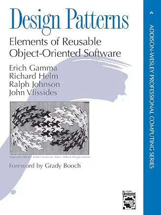

## 设计模式：可复用面向对象软件的基础

 
Erich Gamma, Richard Helm, Ralph Johnson, John Vlissides · 1995

## 目录

- [前言](./preface.md)
- [序言](./foreword.md)
- [读者指南](./guide.md)
- [第 1 章 引言](ch1/0.md)
  - [1.1 什么是设计模式？](ch1/1.md)
  - [1.2 Smalltalk MVC 中的设计模式](ch1/2.md)
  - [1.3 描述设计模式](ch1/3.md)
  - [1.4 设计模式目录](ch1/4.md)
  - [1.5 组织目录](ch1/5.md)
  - [1.6 设计模式如何解决设计问题](ch1/6.md)
  - [1.7 如何选择设计模式](ch1/7.md)
  - [1.8 如何使用设计模式](ch1/8.md)
- [第 2 章 案例研究：设计一个文档编辑器](ch2/0.md)
  - [2.1 设计问题](ch2/1.md)
  - [2.2 文档结构](ch2/2.md)
  - [2.3 格式化](ch2/3.md)
  - [2.4 装饰用户界面](ch2/4.md)
  - [2.5 支持多种外观与风格标准](ch2/5.md)
  - [2.6 支持多个窗口系统](ch2/6.md)
  - [2.7 用户操作](ch2/7.md)
  - [2.8 拼写检查与断词](ch2/8.md)
  - [2.9 小结](ch2/9.md)
- [设计模式目录](partII.md)
  - [第 3 章 创建型模式](ch3/0.md)
    - [3.1 Abstract Factory](ch3/1.md)
    - [3.2 Builder](ch3/2.md)
    - [3.3 Factory Method](ch3/3.md)
    - [3.4 Prototype](ch3/4.md)
    - [3.5 Singleton](ch3/5.md)
    - [3.6 创建型模式讨论](ch3/6.md)
  - [第 4 章 结构型模式](ch4/0.md)
    - [4.1 Adapter](ch4/1.md)
    - [4.2 Bridge](ch4/2.md)
    - [4.3 Composite](ch4/3.md)
    - [4.4 Decorator](ch4/4.md)
    - [4.5 Facade](ch4/5.md)
    - [4.6 Flyweight](ch4/6.md)
    - [4.7 Proxy](ch4/7.md)
    - [4.8 结构型模式讨论](ch4/8.md)
  - [第 5 章 行为型模式](ch5/0.md)
    - [5.1 Chain of Responsibility](ch5/1.md)
    - [5.2 Command](ch5/2.md)
    - [5.3 Interpreter](ch5/3.md)
    - [5.4 Iterator](ch5/4.md)
    - [5.5 Mediator](ch5/5.md)
    - [5.6 Memento](ch5/6.md)
    - [5.7 Observer](ch5/7.md)
    - [5.8 State](ch5/8.md)
    - [5.9 Strategy](ch5/9.md)
    - [5.10 Template Method](ch5/10.md)
    - [5.11 Visitor](ch5/11.md)
    - [5.12 行为型模式讨论](ch5/12.md)
  - [第 6 章 结论](ch6/0.md)
    - [6.1 可以从设计模式中期待什么](ch6/1.md)
    - [6.2 简史](ch6/2.md)
    - [6.3 模式社区](ch6/3.md)
    - [6.4 邀请](ch6/4.md)
    - [6.5 临别随想](ch6/5.md)
- [附录 A 术语表](appendix-a.md)
- [附录 B 记法指南](appendix-b.md)
- [附录 C 基础库](appendix-c.md)
- [参考书目](./biblio.md)
