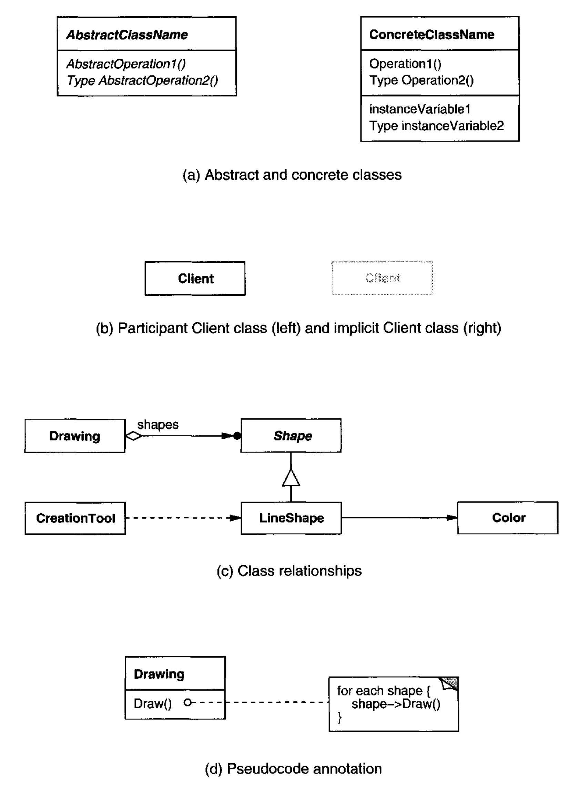
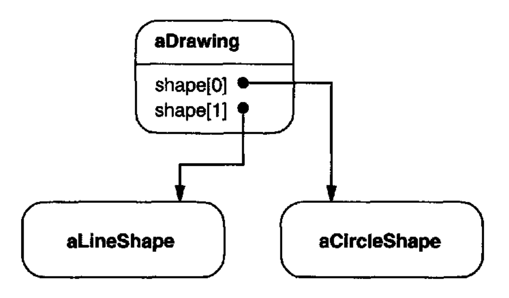
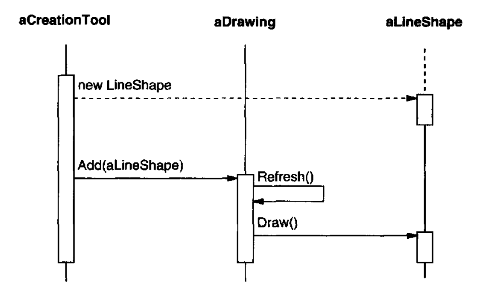

# 附录 B 记法指南

我们在全书中使用图 (diagram) 来说明重要概念。
有些图是非正式的，例如对话框的屏幕截图，或表示对象树的结构示意。
但设计模式尤其会使用更正式的记法，来表示类与对象之间的关系和交互。
本附录详细描述这些记法。

我们使用三种不同的图示记法：

1. **类图 (class diagram)** 描绘各个类、它们的结构，以及它们之间的静态关系。
2. **对象图 (object diagram)** 描绘运行时某个特定的对象结构。
3. **交互图 (interaction diagram)** 展示对象之间请求的流动。

每个设计模式都至少包含一张类图。
其他记法按需使用，以补充讨论。
类图与对象图基于 OMT（Object Modeling Technique，对象建模技术）[RBP+91](biblio.md#rbp91), [Rum94](biblio.md#rum94)。¹
交互图取自 Objectory [JCJO92](biblio.md#jcjo92) 和 Booch 方法 [Boo94](biblio.md#boo94)。
这些记法在本书封三作了汇总。

¹ OMT 使用 “对象图 (object diagram)” 这一术语来指类图。
我们则专以 “对象图” 来指对象结构的图。

## B.1 类图

图 B.1a 展示了 OMT 表示抽象类和具体类的记法。
类用一个方框表示，类名以粗体置于顶部。
类的关键操作出现在类名下方。
任何实例变量出现在操作下方。

类型信息是可选的；我们采用 C++ 的惯例，把类型名放在操作名（用以表示返回类型）、实例变量名或形参名之前。
斜体表示该类或操作是抽象的。

在一些设计模式中，看清哪些客户端类引用了各个参与者类是有帮助的。
当某个模式把 `Client` 类列为参与者之一（意味着客户端在该模式中承担职责）时，`Client` 以普通类的形式出现。
[Flyweight (195)](ch4/6.md) 就是这样的例子。
当模式不包含 `Client` 参与者（即客户端在该模式中不承担职责），但把它画出来仍有助于说明哪些模式参与者与客户端交互时，`Client` 类以灰色显示，如图 B.1b 所示。
[Proxy (207)](ch4/7.md) 就是一个例子。
灰色的 `Client` 也能清楚表明：我们并没有不小心在 “参与者” 的讨论中漏掉 `Client`。

图 B.1c 展示了类之间的各种关系。
OMT 表示类继承的记法是：用三角形把一个子类（图中的 `LineShape`）连接到它的父类（`Shape`）。
表示 part-of（部分-整体）或聚合关系的对象引用，用一条带箭头的线表示，线尾有一个菱形。
箭头指向被聚合的那个类（例如 `Shape`）。
不带菱形的带箭头线表示相识 (acquaintance)（例如 `LineShape` 持有对一个 `Color` 对象的引用，而其他形状可能共享该对象）。
引用名可以标在线尾附近，以便与其他引用区分。²

² OMT 还定义了类之间的关联 (association)，它们在类框之间显示为普通连线。
关联是双向的。
尽管关联在分析阶段是恰当的，但我们认为，对于表达设计模式中的关系而言它过于高层，
原因很简单：关联在设计时必须向下映射为对象引用或指针。
对象引用本质上是定向的，因此更适合我们所关注的关系。
例如，`Drawing` 知道各个 `Shape`，但 `Shape` 并不知道它们所属的那个 `Drawing`。
仅用关联无法表达这种关系。

另一项有用信息是哪些类实例化了哪些其他类。
我们使用带箭头的虚线来表示这种关系，因为 OMT 不支持它。
我们称其为创建 (creates) 关系。
箭头指向被实例化的类。
在图 B.1c 中，`CreationTool` 创建 `LineShape` 对象。

OMT 还定义了用实心圆表示 “多于一个”。
当实心圆出现在引用的头部时，意味着有多个对象被引用或被聚合。
图 B.1c 表明 `Drawing` 聚合了多个 `Shape` 类型的对象。

最后，我们为 OMT 补充了伪代码标注，以便说明各操作的实现。
图 B.1d 展示了 `Drawing` 类上 `Draw` 操作的伪代码标注。

 
*图 B.1：类图记法*

## B.2 对象图

对象图只展示实例。
它给出设计模式中对象的一个快照。
对象命名为 “`aSomething`”，其中 `Something` 是该对象所属的类。
我们表示对象的符号（在标准 OMT 基础上略有修改）是一个圆角方框，框内有一条线把对象名与任何对象引用分开。
箭头指示被引用的对象。
图 B.2 给出了一个例子。

 
*图 B.2：对象图示例*

## B.3 交互图

交互图展示对象之间请求的执行顺序。
图 B.3 是一张交互图，展示一个形状如何被加入一个 `Drawing` 对象中。

 
*图 B.3：交互图记法*

在交互图中，时间自上而下流动。
一条实线竖线表示某个特定对象的存活期。
对象的命名约定与对象图相同 —— 在类名前加上字母 “a”（例如 `aShape`）。
如果该对象直到图中记录的时间起点之后才被实例化，那么它的竖线在创建点之前显示为虚线。

一个竖直的长方形表示该对象处于活动状态，也就是说，它正在处理一个请求。
该操作可以向其他对象发送请求；这些请求用一条指向接收对象的水平箭头表示。
请求的名称标在箭头之上。
创建对象的请求用带箭头的虚线表示。
发回给发送者自身的请求，箭头指回发送者。

图 B.3 表明，第一个请求是从 `aCreationTool` 创建一个 `aLineShape`。
随后，`aLineShape` 被 `Add` 到 `aDrawing`，这促使 `aDrawing` 向自己发送一个 `Refresh` 请求。
注意，作为 `Refresh` 操作的一部分，`aDrawing` 会向 `aLineShape` 发送一个 `Draw` 请求。
