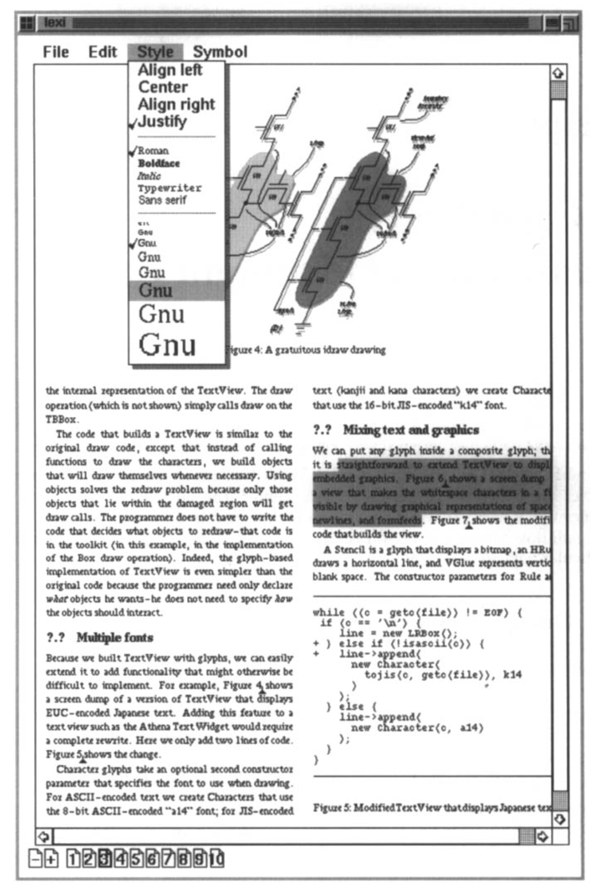

# 第 2 章 案例研究：设计一个文档编辑器

本章通过一个案例研究，介绍一个名为 **Lexi** 的 “所见即所得”（"What-You-See-Is-What-You-Get"，即 "WYSIWYG"）文档编辑器的设计。¹
我们将看到设计模式如何为 Lexi 以及类似应用中的设计问题提供解决方案。
到本章结束时，你将通过实例积累八种模式的使用经验。

图 2.1 描绘了 Lexi 的用户界面。
文档的所见即所得表示占据中央的大块矩形区域。
文档可以在多种格式化样式中，自由混合文本与图形。
文档四周是常见的下拉菜单和滚动条，另有一组页面图标，用于跳转到文档中的某一页。

¹ Lexi 的设计基于 Doc，一个由 Calder [CL92](../biblio.md#cl92) 开发的文本编辑应用。

 
*图 2.1：Lexi 的用户界面*
