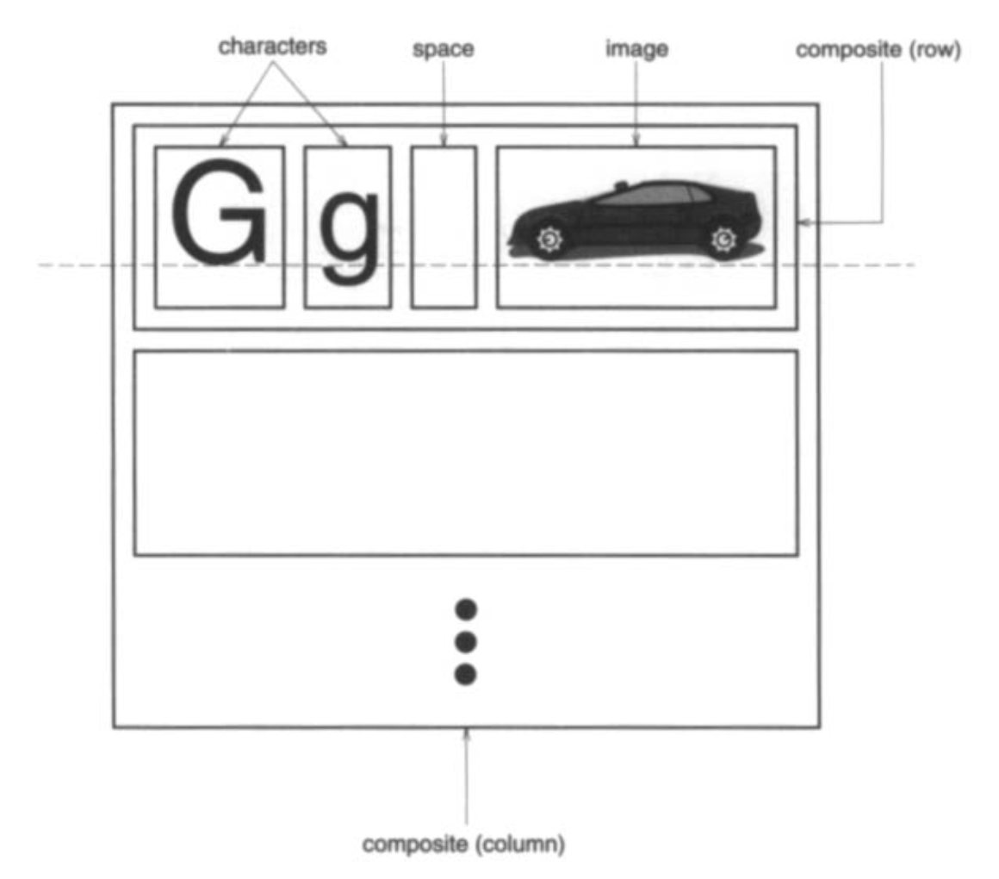
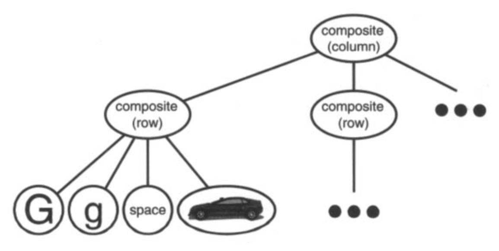
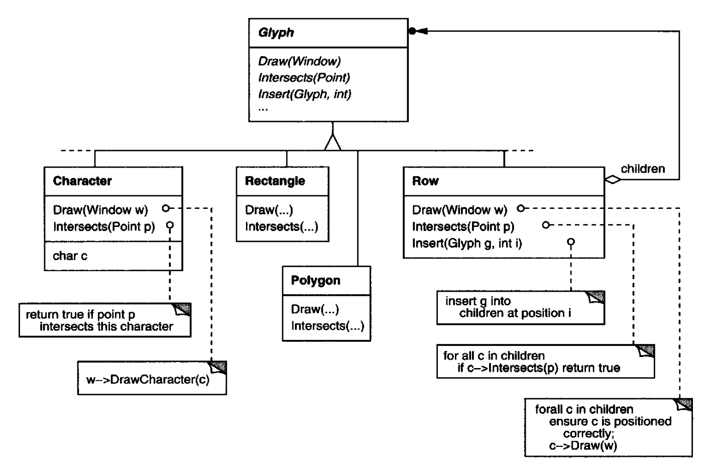
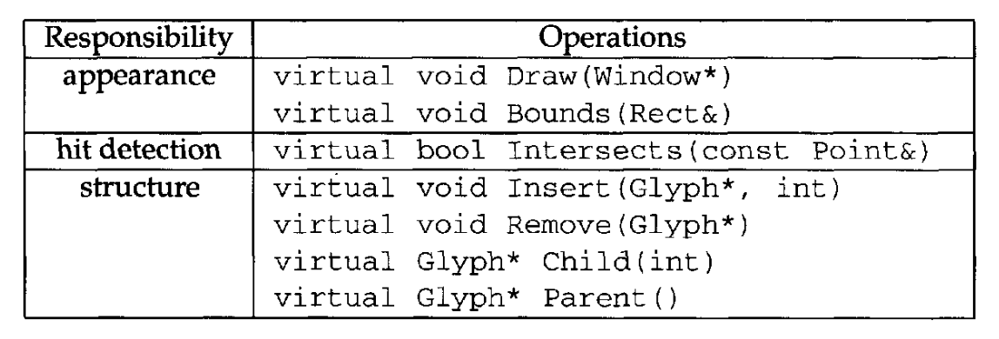

# 2.2 文档结构

文档最终不过是字符、线条、多边形和其他形状等基本图形元素的排布。
这些元素承载了文档的全部信息内容。
然而，作者看待这些元素时，往往不是从图形角度，而是从文档的物理结构 ——行、栏、图、表以及其他子结构—— 出发。²
反过来，这些子结构又有自己的子结构，如此类推。

² 作者也常常从逻辑结构的角度来看待文档，即按句子、段落、节、小节和章来看。
为保持示例简单，我们的内部表示不会显式存储关于逻辑结构的信息。
但我们所描述的设计方案同样适用于表示这类信息。

Lexi 的用户界面应当让用户直接操纵这些子结构。
例如，用户应当能把一个图当作一个整体来处理，而不是一堆彼此独立的图形基元 (graphical primitives)。
用户应当能把一张表格当作一个整体来引用，而不是一团无结构的文本和图形。
这有助于让界面简单而直观。
为了让 Lexi 的实现具备同样的品质，我们将选择一种与文档物理结构相匹配的内部表示。

具体地说，内部表示应当支持以下几点：

- 维护文档的物理结构，即把文本和图形排布成行、栏、表格等。
- 生成并以可视方式呈现文档。
- 把显示位置映射到内部表示中的元素。这使 Lexi 在用户指向可视表示中的某处时，能够确定用户指的是什么。

除了这些目标之外，还有一些约束。
<ins>第一，我们应当统一对待文本和图形。</ins>
应用的界面让用户可以自由地把文本嵌入图形，反之亦然。
我们应当避免把图形当作文本的特例，或把文本当作图形的特例；否则最终会得到两套冗余的格式化和操纵机制。
一套机制就应当足以应付文本和图形两者。

<ins>第二，我们的实现不应在内部表示中区分单个元素与元素组。</ins>
Lexi 应当能够统一对待简单元素和复杂元素，从而支持任意复杂的文档。
例如，第二栏第五行的第十个元素，可能是一个字符，也可能是一张带有许多子元素的复杂图示。
只要我们确知这个元素能够绘制自身并给出自己的尺寸，它的复杂度就不影响它应当如何、在何处出现在页面上。

<ins>然而，与第二条约束相抵触的是：需要分析文本，以找出拼写错误和可能的断词位置之类的东西。</ins>
通常我们并不关心一行中的元素是简单对象还是复杂对象。
但有时分析要取决于被分析的对象。
例如，检查一个多边形的拼写或对它断词，就没什么意义。
内部表示的设计应当把这一点以及其他可能相互冲突的约束都考虑进去。

## 2.2.1 递归组合

表示层次化结构信息的一种常见做法，是一种称为 **递归组合 (recursive composition)** 的技术：用更简单的元素构建越来越复杂的元素。
递归组合为我们提供了一种用简单图形元素组合出文档的方式。
作为第一步，我们可以把一组字符和图形从左到右并排，构成文档中的一行。
接着，多行可以排成一栏，多栏可以构成一页，依此类推（见图 2.2）。

<br/>
*图 2.2：文本与图形的递归组合*

我们可以为每个重要的元素分配一个对象，以此来表示这种物理结构。
这不仅包括字符和图形这类可见元素，也包括不可见的**结构性**元素——行和栏。
结果就是图 2.3 所示的对象结构。

<br/>
*图 2.3：文本与图形递归组合的对象结构*

<ins>通过为文档中的每个字符和图形元素使用一个对象，我们把灵活性提升到了 Lexi 设计的最细粒度。</ins>
我们可以在绘制、格式化以及相互嵌入的方式上统一对待文本和图形。
我们可以在不干扰其他功能的前提下扩展 Lexi，使其支持新的字符集。
Lexi 的对象结构模仿了文档的物理结构。

<ins>这种做法有两个重要推论。
第一个是显而易见的：这些对象需要有对应的类。
第二个推论也许不那么明显：这些类必须具有兼容的接口，因为我们想要统一对待这些对象。</ins>
在 C++ 这样的语言中，让接口兼容的办法是通过继承把各个类关联起来。

## 2.2.2 Glyph

我们将为所有能出现在文档结构中的对象定义一个 `Glyph` 抽象类。³
它的子类既定义原始图形元素（如字符和图像），也定义结构元素（如行和列）。
图 2.4 描绘了 `Glyph` 类层次结构中有代表性的一部分，表 2.1 则用 C++ 记法更详细地给出了基本的 glyph 接口。⁴

³ Calder 是第一个在这种语境下使用 “glyph” 一词的人 [CL90](../biblio.md#cl90)。
当代大多数文档编辑器并不为每个字符使用一个对象，这大概是出于效率考虑。
Calder 在其学位论文 [Cal93](../biblio.md#cal93) 中证明了这种做法是可行的。
我们的 glyph 不如他的精致：为简单起见，我们把自己的限制为严格的层次结构。
Calder 的 glyph 可以被共享以降低存储开销，从而形成有向无环图结构。
我们可以应用 [Flyweight (195)](../ch4/6.md) 模式来获得同样的效果，但这一点留作读者的练习。

⁴ 我们在此描述的接口有意保持最小，以使讨论简单。
完整的接口会包含管理颜色、字体和坐标变换等图形属性的操作，以及更复杂的子节点管理操作。

<br/>
*图 2.4：`Glyph` 类层次结构的一部分*

<br/>
*表 2.1：基本的 glyph 接口*

<ins>Glyph 有三项基本职责。
它们知道自己 (1) 如何绘制自身，(2) 占据多大的空间，(3) 自己的子节点与父节点。</ins>

Glyph 子类重写 `Draw` 操作，把自身渲染到一个窗口上。
在调用 `Draw` 时，会传给它们一个 `Window` 对象的引用。
`Window` 类定义了在屏幕上的窗口中渲染文本和基本形状的图形操作。
`Glyph` 的子类 `Rectangle` 可以这样重写 `Draw`：

```cpp
void Rectangle::Draw (Window* w) {
    w->DrawRect(_x0, _y0, _x1, _y1);
}
```

其中 `_x0`、`_y0`、`_x1` 和 `_y1` 是 `Rectangle` 的数据成员，定义了矩形的两个对角。
`DrawRect` 是让矩形出现在屏幕上的 `Window` 操作。

父 glyph 常常需要知道子 glyph 占据多大空间，例如为了把它和其他 glyph 排在一行里而不相互重叠（如图 2.2 所示）。
`Bounds` 操作返回该 glyph 占据的矩形区域。
它返回包含该 glyph 的最小矩形的对角。
Glyph 子类重写这个操作，返回自己在其间绘制的矩形区域。

`Intersects` 操作返回某个指定点是否与该 glyph 相交。
每当用户在文档中某处点击，Lexi 就调用这个操作，确定鼠标之下是哪个 glyph 或 glyph 结构。
`Rectangle` 类重写这个操作，计算矩形与给定点的交集。

因为 glyph 可以有子节点，我们需要一个统一的接口来添加、移除和访问这些子节点。
例如，`Row` 的子节点就是它排成一行的那些 glyph。
`Insert` 操作按整数索引指定的位置插入一个 glyph。⁵
`Remove` 操作移除指定的 glyph，前提是它确实是子节点。

⁵ 整数索引也许不是指定 glyph 子节点的最佳方式，这取决于该 glyph 使用的数据结构。
如果它用链表存储子节点，那么指向链表节点的指针会更高效。
我们将在 [2.8 节](8.md) 讨论文档分析时，看到一个更好的索引问题解决方案。

`Child` 操作返回给定索引处的子节点（如果有的话）。
像 `Row` 这种可以有子节点的 glyph，在内部应当使用 `Child`，而不是直接访问子节点的数据结构。
这样，当你把数据结构从数组换成链表之类时，就不必修改 `Draw` 这类遍历子节点的操作。
类似地，`Parent` 为 glyph 的父节点（如果有的话）提供标准接口。
Lexi 中的 glyph 保存一个指向其父节点的引用，它的 `Parent` 操作只是返回这个引用。

## 2.2.3 Composite 模式

递归组合的好处不止于文档。
我们可以用它来表示任何可能很复杂的层次结构。
[Composite (163)](../ch4/3.md) 模式以面向对象的术语抓住了递归组合的本质。
现在正适合转向这个模式并研究它，需要时再回到这个场景。
