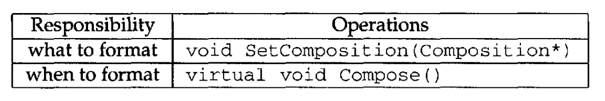
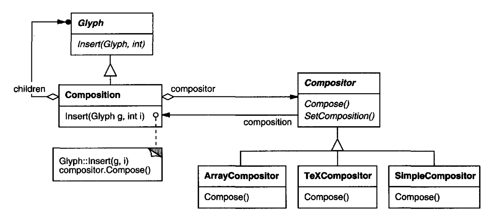
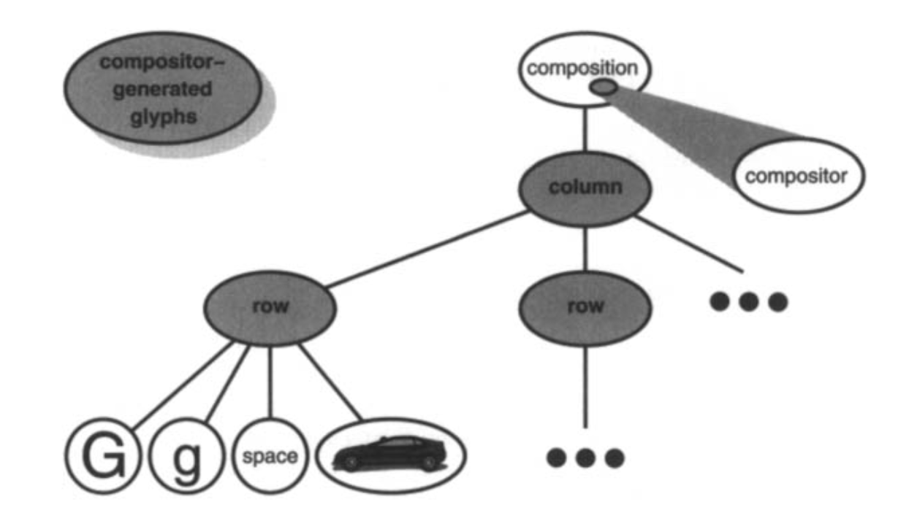

# 2.3 格式化

我们已经确定了表示文档物理结构的方式。
接下来，我们需要弄清楚如何构造出某个特定的物理结构，一个对应于格式良好的文档的结构。
表示与格式化 (formatting) 是两回事：能够捕捉文档的物理结构，并不告诉我们如何得到某个特定结构。
这一职责主要由 Lexi 承担。
它必须把文本断成行、把行断成栏 (columns)，等等，并把用户更高层的意愿考虑进去。
例如，用户可能想改变页边距宽度、缩进和制表位；单倍或双倍行距；以及大概还有许多其他格式化约束。⁶
Lexi 的格式化算法必须把这一切都考虑进去。

⁶ 用户对文档的逻辑结构 ——句子、段落、节、章等—— 还会有更多话要说。
相比之下，物理结构没那么有意思。
大多数人并不在乎段落里断行发生在哪里，只要段落格式正确就行。
对栏和页的格式化也是如此。
于是用户最终只对物理结构规定高层次的约束，把满足这些约束的苦活留给 Lexi。

顺便说明，我们把 “格式化” 限定为把一组 glyph 断成行。
事实上，我们将把 “格式化” 与 “断行 (linebreaking)” 当作同义词使用。
我们将要讨论的技术，同样适用于把行断成栏，以及把栏断成页。

## 2.3.1 封装格式化算法

格式化过程连同它的全部约束和细节，并不容易自动化。
这个问题有许多处理途径，人们已经提出了各种格式化算法，各有强弱。
因为 Lexi 是一个所见即所得编辑器，一个重要的权衡是格式化质量与格式化速度之间的平衡。
我们希望编辑器总体上响应良好，而又不牺牲文档的外观质量。
这一权衡受许多因素影响，并非所有都能在编译期确定。
例如，用户也许愿意容忍稍慢一点的响应，以换取更好的格式化。
那样的权衡可能使另一种完全不同的格式化算法比当前的更合适。
另一个更偏实现层面的权衡，是格式化速度与存储需求之间的平衡：通过缓存更多信息，也许可以缩短格式化时间。

<ins>因为格式化算法往往很复杂，所以还希望把它们良好地封装起来，或者更好 —— 让它们完全独立于文档结构。
理想情况下，我们能够新增一种 `Glyph` 子类，而无需顾及格式化算法。
反过来说，新增一种格式化算法也不应当要求修改已有的 glyph。</ins>

<ins>这些特征提示我们，Lexi 的设计应当让格式化算法易于更换 —— 至少能在编译期更换，如果还能在运行期更换就更好。
把算法封装在一个对象中，就能同时做到隔离算法并让它易于替换。</ins>
更具体地说，我们将为一类负责封装格式化算法的对象定义一条独立的类层次结构。
层次结构的根定义一个支持多种格式化算法的接口，每个子类实现该接口以执行某种特定算法。
然后我们可以引入一个 `Glyph` 子类，它会用给定的算法对象自动组织自己的子节点。

## 2.3.2 Compositor 与 Composition

我们将定义一个 `Compositor` 类，用于封装格式化算法的对象。
该接口（表 2.2）让 compositor 知道要格式化哪些 glyph，以及何时进行格式化。
它要格式化的 glyph 是一个名为 `Composition` 的特殊 `Glyph` 子类的子节点。
`Composition` 在创建时会获得一个 `Compositor` 子类（针对某种特定断行算法特化）的实例，
并在必要时 ——例如用户修改文档时—— 告诉 compositor 去 `Compose` 它的 glyph。
图 2.5 描绘了 `Composition` 与 `Compositor` 类之间的关系。

 
*表 2.2：基本的 compositor 接口*

 
*图 2.5：`Composition` 与 `Compositor` 的类关系*

未格式化的 `Composition` 对象只包含构成文档基本内容的可见 glyph。
它不包含决定文档物理结构的 glyph，例如 `Row` 和 `Column`。
`Composition` 在刚被创建、并用它应当格式化的 glyph 初始化之后，就处于这种状态。
当 `Composition` 需要格式化时，它调用其 compositor 的 `Compose` 操作。
compositor 则遍历 `Composition` 的子节点，并按照它的断行算法插入新的 `Row` 和 `Column` glyph。⁷
图 2.6 展示了所得的对象结构。
图中，compositor 创建并插入到对象结构中的 glyph 以灰色背景显示。

⁷ compositor 必须取得 `Character` glyph 的字符编码，才能计算断行位置。
在 [2.8 节](8.md) 我们将看到，如何在不给 `Glyph` 接口添加字符专用操作的前提下，以多态方式取得这一信息。

 
*图 2.6：反映 compositor 主导断行的对象结构*

每个 `Compositor` 子类都可以实现不同的断行算法。
例如，`SimpleCompositor` 可能只做一次快速处理，而不考虑文档 “色彩” 这类玄妙之处。
好的色彩意味着文本与空白的分布均匀。
`TeXCompositor` 则会实现完整的 TeX 算法 [Knu84](../biblio.md#knu84)，它会考虑色彩之类的东西，代价是格式化时间更长。

<ins>`Compositor` 与 `Composition` 的类划分，确保了支持文档物理结构的代码与各种格式化算法的代码之间形成强分离。
我们可以在不触碰 glyph 类的情况下新增 `Compositor` 子类，反之亦然。</ins>
事实上，只要给 `Composition` 的基本 glyph 接口添加一个 `SetCompositor` 操作，我们就能在运行期更换断行算法。

## 2.3.3 Strategy 模式

<ins>[Strategy (315)](../ch5/9.md) 模式的意图就是把一个算法封装在一个对象中。
该模式的关键参与者是 Strategy 对象（封装不同的算法）以及它们运作于其中的上下文 (context)。
compositor 就是策略；它们封装不同的格式化算法。
而 composition 就是 compositor 策略的上下文。</ins>

<ins>应用 Strategy 模式的关键，是为 strategy 及其 context 设计出足够通用的接口，以支持一系列算法。
你应当不必为了支持一种新算法而改动 strategy 或 context 的接口。</ins>
在我们的例子中，基本 `Glyph` 接口对子节点访问、插入和移除的支持已经足够通用，
足以让 `Compositor` 子类改变文档的物理结构，无论它们用的是什么算法。
同样，`Compositor` 接口也向 composition 提供了发起格式化所需的一切。
