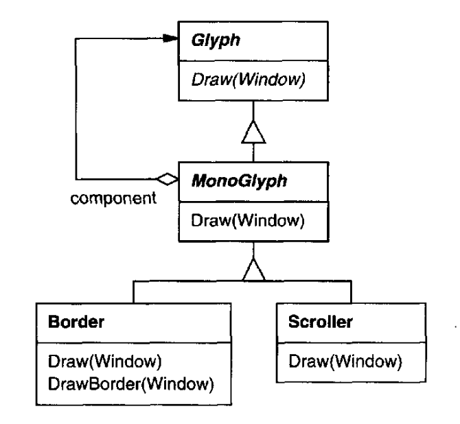
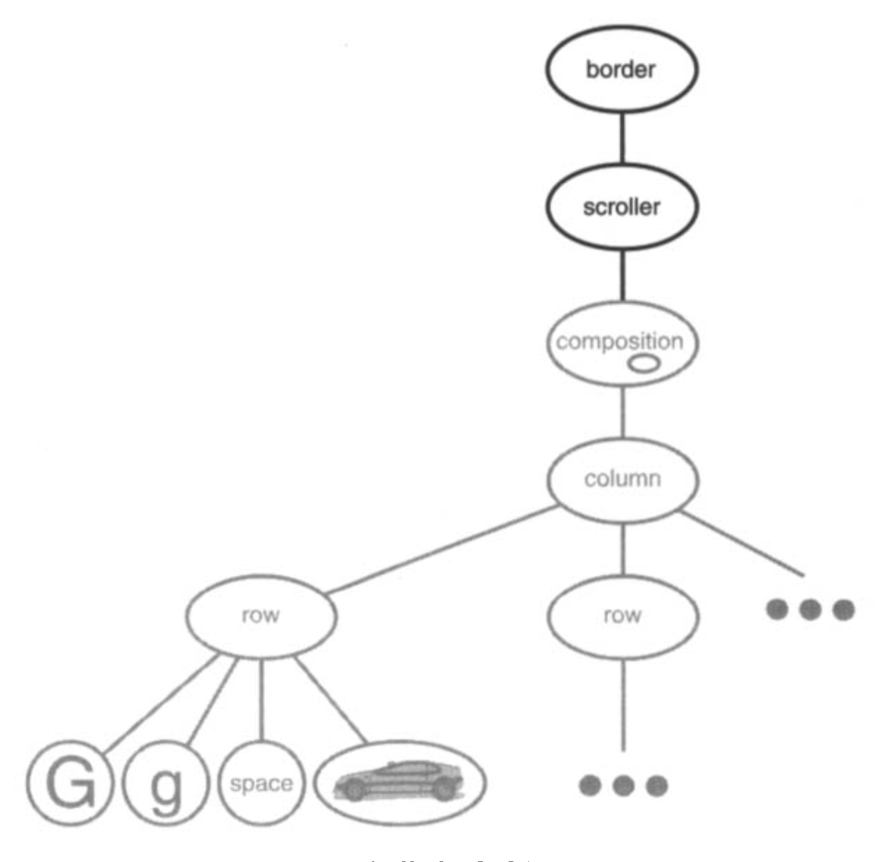

# 2.4 装饰用户界面

我们考虑 Lexi 用户界面中的两种装饰。
第一种在文本编辑区周围加一个边框，以标示正文页面。
第二种加上滚动条，让用户可以查看页面的不同部分。
为了让这些装饰易于添加和移除（尤其是在运行期），我们不应当用继承把它们加到用户界面上。
<ins>当其他用户界面对象甚至都不知道这些装饰的存在时，我们获得的灵活性最大。
那将让我们在不改动其他类的情况下添加和移除装饰。</ins>

## 2.4.1 透明封装

从编程的角度看，装饰用户界面意味着扩展现有代码。
用继承来做这种扩展，就无法在运行期重新安排装饰；但同样严重的问题是，基于继承的做法可能导致类的数量爆炸。

我们可以通过子类化 `Composition`，派生出一个 `BorderedComposition` 类，来给它加上边框。
或者用同样的方式加一个滚动接口，得到 `ScrollableComposition`。
如果我们既想要滚动条又想要边框，也许就得造一个 `BorderedScrollableComposition`，以此类推。
极端情况下，我们最终会为装饰的每一种可能组合都准备一个类 —— 随着装饰种类的增加，这种方案很快就行不通了。

对象组合提供了一种可能更可行、更灵活的扩展机制。
但我们组合哪些对象呢？
既然我们知道要装饰的是一个已有的 glyph，就可以把装饰本身也做成一个对象（比如 `Border` 类的一个实例）。
这样我们就有了两个组合的候选者：glyph 和 border。
下一步要决定谁组合谁。
我们可以让 border 包含 glyph —— 既然 border 在屏幕上会包围 glyph，这很合理。
或者反过来，把 border 放进 glyph 里，但那样我们就必须修改相应的 `Glyph` 子类，让它感知到 border。
我们选择前一种做法 ——把 glyph 组合进 border—— 把绘制边框的代码完全留在 `Border` 类里，其他类不受影响。

`Border` 类长什么样呢？
边框有外观，这一事实暗示它们其实就是 glyph；也就是说，`Border` 应当是 `Glyph` 的子类。
但还有一个更有力的理由：客户端不应当关心 glyph 有没有边框。
它们应当统一对待 glyph。
当客户端让一个普通的、无边框的 glyph 绘制自身时，它应当不加装饰地绘制。
如果那个 glyph 被组合在一个 border 里，客户端也不应当区别对待这个包含 glyph 的 border；它们只是像先前让普通 glyph 那样，让它绘制自身。
这意味着 `Border` 的接口要与 `Glyph` 的接口相匹配。
我们让 `Border` 继承 `Glyph`，以保证这种关系。

<ins>这一切把我们引向 **透明封装 (transparent enclosure)** 的概念，它结合了两个观念：(1) 单子节点（或单组件）组合；(2) 兼容的接口。</ins>
客户端通常分辨不出自己面对的是组件还是它的封装（即子节点的父节点），尤其是当封装只是把所有操作都委托给它的组件时。
但封装也可以在委托操作之前和/或之后做自己的事，从而增强组件的行为。
封装还可以有效地给组件增加状态。
下面我们就会看到怎么做。

## 2.4.2 MonoGlyph

我们可以把透明封装的概念应用到所有装饰其他 glyph 的 glyph 上。
为了让这个概念具体化，我们将定义 `Glyph` 的一个子类，称为 `MonoGlyph`，作为 “装饰性 glyph”（如 `Border`）的抽象类（见图 2.7）。
`MonoGlyph` 保存一个指向组件的引用，并把所有请求转发给它。

<br/>
*图 2.7：`MonoGlyph` 的类关系*

这使得 `MonoGlyph` 默认对客户端完全透明。
例如，`MonoGlyph` 这样实现 `Draw` 操作：

```cpp
void MonoGlyph::Draw (Window* w) {
    _component->Draw(w);
}
```

`MonoGlyph` 的子类会重新实现这些转发操作中的至少一个。
例如，`Border::Draw` 首先调用父类操作 `MonoGlyph::Draw` 作用于组件，让组件完成自己那一份工作 —— 也就是绘制除边框之外的一切。
然后 `Border::Draw` 通过调用一个名为 `DrawBorder` 的私有操作来绘制边框，其细节我们略去：

```cpp
void Border::Draw (Window* w) {
    MonoGlyph::Draw(w);
    DrawBorder(w);
}
```

<ins>注意 `Border::Draw` 是如何有效地扩展父类操作以绘制边框的。
这与仅仅替换父类操作形成对照 —— 后者会丢掉对 `MonoGlyph::Draw` 的调用。</ins>

图 2.7 中还有另一个 `MonoGlyph` 子类。
`Scroller` 是一个 `MonoGlyph`，它根据两个滚动条的位置把组件绘制在不同位置，这两个滚动条是它加上的装饰。
当 `Scroller` 绘制其组件时，它告诉图形系统裁剪到自己的边界。
把组件因滚动而移出视野的部分裁剪掉，可以防止它们出现在屏幕上。

现在我们有了把边框和滚动接口加到 Lexi 文本编辑区所需的一切。
我们把现有的 `Composition` 实例组合进一个 `Scroller` 实例以添加滚动接口，再把它组合进一个 `Border` 实例。
所得的对象结构见图 2.8。

<br/>
*图 2.8：装饰后的对象结构*

注意我们可以颠倒组合的顺序，把带边框的 composition 放进 `Scroller` 实例里。
那样的话，边框会随文本一起滚动，这未必是想要的。
<ins>关键在于，透明封装让我们很容易试验不同的方案，并且让客户端完全不必包含装饰代码。</ins>

还要注意，border 只组合一个 glyph，而不是两个或更多。
这与我们迄今定义的组合不同 —— 在那些组合里，父对象可以有任意多个子节点。
这里，给某个东西加边框，意味着那个 “东西” 是单数。
我们本可以赋予 “一次装饰多个对象” 某种含义，但那样就得把许多种组合方式混进装饰的概念里：行装饰、栏装饰，等等。
<ins>那对我们没有好处，因为我们已经有类来做这些种类的组合。
所以更好的做法是：用现有的类做组合，再为装饰组合结果新增类。
让装饰独立于其他种类的组合，既简化了装饰类，也减少了它们的数量。</ins>
它还让我们不必重复实现已有的组合功能。

## 2.4.3 Decorator 模式

<ins>[Decorator (175)](../ch4/4.md) 模式捕捉了支持 “通过透明封装实现装饰” 的类与对象关系。</ins>
“装饰 (embellishment)” 一词的含义其实比我们这里考虑的更广。
在 Decorator 模式中，装饰指的是任何给对象增加职责的东西。
例如，我们可以设想用语义动作装饰一棵抽象语法树、用新迁移装饰一个有限状态自动机，或者用属性标记装饰一个持久对象网络。
Decorator 把我们在 Lexi 中使用的做法一般化，使其具有更广的适用性。
