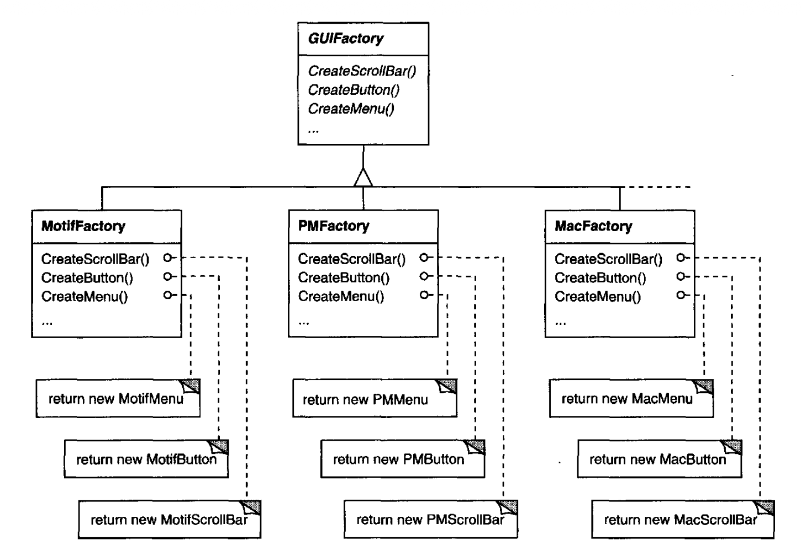
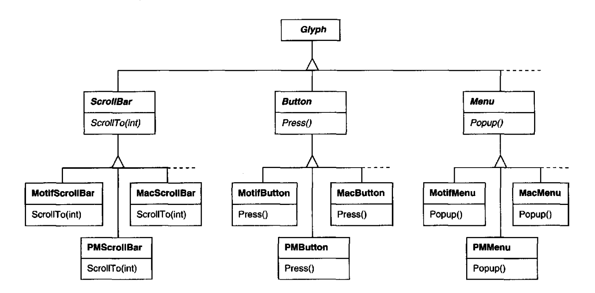

# 2.5 支持多种外观与风格标准

在硬件和软件平台之间实现可移植性，是系统设计中的一个主要问题。
把 Lexi 移植到一个新平台不应当需要大动干戈，否则就不值得移植了。
我们应当让移植尽可能容易。

可移植性的一个障碍是外观与风格标准（look-and-feel standards）的多样性 —— 这些标准意在强制各应用之间保持一致。
它们规定了应用如何呈现、如何响应用户的准则。
虽然现有标准彼此差别并不大，但人们肯定不会把它们混为一谈 —— Motif 应用的外观与风格跟其他平台上的对应物并不完全相同，反之亦然。
一个能运行在多个平台上的应用，必须符合每个平台的用户界面风格指南。

<ins>我们的设计目标是：让 Lexi 符合多种现有的外观与风格标准，并且在（必然会出现的）新标准出现时，容易为其添加支持。</ins>
我们还希望设计能支持最大程度的灵活性：在运行期改变 Lexi 的外观与风格。

## 2.5.1 抽象对象创建

在 Lexi 用户界面中，我们看到的、与之交互的一切，都是被组合在其他不可见 glyph（如 `Row` 和 `Column`）之中的 glyph。
不可见的 glyph 组合可见的 glyph（如 `Button` 和 `Character`），并把它们妥善排版。
风格指南对所谓 “部件 (widget)” 的外观与风格着墨甚多 —— 这是对按钮、滚动条、菜单这类作为用户界面控制元素的可见 glyph 的另一种称呼。
部件可能使用字符、圆、矩形和多边形这类更简单的 glyph 来呈现数据。

我们假定有两组部件 glyph 类，用来实现多种外观与风格标准：

1. 为每一类部件 glyph 提供一组抽象 `Glyph` 子类。
例如，抽象类 `ScrollBar` 会增强基本的 glyph 接口，加入通用的滚动操作；`Button` 是一个加入按钮类操作的抽象类；依此类推。

2. 为每个抽象子类提供一组具体子类，实现不同的外观与风格标准。
例如，`ScrollBar` 可以有 `MotifScrollBar` 和 `PMScrollBar` 两个子类，分别实现 Motif 风格和 Presentation Manager 风格的滚动条。

Lexi 必须区分不同外观与风格样式的部件 glyph。
例如，当 Lexi 需要在界面里放一个按钮时，它必须实例化正确风格的按钮对应的 `Glyph` 子类（`MotifButton`、`PMButton`、`MacButton` 等）。

显然，Lexi 的实现不能直接做这件事，比如说，在 C++ 里写一个构造函数调用。
那会把某种特定风格的按钮硬编码进去，使得运行期无法选择风格。
为了把 Lexi 移植到另一个平台，我们还得把每一处这样的构造函数调用都找出来改掉。
而按钮只是 Lexi 用户界面中众多种部件之一。
让代码里到处散落着指向特定外观与风格类的构造函数调用，会带来维护噩梦 —— 只要漏掉一处，你就可能在一个 Mac 应用的中间冒出一个 Motif 菜单。

Lexi 需要一种办法来确定目标外观与风格标准，以便创建相应的部件。
我们不但必须避免显式的构造函数调用，还必须能够轻松替换整套部件。
把对象创建的过程抽象出来，就能同时做到这两点。
一个例子可以说明我们的意思。

## 2.5.2 工厂与产品类

通常，我们可能用下面这样的 C++ 代码创建一个 Motif 滚动条 glyph 的实例：

```cpp
ScrollBar* sb = new MotifScrollBar;
```

如果你想尽量减少 Lexi 对外观与风格的依赖，这正是要避免的那类代码。
但假设我们这样初始化 `sb`：

```cpp
ScrollBar* sb = guiFactory->CreateScrollBar();
```

其中 `guiFactory` 是 `MotifFactory` 类的一个实例。
`CreateScrollBar` 返回所需外观与风格（此处是 Motif）对应的正确 `ScrollBar` 子类的新实例。
就客户端而言，效果与直接调用 `MotifScrollBar` 构造函数相同。
但有一个关键区别：代码里再也不会有任何地方按名字提到 Motif。
`guiFactory` 对象抽象出的创建过程，不仅限于 Motif 的滚动条，而是任何外观与风格标准的滚动条。
而且 `guiFactory` 也不限于生产滚动条。
它可以制造全套部件 glyph，包括滚动条、按钮、输入字段、菜单等等。

这一切之所以可行，是因为 `MotifFactory` 是 `GUIFactory` 的子类 —— 后者是一个为创建部件 glyph 定义通用接口的抽象类。
它包含 `CreateScrollBar` 和 `CreateButton` 之类的操作，用于实例化不同种类的部件 glyph。
`GUIFactory` 的子类实现这些操作，返回 `MotifScrollBar`、`PMButton` 这类实现某种特定外观与风格的 glyph。
图 2.9 展示了 `guiFactory` 对象所得的类层次结构。

<br/>
*图 2.9：`GUIFactory` 类层次*

我们说工厂创建 **产品 (product)** 对象。
而且，一个工厂生产的产品彼此相关；在此例中，产品都是同一种外观与风格的全部部件。
图 2.10 展示了让工厂机制能作用于部件 glyph 所需的部分产品类。

<br/>
*图 2.10：抽象产品类及其具体子类*

最后一个必须回答的问题是：`GUIFactory` 实例从哪来？
答案是：任何方便的地方。
变量 `guiFactory` 可以是全局变量、某个众所周知的类的静态成员，甚至可以是局部变量 —— 如果整个用户界面都在某一个类或函数里创建的话。
甚至还有专门的设计模式 [Singleton (127)](../ch3/5.md)，用来管理这种众所周知的、独一无二的对象。
不过重要的是，要在程序中某个既已明确需要哪种外观与风格、又尚未用它创建部件的时刻初始化 `guiFactory`。

如果外观与风格在编译期就已知，那么只要在程序开头简单地赋值一个工厂实例即可初始化 `guiFactory`：

```cpp
GUIFactory* guiFactory = new MotifFactory;
```

如果用户能在启动时用一个字符串名字指定外观与风格，那么创建工厂的代码可能如下：

```cpp
GUIFactory* guiFactory;
const char* styleName = getenv("LOOK_AND_FEEL");
    // user or environment supplies this at startup

if (strcmp(styleName, "Motif") == 0) {
    guiFactory = new MotifFactory;

} else if (strcmp(styleName, "Presentation_Manager") == 0) {
    guiFactory = new PMFactory;

} else {
    guiFactory = new DefaultGUIFactory;
}
```

在运行期选择工厂还有更精巧的做法。
例如，你可以维护一张把字符串映射到工厂对象的注册表。
这让你可以注册新的工厂子类实例，而无需像上面那种做法那样修改现有代码。
而且你不必把所有平台相关的工厂都链接进应用。
这一点很重要，因为在一个不支持 Motif 的平台上，可能根本无法链接 `MotifFactory`。

但要点在于：一旦我们用正确的工厂对象配置好应用，此后它的外观与风格就确定了。
如果我们改变主意，可以用另一种外观与风格的工厂重新初始化 `guiFactory`，然后重建界面。
无论我们决定以何种方式、在何时初始化 `guiFactory`，我们都确知：一旦完成初始化，应用就能在不做修改的情况下创建相应的外观与风格。

## 2.5.3 Abstract Factory 模式

工厂与产品是 [Abstract Factory (87)](../ch3/1.md) 模式的关键参与者。
<ins>该模式捕捉了如何创建一族相关的产品对象，而不直接实例化类。
当产品对象的数量与大体种类保持恒定、而具体产品族之间存在差异时，它最为适用。</ins>
我们通过实例化某个具体工厂，并在此后一致地用它创建产品，来在多个产品族之间做出选择。
我们也可以用一个不同具体工厂的实例替换掉当前工厂，从而整体换掉产品族。
Abstract Factory 模式对 *产品族* 的强调，使它区别于其他创建型模式 —— 那些模式只涉及一种产品对象。
