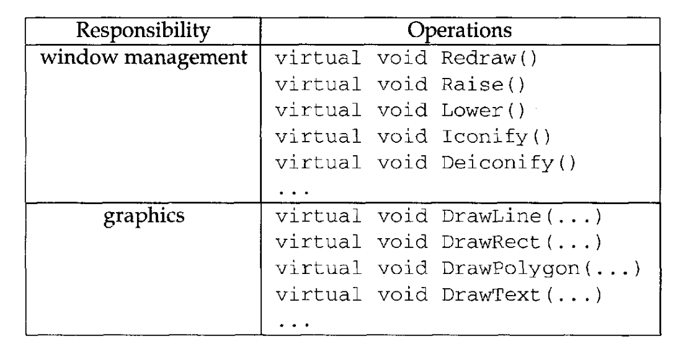
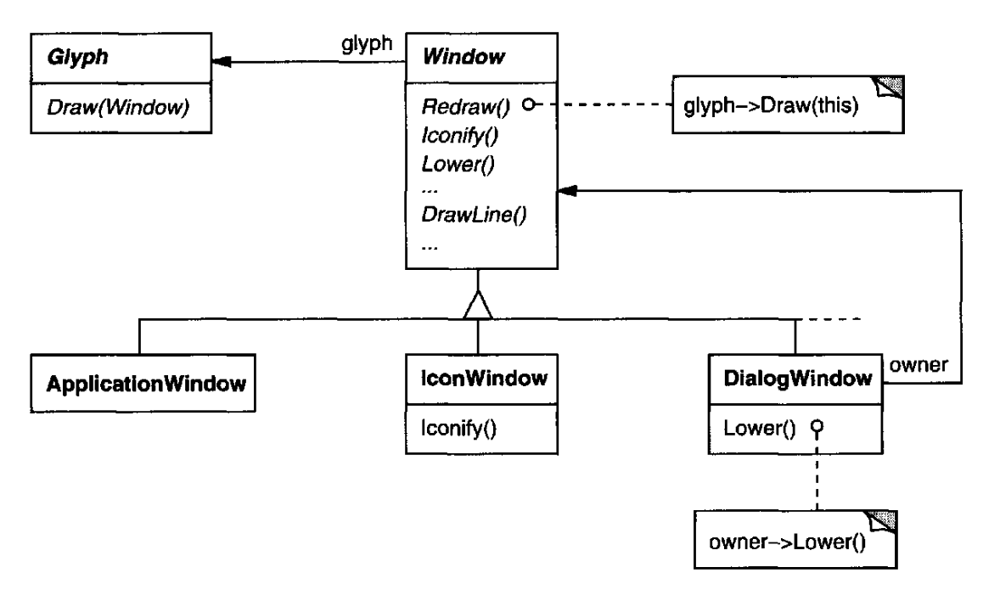
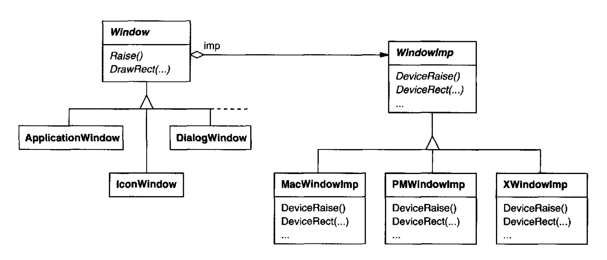

# 2.6 支持多个窗口系统

外观与风格只是众多可移植性问题之一。
另一个是 Lexi 运行其上的窗口环境。
平台的窗口系统在位图显示器上营造出多个重叠窗口的假象。
它为窗口管理屏幕空间，并把键盘和鼠标的输入路由给它们。
如今存在若干重要且彼此大体不兼容的窗口系统（例如 Macintosh、Presentation Manager、Windows、X）。
我们之所以希望 Lexi 能尽可能多地运行在这些系统上，理由与支持多种外观与风格标准完全相同。

## 2.6.1 能否用 Abstract Factory？

乍看之下，这像是又一个应用 Abstract Factory 模式的机会。
但窗口系统可移植性的约束，与外观与风格独立性的约束差别很大。

应用 Abstract Factory 模式时，我们假定会为每种外观与风格标准定义具体的部件 glyph 类。
这意味着我们能从抽象产品类（例如 `ScrollBar`）派生出某种特定标准下的具体产品（例如 `MotifScrollBar` 和 `MacScrollBar`）。
但假设我们已经从不同厂商那里拿到了若干类层次结构，每种外观与风格标准各一套。
当然，这些层次结构极不可能在任何意义上相互兼容。
于是我们就不会有为每一类部件（`ScrollBar`、`Button`、`Menu` 等）准备的共同抽象产品类 —— 而缺少这些关键类，Abstract Factory 模式就行不通。
我们必须让这些不同的部件层次结构遵从一套共同的抽象产品接口。
只有到那时，我们才能在抽象工厂的接口里正确地声明那些 `Create...` 操作。

部件的问题，我们是通过自己开发抽象与具体产品类来解决的。
现在，当我们试图让 Lexi 运行在已有窗口系统上时，又面临类似的问题：不同窗口系统的编程接口互不兼容。
不过这次要更难一些，因为我们负担不起自己实现一个非标准的窗口系统。

但还有一线转机。
<ins>与外观与风格标准类似，窗口系统接口之间也并非截然不同，因为所有窗口系统做的事大体相同。
我们需要一套统一的窗口抽象，让我们能够用不同的窗口系统实现，并把其中任何一个塞到共同的接口之下。</ins>

## 2.6.2 封装实现依赖

在 [2.2 节](2.md)，我们引入了一个 `Window` 类，用来在显示器上显示一个 glyph 或 glyph 结构。
当时我们没有指定这个对象与哪个窗口系统协同工作，因为事实是它并不来自任何特定的窗口系统。
`Window` 类封装了窗口在各种窗口系统中都倾向要做的事情：

- 它们提供绘制基本几何形状的操作。

- 它们可以把自身图标化，也可以取消图标化。

- 它们可以调整自身大小。

- 它们可以按需（重新）绘制自己的内容，例如在取消图标化时，或当它们屏幕空间中被重叠、遮挡的部分重新露出时。

<br/>
*表 2.3：`Window` 类的接口*

`Window` 类必须覆盖来自不同窗口系统的窗口功能。
我们考虑两种极端的思路：

1. *功能交集。*
`Window` 类的接口只提供所有窗口系统共有的功能。
这种思路的问题在于，我们的 `Window` 接口最终只会和功能最弱的那个窗口系统一样强。
即便大多数（但不是全部）窗口系统支持更高级的特性，我们也无法利用它们。

2. *功能并集。*
创建一个把所有现有系统的能力都纳入进来的接口。
这里的麻烦在于，所得的接口很可能极其庞大且缺乏一致性。
何况，只要某个厂商修订了它的窗口系统接口，我们就得修改这个接口（以及依赖它的 Lexi）。

两种极端都不是可行的方案，所以我们的设计会落在两者之间。
`Window` 类将提供一个方便的接口，支持最流行的窗口功能。
因为 Lexi 会直接与这个类打交道，`Window` 类还必须支持 Lexi 所了解的东西，也就是 glyph。
这意味着 `Window` 的接口必须包含一组基本的图形操作，让 glyph 能在窗口中绘制自身。
表 2.3 给出了 `Window` 类接口中操作的一个示例。

`Window` 是一个抽象类。
`Window` 的具体子类支持用户与之打交道的各种窗口。
例如，应用窗口、图标和警告对话框都是窗口，但它们的行为有些不同。
于是我们可以定义 `ApplicationWindow`、`IconWindow` 和 `DialogWindow` 这样的子类来捕捉这些差异。
所得的类层次结构为 Lexi 这类应用提供了一套统一而直观的窗口抽象，它不依赖于任何特定厂商的窗口系统：

<br/>
*图 2.6.1：`Window` 类层次结构*

既然我们已经为 Lexi 定义了可用的窗口接口，那么真正与平台相关的窗口在哪里登场呢？
如果我们不是自己实现窗口系统，那么到了某个时刻，我们的窗口抽象必须用目标窗口系统所提供的东西来实现。
那么这份实现放在哪儿呢？

一种做法是实现多个版本的 `Window` 类及其子类，每个窗口平台一个版本。
在为一个给定平台构建 Lexi 时，我们得选择使用哪个版本。
但请想象一下维护上的麻烦：多个类全都叫 "Window"，每个却实现在不同的窗口系统上。
另一种做法是为 `Window` 层次结构中的每个类创建特定于实现的子类 —— 结果就是又一个子类爆炸问题，就像我们在添加装饰时遇到的那个。
这两种做法还各有一个缺点：它们都不能让我们在编译完程序之后还有更换所用窗口系统的灵活性。
于是我们还得在身边保留若干个不同的可执行文件。

两种做法都不太吸引人，但我们还能做什么呢？
和对待格式化与装饰一样，那就是 *把变化的概念封装起来* 。
在这个例子里，变化的是窗口系统的实现。
如果我们把某个窗口系统的功能封装在一个对象里，就可以基于该对象的接口来实现我们的 `Window` 类及其子类。
而且，如果这个接口能服务于我们关心的所有窗口系统，那么我们就不必为了支持不同的窗口系统而修改 `Window` 或它的任何子类。
只要把正确的、封装窗口系统的对象传进去，就能把窗口对象配置成我们想要的那个窗口系统。
我们甚至可以在运行期配置窗口。

## 2.6.3 Window 与 WindowImp

我们将定义一条独立的 `WindowImp` 类层次结构，用来隐藏不同的窗口系统实现。
`WindowImp` 是一个抽象类，用于封装与窗口系统相关代码的对象。
要让 Lexi 运行在某个特定窗口系统上，我们用该系统对应的 `WindowImp` 子类实例来配置每个窗口对象。
下图展示了 `Window` 与 `WindowImp` 两条层次结构之间的关系：

<br/>
*图 2.6.2：`Window` 与 `WindowImp` 两条层次结构的关系*

<ins>把实现隐藏在 `WindowImp` 类中，我们就避免了让 `Window` 类被窗口系统依赖污染，从而使 `Window` 类层次结构相对小巧而稳定。
与此同时，我们可以轻松扩展实现层次结构，以支持新的窗口系统。</ins>

### WindowImp 子类

`WindowImp` 的子类把请求转换成特定于窗口系统的操作。
考虑我们在 [2.2 节](2.md) 用过的例子。
我们用 `Window` 实例上的 `DrawRect` 操作来定义 `Rectangle::Draw`：

```cpp
void Rectangle::Draw (Window* w) {
    w->DrawRect(_x0, _y0, _x1, _y1);
}
```

`DrawRect` 的默认实现使用了 `WindowImp` 声明的绘制矩形的抽象操作：

```cpp
void Window::DrawRect (
    Coord x0, Coord y0, Coord x1, Coord y1
) {
    _imp->DeviceRect(x0, y0, x1, y1);
}
```

其中 `_imp` 是 `Window` 的一个成员变量，保存着该 `Window` 所配置的 `WindowImp`。
窗口实现由 `_imp` 所指向的那个 `WindowImp` 子类实例来定义。
对于 `XWindowImp`（即 X Window System 的 `WindowImp` 子类），`DeviceRect` 的实现可能如下：

```cpp
void XWindowImp::DeviceRect (
    Coord x0, Coord y0, Coord x1, Coord y1
) {
    int x = round(min(x0, x1));
    int y = round(min(y0, y1));
    int w = round(abs(x0 - x1));
    int h = round(abs(y0 - y1));
    XDrawRectangle(_dpy, _winid, _gc, x, y, w, h);
}
```

`DeviceRect` 之所以这样定义，是因为 `XDrawRectangle`（X 中绘制矩形的接口）是用矩形的左下角、宽度和高度来描述矩形的。
`DeviceRect` 必须从传入的值算出这些量。
它先确定左下角（因为 `(x0, y0)` 可能是矩形四个角中的任意一个），然后计算宽度和高度。

`PMWindowImp`（Presentation Manager 的 `WindowImp` 子类）则会以不同方式定义 `DeviceRect`：

```cpp
void PMWindowImp::DeviceRect (
    Coord x0, Coord y0, Coord x1, Coord y1
) {
    Coord left = min(x0, x1);
    Coord right = max(x0, x1);
    Coord bottom = min(y0, y1);
    Coord top = max(y0, y1);

    PPOINTL point[4];

    point[0].x = left;    point[0].y = top;
    point[1].x = right;   point[1].y = top;
    point[2].x = right;   point[2].y = bottom;
    point[3].x = left;    point[3].y = bottom;

    if (
        (GpiBeginPath(_hps, 1L) == false) ||
        (GpiSetCurrentPosition(_hps, &point[3]) == false) ||
        (GpiPolyLine(_hps, 4L, point) == GPI_ERROR) ||
        (GpiEndPath(_hps) == false)
    ) {
        // report error

    } else {
        GpiStrokePath(_hps, 1L, 0L);
    }
}
```

为什么它和 X 版本差别这么大？
因为 PM 并没有像 X 那样提供显式绘制矩形的操作。
PM 提供的是一套更通用的接口，用于指定多段形状（称为 *path*）的顶点，并对它们围成的区域进行勾边或填充。

PM 对 `DeviceRect` 的实现显然与 X 的相当不同，但这无关紧要。
`WindowImp` 把窗口系统接口之间的差异，藏在一个可能很大但稳定的接口背后。
这让 `Window` 子类的编写者可以专注于窗口抽象，而不必操心窗口系统的细节。
它还让我们能够添加对新窗口系统的支持，而不打扰 `Window` 类。

### 用 WindowImp 配置 Window

还有一个我们尚未处理的关键问题：窗口最初是如何被配置成正确的 `WindowImp` 子类的？
换个说法：`_imp` 什么时候被初始化，又是谁知道自己用的是哪个窗口系统（因而该用哪个 `WindowImp` 子类）？
窗口在做任何有意思的事情之前，都需要某种 `WindowImp`。

有若干种可能，但我们重点看一种使用 [Abstract Factory (87)](../ch3/1.md) 模式的做法。
我们可以定义一个抽象工厂类 `WindowSystemFactory`，为创建不同种类的、与窗口系统相关的实现对象提供接口：

```cpp
class WindowSystemFactory {
public:
    virtual WindowImp* CreateWindowImp() = 0;
    virtual ColorImp* CreateColorImp() = 0;
    virtual FontImp* CreateFontImp() = 0;

    // a "Create..." operation for all window system resources
};
```

现在我们可以为每个窗口系统定义一个具体工厂：

```cpp
class PMWindowSystemFactory : public WindowSystemFactory {
    virtual WindowImp* CreateWindowImp()
        { return new PMWindowImp; }
    // . . .
};

class XWindowSystemFactory : public WindowSystemFactory {
    virtual WindowImp* CreateWindowImp()
        { return new XWindowImp; }
    // . . .
};
```

`Window` 基类的构造函数可以利用 `WindowSystemFactory` 接口，把 `_imp` 成员初始化为该窗口系统所对应的 `WindowImp`：

```cpp
Window::Window () {
    _imp = windowSystemFactory->CreateWindowImp();
}
```

`windowSystemFactory` 变量是一个众所周知的 `WindowSystemFactory` 子类实例，类似于定义外观与风格的那个众所周知的 `guiFactory` 变量。
`windowSystemFactory` 变量可以用同样的方式初始化。

## 2.6.4 Bridge 模式

`WindowImp` 类定义了通往通用窗口系统设施的接口，但它的设计受制于与 `Window` 接口不同的约束。
应用程序员不会直接与 `WindowImp` 的接口打交道；他们只与 `Window` 对象打交道。
所以 `WindowImp` 的接口不必匹配应用程序员的世界观 —— 而这正是我们设计 `Window` 类层次结构和接口时所关心的。
`WindowImp` 的接口可以更贴近窗口系统实际提供的东西，无论好坏。
它既可以偏向功能交集，也可以偏向功能并集，哪种更适合目标窗口系统就用哪种。

<ins>真正重要的是认识到：`Window` 的接口迎合的是应用程序员，而 `WindowImp` 迎合的是窗口系统。
把窗口功能分离到 `Window` 与 `WindowImp` 两条层次结构中，让我们能够独立地实现和特化这两个接口。
来自这两条层次结构的对象协同工作，使 Lexi 无需修改就能运行在多个窗口系统之上。</ins>

`Window` 与 `WindowImp` 之间的关系，是 [Bridge (151)](../ch4/2.md) 模式的一个例子。
<ins>Bridge 的意图是让彼此独立的类层次结构能够协同工作，即便它们各自独立演化。</ins>
我们的设计准则引导我们创建了两条独立的类层次结构：一条支持窗口的逻辑概念，另一条捕捉窗口的不同实现。
Bridge 模式让我们能够维护并增强逻辑上的窗口抽象，而不触碰与窗口系统相关的代码，反之亦然。
