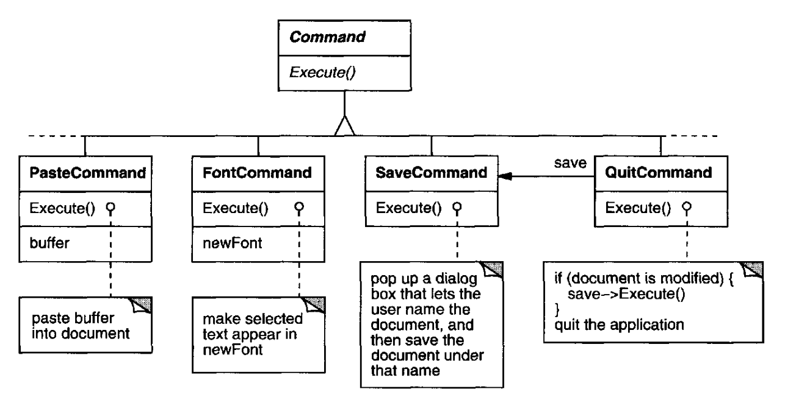
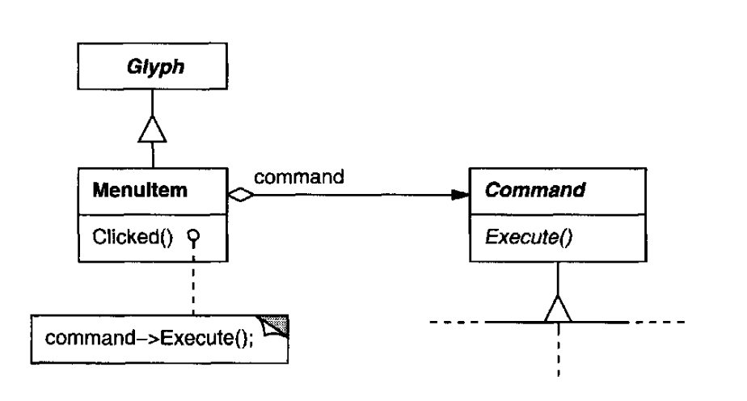
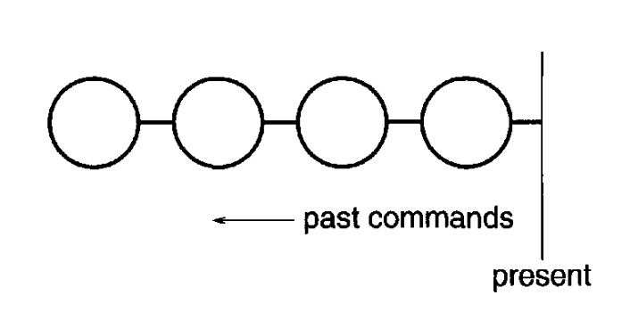
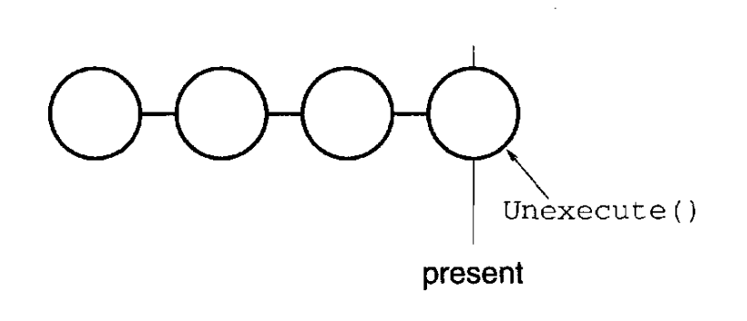
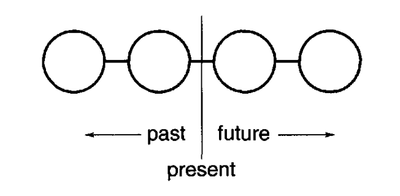
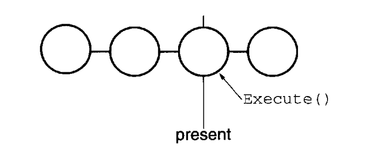
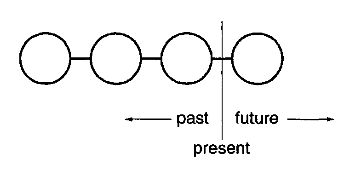

# 2.7 用户操作

Lexi 的一部分功能通过文档的所见即所得表示即可使用。
你可以直接在文档中指点、点击和输入，从而录入和删除文本、移动插入点、选定文本范围。
其他功能则通过 Lexi 的下拉菜单、按钮和键盘加速键中的**用户操作**间接访问。
这些功能包括：

- 新建文档，

- 打开、保存和打印已有文档，

- 把选中的文本从文档中剪切出去并再粘贴回来，

- 改变所选文本的字体和样式，

- 改变文本的格式化方式，例如对齐与两端对齐，

- 退出应用，

- 如此等等，不一而足。

Lexi 为这些操作提供了不同的用户界面。
但我们不希望把某个特定的用户操作与某个特定的用户界面绑在一起，因为我们可能希望同一个操作用多种界面
（例如，你既可以用页面按钮翻页，也可以用菜单操作翻页）。
将来我们还可能想更换界面。

<ins>进一步说，这些操作实现在许多不同的类里。
作为实现者，我们希望访问它们的功能，而又不在实现类与用户界面类之间制造大量依赖。</ins>
否则我们最终会得到一个紧耦合的实现，难以理解、扩展和维护。

<ins>让事情更复杂的是，我们希望 Lexi 对它的 *大部分* （而非全部）功能支持撤销与重做。⁸</ins>
具体地说，我们希望能撤销 delete 这类修改文档的操作 —— 用户可能用它不经意地毁掉大量数据。
但我们不应当试图撤销保存图形或退出应用这类操作。
这些操作不应当对撤销过程产生任何影响。
我们也不希望对撤销与重做的层数施加任意的限制。

⁸ 也就是说，重新执行一个刚刚被撤销的操作。

显然，对用户操作的支持渗透在整个应用中。
挑战在于提出一种简单而可扩展的机制来满足上述所有需求。

## 2.7.1 封装请求

从我们设计者的角度看，下拉菜单不过是另一种 glyph，它包含其他 glyph。
下拉菜单与其他有子节点的 glyph 的区别在于：菜单中的大多数 glyph 会响应一次点击而做些事情。

我们假定这些干活的 glyph 是 `Glyph` 的一个子类 `MenuItem` 的实例，它们响应来自客户端的请求来干活。⁹
完成这个请求可能涉及对一个对象的一个操作，也可能是对许多对象的许多操作，或者介于两者之间。

⁹ 概念上，客户端是 Lexi 的用户；但在现实中，它是另一个对象（例如事件分派器），负责处理来自用户的输入。

我们可以为每个用户操作定义一个 `MenuItem` 子类，然后把这些子类分别硬编码以完成该请求。
但这并不真的合适；我们并不需要为每个请求都准备一个 `MenuItem` 子类，就像我们并不需要为下拉菜单里的每个文本字符串准备一个子类一样。
而且，这种做法把请求与某个特定的用户界面绑在一起，使得很难通过另一种用户界面来完成同一个请求。

举例来说，假设你既能通过下拉菜单里的一个 `MenuItem` 翻到文档的最后一页，也能通过按 Lexi 界面底部的页面图标做到这一点（对于短文档，后者也许更方便）。
如果我们通过继承把请求与 `MenuItem` 绑在一起，那么对页面图标以及任何其他可能发出这类请求的部件，我们也必须如法炮制。
这会导致类的数量接近部件种类数与请求数的乘积。

我们缺少的是一种机制，它能让我们用 "该完成哪个请求" 来参数化菜单项。
这样我们既能避免子类泛滥，又能在运行期获得更大的灵活性。
我们可以用一个待调用的函数来参数化 `MenuItem`，但这至少有三点不足，算不上完整的解决方案：

1. 它没有解决撤销/重做的问题。

2. 很难把状态与函数关联起来。例如，一个改变字体的函数需要知道改成哪个字体。

3. 函数难以扩展，也难以复用其中的一部分。

这些理由表明，我们应当用一个 *对象* 、而不是一个函数来参数化 `MenuItem`。
这样我们就能用继承来扩展和复用请求的实现。
我们也有一处地方来存放状态、实现撤销/重做功能。
这里又出现了一个 "把变化的概念封装起来" 的例子，此处的变化是请求。
我们将把每个请求封装在一个 **命令 (command)** 对象里。

## 2.7.2 Command 类及其子类

首先，我们定义一个 `Command` 抽象类，为发出请求提供接口。
基本接口由一个名为 `Execute` 的抽象操作构成。
`Command` 的子类以不同方式实现 `Execute`，以完成不同的请求。
有些子类可能把部分或全部工作委托给其他对象。
另一些子类可能可以完全靠自己完成请求（见图 2.11）。
不过对请求者来说，`Command` 对象就是 `Command` 对象 —— 它们被统一对待。

现在 `MenuItem` 可以存储一个封装了请求的 `Command` 对象（图 2.12）。
我们给每个菜单项对象一个适合该菜单项的 `Command` 子类实例，就像我们指定菜单项中要显示的文本一样。
当用户选择了某个菜单项，`MenuItem` 只需调用其 `Command` 对象的 `Execute` 来完成请求。
注意，按钮和其他部件也能像菜单项一样使用命令。

 
*图 2.11：`Command` 类层次结构的一部分*

 
*图 2.12：`MenuItem` 与 `Command` 的关系*

## 2.7.3 可撤销性

撤销/重做是交互式应用中的一项重要能力。
为了撤销和重做命令，我们给 `Command` 的接口增加一个 `Unexecute` 操作。
`Unexecute` 利用 `Execute` 所保存的撤销信息，反转此前某个 `Execute` 操作的效果。
例如，对于 `FontCommand`，`Execute` 操作会保存受字体变更影响的文本范围以及原来的字体。
`FontCommand` 的 `Unexecute` 操作则把该文本范围恢复为原来的字体。

<ins>有时，可撤销性必须在运行期判定。</ins>
如果选中的文本已经是某种字体，那么把该选区改成这种字体的请求什么也不做。
假设用户选中了一些文本，然后请求了一次无意义的字体变更。
随后的一次撤销请求，结果应当是什么？
一次没有意义的变更，应当让撤销请求去做同样没有意义的事吗？
大概不应当。
即使用户反复做了几次无意义的字体变更，他也不应当必须执行完全相同次数的撤销操作，才能回到最后一次有意义的操作。
<ins>如果一个命令执行后的净效果为零，那就不需要对应的撤销请求。</ins>

所以，为了判定一个命令是否可撤销，我们给 `Command` 接口增加一个抽象的 `Reversible` 操作。
`Reversible` 返回一个布尔值。
子类可以重定义这个操作，根据运行期的条件返回 true 或 false。

## 2.7.4 命令历史

支持任意层数撤销与重做的最后一步，是定义一个 **命令历史 (command history)**，即已执行（或已反执行，如果某些命令被撤销过）的命令列表。
概念上，命令历史看起来是这样：

 
*图 2.7.1：命令历史*

每个圆圈代表一个 `Command` 对象。
在这个例子里，用户发出了四个命令。
最左边的命令最先发出，其次是左起第二个，如此类推，直到最右边那个最近发出的命令。
标着 “present” 的那条线，跟踪最近执行过（也最近反执行过）的那个命令。

要撤销最后一个命令，我们只需对最近的那个命令调用 `Unexecute`：

 
*图 2.7.2：撤销最近一个命令*

反执行该命令之后，我们把 “present” 线向左移动一个命令。
如果用户再次选择撤销，次近发出的命令会以同样方式被撤销，我们便处于下图所示的状态：

 
*图 2.7.3：再次撤销后的状态*

你可以看到，只要重复这个过程，我们就能得到多层撤销。
层数仅受命令历史长度的限制。

要重做一个刚被撤销的命令，我们反过来做同样的事。
“present” 线右侧的命令，是将来可能被重做的命令。
要重做最后一个被撤销的命令，我们对 “present” 线右侧的那个命令调用 `Execute`：

 
*图 2.7.4：重做一个被撤销的命令*

然后我们向前推进 “present” 线，以便下一次重做会调用其后一个命令的 redo。

 
*图 2.7.5：重做之后 “present” 线前移*

当然，如果接下来的操作不是又一次重做，而是一次撤销，那么 “present” 线左侧的命令就会被撤销。
这样，用户就可以在时间上来回穿梭，从错误中恢复过来。

## 2.7.5 Command 模式

Lexi 的命令是 [Command (233)](../ch5/2.md) 模式的应用，该模式描述了如何封装一个请求。
Command 模式规定了发出请求的统一接口，让你能够配置客户端来处理不同的请求。
该接口使客户端不必了解请求的实现。
一个命令可以把请求的实现全部、部分或者完全不委托给其他对象。
这对于像 Lexi 这样必须为分散在全应用中的功能，提供集中访问入口的应用来说再合适不过。
该模式还讨论了建立在基本 Command 接口之上的撤销与重做机制。
