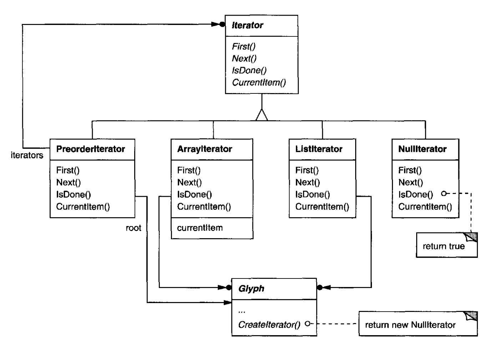
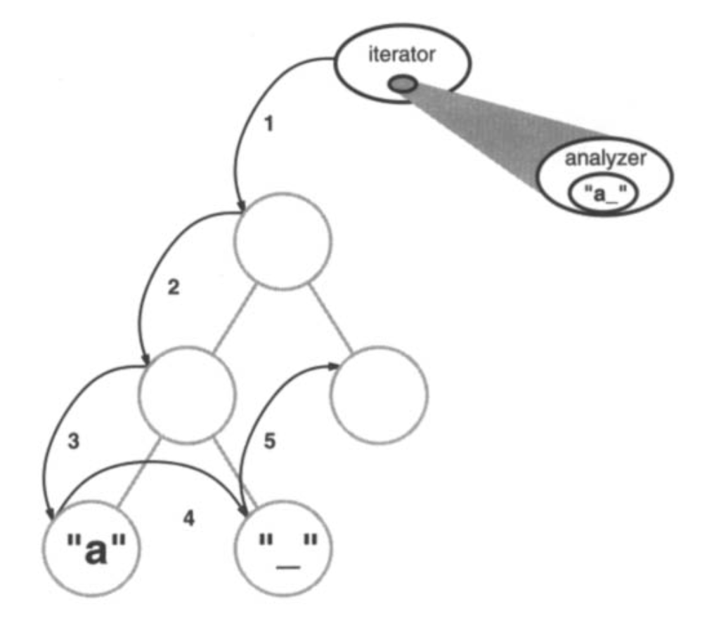
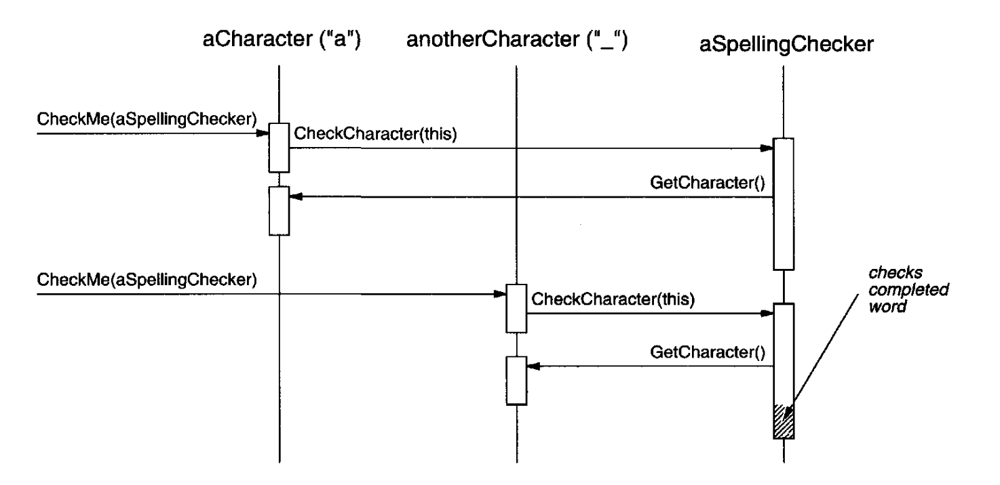
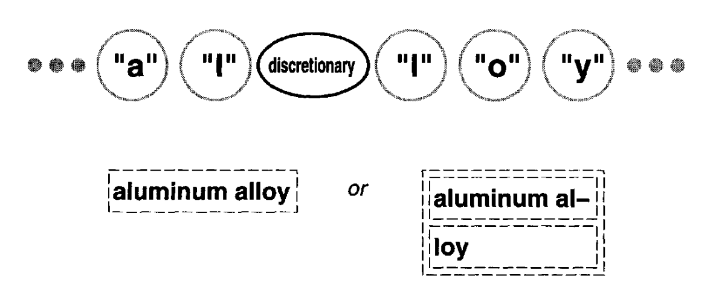

# 2.8 拼写检查与断词

最后一个设计问题涉及文本分析，具体说，是检查拼写错误，以及在需要时引入断词点以获得良好的格式化效果。

这里的约束与我们在 [2.3 节](3.md) 格式化设计问题中所遇到的相似。
正如断行策略那样，检查拼写和计算断词点也不止一种办法。
所以这里同样要支持多种算法。
多样的算法集合可以提供空间/时间/质量上的不同权衡。
我们还应当让新增算法变得容易。

<ins>我们还想避免把这项功能硬接到文档结构里。
这个目标在这里比在格式化的情形下更重要，因为拼写检查与断词只是我们可能希望 Lexi 支持的众多分析中的两种。</ins>
随着时间推移，我们不可避免地会想扩展 Lexi 的分析能力。
我们可能会加入搜索、词数统计、用于累加表列数值的计算功能、语法检查等等。
但我们不希望每引入一种这类新功能，就去改动 `Glyph` 类及其所有子类。

这个谜题其实有两块：(1) 访问待分析的信息 —— 这些信息分散在文档结构中的各个 glyph 上；(2) 执行分析。
我们把这两块分开来看。

## 2.8.1 访问分散的信息

许多种分析都需要逐字符地检查文本。
我们需要分析的文本分散在由 glyph 对象构成的层次结构各处。
要在这样的结构中检查文本，我们需要一种访问机制，它了解对象存储在何种数据结构中。
有些 glyph 可能用链表存储子节点，有些用数组，还有些用更古怪的数据结构。
我们的访问机制必须能应付所有这些可能。

还有一个麻烦：不同的分析以不同方式访问信息。
大多数分析会从头到尾遍历文本。
但有些正相反 —— 例如反向搜索需要从后往前、而不是从前往后推进文本。
求值代数表达式则可能需要中序遍历。

<ins>所以我们的访问机制必须适应不同的数据结构，而且我们必须支持不同种类的遍历，例如前序、后序和中序。</ins>

## 2.8.2 封装访问与遍历

目前我们的 glyph 接口用整数索引让客户端引用子节点。
对于把子节点存在数组里的 glyph 类，这也许合理；但对用链表的 glyph 来说，这可能很低效。
glyph 抽象的一个重要职责，就是隐藏存储子节点的数据结构。
这样我们就能更换 glyph 类所用的数据结构，而不影响其他类。
因此，只有 glyph 自己知道它用的是哪种数据结构。
一个推论是：glyph 接口不应当偏向某一种数据结构。
例如，它不应当像现在这样，对数组比对链表更友好。

我们可以解决这个问题，同时支持好几种不同的遍历。
我们可以把多种访问与遍历能力直接放进 glyph 类，并提供一种在其中做选择的方式，也许是把一个枚举常量作为参数传进去。
各对象在遍历过程中传递这个参数，以确保它们做的是同一种遍历。
它们还得把遍历过程中累积的任何信息传递下去。

为了支持这种做法，我们可以在 `Glyph` 的接口中加入下面这些抽象操作：

```cpp
void First(Traversal kind)
void Next()
bool IsDone()
Glyph* GetCurrent()
void Insert(Glyph*)
```

`First`、`Next` 和 `IsDone` 控制遍历。
`First` 初始化遍历。
它把遍历的种类作为 `Traversal` 类型的参数，
后者是一个枚举常量，取值如 `CHILDREN`（只遍历该 glyph 的直接子节点）、`PREORDER`（以前序遍历整个结构）、`POSTORDER` 和 `INORDER`。
`Next` 推进到遍历中的下一个 glyph，`IsDone` 报告遍历是否结束。
`GetCurrent` 取代 `Child` 操作；它访问遍历中的当前 glyph。
`Insert` 取代旧的那个操作；它在当前位置插入给定的 glyph。

一次分析会用下面这段 C++ 代码，对以 `g` 为根的 glyph 结构做前序遍历：

```cpp
Glyph* g;

for (g->First(PREORDER); !g->IsDone(); g->Next()) {
    Glyph* current = g->GetCurrent();

    // do some analysis
}
```

注意，我们把整数索引从 glyph 接口中驱逐出去了。
接口上再也不会有任何东西偏向某一种集合。
我们同时也不再让客户端自己去实现常见的遍历。

但这样做仍有问题。
其一，它无法在不扩展枚举值集合、或不新增操作的前提下支持新的遍历。
假设我们想要前序遍历的一个变体，它能自动跳过非文本的 glyph。
那我们就得改动 `Traversal` 枚举，加入诸如 `TEXTUAL-PREORDER` 之类的东西。

我们希望避免改动已有的声明。
把遍历机制整个放进 `Glyph` 类层次结构，使得任何修改或扩展都很难不牵动大量类。
这套机制也难以复用到其他种类的对象结构上。
而且我们无法在一个结构上同时进行多个遍历。

<ins>又一次，更好的方案是把变化的概念封装起来，这里变化的是访问与遍历机制。</ins>
我们可以引入一类称为 iterator 的对象，其唯一目的就是定义不同的这类机制。
我们可以用继承让我们统一访问不同的数据结构，并支持新的遍历种类。
而且这样做不必改动 glyph 接口，也不必打扰已有的 glyph 实现。

<br/>
*图 2.13：`Iterator` 类及其子类*

## 2.8.3 Iterator 类及其子类

我们将用一个称为 `Iterator` 的抽象类来定义访问与遍历的通用接口。
`ArrayIterator`、`ListIterator` 这样的具体子类实现该接口，以提供对数组和列表的访问；
而 `PreorderIterator`、`PostorderIterator` 之类则在特定结构上实现不同的遍历。
每个 `Iterator` 子类都持有对它所要遍历的结构的引用。
子类实例在创建时用这个引用来初始化。
图 2.13 展示了 `Iterator` 类及其若干子类。
注意我们在 `Glyph` 类接口上增加了一个 `CreateIterator` 抽象操作，以支持 iterator。

`Iterator` 接口提供 `First`、`Next` 和 `IsDone` 三个操作来控制遍历。
`ListIterator` 类实现 `First` 指向列表中的第一个元素，`Next` 把 iterator 推进到列表中的下一项。
`IsDone` 返回列表指针是否已越过列表最后一个元素。
`CurrentItem` 解引用 (dereferences) iterator，返回它所指向的 glyph。
`ArrayIterator` 类做的事类似，只不过作用于一个 glyph 数组。

现在，我们无需知道 glyph 结构的表示方式，就能访问它的子节点：

```cpp
Glyph* g;
Iterator<Glyph*>* i = g->CreateIterator();

for (i->First(); !i->IsDone(); i->Next()) {
    Glyph* child = i->CurrentItem();

    // do something with current child
}
```

`CreateIterator` 默认返回一个 `NullIterator` 实例。
`NullIterator` 是一种退化的 iterator，用于没有子节点的 glyph，也就是叶子 glyph。
`NullIterator` 的 `IsDone` 操作总是返回 true。

有子节点的 glyph 子类会重写 `CreateIterator`，返回另一个 `Iterator` 子类的实例。
具体是哪个子类，取决于存储其子节点的结构。
如果 `Glyph` 的子类 `Row` 把子节点存在一个名为 `_children` 的列表里，那么它的 `CreateIterator` 操作会是这样：

```cpp
Iterator<Glyph*>* Row::CreateIterator () {
    return new ListIterator<Glyph*>(_children);
}
```

用于前序和中序遍历的 iterator 是借助各 glyph 特有的 iterator 来实现其遍历的。
这类遍历所需的 iterator 在创建时会拿到它所遍历结构的根 glyph。
它们对结构中的 glyph 调用 `CreateIterator`，并用一个栈来记录所得的各个 iterator。

例如，`PreorderIterator` 类从根 glyph 取得 iterator，把它初始化指向第一个元素，然后把它压入栈：

```cpp
void PreorderIterator::First () {
    Iterator<Glyph*>* i = _root->CreateIterator();

    if (i) {
        i->First();
        _iterators.RemoveAll();
        _iterators.Push(i);
    }
}
```

`CurrentItem` 则只需调用栈顶 iterator 的 `CurrentItem`：

```cpp
Glyph* PreorderIterator::CurrentItem () const {
    return
        _iterators.Size() > 0 ?
        _iterators.Top()->CurrentItem() : 0;
}
```

`Next` 操作取栈顶的 iterator，并请求它的当前项创建一个 iterator，力图尽可能深入地进入 glyph 结构（毕竟这是前序遍历）。
`Next` 把新 iterator 初始化到遍历的第一项，并把它压入栈。
接着 `Next` 检验最新的 iterator；如果它的 `IsDone` 返回 true，那么我们已经完成了当前这棵子树（或叶子）的遍历。
此时，`Next` 把栈顶 iterator 弹出，并重复这一过程，直到找到下一个尚未完成的遍历——如果存在的话；如果不存在，我们就遍历完整个结构了。

```cpp
void PreorderIterator::Next () {
    Iterator<Glyph*>* i =
        _iterators.Top()->CurrentItem()->CreateIterator();

    i->First();
    _iterators.Push(i);

    while (
        _iterators.Size() > 0 && _iterators.Top()->IsDone()
    ) {
        delete _iterators.Pop();
        _iterators.Top()->Next();
    }
}
```

<ins>注意 `Iterator` 类层次结构如何让我们在不修改 glyph 类的前提下增加新的遍历种类 —— 我们只要派生 `Iterator` 子类，像 `PreorderIterator` 那样加入一种新遍历即可。
glyph 子类用同一套接口让客户端访问自己的子节点，而不泄露自己存储它们所用的底层数据结构。
因为 iterator 各自保存遍历状态的副本，我们可以同时进行多个遍历，即使是在同一个结构上。
尽管本例中的遍历都是作用于 glyph 结构，但没有理由我们不能用结构中对象的类型来参数化 `PreorderIterator` 这样的类。</ins>
在 C++ 中，我们会用模板来做这件事。
那样我们就能复用 `PreorderIterator` 里的机制去遍历其他结构。

## 2.8.4 Iterator 模式

[Iterator (257)](../ch5/4.md) 模式捕捉了这些在对象结构上支持访问与遍历的技术。
<ins>它不仅适用于复合结构，也适用于集合。
它把遍历算法抽象出来，使客户端不必了解它所遍历对象的内部结构。</ins>
Iterator 模式再一次说明：封装变化的概念如何帮助我们获得灵活性与可复用性。
即便如此，迭代这个问题有着惊人的深度，Iterator 模式所涵盖的细微之处与权衡，远超我们这里所讨论的。

## 2.8.5 遍历与遍历动作

既然我们有了遍历 glyph 结构的办法，接下来就要检查拼写、进行断词。
这两项分析都涉及在遍历过程中累积信息。

首先我们必须决定把分析的职责放在哪里。
我们可以把它放进 `Iterator` 类，从而让分析成为遍历不可分割的一部分。
但如果我们把遍历与遍历期间执行的动作区分开，就能获得更大的灵活性和复用的可能。
这是因为不同的分析往往需要同一种遍历。
于是我们可以为不同的分析复用同一组 iterator。
例如，前序遍历在许多分析中都很常见，包括拼写检查、断词、向前搜索和词数统计。

所以分析与遍历应当分开。
那么分析的职责还能放在哪里呢？
我们知道我们可能想做的分析有许多种。
每项分析在遍历的不同位置会做不同的事。
取决于分析的种类，有些 glyph 比其他 glyph 更重要。
如果我们在做拼写检查或断词，我们想考虑的是字符 glyph，而不是线条、位图图像这类图形 glyph。
如果我们在做分色，我们想考虑的是可见 glyph，而不是不可见的。
不可避免地，不同的分析会分析不同的 glyph。

因此，给定的分析必须能够区分不同种类的 glyph。
一个显而易见的做法是把分析能力放进 glyph 类本身。
对每项分析，我们可以给 `Glyph` 类增加一个或多个抽象操作，并让子类按照自己在分析中所扮演的角色来实现它们。
但这种做法的麻烦在于：每当我们新增一种分析，就得改动每一个 glyph 类。
在某些情况下我们可以缓解这个问题：
如果只有少数类参与该分析，或者大多数类以相同方式做该分析，那么我们可以在 `Glyph` 类中为这个抽象操作提供一个默认实现。
这个默认操作会覆盖常见情形。
这样我们就把改动限制在 `Glyph` 类以及那些偏离常规的子类上。

<ins>然而，即便默认实现减少了改动数量，仍有一个隐伏的问题：`Glyph` 的接口会随着每一项新的分析能力而膨胀。
随着时间推移，这些分析操作会开始淹没基本的 `Glyph` 接口。</ins>
glyph 的主要目的是定义和构造具有外观与形状的对象 —— 这一点会越来越难以看清，那个接口会被淹没在噪声里。

## 2.8.6 封装分析

种种迹象表明，我们需要把分析封装在一个独立的对象里，就像我们此前多次做过的那样。
我们可以把某项分析的机制放进它自己的类。
我们可以把这个类的实例与一个合适的 iterator 配合使用。
iterator 会把这个实例 "携带" 到结构中的每个 glyph。
分析对象则可以在遍历的每个位置上完成分析的一部分。
分析器随着遍历的推进，累积它感兴趣的信息（此处是字符）：

<br/>
*图 2.8.1：分析器随遍历累积信息*

这种做法带出的根本问题是：分析对象如何在不诉诸类型测试或向下转型的前提下区分不同种类的 glyph？
我们不希望 `SpellingChecker` 类里出现这样的（伪）代码：

```cpp
void SpellingChecker::Check (Glyph* glyph) {
    Character* c;
    Row* r;
    Image* i;

    if (c = dynamic_cast<Character*>(glyph)) {
        // analyze the character

    } else if (r = dynamic_cast<Row*>(glyph)) {
        // prepare to analyze r's children

    } else if (i = dynamic_cast<Image*>(glyph)) {
        // do nothing
    }
}
```

这段代码相当难看。
它依赖于类型安全转换这类颇为冷僻的能力。
它也很难扩展。
每当 `Glyph` 类层次结构发生变化，我们都得记得修改这个函数体。
事实上，这正是面向对象语言本来要消灭的那类代码。

我们想避开这种蛮力做法，但怎么做呢？
考虑一下，当我们给 `Glyph` 类增加下面这个抽象操作时会发生什么：

```cpp
void CheckMe(SpellingChecker&)
```

我们在每个 `Glyph` 子类里这样定义 `CheckMe`：

```cpp
void GlyphSubclass::CheckMe (SpellingChecker& checker) {
    checker.CheckGlyphSubclass(this);
}
```

其中 `GlyphSubclass` 会被替换成该 glyph 子类的名字。
注意，当 `CheckMe` 被调用时，具体的 `Glyph` 子类是已知的 —— 毕竟我们正身处它的某个操作之中。
相应地，`SpellingChecker` 类的接口为每个 `Glyph` 子类都包含一个 `CheckGlyphSubclass` 之类的操作：¹⁰

```cpp
class SpellingChecker {
public:
    SpellingChecker();

    virtual void CheckCharacter(Character*);
    virtual void CheckRow(Row*);
    virtual void CheckImage(Image*);

    // . . . and so forth

    List<char*>& GetMisspellings();

protected:
    virtual bool IsMisspelled(const char*);

private:
    char _currentWord[MAX_WORD_SIZE];
    List<char*> _misspellings;
};
```

¹⁰ 我们本可以用函数重载，给这些成员函数取同一个名字，因为它们的参数已经把它们区分开了。
这里我们给它们取了不同的名字，是为了强调它们的差异，尤其是在它们被调用的时候。

`SpellingChecker` 针对 `Character` glyph 的检查操作可能大致如下：

```cpp
void SpellingChecker::CheckCharacter (Character* c) {
    const char ch = c->GetCharCode();

    if (isalpha(ch)) {
        // append alphabetic character to _currentWord

    } else {
        // we hit a nonalphabetic character

        if (IsMisspelled(_currentWord)) {
            // add _currentWord to _misspellings
            _misspellings.Append(strdup(_currentWord));
        }

        _currentWord[0] = '\0';
            // reset _currentWord to check next word
    }
}
```
注意我们只在 `Character` 类上定义了一个特殊的 `GetCharCode` 操作。
拼写检查器可以处理子类特有的操作，而不必诉诸类型测试或类型转换 —— 这让我们能够特殊对待某些对象。
`CheckCharacter` 把字母字符累积到 `_currentWord` 缓冲区。
当它遇到非字母字符（比如下划线）时，就用 `IsMisspelled` 操作检查 `_currentWord` 中单词的拼写。¹¹
如果该单词拼写错误，`CheckCharacter` 就把它加入拼错的单词列表。
然后它必须清空 `_currentWord` 缓冲区，为下一个单词做好准备。
遍历结束后，你可以用 `GetMisspellings` 操作取出拼错的单词列表。

¹¹ `IsMisspelled` 实现了拼写算法，我们在此不细述，因为我们已经把它做成独立于 Lexi 设计的了。
我们可以通过派生 `SpellingChecker` 子类来支持不同的算法；
另一种做法是应用 [Strategy (315)](../ch5/9.md) 模式（就像我们在 [2.3 节](3.md) 对格式化所做的那样）来支持不同的拼写检查算法。

现在我们可以遍历 glyph 结构，以拼写检查器为参数对每个 glyph 调用 `CheckMe`。
这实际上是把每个 glyph 的身份告知 `SpellingChecker`，并促使检查器完成拼写检查的下一个增量。

```cpp
SpellingChecker spellingChecker;
Composition* c;

// . . .

Glyph* g;
PreorderIterator i(c);

for (i.First(); !i.IsDone(); i.Next()) {
    g = i.CurrentItem();
    g->CheckMe(spellingChecker);
}
```

下面的交互图展示了 `Character` glyph 与 `SpellingChecker` 对象如何协同工作：

<br/>
*图 2.8.2：`Character` glyph 与 `SpellingChecker` 的协作*

这种做法在查找拼写错误上可行，但它如何帮助我们支持多种分析呢？
看起来，每当我们新增一种分析，就得给 `Glyph` 及其子类增加一个 `CheckMe(SpellingChecker&)` 之类的操作。
如果我们坚持为每项分析都设一个独立的类，那确实如此。
但没有理由不能给所有分析类同一个接口。
这样做让我们能以多态方式使用它们。
也就是说，我们可以把 `CheckMe(SpellingChecker&)` 这类分析专用的操作，换成一个与分析无关、接受更通用参数的操作。

## 2.8.7 Visitor 类及其子类

我们将用 **visitor** 一词泛指这样一类对象：它们在遍历期间 “访问” 其他对象并做相应的事情。¹²
在此，我们可以定义一个 `Visitor` 类，为访问结构中的 glyph 定义抽象接口。

¹² “Visit” 只是 “analyze” 的一个稍更通用的说法。
它预示了我们在即将引入的设计模式中所使用的术语。

```cpp
class Visitor {
public:
    virtual void VisitCharacter(Character*) { }
    virtual void VisitRow(Row*) { }
    virtual void VisitImage(Image*) { }

    // ... and so forth
};
```

`Visitor` 的具体子类执行不同的分析。
例如，我们可以有一个用于拼写检查的 `SpellingCheckingVisitor` 子类，以及一个用于断词的 `HyphenationVisitor` 子类。
`SpellingCheckingVisitor` 的实现与上面实现 `SpellingChecker` 完全一样，只是操作名会反映更通用的 Visitor 接口。
例如，`CheckCharacter` 会被称为 `VisitCharacter`。

既然 `CheckMe` 对于什么都不检查的 visitor 并不合适，我们就给它一个更通用的名字：`Accept`。
它的参数也必须改成接受 `Visitor&`，以反映它能接受任何 visitor。
现在，新增一项分析只需要定义一个 visitor 的新子类 —— 我们不必触碰任何 glyph 类。
只要给 `Glyph` 及其子类加上这一个操作，我们就能支持未来所有的分析。

我们已经看到拼写检查是如何工作的。
在 `HyphenationVisitor` 中，我们用类似的办法累积文本。
但一旦 `HyphenationVisitor` 的 `VisitCharacter` 操作组装出一个完整单词，它的做法就稍有不同。
它不是检查该单词是否拼错，而是应用断词算法来确定该单词中可能的断词点（如果有的话）。
然后它在每个断词点处，把一个 discretionary glyph 插入 composition。
discretionary glyph 是 `Discretionary` 的实例，而 `Discretionary` 是 `Glyph` 的一个子类。

discretionary glyph 有两种可能的外观，取决于它是否是行上的最后一个字符。
如果它是最后一个字符，这个 discretionary 看起来就像一个连字符；如果它不在行尾，那就完全没有外观。
discretionary 会检查它的父节点（一个 `Row` 对象），看自己是不是最后一个子节点。
每当被要求绘制自身或计算边界时，discretionary 就做这项检查。
格式化策略把 discretionary 与空白同等看待，使它们成为结束一行的候选位置。
下图展示了嵌入的 discretionary 可以呈现的样子。

<br/>
*图 2.8.3：嵌入的 discretionary 的外观*

## 2.8.8 Visitor 模式

我们此处描述的，是 [Visitor (331)](../ch5/11.md) 模式的一个应用。
前面描述的 `Visitor` 类及其子类，正是该模式的关键参与者。
Visitor 模式捕捉了我们所用的技术：允许对 glyph 结构进行数量不限的分析，而无需改动 glyph 类本身。
visitor 的另一个好处是，它们不仅可用于我们这种 glyph 结构这样的复合结构，也可用于任何对象结构。
这包括集合、列表，甚至是有向无环图。
而且，visitor 所能访问的类之间不必通过共同的父类相关联。
这意味着 visitor 可以跨类层次结构工作。

<ins>在应用 Visitor 模式之前，你应当问自己一个重要问题：哪条类层次结构变化得更频繁？</ins>
当你希望对类结构稳定的对象做各种不同的事情时，这个模式最为合适。
新增一种 visitor 不需要改动那种类结构，这在类结构庞大时尤为重要。
但每当你给结构增加一个子类，你也得更新所有 visitor 接口，为该子类加上一个 `Visit...` 操作。
在我们的例子里，这意味着新增一个名为 `Foo` 的 `Glyph` 子类，将需要改动 `Visitor` 及其所有子类，加入一个 `VisitFoo` 操作。
但鉴于我们的设计约束，我们给 Lexi 新增一种分析的可能性，远大于新增一种 `Glyph`。
所以 Visitor 模式很适合我们的需要。
