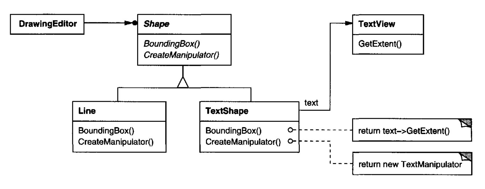
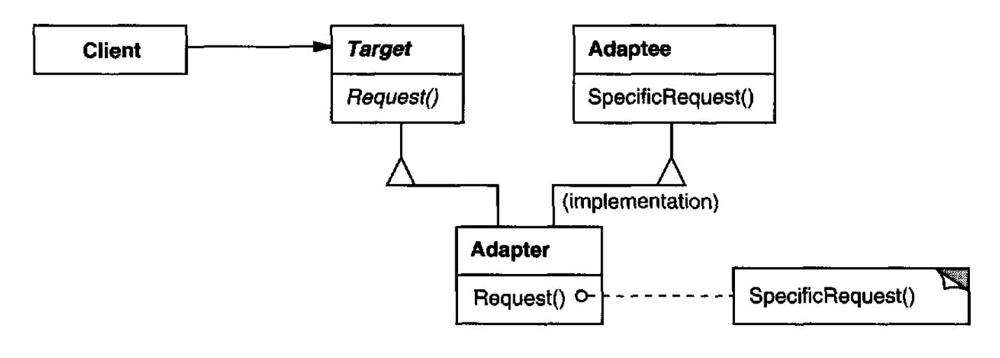
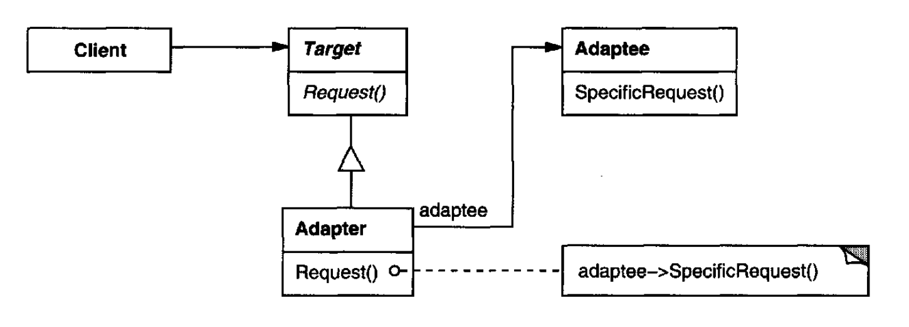
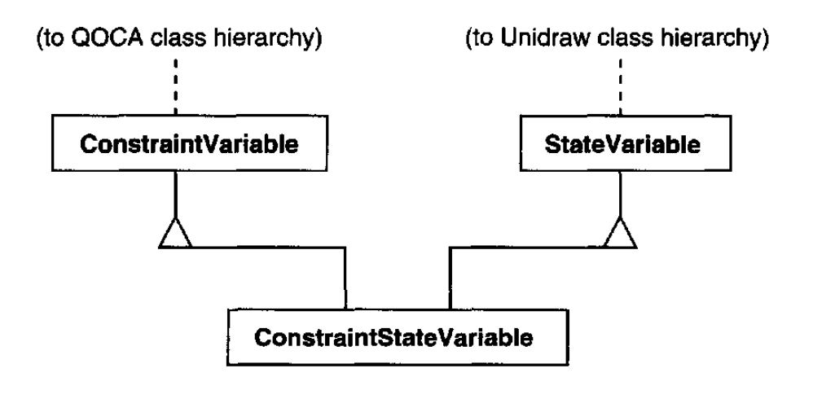
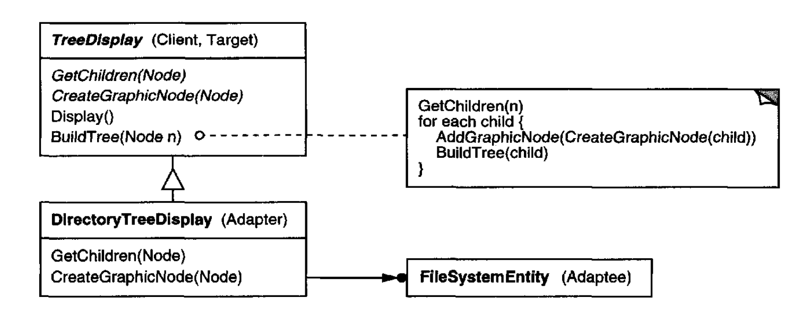
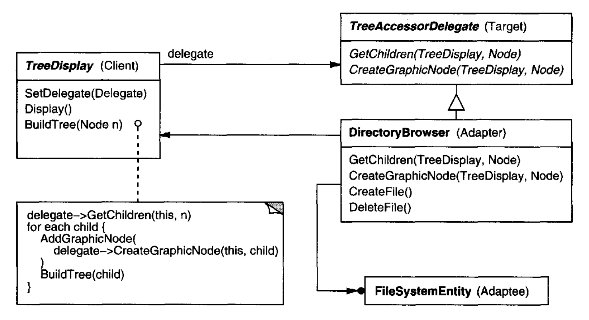
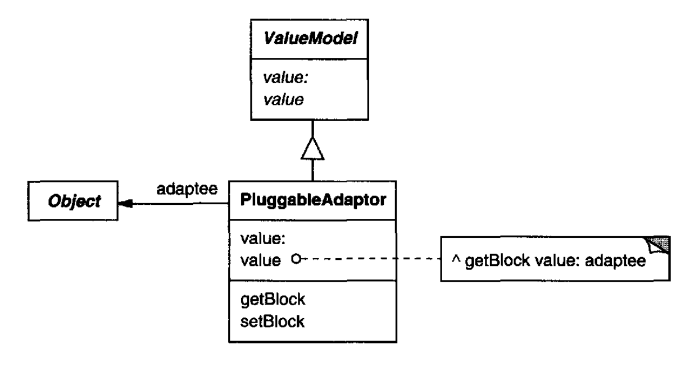

# Adapter （类、对象结构型）

## 意图

把一个类的接口转换成客户端期望的另一个接口。
Adapter 让原本因为接口不兼容而无法一起工作的类可以一起工作。

## 别名

包装器 (Wrapper)

## 动机

有时，一个为复用而设计的工具包类之所以不可复用，仅仅因为它的接口与应用所需的领域特定接口不匹配。

例如，考虑一个绘图编辑器，它让用户把图形元素（线、多边形、文本等）绘制和排列成图片和图表。
绘图编辑器的关键抽象是图形对象，它有一个可编辑的形状，并且可以绘制自己。
图形对象的接口由一个名为 `Shape` 的抽象类定义。
编辑器为每种图形对象定义 `Shape` 的一个子类：用于线的 `LineShape` 类，用于多边形的 `PolygonShape` 类，等等。

像 `LineShape` 和 `PolygonShape` 这样的基本几何形状类相当容易实现，因为它们的绘制和编辑能力本质上是有限的。
但一个可以显示和编辑文本的 `TextShape` 子类实现起来要困难得多，因为即使基本的文本编辑也涉及复杂的屏幕更新和缓冲区管理。
与此同时，一个现成的用户界面工具包可能已经提供了一个用于显示和编辑文本的复杂 `TextView` 类。
理想情况下，我们希望复用 `TextView` 来实现 `TextShape`，但该工具包并不是带着 `Shape` 类来设计的。
所以我们不能互换使用 `TextView` 和 `Shape` 对象。

像 `TextView` 这样现有且不相关的类，如何在一个期望具有不同且不兼容接口的类的应用程序中工作？
我们可以改变 `TextView` 类，使它符合 `Shape` 接口，但除非我们有工具包的源代码，否则这不是一个选项。
即使我们有，改变 `TextView` 也没有意义；工具包不应该仅仅为了让一个应用程序工作就采用领域特定的接口。

相反，我们可以定义 `TextShape`，使它把 `TextView` 接口适配到 `Shape` 的接口。
我们可以用两种方式之一做到这一点：（1）通过继承 `Shape` 的接口和 `TextView` 的实现，或（2）通过在 `TextShape` 中组合一个 `TextView` 实例，并按照 `TextView` 的接口实现 `TextShape`。
这两种方法分别对应于 Adapter 模式的类版本和对象版本。
我们把 `TextShape` 称为适配器。

<br/>

这个图说明了对象适配器的情况。
它显示了 `Shape` 类中声明的 `BoundingBox` 请求如何被转换为 `TextView` 中定义的 `GetExtent` 请求。
因为 `TextShape` 把 `TextView` 适配到 `Shape` 接口，绘图编辑器可以复用原本不兼容的 `TextView` 类。

适配器常常负责被适配类不提供的功能。
该图显示了适配器如何履行这类职责。
用户应当能够交互式地把每个 `Shape` 对象 “拖拽” 到新位置，但 `TextView` 不是为此设计的。
`TextShape` 可以通过实现 `Shape` 的 `CreateManipulator` 操作来添加这个缺失的功能，该操作返回适当的 `Manipulator` 子类的实例。

`Manipulator` 是一个抽象类，用于那些知道如何响应用户输入来动画化 `Shape` 的对象，比如把形状拖拽到新位置。
针对不同形状有 `Manipulator` 的子类；例如，`TextManipulator` 是 `TextShape` 对应的子类。
通过返回一个 `TextManipulator` 实例，`TextShape` 添加了 `TextView` 缺少但 `Shape` 要求的功能。

## 适用性

在以下情况下使用 Adapter 模式

- 你想使用一个现有类，而它的接口与你需要的接口不匹配。

- 你想创建一个可复用的类，它与不相关或无法预见的类协作，也就是说，这些类不一定具有兼容的接口。

- （仅对象适配器）你需要使用几个现有子类，但通过子类化每一个来适配它们的接口并不实际。
对象适配器可以适配其父类的接口。

## 结构

类适配器使用多重继承把一个接口适配到另一个接口：

<br/>

对象适配器依赖对象组合：

<br/>

## 参与者

- **Target** （`Shape`）
  - 定义 Client 使用的领域特定接口。

- **Client** （`DrawingEditor`）
  - 与符合 Target 接口的对象协作。

- **Adaptee** （`TextView`）
  - 定义需要被适配的现有接口。

- **Adapter** （`TextShape`）
  - 把 Adaptee 的接口适配到 Target 接口。

## 协作

- 客户端在 Adapter 实例上调用操作。适配器则调用执行该请求的 Adaptee 操作。

## 结果

类适配器和对象适配器有不同的取舍。类适配器

- 通过承诺一个具体的 Adaptee 类来把 Adaptee 适配到 Target。
因此，当我们想适配一个类及其所有子类时，类适配器无法工作。

- 让 Adapter 可以重写 Adaptee 的某些行为，因为 Adapter 是 Adaptee 的子类。

- 只引入一个对象，而且不需要额外的间接指针来访问 adaptee。

对象适配器

- 让单个 Adapter 可以与许多 Adaptee 一起工作 —— 也就是说，Adaptee 本身及其所有子类（如果有的话）。
Adapter 还可以一次为所有 Adaptee 添加功能。

- 使重写 Adaptee 行为变得更困难。
它将需要子类化 Adaptee，并让 Adapter 引用该子类而不是 Adaptee 本身。

使用 Adapter 模式时还要考虑以下其他问题：

1. *Adapter 做多少适配？*
适配器在把 Adaptee 适配到 Target 接口时所做的工作量各不相同。
可能的工作范围很广，从简单的接口转换 ——例如改变操作名称—— 到支持一整套完全不同的操作。
Adapter 做多少工作取决于 Target 接口与 Adaptee 的接口有多相似。

2. *可插拔适配器。*
当你最小化其他类为使用一个类而必须做出的假设时，这个类就更可复用。
通过把接口适配构建到一个类中，你消除了其他类看到相同接口这一假设。
换句话说，接口适配让我们可以把我们的类并入可能期望不同接口的现有系统中。
ObjectWorks\Smalltalk [Par90](../biblio.md#par90) 使用术语 **可插拔适配器 (pluggable adapter)** 来描述具有内建接口适配的类。

   考虑一个 `TreeDisplay` 部件，它可以以图形方式显示树结构。
   如果这是一个只在一个应用程序中使用的专用部件，那么我们可能会要求它显示的对象具有特定接口；
   也就是说，所有对象都必须继承自一个 `Tree` 抽象类。
   但如果我们想让 `TreeDisplay` 更可复用（比如我们想把它做成有用部件工具包的一部分），那么那个要求就不合理了。
   应用程序将为树结构定义自己的类。
   它们不应该被迫使用我们的 `Tree` 抽象类。
   不同的树结构将有不同的接口。

   例如，在目录层次结构中，子目录可能通过 `GetSubdirectories` 操作访问，而在继承层次结构中，对应的操作可能称为 `GetSubclasses`。
   一个可复用的 `TreeDisplay` 部件必须能够显示这两种层次结构，即使它们使用不同的接口。
   换句话说，`TreeDisplay` 应当内建接口适配。

   我们将在实现部分研究把接口适配构建到类中的不同方式。

3. *使用双向适配器提供透明性。*
适配器的一个潜在问题是它们并非对所有客户端都透明。
被适配的对象不再符合 Adaptee 接口，所以它不能在任何可以使用 Adaptee 对象的地方原样使用。
**双向适配器 (two-way adapters)** 可以提供这种透明性。
具体来说，当两个不同的客户端需要以不同方式查看一个对象时，它们很有用。

   考虑一个集成 Unidraw（一个图形编辑器框架 [VL90](../biblio.md#vl90) ）和 QOCA（一个约束求解工具包 [HHMV92](../biblio.md#hhmv92) ）的双向适配器。
   两个系统都有显式表示变量的类：Unidraw 有 `StateVariable`，QOCA 有 `ConstraintVariable`。
   要让 Unidraw 与 QOCA 一起工作，必须把 `ConstraintVariable` 适配到 `StateVariable`；
   要让 QOCA 把解传播到 Unidraw，必须把 `StateVariable` 适配到 `ConstraintVariable`。

   <br/>

   解决方案涉及一个双向类适配器 `ConstraintStateVariable`，它是 `StateVariable` 和 `ConstraintVariable` 两者的子类，把两个接口相互适配。
   在这种情况下，多重继承是一种可行的解决方案，因为被适配类的接口差异很大。
   双向类适配器符合两个被适配类，可以在任一系统中工作。

## 实现

尽管 Adapter 的实现通常很直接，但这里有一些需要记住的问题：

1. *在 C++ 中实现类适配器。*
在类适配器的 C++ 实现中，`Adapter` 会公开继承 `Target`，并私有继承 `Adaptee`。
因此 `Adapter` 会是 `Target` 的子类型，但不是 `Adaptee` 的子类型。

2. *可插拔适配器。*
让我们看看为前面描述的 `TreeDisplay` 部件实现可插拔适配器的三种方式，该部件可以自动布局并显示层次结构。

   第一步是找到 `Adaptee` 的一个 “窄” 接口，也就是让我们能够完成适配的最小操作子集。
   这一步对这里讨论的三种实现都是共同的。
   一个只包含几个操作的窄接口，比一个包含几十个操作的接口更容易适配。
   对于 `TreeDisplay`，被适配者是任何层次结构。
   一个极简接口可能包括两个操作，一个定义如何以图形方式呈现层次结构中的节点，另一个取回该节点的子节点。

   窄接口引出三种实现方法：

   - (a) *使用抽象操作。*
   在 `TreeDisplay` 类中为窄 `Adaptee` 接口定义相应的抽象操作。
   子类必须实现这些抽象操作，并适配层次结构对象。
   例如，`DirectoryTreeDisplay` 子类将通过访问目录结构来实现这些操作。

      <br/>

      `DirectoryTreeDisplay` 特化窄接口，以便它可以显示由 `FileSystemEntity` 对象组成的目录结构。

   - (b) *使用委托对象。*
   在这种方法中，`TreeDisplay` 把访问层次结构的请求转发给一个委托对象。
   `TreeDisplay` 可以通过替换不同的委托来使用不同的适配策略。
   例如，假设存在一个使用 `TreeDisplay` 的 `DirectoryBrowser`。
   `DirectoryBrowser` 可能是一个很好的委托，用于把 `TreeDisplay` 适配到层次目录结构。
   在像 Smalltalk 或 Objective C 这样的动态类型语言中，这种方法只需要一个用于向适配器注册委托的接口。
   然后 `TreeDisplay` 只需把请求转发给委托。
   NEXTSTEP [Add94](../biblio.md#add94) 大量使用这种方法来减少子类化。

      像 C++ 这样的静态类型语言需要为委托显式定义接口。
      我们可以通过把 `TreeDisplay` 所需的窄接口放入一个抽象 `TreeAccessorDelegate` 类来指定这样一个接口。
      然后我们可以使用继承把这个接口混入我们选择的委托 —— 在这个例子中是 `DirectoryBrowser`。
      如果 `DirectoryBrowser` 没有现有父类，我们使用单继承；如果有，则使用多重继承。
      像这样把类混合在一起，比引入一个新的 `TreeDisplay` 子类并逐个实现其操作更容易。

      <br/>

   - (c) *参数化适配器。*
   在 Smalltalk 中支持可插拔适配器的通常方式是，用一个或多个块来参数化适配器。
   块构造支持无需子类化的适配。
   块可以适配一个请求，而适配器可以为每个单独的请求存储一个块。
   在我们的例子中，这意味着 `TreeDisplay` 存储一个用于把节点转换为 `GraphicNode` 的块，
   以及另一个用于访问节点子节点的块。

      例如，要在目录层次结构上创建 `TreeDisplay`，我们写

      ```smalltalk
      directoryDisplay :=
          (TreeDisplay on: treeRoot)
              getChildrenBlock:
                  [:node | node getSubdirectories]
              createGraphicNodeBlock:
                  [:node | node createGraphicNode].
      ```

      如果你正在把接口适配构建到一个类中，这种方法提供了一种方便的子类化替代方案。

## 示例代码

我们将从 `Shape` 和 `TextView` 类开始，简要勾勒动机示例中类适配器和对象适配器的实现。

```cpp
class Shape {
public:
    Shape();
    virtual void BoundingBox(
        Point& bottomLeft, Point& topRight
    ) const;
    virtual Manipulator* CreateManipulator() const;
};

class TextView {
public:
    TextView();
    void GetOrigin(Coord& x, Coord& y) const;
    void GetExtent(Coord& width, Coord& height) const;
    virtual bool IsEmpty() const;
};
```

`Shape` 假设一个由其相对角定义的边界框。
相比之下，`TextView` 由原点、高度和宽度定义。
`Shape` 还定义了一个 `CreateManipulator` 操作，用于创建一个 `Manipulator` 对象，该对象知道当用户操作形状时如何动画化它。¹
`TextView` 没有等价的操作。
`TextShape` 类就是这些不同接口之间的适配器。

¹ `CreateManipulator` 是 [Factory Method (107)](../ch3/3.md) 的一个例子。

类适配器使用多重继承来适配接口。
类适配器的关键是用一个继承分支继承接口，用另一个分支继承实现。
在 C++ 中进行这种区分的通常方式是公开继承接口，私有继承实现。
我们将使用这个约定来定义 `TextShape` 适配器。

```cpp
class TextShape : public Shape, private TextView {
public:
    TextShape();

    virtual void BoundingBox(
        Point& bottomLeft, Point& topRight
    ) const;
    virtual bool IsEmpty() const;
    virtual Manipulator* CreateManipulator() const;
};
```

`BoundingBox` 操作把 `TextView` 的接口转换为符合 `Shape` 的接口。

```cpp
void TextShape::BoundingBox (
    Point& bottomLeft, Point& topRight
) const {
    Coord bottom, left, width, height;

    GetOrigin(bottom, left);
    GetExtent(width, height);

    bottomLeft = Point(bottom, left);
    topRight = Point(bottom + height, left + width);
}
```

`IsEmpty` 操作展示了适配器实现中常见的直接转发请求：

```cpp
bool TextShape::IsEmpty () const {
    return TextView::IsEmpty();
}
```

最后，我们从头定义 `CreateManipulator`（`TextView` 不支持它）。
假设我们已经实现了一个 `TextManipulator` 类，它支持对 `TextShape` 的操作。

```cpp
Manipulator* TextShape::CreateManipulator () const {
    return new TextManipulator(this);
}
```

对象适配器使用对象组合来组合具有不同接口的类。
在这种方法中，适配器 `TextShape` 维护一个指向 `TextView` 的指针。

```cpp
class TextShape : public Shape {
public:
    TextShape(TextView*);

    virtual void BoundingBox(
        Point& bottomLeft, Point& topRight
    ) const;
    virtual bool IsEmpty() const;
    virtual Manipulator* CreateManipulator() const;
private:
    TextView* _text;
};
```

`TextShape` 必须初始化指向 `TextView` 实例的指针，它在构造函数中这样做。
每当它自己的操作被调用时，它还必须在其 `TextView` 对象上调用操作。
在这个例子中，假设客户端创建 `TextView` 对象并将其传递给 `TextShape` 构造函数：

```cpp
TextShape::TextShape (TextView* t) {
    _text = t;
}

void TextShape::BoundingBox (
    Point& bottomLeft, Point& topRight
) const {
    Coord bottom, left, width, height;

    _text->GetOrigin(bottom, left);
    _text->GetExtent (width, height) ;

    bottomLeft = Point(bottom, left);
    topRight = Point(bottom + height, left + width);
}

bool TextShape::IsEmpty () const {
    return _text->IsEmpty();
}
```

`CreateManipulator` 的实现与类适配器版本相比没有变化，因为它是从头实现的，不重用任何现有 `TextView` 功能。

```cpp
Manipulator* TextShape::CreateManipulator () const {
    return new TextManipulator(this);
}
```

把这段代码与类适配器的情况比较一下。
对象适配器需要多花一点功夫来编写，但它更灵活。
例如，`TextShape` 的对象适配器版本同样可以与 `TextView` 的子类一起工作 —— 客户端只需把 `TextView` 子类的实例传递给 `TextShape` 构造函数。

## 已知应用

动机中的例子来自 ET++Draw，一个基于 ET++ [WGM88](../biblio.md#wgm88) 的绘图应用程序。
ET++Draw 通过使用一个 `TextShape` 适配器类来复用 ET++ 的文本编辑类。

InterViews 2.6 为用户界面元素（如滚动条、按钮和菜单）定义了一个抽象类 `Interactor` [VL88](../biblio.md#vl88)。
它还为结构化图形对象（如线、圆、多边形和样条）定义了一个抽象类 `Graphic`。
`Interactor` 和 `Graphic` 都有图形外观，但它们有不同的接口和实现（它们不共享公共父类），因此不兼容 —— 你不能把结构化图形对象直接嵌入，比如说，一个对话框中。

相反，InterViews 2.6 定义了一个名为 `GraphicBlock` 的对象适配器，它是 `Interactor` 的子类，包含一个 `Graphic` 实例。
`GraphicBlock` 把 `Graphic` 类的接口适配到 `Interactor` 的接口。
`GraphicBlock` 让一个 `Graphic` 实例可以在 `Interactor` 结构中被显示、滚动和缩放。

可插拔适配器在 ObjectWorks\Smalltalk [Par90](../biblio.md#par90) 中很常见。
标准 Smalltalk 为显示单个值的视图定义了一个 `ValueModel` 类。
`ValueModel` 定义了用于访问值的 `value`、`value:` 接口。
这些是抽象方法。应用程序编写者用更具领域特定性的名称（如 `width` 和 `width:`）访问该值，但他们不应该为了把这类应用程序特定的名称适配到 `ValueModel` 接口而子类化 `ValueModel`。

相反，ObjectWorks\Smalltalk 包含一个名为 `PluggableAdaptor` 的 `ValueModel` 子类。`PluggableAdaptor` 对象把其他对象适配到 `ValueModel` 接口（`value`、`value:`）。
它可以用用于获取和设置所需值的块来参数化。
`PluggableAdaptor` 在内部使用这些块来实现 `value`、`value:` 接口。
`PluggableAdaptor` 还让你可以直接传入选择器名称（例如 `width`、`width:`），以获得语法上的便利。
它会自动把这些选择器转换为相应的块。

<br/>

ObjectWorks\Smalltalk 中的另一个例子是 `TableAdaptor` 类。
`TableAdaptor` 可以把一个对象序列适配成表格呈现。
该表格每行显示一个对象。
客户端用一组消息来参数化 `TableAdaptor`，表格可以使用这些消息从对象中获取列值。

NeXT 的 AppKit [Add94](../biblio.md#add94) 中一些类使用委托对象来执行接口适配。
一个例子是 `NXBrowser` 类，它可以显示分层的数据列表。
`NXBrowser` 使用一个委托对象来访问和适配数据。

Meyer 的 “权宜婚姻” [Mey88](../biblio.md#mey88) 是类适配器的一种形式。
Meyer 描述了 `FixedStack` 类如何把 `Array` 类的实现适配到 `Stack` 类的接口。
结果是一个包含固定数量条目的栈。

## 相关模式

[Bridge (151)](2.md) 的结构类似于对象适配器，但 Bridge 的意图不同：它旨在把接口与其实现分离，以便它们可以容易且独立地变化。
适配器旨在改变现有对象的接口。

[Decorator (175)](4.md) 增强另一个对象而不改变其接口。
因此，装饰器对应用程序来说比适配器更透明。
结果是，Decorator 支持递归组合，而纯粹的适配器不可能做到这一点。

[Proxy (207)](7.md) 为另一个对象定义代表或替身，并且不改变其接口。
