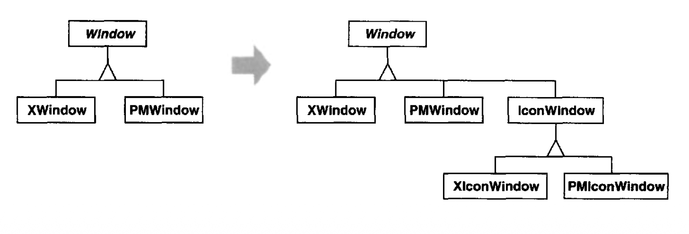
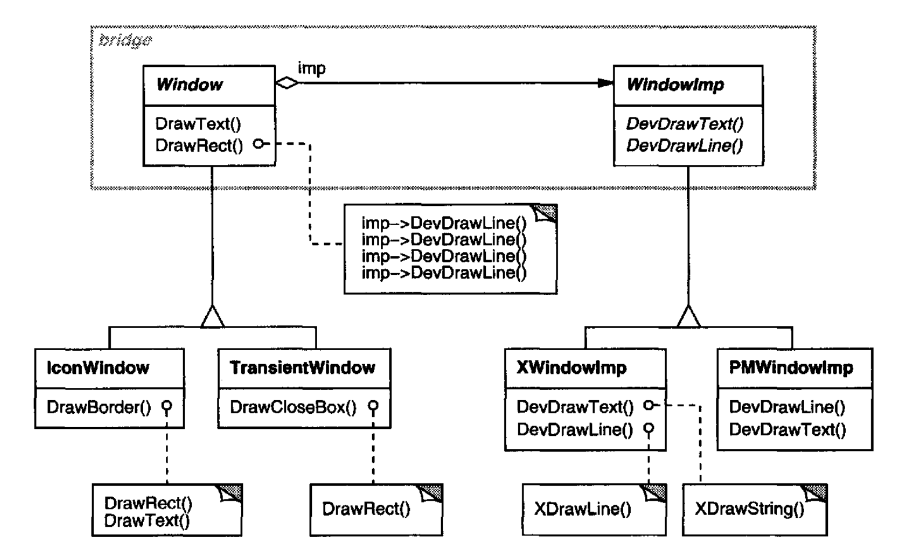
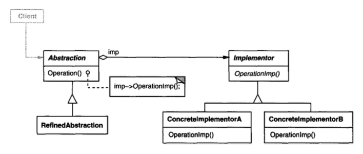

# Bridge （对象结构型）

## 意图

将抽象与其实现解耦，使两者可以独立变化。

## 别名

Handle/Body

## 动机

当一个抽象可能有多种实现时，通常的做法是用继承来容纳它们。
一个抽象类定义该抽象的接口，而具体子类以不同方式实现它。
但这种方法并不总是足够灵活。
继承把实现永久地绑定到抽象上，这使得独立地修改、扩展和复用抽象与实现变得困难。

考虑用户界面工具包中可移植 `Window` 抽象的实现。
这个抽象应当让我们能够编写这样的应用程序：它们能同时工作在 X Window System 和 IBM 的 Presentation Manager（PM）等平台上。
使用继承，我们可以定义一个抽象类 `Window`，以及为不同平台实现 `Window` 接口的子类 `XWindow` 和 `PMWindow`。
但这种方法有两个缺点：

1. 扩展 `Window` 抽象以涵盖不同种类的窗口或新平台很不方便。
想象一个 `IconWindow` 子类，它把 `Window` 抽象特化用于图标。
要同时支持两个平台的 `IconWindow`，我们必须实现两个新类，`XIconWindow` 和 `PMIconWindow`。
更糟的是，我们不得不为每一种窗口定义两个类。
支持第三个平台又需要为每一种窗口再增加一个新的 `Window` 子类。

   <br/>

2. 它让客户端代码依赖平台。
每当客户端创建一个窗口时，它就实例化一个具有特定实现的具体类。
例如，创建一个 `XWindow` 对象会把 `Window` 抽象绑定到 X Window 实现，这使客户端代码依赖 X Window 实现。
这反过来又让把客户端代码移植到其他平台变得更困难。

   客户端应当能够创建一个窗口，而不依赖某个具体实现。
   只有窗口实现才应当依赖应用程序运行所在的平台。
   因此客户端代码应当在实例化窗口时不提及特定平台。

Bridge 模式通过把 `Window` 抽象及其实现放入分离的类层次结构来解决这些问题。
一个类层次结构用于窗口接口（`Window`、`IconWindow`、`TransientWindow`），
另一个分离的层次结构用于平台特定的窗口实现，以 `WindowImp` 为根。
例如，`XWindowImp` 子类提供基于 X Window System 的实现。

<br/>

`Window` 子类上的所有操作都按照 `WindowImp` 接口中的抽象操作来实现。
这使窗口抽象与各种平台特定的实现解耦。
我们把 `Window` 和 `WindowImp` 之间的关系称为 **桥接 (bridge)**，因为它桥接了抽象与其实现，让它们可以独立变化。

## 适用性

在以下情况下使用 Bridge 模式

- 你想避免抽象与其实现之间的永久绑定。例如，当实现必须在运行时被选择或切换时，就可能是这种情况。

- 抽象及其实现都应当可以通过子类化来扩展。在这种情况下，Bridge 模式让你可以组合不同的抽象和实现，并独立地扩展它们。

- 抽象的实现中的变化不应对客户端产生影响；也就是说，它们的代码不必重新编译。

- （C++）你想向客户端完全隐藏一个抽象的实现。在 C++ 中，类的表示在类接口中是可见的。

- 你遇到了前面第一个动机图中显示的那种类激增。这样的类层次结构表明需要把一个对象拆分成两部分。
Rumbaugh 使用术语 “嵌套泛化” [RBP+91](../biblio.md#rbp91) 来指代这类类层次结构。

- 你想在多个对象之间共享一个实现（也许使用引用计数），而这一事实应当对客户端隐藏。
一个简单的例子是 Coplien 的 `String` 类 [Cop92](../biblio.md#cop92)，
其中多个对象可以共享同一个字符串表示（`StringRep`）。

## 结构

<br/>

> **译注**：不是所有 “类里持有接口并委托” 都叫 Bridge——Strategy、State 等也有这种结构。
> Bridge 的判据是：抽象与实现被拆到两侧、以 **组合** 连接，从而能 **各自独立变化**。
> 完整的 Bridge 通常表现为两棵可独立扩展的层次：
>
> 1. Abstraction 侧（含 RefinedAbstraction）
> 2. Implementor 侧（含 ConcreteImplementor）
>
> 注意：当只有一种实现时（见 “实现” 第 1 点），它会退化成只保留组合、不再有两条层次——此时 Bridge 的价值主要在于 “实现变化不牵连客户端”。

## 参与者

- **Abstraction** （`Window`）
  - 定义抽象的接口。
  - 维护对 `Implementor` 类型对象的引用。

- **RefinedAbstraction** （`IconWindow`）
  - 扩展由 `Abstraction` 定义的接口。

- **Implementor** （`WindowImp`）
  - 定义实现类的接口。这个接口不必与 `Abstraction` 的接口完全对应；事实上，这两个接口可以相当不同。
  通常 `Implementor` 接口只提供原始操作，而 `Abstraction` 基于这些原始操作定义更高层操作。

- **ConcreteImplementor** （`XWindowImp`、`PMWindowImp`）
  - 实现 `Implementor` 接口并定义其具体实现。

## 协作

- `Abstraction` 把客户端请求转发给它的 `Implementor` 对象。

## 效果

Bridge 模式有以下效果：

1. *解耦接口与实现。*
实现不会永久绑定到接口上。一个抽象的实现可以在运行时配置。一个对象甚至可以在运行时改变它的实现。

   解耦 `Abstraction` 和 `Implementor` 还消除了对实现的编译时依赖。
   改变一个实现类不需要重新编译 `Abstraction` 类及其客户端。
   当你必须确保类库不同版本之间的二进制兼容性时，这一特性至关重要。

   此外，这种解耦鼓励分层，从而可以带来结构更好的系统。
   系统的高层部分只需要知道 `Abstraction` 和 `Implementor`。

2. *改进的可扩展性。*
你可以独立扩展 `Abstraction` 和 `Implementor` 层次结构。

3. *向客户端隐藏实现细节。*
你可以让客户端不必接触实现细节，例如 `Implementor` 对象的共享以及随之而来的引用计数机制（如果有的话）。

## 实现

在应用 Bridge 模式时考虑以下实现问题：

1. *只有一个 `Implementor`。*
在只有一种实现的情况下，创建抽象 `Implementor` 类并不必要。
这是 Bridge 模式的一个退化情况；`Abstraction` 和 `Implementor` 之间是一对一关系。
尽管如此，当一个类的实现变化不能影响其现有客户端时 ——也就是说，它们不必重新编译，只需重新链接—— 这种分离仍然有用。

   Carolan [Car89](../biblio.md#car89) 使用术语 “柴郡猫 (Cheshire Cat)” 来描述这种分离。
   在 C++ 中，`Implementor` 类的接口可以定义在不会提供给客户端的私有头文件中。
   这让你可以向其客户端完全隐藏一个类的实现。

2. *创建正确的 `Implementor` 对象。*
当有不止一个时，你如何、何时、在哪里决定实例化哪个 `Implementor` 类？

   如果 `Abstraction` 知道所有 `ConcreteImplementor` 类，那么它可以在其构造函数中实例化其中一个；
   它可以根据传递给其构造函数的参数在它们之间决定。
   例如，如果一个集合类支持多种实现，决定可以基于集合的大小。
   链表实现可以用于小集合，哈希表用于较大的集合。

   另一种方法是先选择一个默认实现，然后根据使用情况稍后改变它。
   例如，如果集合增长到超过某个阈值，那么它就把实现切换为更适合大量条目的实现。

   也可以把决定完全委托给另一个对象。
   在 `Window`/`WindowImp` 例子中，我们可以引入一个工厂对象（参见 [Abstract Factory (87)](../ch3/1.md) ），其唯一职责是封装平台特定细节。
   工厂知道为正在使用的平台创建什么种类的 `WindowImp` 对象；
   `Window` 只需向它请求一个 `WindowImp`，它就返回正确的那种。
   这种方法的一个好处是 `Abstraction` 不直接耦合到任何 `Implementor` 类。

3. *共享实现者。*
Coplien 说明了 C++ 中的 Handle/Body 惯用法如何用于在多个对象之间共享实现 [Cop92](../biblio.md#cop92)。
Body 存储一个引用计数，Handle 类对它进行递增和递减。
让多个 Handle 共享同一个 Body 的赋值代码具有以下一般形式：

   ```cpp
   Handle& Handle::operator= (const Handle& other) {
       other._body->Ref();
       _body->Unref();

       if (_body->RefCount() == 0) {
           delete _body;
       }
       _body = other._body;

       return *this;
   }
   ```

4. *使用多重继承。*
你可以在 C++ 中使用多重继承来把一个接口与其实现组合起来 [Mar91](../biblio.md#mar91)。
例如，一个类可以公开继承 `Abstraction`，并私有继承一个 `ConcreteImplementor`。
但因为这种方法依赖静态继承，它把实现永久地绑定到接口上。
因此你不能用多重继承实现真正的 Bridge —— 至少在 C++ 中不能。

## 示例代码

以下 C++ 代码实现了动机部分中的 `Window`/`WindowImp` 例子。`Window` 类为客户端应用程序定义窗口抽象：

```cpp
class Window {
public:
    Window(View* contents);

    // requests handled by window
    virtual void DrawContents();

    virtual void Open();
    virtual void Close();
    virtual void Iconify();
    virtual void Deiconify();

    // requests forwarded to implementation
    virtual void SetOrigin(const Point& at);
    virtual void SetExtent(const Point& extent);
    virtual void Raise();
    virtual void Lower();

    virtual void DrawLine(const Point&, const Point&);
    virtual void DrawRect(const Point&, const Point&);
    virtual void DrawPolygon(const Point[], int n);
    virtual void DrawText(const char*, const Point&);

protected:
    WindowImp* GetWindowImp();
    View* GetView();

private:
    WindowImp* _imp;
    View* _contents; // the window's contents
};
```

`Window` 维护一个对 `WindowImp` 的引用，后者是声明底层窗口系统接口的抽象类。

```cpp
class WindowImp {
public:
    virtual void ImpTop() = 0;
    virtual void ImpBottom() = 0;
    virtual void ImpSetExtent(const Point&) = 0;
    virtual void ImpSetOrigin(const Point&) = 0;

    virtual void DeviceRect(Coord, Coord, Coord, Coord) = 0 ;
    virtual void DeviceText(const char*, Coord, Coord) = 0;
    virtual void DeviceBitmap(const char*, Coord, Coord) = 0;
    // lots more functions for drawing on windows...
protected:
    WindowImp();
};
```

`Window` 的子类定义应用程序可能使用的不同种类的窗口，例如应用程序窗口、图标、对话框用的临时窗口、浮动工具面板，等等。

例如，`ApplicationWindow` 将实现 `DrawContents` 来绘制它存储的 `View` 实例：

```cpp
class ApplicationWindow : public Window {
public:
    // . . .
    virtual void DrawContents();
};

void ApplicationWindow::DrawContents () {
    GetView()->DrawOn(this);
}
```

`IconWindow` 存储它显示的图标的位图名称……

```cpp
class IconWindow : public Window {
public:
    // . . .
    virtual void DrawContents();
private:
    const char* _bitmapName;
};
```

……并且它实现 `DrawContents` 来在窗口上绘制位图：

```cpp
void IconWindow::DrawContents() {
    WindowImp* imp = GetWindowImp();
    if (imp != 0) {
        imp->DeviceBitmap(_bitmapName, 0.0, 0.0);
    }
}
```

`Window` 的许多其他变体是可能的。
`TransientWindow` 在对话框期间可能需要与创建它的窗口通信；因此它保留对那个窗口的引用。
`PaletteWindow` 总是浮在其他窗口之上。
`IconDockWindow` 持有 `IconWindow` 并把它们整齐地排列。

`Window` 操作按照 `WindowImp` 接口来定义。
例如，`DrawRect` 在调用在窗口中绘制矩形的 `WindowImp` 操作之前，
从它的两个 `Point` 参数中提取四个坐标：

```cpp
void Window::DrawRect (const Point& p1, const Point& p2) {
    WindowImp* imp = GetWindowImp();
    imp->DeviceRect(p1.X(), p1.Y(), p2.X(), p2.Y());
}
```

`WindowImp` 的具体子类支持不同的窗口系统。`XWindowImp` 子类支持 X Window System：

```cpp
class XWindowImp : public WindowImp {
public:
    XWindowImp();

    virtual void DeviceRect(Coord, Coord, Coord, Coord);
    // remainder of public interface...
private:
    // lots of X window system-specific state, including:
    Display* _dpy;
    Drawable _winid; // window id
    GC _gc; // window graphic context
};
```

对于 Presentation Manager（PM），我们定义一个 `PMWindowImp` 类：

```cpp
class PMWindowImp : public WindowImp {
public:
    PMWindowImp();
    virtual void DeviceRect(Coord, Coord, Coord, Coord);

    // remainder of public interface...
private:
    HPS _hps;
    // lots of PM window system-specific state, including:
};
```

这些子类按照窗口系统原语实现 `WindowImp` 操作。例如，`DeviceRect` 为 X 实现如下：

```cpp
void XWindowImp::DeviceRect (
    Coord x0, Coord y0, Coord x1, Coord y1
) {
    int x = round(min(x0, x1));
    int y = round(min(y0, y1));
    int w = round(abs(x0 - x1));
    int h = round(abs(y0 - y1));
    XDrawRectangle(_dpy, _winid, _gc, x, y, w, h);
}
```

PM 实现可能看起来像这样：

```cpp
void PMWindowImp::DeviceRect (
    Coord x0, Coord y0, Coord x1, Coord y1
) {
    Coord left = min(x0, x1);
    Coord right = max(x0, x1);
    Coord bottom = min(y0, y1);
    Coord top = max(y0, y1);

    PPOINTL point[4];

    point[0].x = left;  point[0].y = top;
    point[1].x = right; point[1].y = top;
    point[2].x = right; point[2].y = bottom;
    point[3].x = left;  point[3].y = bottom;

    if (
        (GpiBeginPath(_hps, 1L) == false) ||
        (GpiSetCurrentPosition(_hps, &point[3]) == false) ||
        (GpiPolyLine(_hps, 4L, point) == GPI_ERROR) ||
        (GpiEndPath(_hps) == false)
    ) {
        // report error
    } else {
        GpiStrokePath(_hps, 1L, 0L);
    }
}
```

窗口如何获得正确的 `WindowImp` 子类的实例？
在这个例子中，我们假设 `Window` 承担这个责任。
它的 `GetWindowImp` 操作从一个抽象工厂（参见 [Abstract Factory (87)](../ch3/1.md) ）获取正确的实例，该工厂实际上封装了所有窗口系统特定细节。

```cpp
WindowImp* Window::GetWindowImp () {
    if (_imp ==0) {
        _imp = WindowSystemFactory::Instance()->MakeWindowImp();
    }
    return _imp;
}
```

`WindowSystemFactory::Instance()` 返回一个抽象工厂，它制造所有窗口系统特定的对象。
为简单起见，我们把它做成了一个 [Singleton (127)](../ch3/5.md)，并让 `Window` 类直接访问该工厂。

## 已知应用

上面的 `Window` 例子来自 ET++ [WGM88](../biblio.md#wgm88)。
在 ET++ 中，`WindowImp` 被称为 “WindowPort”，并有诸如 `XWindowPort` 和 `SunWindowPort` 这样的子类。
`Window` 对象通过向一个名为 “WindowSystem” 的抽象工厂请求它来创建其对应的 `Implementor` 对象。
`WindowSystem` 提供一个用于创建平台特定对象（如字体、光标、位图等）的接口。

ET++ 的 `Window`/`WindowPort` 设计扩展了 Bridge 模式，因为 `WindowPort` 还保留一个指回 `Window` 的引用。
`WindowPort` 实现类使用这个引用来通知 `Window` 关于 `WindowPort` 特定的事件：输入事件的到达、窗口大小调整等。

Coplien [Cop92](../biblio.md#cop92) 和 Stroustrup [Str91](../biblio.md#str91) 都提到了 `Handle` 类并给出了一些例子。
他们的例子强调内存管理问题，如共享字符串表示和支持可变大小对象。
我们的重点更多是支持抽象及其实现的独立扩展。

libg++ [Lea88](../biblio.md#lea88) 定义了实现常见数据结构的类，例如 `Set`、`LinkedSet`、`HashSet`、`LinkedList` 和 `HashTable`。
`Set` 是定义集合抽象的抽象类，而 `LinkedList` 和 `HashTable` 分别是链表和哈希表的具体实现者。
`LinkedSet` 和 `HashSet` 是 `Set` 实现者，在 `Set` 与其具体对应物 `LinkedList` 和 `HashTable` 之间桥接。
这是一个退化桥接的例子，因为没有一个抽象 `Implementor` 类。

NeXT 的 AppKit [Add94](../biblio.md#add94) 在图形图像的实现和显示中使用 Bridge 模式。
一个图像可以以几种不同方式表示。
图像的最佳显示取决于显示设备的属性，特别是它的颜色能力和分辨率。
没有 AppKit 的帮助，开发者将不得不在每个应用程序中根据各种情况确定使用哪种实现。

为了让开发者免于这一责任，AppKit 提供了一个 `NXImage`/`NXImageRep` 桥接。
`NXImage` 定义用于处理图像的接口。
图像的实现定义在一个单独的 `NXImageRep` 类层次结构中，其子类包括 `NXEPSImageRep`、`NXCachedImageRep` 和 `NXBitMapImageRep`。
`NXImage` 维护对一个或多个 `NXImageRep` 对象的引用。
如果有不止一个图像实现，那么 `NXImage` 为当前显示设备选择最合适的一个。
如有必要，`NXImage` 甚至能够把一种实现转换为另一种。
这个 Bridge 变体的有趣之处在于，`NXImage` 可以同时存储不止一个 `NXImageRep` 实现。

## 相关模式

[Abstract Factory (87)](../ch3/1.md) 可以创建并配置一个特定的 Bridge。

[Adapter (139)](../ch4/1.md) 模式旨在让不相关的类一起工作。
它通常在系统设计之后应用于系统。
另一方面，Bridge 在设计前期使用，让抽象和实现可以独立变化。
