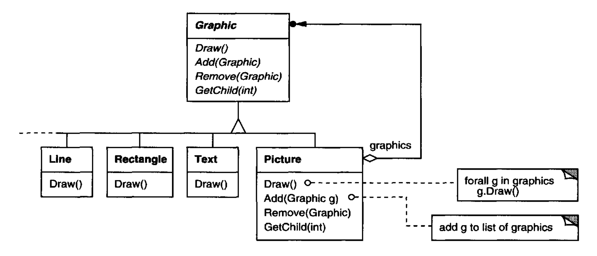
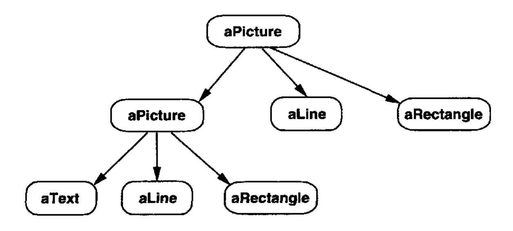
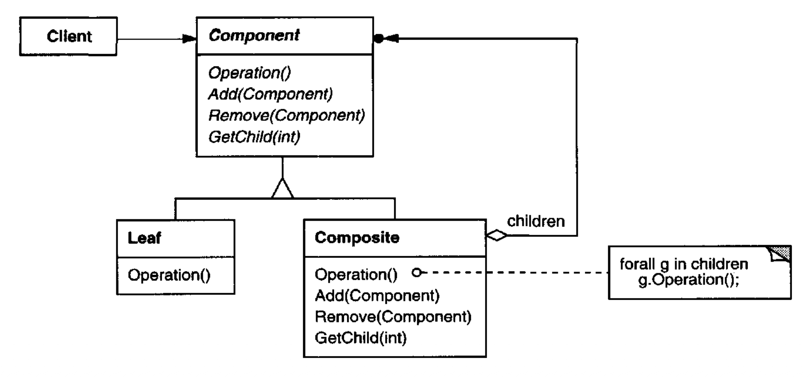
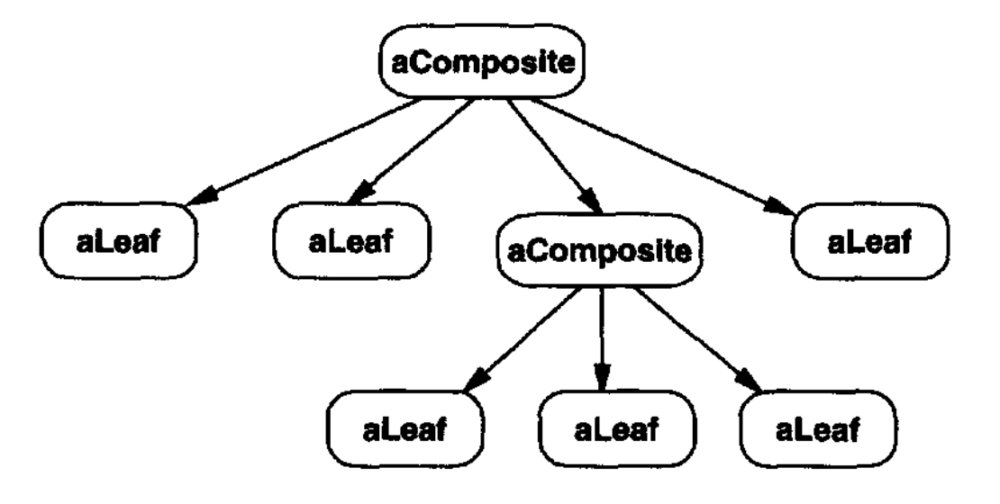

# Composite （对象结构型）

## 意图

将对象组合成树结构以表示部分-整体层次结构。Composite 让客户端统一对待单个对象和对象组合。

## 动机

像绘图编辑器和原理图捕获系统 (schematic capture systems) 这样的图形应用程序，让用户用简单组件构建复杂图表。
用户可以组合组件以形成更大的组件，而这些更大的组件又可以继续组合以形成更大的组件。
一种简单的实现可以为 `Text` 和 `Line` 等图形原语定义类，再加上充当这些原语容器的其他类。

但这种方法有一个问题：使用这些类的代码必须区别对待原语对象和容器对象，即使大多数时候用户对它们的对待是相同的。
不得不区分这些对象使应用程序更复杂。
Composite 模式描述如何使用递归组合，使客户端不必做这种区分。

<br/>

Composite 模式的关键是一个抽象类，它同时表示原语及其容器。
对于图形系统，这个类是 `Graphic`。
`Graphic` 声明像 `Draw` 这样特定于图形对象的操作。
它还声明所有复合对象共享的操作，例如用于访问和管理其子节点的操作。

子类 `Line`、`Rectangle` 和 `Text`（见前面的类图）定义原始图形对象。
这些类分别实现 `Draw` 来绘制线、矩形和文本。
由于原始图形没有子图形，这些子类都不实现与子节点相关的操作。

`Picture` 类定义一个 `Graphic` 对象的聚合。
`Picture` 实现 `Draw` 来调用其子节点的 `Draw`，并相应地实现与子节点相关的操作。
因为 `Picture` 接口符合 `Graphic` 接口，`Picture` 对象可以递归地组合其他 `Picture`。

下图显示了递归组合的 `Graphic` 对象的典型复合对象结构：

<br/>

## 适用性

在以下情况下使用 Composite 模式

- 你想表示对象的部分-整体层次结构。

- 你希望客户端能够忽略对象组合与单个对象之间的区别。客户端将统一对待复合结构中的所有对象。

## 结构

<br/>

一个典型的 Composite 对象结构可能看起来像这样：

<br/>

## 参与者

- **Component** （`Graphic`）
  - 声明组合中对象的接口。
  - 酌情为所有类共有的接口实现默认行为。
  - 声明用于访问和管理其子组件的接口。
  - （可选）定义用于访问递归结构中组件父节点的接口，并在合适时实现它。

- **Leaf** （`Rectangle`、`Line`、`Text` 等）
  - 表示组合中的叶子对象。叶子没有子节点。
  - 为组合中的原始对象定义行为。

- **Composite** （`Picture`）
  - 为有子节点的组件定义行为。
  - 存储子组件。
  - 实现 Component 接口中与子节点相关的操作。

- **Client**
  - 通过 Component 接口操作组合中的对象。

## 协作

- 客户端使用 Component 类接口与复合结构中的对象交互。
如果接收者是 Leaf，那么请求被直接处理。
如果接收者是 Composite，那么它通常把请求转发给其子组件，可能在转发之前和/或之后执行额外操作。

## 结果

Composite 模式

- 定义由原始对象和复合对象组成的类层次结构。
原始对象可以组合成更复杂的对象，这些更复杂的对象又可以继续组合，如此递归。
只要客户端代码期望一个原始对象，它也可以接受一个复合对象。

- 让客户端简单。
客户端可以统一对待复合结构和单个对象。
客户端通常不知道（也不应该关心）它们处理的是叶子还是复合组件。
这简化了客户端代码，因为它避免了必须编写在定义组合的类上进行标记和分支判断式操作的函数。

- 让添加新种类的组件更容易。
新定义的 Composite 或 Leaf 子类会自动与现有结构和客户端代码一起工作。
客户端不必为新 Component 类而改变。

- 可能让你的设计过于通用。
让添加新组件变得容易的缺点是，它让限制复合对象的组件变得更困难。
有时你希望一个复合对象只拥有某些组件。
使用 Composite 时，你不能依赖类型系统为你强制执行这些约束。
你将不得不改用运行时检查。

## 实现

实现 Composite 模式时需要考虑许多问题：

1. *显式父引用。*
维护从子组件到其父组件的引用可以简化复合结构的遍历和管理。
父引用简化了在结构中向上移动和删除组件。
父引用也有助于支持 [Chain of Responsibility (223)](../ch5/1.md) 模式。

   定义父引用的通常位置是在 Component 类中。
   Leaf 和 Composite 类可以继承该引用以及管理它的操作。

   有了父引用，必须维护这样一个不变量：一个复合对象的所有子节点都以该复合对象为父节点，而该复合对象又以这些子节点为其子节点。
   确保这一点的最简单方式是，只在组件被加入或移出复合对象时才改变其父节点。
   如果这能在 Composite 类的 `Add` 和 `Remove` 操作中实现一次，那么它就可以被所有子类继承，而不变量将自动得到维护。

2. *共享组件。*
共享组件通常很有用，例如为了减少存储需求。
但当一个组件最多只能有一个父节点时，共享组件就变得困难。

   一种可能的解决方案是让子节点存储多个父节点。
   但那会在请求沿结构向上传播时导致歧义。
   [Flyweight (195)](6.md) 模式展示了如何重新设计以避免存储父节点。
   它适用于子节点可以通过外部化其部分或全部状态来避免发送父请求的情况。

3. *最大化 Component 接口。*
Composite 模式的目标之一是让客户端不知道它们正在使用的是具体的 Leaf 还是 Composite 类。
为达到这个目标，Component 类应当为 Composite 和 Leaf 类定义尽可能多的公共操作。
Component 类通常为这些操作提供默认实现，而 Leaf 和 Composite 子类将重写它们。

   然而，这个目标有时会与类层次结构设计原则冲突，该原则说一个类只应定义对其子类有意义的操作。
   Component 支持的许多操作似乎对 Leaf 类没有意义。
   Component 如何为它们提供默认实现？

   有时一点创造力就能表明，一个似乎只对 Composite 有意义的操作，可以通过把它移到 Component 类来为所有 Component 实现。
   例如，访问子节点的接口是 Composite 类的基本部分，但不一定是 Leaf 类的。
   但如果我们把一个 Leaf 看作一个从没有子节点的 Component，那么我们可以在 Component 类中为子节点访问定义一个默认操作，它从不返回任何子节点。
   Leaf 类可以使用默认实现，但 Composite 类将重新实现它以返回其子节点。

   子节点管理操作更麻烦，将在下一项中讨论。

4. *声明子节点管理操作。*
尽管 Composite 类实现了用于管理子节点的 `Add` 和 `Remove` 操作，Composite 模式中的一个重要问题是哪些类在 Composite 类层次结构中声明这些操作。
我们应该在 Component 中声明这些操作并使它们对 Leaf 类有意义，还是应该只在 Composite 及其子类中声明和定义它们？

   这个决定涉及安全性与透明性之间的取舍：

   - 在类层次结构的根处定义子节点管理接口给你透明性，因为你可以统一对待所有组件。
   然而，它让你付出安全性的代价，因为客户端可能尝试做无意义的事情，比如向叶子添加或移除对象。

   - 在 Composite 类中定义子节点管理给你安全性，因为任何向叶子添加或移除对象的尝试都会在像 C++ 这样的静态类型语言中在编译时被捕获。
   但你失去透明性，因为叶子和复合对象有不同的接口。

   在这个模式中，我们强调透明性胜过安全性。
   如果你选择安全性，那么有时你可能会丢失类型信息，并且不得不把一个组件转换为复合对象。
   你如何在不求助于类型不安全转换的情况下做到这一点？

   一种方法是在 Component 类中声明一个操作 `Composite* GetComposite()`。
   Component 提供一个返回空指针的默认操作。
   Composite 类重定义这个操作，通过 `this` 指针返回自身：

   ```cpp
   class Composite;
   
   class Component {
   public:
       //. . .
       virtual Composite* GetComposite() { return 0; }
   };
      
   class Composite : public Component {
   public:
       void Add(Component*);
       // . . .
       virtual Composite* GetComposite() { return this; }
   };
   
   class Leaf : public Component {
       // . . .
   };
   ```

   `GetComposite` 让你查询一个组件，看看它是否是复合对象。
   你可以在它返回的复合对象上安全地执行 `Add` 和 `Remove`。

   ```cpp
   Composite* aComposite = new Composite;
   Leaf* aLeaf = new Leaf;

   Component * aComponent;
   Composite* test;

   aComponent = aComposite;
   if (test = aComponent->GetComposite()) {
       test->Add(new Leaf);
   }

   aComponent = aLeaf;

   if (test = aComponent->GetComposite()) {
       test->Add(new Leaf); // will not add leaf
   }
   ```

   对 Composite 的类似测试可以使用 C++ 的 `dynamic_cast` 构造来完成。

   当然，这里的问题是我们没有统一对待所有组件。
   在采取适当行动之前，我们不得不退回到测试不同类型。

   提供透明性的唯一方式是在 Component 中定义默认的 `Add` 和 `Remove` 操作。
   这产生了一个新问题：无法在不引入失败可能性的情况下实现 `Component::Add`。
   你可以让它什么都不做，但那忽略了一个重要考虑；也就是说，试图向叶子添加某物很可能表明存在缺陷。
   在这种情况下，`Add` 操作会产生垃圾结果。
   你可以让它删除其参数，但那可能不是客户端所期望的。

   通常，如果组件不允许有子节点，或者 `Remove` 的参数不是该组件的子节点，那么最好让 `Add` 和 `Remove` 默认失败（也许通过抛出异常）。

   另一种替代方案是稍微改变 “移除” 的含义。
   如果组件维护一个父引用，那么我们可以重定义 `Component::Remove`，让它把自己从父节点中移除。
   然而，对于相应的 `Add`，仍然没有一个有意义的解释。

5. *Component 是否应当实现一个 Component 列表？*
你可能会倾向于把子节点集合定义为 Component 类中的一个实例变量，因为子节点访问和管理操作是在那里声明的。
但把子节点指针放在基类中会给每个叶子带来空间开销，即使叶子从来没有子节点。
只有当结构中子节点相对较少时，这才值得。

6. *子节点排序。*
许多设计对 Composite 的子节点指定顺序。
在早先的 `Graphics` 例子中，顺序可能反映从前到后的排列。
如果 Composite 表示解析树，那么复合语句可以是 Composite 的实例，其子节点必须排序以反映程序。

   当子节点排序是一个问题时，你必须仔细设计子节点访问和管理接口来管理子节点序列。
   [Iterator (257)](../ch5/4.md) 模式可以在这方面指导你。

7. *缓存以提高性能。*
如果你需要频繁遍历或搜索组合，Composite 类可以缓存关于其子节点的遍历或搜索信息。
Composite 可以缓存实际结果，或者只缓存能让它短路遍历或搜索的信息。
例如，动机示例中的 `Picture` 类可以缓存其子节点的边界框。
在绘制或选择期间，这个缓存的边界框让 `Picture` 在当前窗口中子节点不可见时避免绘制或搜索。

   对组件的更改将需要使其父节点的缓存失效。
   当组件知道自己的父节点时，这效果最好。
   所以如果你使用缓存，你需要定义一个接口来告诉复合对象它们的缓存已失效。

8. *谁应当删除组件？*
在没有垃圾回收的语言中，通常最好让 Composite 在销毁时负责删除其子节点。
这条规则的一个例外是当 Leaf 对象不可变因而可以被共享时。

9. *存储组件的最佳数据结构是什么？*
Composite 可以使用各种数据结构来存储其子节点，包括链表、树、数组和哈希表。
数据结构的选择（一如既往）取决于效率。
事实上，甚至根本不必使用通用数据结构。
有时复合对象为每个子节点都有一个变量，尽管这要求每个 Composite 子类实现自己的管理接口。
例子参见 [Interpreter (243)](../ch5/3.md)。

## 示例代码

像计算机和立体声组件这样的设备常常被组织成部分-整体或包含层次结构。
例如，机箱可以包含驱动器和主板，总线可以包含卡，机柜可以包含机箱、总线等。
这类结构可以用 Composite 模式自然地建模。

`Equipment` 类为部分-整体层次结构中的所有设备定义一个接口。

```cpp
class Equipment {
public:
    virtual ~Equipment();

    const char* Name() { return _name; }

    virtual Watt Power();
    virtual Currency NetPrice();
    virtual Currency DiscountPrice();

    virtual void Add(Equipment*);
    virtual void Remove(Equipment*);
    virtual Iterator<Equipment*>* CreateIterator();
protected:
    Equipment(const char*);
private:
    const char* _name;
};
```

`Equipment` 声明返回一件设备属性的操作，比如它的功耗和成本。
子类为特定种类的设备实现这些操作。
`Equipment` 还声明一个 `CreateIterator` 操作，它返回一个 [Iterator (257)](../ch5/4.md)（参见附录 C），用于访问它的各个部分。
这个操作的默认实现返回一个 `NullIterator`，它在空集上迭代。

`Equipment` 的子类可能包括表示磁盘驱动器、集成电路和开关的 Leaf 类：

```cpp
class FloppyDisk : public Equipment {
public:
    FloppyDisk(const char*);
    virtual ~FloppyDisk();

    virtual Watt Power();
    virtual Currency NetPrice();
    virtual Currency DiscountPrice();
};
```

`CompositeEquipment` 是包含其他设备的设备的基类。它也是 `Equipment` 的子类。

```cpp
class CompositeEquipment : public Equipment {
public:
    virtual ~CompositeEquipment();

    virtual Watt Power();
    virtual Currency NetPrice();
    virtual Currency DiscountPrice();

    virtual void Add(Equipment*);
    virtual void Remove(Equipment*);
    virtual Iterator<Equipment*>* CreateIterator();

protected:
    CompositeEquipment(const char*);
private:
    List<Equipment*> _equipment;
};
```

`CompositeEquipment` 定义用于访问和管理子设备的操作。
`Add` 和 `Remove` 操作从存储在 `_equipment` 成员中的设备列表里插入和删除设备。
`CreateIterator` 操作返回一个迭代器（具体来说，是一个 `ListIterator` 实例），它将遍历这个列表。

`NetPrice` 的一个默认实现可能使用 `CreateIterator` 来对子设备的净价求和²：

```cpp
Currency CompositeEquipment::NetPrice () {
    Iterator<Equipment*>* i = CreateIterator();
    Currency total = 0;

    for (i->First(); !i->IsDone(); i->Next()) {
        total += i->CurrentItem()->NetPrice();
    }
    delete i;
    return total;
}
```

² 一旦用完迭代器，很容易忘记删除它。Iterator 模式在第 [266](../ch5/4.md) 页展示了如何防范这类缺陷。

现在我们可以把计算机机箱表示为 `CompositeEquipment` 的一个名为 `Chassis` 的子类。
`Chassis` 从 `CompositeEquipment` 继承与子节点相关的操作。

```cpp
class Chassis : public CompositeEquipment {
public:
    Chassis(const char*);
    virtual ~Chassis();

    virtual Watt Power();
    virtual Currency NetPrice();
    virtual Currency DiscountPrice();
};
```

我们可以用类似方式定义其他设备容器，比如 `Cabinet` 和 `Bus`。
这样我们就有了把设备组装成一台（相当简单的）个人计算机所需的一切：

```cpp
Cabinet* cabinet = new Cabinet("PC Cabinet");
Chassis* chassis = new Chassis("PC Chassis");

cabinet->Add(chassis);

Bus* bus = new Bus("MCA Bus");
bus->Add(new Card("16Mbs Token Ring"));

chassis->Add(bus);
chassis->Add(new FloppyDisk("3.5in Floppy"));

cout << "The net price is " << chassis->NetPrice() << endl;
```

## 已知应用

Composite 模式的例子几乎可以在所有面向对象系统中找到。
Smalltalk Model/View/Controller [KP88](../biblio.md#kp88) 最初的 `View` 类就是一个 Composite，而且几乎每个用户界面工具包或框架都沿袭了它的做法，包括 ET++（及其 `VObject` [WGM88](../biblio.md#wgm88) ）和 InterViews（`Style` [LCI+92](../biblio.md#lci92)、`Graphic` [VL88](../biblio.md#vl88) 和 `Glyph` [CL90](../biblio.md#cl90) ）。
有趣的是，Model/View/Controller 最初的 `View` 有一组子视图；换句话说，`View` 既是 Component 类又是 Composite 类。
Smalltalk-80 的 4.0 版本修订了 Model/View/Controller，加入了一个 `VisualComponent` 类，它有子类 `View` 和 `CompositeView`。

RTL Smalltalk 编译器框架 [JML92](../biblio.md#jml92) 广泛使用 Composite 模式。
`RTLExpression` 是用于解析树的 Component 类。
它有子类，例如 `BinaryExpression`，其中包含子 `RTLExpression` 对象。
这些类为解析树定义了一个复合结构。
`RegisterTransfer` 是用于表示采用中间单静态赋值（SSA）形式的程序的 Component 类。
`RegisterTransfer` 的 Leaf 子类定义不同的静态赋值，例如

- 对两个寄存器执行操作并把结果赋给第三个寄存器的原始赋值；

- 一个有源寄存器但没有目标寄存器的赋值，表示该寄存器在例程返回后被使用；以及

- 一个有目标寄存器但没有源寄存器的赋值，表示该寄存器在例程开始前被赋值。

另一个子类 `RegisterTransferSet` 是一个 Composite 类，用于表示一次改变多个寄存器的赋值。

这种模式的另一个例子出现在金融领域，其中一个投资组合聚合单个资产。
你可以通过把投资组合实现为符合单个资产接口的 Composite，来支持复杂的资产聚合 [BE93](../biblio.md#be93)。

[Command (233)](../ch5/2.md) 模式描述如何用一个 `MacroCommand` Composite 类来组合和排序 Command 对象。

## 相关模式

父子链接常常用于 [Chain of Responsibility (223)](../ch5/1.md)。

[Decorator (175)](4.md) 常常与 Composite 一起使用。当装饰器和复合对象一起使用时，它们通常会有一个公共父类。所以装饰器将不得不支持 Component 接口中的操作，如 `Add`、`Remove` 和 `GetChild`。

[Flyweight (195)](6.md) 让你共享组件，但它们不再能引用其父节点。

[Iterator (257)](../ch5/4.md) 可以用于遍历复合对象。

[Visitor (331)](../ch5/11.md) 把否则会分散在 Composite 和 Leaf 类中的操作和行为局部化。
