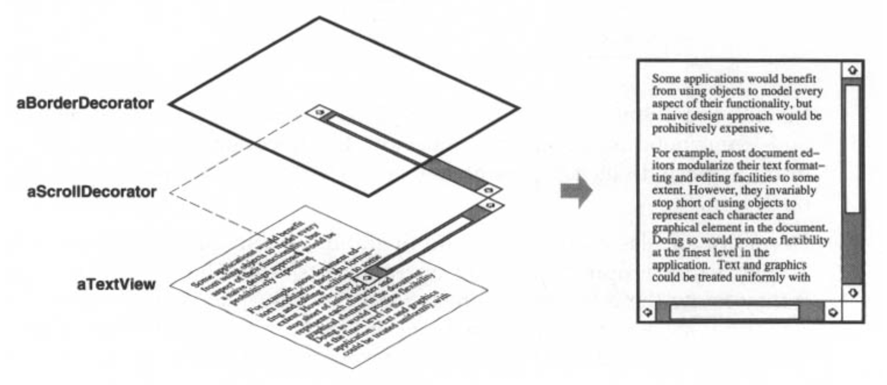
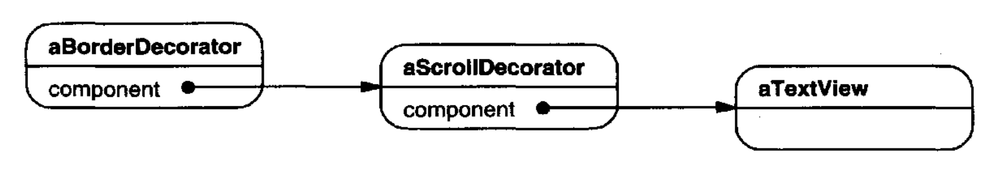
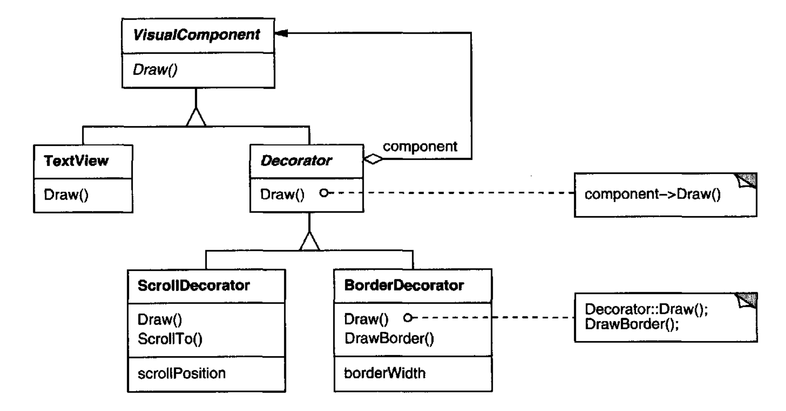
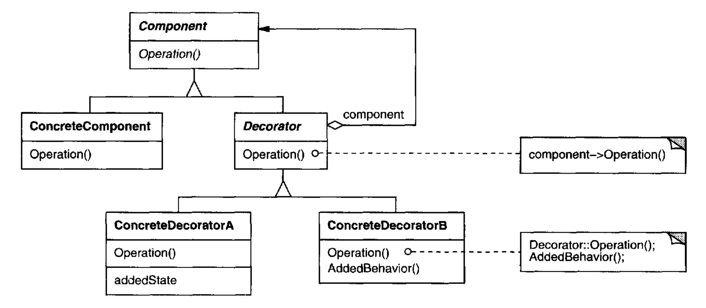
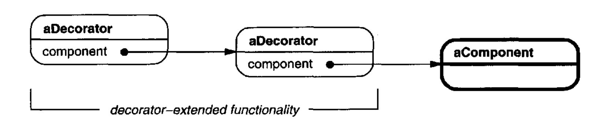
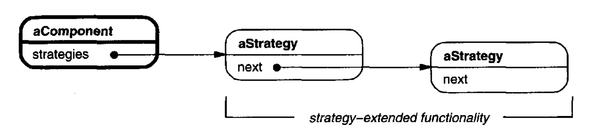
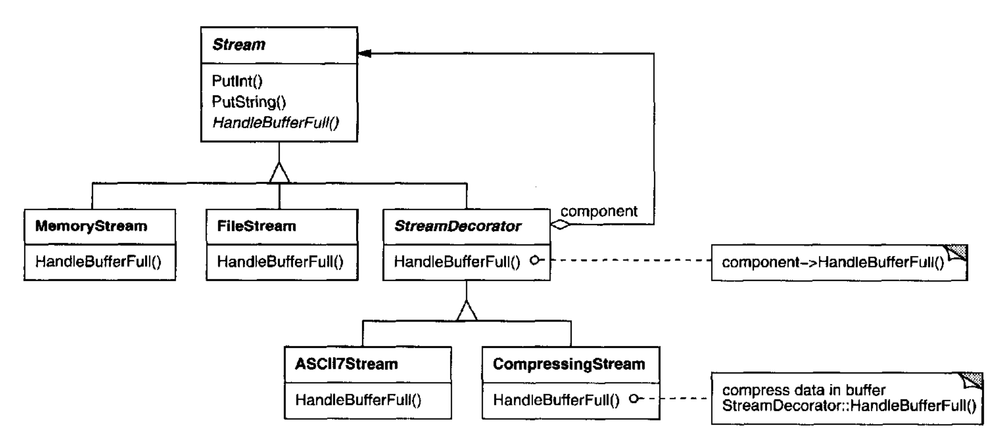

# Decorator （结构型对象模式）

## 意图

动态地给一个对象附加额外职责。Decorator 为扩展功能提供了一种比子类化更灵活的替代方案。

## 别名

Wrapper

## 动机

有时我们想给单个对象而不是整个类添加职责。
例如，一个图形用户界面工具包应当让你能够给任何用户界面组件添加像边框这样的属性或像滚动这样的行为。

添加职责的一种方式是继承。
从另一个类继承一个边框会给每个子类实例都加上边框。
然而，这不够灵活，因为边框的选择是静态做出的。
客户端无法控制如何以及何时用边框装饰组件。

一种更灵活的方法是把组件封装在另一个用于添加边框的对象中。
这个封装对象被称为 **装饰器 (decorator)** 。
装饰器符合它所装饰组件的接口，因此它的存在对组件的客户端是透明的。
装饰器把请求转发给组件，并可以在转发之前或之后执行额外动作（例如绘制边框）。
透明性让你可以递归地嵌套装饰器，从而允许无限数量的附加职责。

<br/>

例如，假设我们有一个在窗口中显示文本的 `TextView` 对象。
`TextView` 默认没有滚动条，因为我们可能并不总是需要它们。
当我们需要时，可以使用一个 `ScrollDecorator` 来添加它们。
假设我们还想要在 `TextView` 周围添加一个粗黑边框。
我们也可以使用一个 `BorderDecorator` 来添加它。
我们只需把装饰器与 `TextView` 组合起来，以产生所需的结果。

下面的对象图显示了如何把一个 `TextView` 对象与 `BorderDecorator` 和 `ScrollDecorator` 对象组合起来，以产生一个有边框、可滚动的文本视图：

<br/>

`ScrollDecorator` 和 `BorderDecorator` 类是 `Decorator` 的子类，`Decorator` 是用于装饰其他可视组件的抽象类。

<br/>

`VisualComponent` 是可视对象的抽象类。
它定义它们的绘制和事件处理接口。
注意 `Decorator` 类如何简单地把绘制请求转发给它的组件，以及 `Decorator` 子类如何扩展这个操作。

`Decorator` 子类可以自由地为特定功能添加操作。
例如，`ScrollDecorator` 的 `ScrollTo` 操作让其他对象可以滚动界面，前提是它们知道界面中恰好有一个 `ScrollDecorator` 对象。
这个模式的重要方面是，它让装饰器可以出现在任何 `VisualComponent` 可以出现的地方。
这样客户端通常无法区分被装饰的组件和未被装饰的组件，因此它们完全不依赖装饰。

## 适用性

使用 Decorator

- 动态且透明地给单个对象添加职责，也就是说，不影响其他对象。

- 用于可以被撤销的职责。

- 当通过子类化进行扩展不切实际时。
有时可能有大量独立的扩展，并且会产生子类爆炸以支持每一种组合。
或者类定义可能被隐藏，或以其他方式无法用于子类化。

## 结构

<br/>

## 参与者

- **Component** （`VisualComponent`）
  - 定义可以动态地给其添加职责的对象的接口。

- **ConcreteComponent** （`TextView`）
  - 定义可以附加额外职责的对象。

- **Decorator**
  - 维护对 Component 对象的引用，并定义符合 Component 接口的接口。

- **ConcreteDecorator** （`BorderDecorator`、`ScrollDecorator`）
  - 给组件添加职责。

## 协作

- Decorator 把请求转发给它的 Component 对象。它可以选择性地在转发请求之前和之后执行额外操作。

## 效果

Decorator 模式至少有两个关键好处和两个缺点：

1. *比静态继承更灵活。*
Decorator 模式提供了一种比静态（多重）继承更灵活的方式，来给对象添加职责。
有了装饰器，职责可以在运行时通过简单地附加和分离来添加和移除。
相比之下，继承要求为每个附加职责创建一个新类（例如 `BorderedScrollableTextView`、`BorderedTextView`）。
这会产生许多类并增加系统的复杂性。
此外，为特定 Component 类提供不同的 Decorator 类，让你可以混合和匹配职责。

   装饰器还让添加一个属性两次变得容易。
   例如，要给 `TextView` 一个双边框，只需附加两个 `BorderDecorator`。
   从 `Border` 类继承两次往好了说也容易出错。

2. *避免层次结构高层的功能繁重类。*
Decorator 提供了一种按需付费的添加职责方式。
你可以定义一个简单的类，并用 Decorator 对象增量地添加功能。
功能可以由简单的部件组合而成。
因此，应用程序不必为它不使用的功能付出代价。
定义新种类的 Decorator 也很容易，可以独立于它们所扩展的对象类，甚至用于无法预见的扩展。
扩展一个复杂的类往往会暴露与你正在添加的职责无关的细节。

3. *装饰器与其组件不相同。*
装饰器充当透明的外壳。
但从对象标识的角度看，被装饰的组件与组件本身并不相同。
因此，当你使用装饰器时，不应依赖对象标识。

4. *大量小对象。*
使用 Decorator 的设计常常导致系统由大量看起来相似的小对象组成。
这些对象只在它们如何互连的方式上不同，而不在它们的类或变量的值上不同。
尽管这些系统对于理解它们的人来说容易定制，但它们可能难以学习和调试。

## 实现

应用 Decorator 模式时应考虑几个问题：

1. *接口一致性。*
装饰器对象的接口必须符合它所装饰组件的接口。
因此 ConcreteDecorator 类必须继承自一个公共类（至少在 C++ 中）。

2. *省略抽象 Decorator 类。*
当你只需要添加一个职责时，没有必要定义抽象 Decorator 类。
当你处理现有类层次结构而不是设计新层次结构时，情况通常如此。
在这种情况下，你可以把 Decorator 转发请求给组件的职责合并到 ConcreteDecorator 中。

3. *保持 Component 类轻量。*
为确保接口一致，组件和装饰器必须继承自一个公共 Component 类。
保持这个公共类轻量很重要；也就是说，它应当专注于定义接口，而不是存储数据。
数据表示的定义应当推迟到子类；否则 Component 类的复杂性可能使装饰器过于重量级，无法大量使用。
把大量功能放入 Component 也增加了具体子类为它们不需要的功能付出代价的可能性。

4. *改变对象的外皮与改变其内核 (guts)。*
我们可以把装饰器看作对象上改变其行为的外皮。
另一种选择是改变对象的内核。
[Strategy (315)](../ch5/9.md) 模式是改变内核的一个很好的模式例子。

   在 Component 类本质上是重量级、从而使 Decorator 模式应用成本过高的情况下，Strategy 是更好的选择。
在 Strategy 模式中，组件把它的某些行为转发给一个单独的 strategy 对象。
Strategy 模式让我们可以通过替换 strategy 对象来改变或扩展组件的功能。

   例如，我们可以通过让组件把边框绘制推迟给一个单独的 `Border` 对象来支持不同的边框样式。
`Border` 对象是一个 Strategy 对象，封装了一种边框绘制策略。
通过把策略数量从一个扩展到开放式列表，我们达到与递归嵌套装饰器相同的效果。

   例如，在 MacApp 3.0 [App89](../biblio.md#app89) 和 Bedrock [Sym93a](../biblio.md#sym93a) 中，图形组件（称为 “views”）维护一个 “adorner” 对象列表，这些对象可以把像边框这样的额外装饰附加到视图组件上。
如果一个视图附加了任何 adorner，那么它就给这些 adorner 一个绘制额外装饰的机会。
MacApp 和 Bedrock 必须使用这种方法，因为 `View` 类是重量级的。
仅为了添加一个边框而使用一个完整的 `View` 太昂贵了。

   由于 Decorator 模式只从外部改变组件，组件不必知道任何关于其装饰器的事情；也就是说，装饰器对组件是透明的：

   <br/>

   使用策略时，组件本身知道可能的扩展。因此它必须引用并维护相应的策略：

   <br/>

   基于 Strategy 的方法可能需要修改组件以适应新的扩展。
   另一方面，策略可以有自己的专门接口，而装饰器的接口必须符合组件的接口。
   例如，用于渲染边框的策略只需定义用于渲染边框的接口（`DrawBorder`、`GetWidth` 等），这意味着即使 Component 类是重量级的，策略也可以是轻量级的。

   MacApp 和 Bedrock 不仅把这种方法用于装饰视图。
   它们还用它来增强对象的事件处理行为。
   在这两个系统中，视图维护一个 “行为” 对象列表，这些对象可以修改和拦截事件。
   视图给每个已注册的行为对象一个在任何其他行为对象之前处理事件的机会，实际上覆盖它们。
   例如，你可以通过注册一个拦截并处理按键事件的行为对象，来装饰一个视图，使其支持特殊的键盘处理。

## 示例代码

以下代码展示了如何在 C++ 中实现用户界面装饰器。
我们假设有一个名为 `VisualComponent` 的 Component 类。

```cpp
class VisualComponent {
public:
    VisualComponent();

    virtual void Draw();
    virtual void Resize();
    // . . .
};
```

我们定义 `VisualComponent` 的一个子类，称为 `Decorator`，我们将对它进行子类化以获得不同的装饰。

```cpp
class Decorator : public VisualComponent {
public:
    Decorator(VisualComponent*);

    virtual void Draw();
    virtual void Resize();
    // . . .
private:
    VisualComponent* _component;
};
```

`Decorator` 装饰由 `_component` 实例变量引用的 `VisualComponent`，该变量在构造函数中初始化。
对于 `VisualComponent` 接口中的每个操作，`Decorator` 定义一个默认实现，把请求传递给 `_component`：

```cpp
void Decorator::Draw () {
    _component->Draw();
}

void Decorator::Resize () {
    _component->Resize();
}
```

`Decorator` 的子类定义特定的装饰。
例如，类 `BorderDecorator` 给它的封闭组件添加一个边框。
`BorderDecorator` 是 `Decorator` 的子类，它重写 `Draw` 操作来绘制边框。
`BorderDecorator` 还定义一个私有的 `DrawBorder` 辅助操作来完成绘制。
该子类从 `Decorator` 继承所有其他操作实现。

```cpp
class BorderDecorator : public Decorator {
public:
    BorderDecorator(VisualComponent*, int borderWidth);

    virtual void Draw();
private:
    void DrawBorder(int);
private:
    int _width;
};

void BorderDecorator::Draw () {
    Decorator::Draw();
    DrawBorder(_width);
}
```

`ScrollDecorator` 和 `DropShadowDecorator` 会遵循类似的实现，它们会给可视组件添加滚动和投影能力。

现在我们可以组合这些类的实例来提供不同的装饰。
以下代码说明了我们如何使用装饰器创建一个有边框、可滚动的 `TextView`。

首先，我们需要一种把可视组件放入窗口对象的方法。
我们假设我们的 `Window` 类为此提供了一个 `SetContents` 操作：

```cpp
void Window::SetContents (VisualComponent* contents) {
    // . . .
}
```

现在我们可以创建文本视图和一个用来放置它的窗口：

```cpp
Window* window = new Window;
TextView* textView = new TextView;
```

`TextView` 是一个 `VisualComponent`，这让我们可以把它放入窗口：

```cpp
window->SetContents(textView);
```

但我们想要一个有边框且可滚动的 `TextView`。
所以我们在把它放入窗口之前相应地装饰它。

```cpp
window->SetContents(
    new BorderDecorator(
        new ScrollDecorator(textView), 1
    )
);
```

因为 `Window` 通过 `VisualComponent` 接口访问其内容，它不知道装饰器的存在。
作为客户端，如果你必须直接与文本视图交互，例如当你需要调用不属于 `VisualComponent` 接口的操作时，你仍然可以跟踪它。
依赖组件标识的客户端也应当直接引用它。

## 已知应用

许多面向对象用户界面工具包使用装饰器来给部件添加图形修饰。
例子包括 InterViews [LVC89](../biblio.md#lvc89), [LCI+92](../biblio.md#lci92)、ET++ [WGM88](../biblio.md#wgm88) 和 ObjectWorks\Smalltalk 类库 [Par90](../biblio.md#par90)。
Decorator 更奇特的用途包括 InterViews 的 `DebuggingGlyph` 和 ParcPlace Smalltalk 的 `PassivityWrapper`。
`DebuggingGlyph` 在把布局请求转发给其组件之前和之后打印调试信息。
这些跟踪信息可用于分析和调试复杂组合中对象的布局行为。
`PassivityWrapper` 可以启用或禁用与组件的用户交互。

但 Decorator 模式绝不限于图形用户界面，下面的例子（基于 ET++ 流类 [WGM88](../biblio.md#wgm88) ）说明了这一点。

流是大多数 I/O 设施中的一个基本抽象。
流可以提供一个接口，用于把对象转换为字节或字符序列。
这让我们可以把一个对象转录到文件或内存中的字符串，以便以后取回。
一种直接的方式是定义一个抽象 `Stream` 类，其子类为 `MemoryStream` 和 `FileStream`。
但假设我们还希望能够做以下事情：

- 使用不同的压缩算法（run-length 编码、Lempel-Ziv 等）压缩流数据。

- 把流数据缩减为 7 位 ASCII 字符，以便它可以通过 ASCII 通信信道传输。

Decorator 模式给我们一种优雅的方式来给流添加这些职责。下图显示了该问题的一种解决方案：

<br/>

`Stream` 抽象类维护一个内部缓冲区，并提供用于把数据存储到流上的操作（`PutInt`、`PutString`）。
每当缓冲区满时，`Stream` 就调用抽象操作 `HandleBufferFull`，由它执行实际的数据传输。
`FileStream` 版本重写该操作，以把缓冲区传输到文件。

这里的关键类是 `StreamDecorator`，它维护对组件流的引用并把请求转发给它。
`StreamDecorator` 子类重写 `HandleBufferFull`，并在调用 `StreamDecorator` 的 `HandleBufferFull` 操作之前执行额外动作。

例如，`CompressingStream` 子类压缩数据，而 `ASCII7Stream` 把数据转换为 7 位 ASCII。
现在，要创建一个压缩其数据并把压缩后的二进制数据转换为 7 位 ASCII 的 `FileStream`，我们用一个 `CompressingStream` 和一个 `ASCII7Stream` 来装饰一个 `FileStream`：

```cpp
Stream* aStream = new CompressingStream(
    new ASCII7Stream(
        new FileStream("aFileName")
    )
) ;
aStream->PutInt(12);
aStream->PutString("aString");
```

## 相关模式

[Adapter (139)](1.md)：装饰器与适配器不同，因为装饰器只改变对象的职责，不改变其接口；
适配器会给对象一个全新的接口。

[Composite (163)](3.md)：装饰器可以被看作只有一个组件的退化组合。
然而，装饰器添加额外职责 —— 它不用于对象聚合。

[Strategy (315)](../ch5/9.md)：装饰器让你改变对象的外皮；策略让你改变内核。这是改变对象的两种替代方式。
