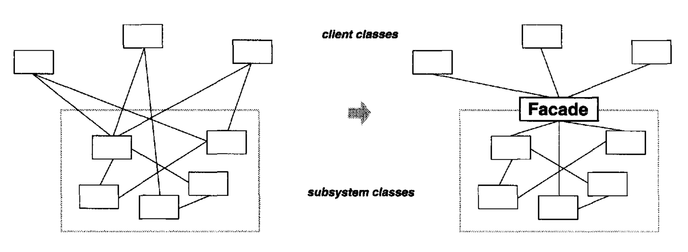
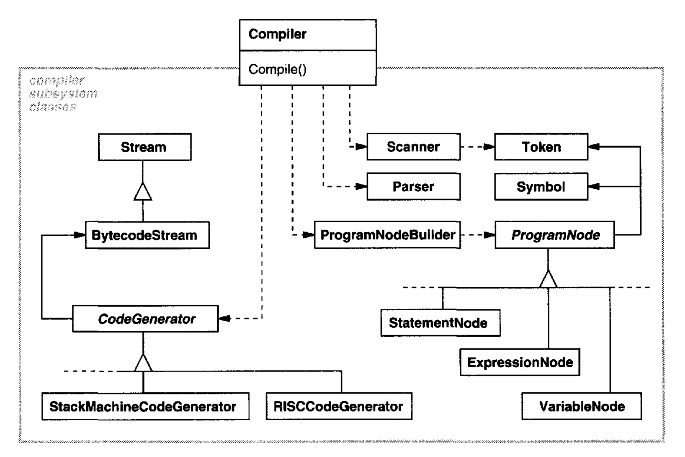
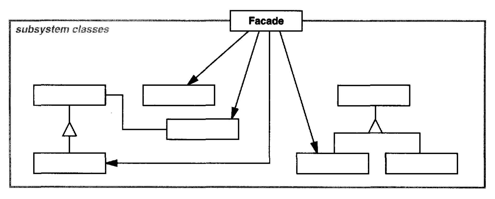
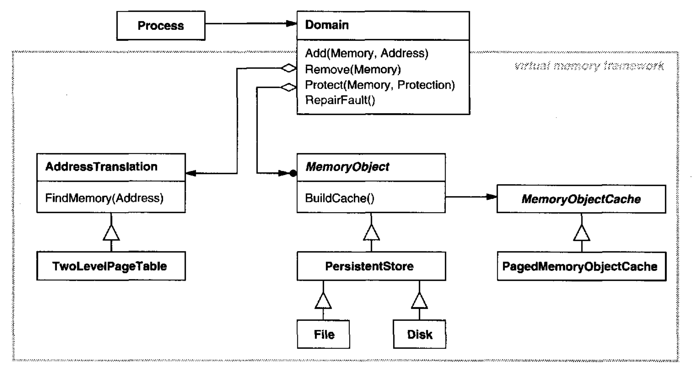

# Facade （对象结构型）

## 意图

为子系统中的一组接口提供一个统一接口。Facade 定义了一个更高层接口，使子系统更容易使用。

## 动机

把系统结构化为子系统有助于降低复杂性。
一个常见的设计目标是最小化子系统之间的通信和依赖。
实现这个目标的一种方式是引入一个 **Facade** 对象，它为子系统的更一般设施提供单个简化接口。

<br/>

例如，考虑一个让应用程序访问其编译器子系统的编程环境。
这个子系统包含实现编译器的类，如 `Scanner`、`Parser`、`ProgramNode`、`BytecodeStream` 和 `ProgramNodeBuilder`。
一些专门应用程序可能需要直接访问这些类。
但编译器的大多数客户端通常不关心解析和代码生成之类的细节；它们只是想编译一些代码。
对它们来说，编译器子系统中强大但低层的接口只会使它们的任务复杂化。

为了提供一个可以屏蔽这些类的高层接口，编译器子系统还包括一个 `Compiler` 类。
这个类为编译器的功能定义一个统一接口。
`Compiler` 类充当 Facade ：它向客户端提供编译器子系统的单个简单接口。
它把实现编译器功能的类粘合在一起，而不完全隐藏它们。
编译器 Facade 让大多数程序员的生活更轻松，同时不向少数需要低层功能的人隐藏这些功能。

<br/>

## 适用性

在以下情况下使用 Facade 模式

- 你想为一个复杂子系统提供一个简单接口。
子系统随着演化往往会变得更复杂。
大多数模式在应用时会产生更多更小的类。
这使子系统更可复用、更容易定制，但也让不需要定制它的客户端更难使用。
Facade 可以为子系统提供一个简单的默认视图，对大多数客户端来说足够好。
只有需要更多可定制性的客户端才需要越过 Facade 去看。

- 客户端与一个抽象的实现类之间存在许多依赖。
引入 Facade 以将子系统与客户端及其他子系统解耦，从而促进子系统的独立性和可移植性。

- 你想分层你的子系统。
使用 Facade 为每个子系统层级定义一个入口点。
如果子系统相互依赖，那么你可以通过让它们仅经由各自的 Facade 相互通信，来简化它们之间的依赖。

## 结构

<br/>

## 参与者

- **Facade** （`Compiler`）
  - 知道哪些子系统类负责处理一个请求。

  - 把客户端请求委托给适当的子系统对象。

- **subsystem classes** （`Scanner`、`Parser`、`ProgramNode` 等）
  - 实现子系统功能。

  - 处理由 Facade 对象分配的工作。

  - 不知道 Facade；也就是说，它们不保留对它的引用。

## 协作

- 客户端通过向 Facade 发送请求来与子系统通信，Facade 把这些请求转发给适当的子系统对象。
尽管子系统对象执行实际工作，Facade 可能不得不做自己的工作，把它的接口转换为子系统接口。

- 使用 Facade 的客户端不必直接访问其子系统对象。

## 结果

Facade 模式提供以下好处：

1. 它屏蔽客户端与子系统组件，从而减少客户端处理的对象数量，并使子系统更容易使用。

2. 它促进子系统与其客户端之间的弱耦合。
子系统中的组件常常是强耦合的。
弱耦合让你可以改变子系统的组件而不影响其客户端。
Facade 有助于对系统以及对象之间的依赖进行分层。
它们可以消除复杂或循环的依赖。
当客户端和子系统独立实现时，这可能是一个重要结果。

   减少编译依赖在大型软件系统中至关重要。
   你希望通过在子系统类变化时最小化重新编译来节省时间。
   用 Facade 减少编译依赖可以限制一个重要子系统中的小改动所需的重新编译。
   Facade 还可以简化把系统移植到其他平台，因为构建一个子系统不太可能需要构建所有其他子系统。

3. 如果应用程序需要使用子系统类，它并不阻止它们这样做。因此你可以在易用性和通用性之间选择。

## 实现

在实现 Facade 时考虑以下问题：

1. *减少客户端-子系统耦合。*
通过把 Facade 做成抽象类，并为子系统的不同实现提供具体子类，可以进一步减少客户端与子系统之间的耦合。
然后客户端可以通过抽象 Facade 类的接口与子系统通信。
这种抽象耦合使客户端不必知道使用的是子系统的哪种实现。

   子类化的一种替代方式是用不同的子系统对象配置一个 Facade 对象。要定制 Facade，只需替换它的一个或多个子系统对象。

2. *公共子系统类与私有子系统类。*
子系统类似于类，因为两者都有接口，也都封装了某些东西 —— 类封装状态和操作，而子系统封装类。
正如思考一个类的公共接口和私有接口是有用的，我们也可以思考一个子系统的公共接口和私有接口。

   子系统的公共接口由所有客户端都可以访问的类组成；私有接口仅供子系统扩展者使用。
   Facade 类当然是公共接口的一部分，但它不是唯一的部分。
   其他子系统类通常也是公共的。
   例如，编译器子系统中的类 `Parser` 和 `Scanner` 就是公共接口的一部分。

   把子系统类设为私有会很有用，但很少有面向对象语言支持它。
   C++ 和 Smalltalk 传统上都有一个全局的类命名空间。
   然而，最近 C++ 标准化委员会为语言添加了命名空间 [Str94](../biblio.md#str94)，这将让你只暴露公共子系统类。

## 示例代码

让我们更仔细地看看如何为一个编译器子系统放置 Facade。

编译器子系统定义了一个 `BytecodeStream` 类，它实现 `Bytecode` 对象的流。
一个 `Bytecode` 对象封装一个字节码，字节码可以指定机器指令。
该子系统还定义了一个 `Token` 类，用于封装编程语言中 token 的对象。

`Scanner` 类接收字符流并产生 token 流，一次一个 token。

```cpp
class Scanner {
public:
    Scanner(istream&);
    virtual ~Scanner();

    virtual Token& Scan();
private:
    istream& _inputStream;
};
```

`Parser` 类使用一个 `ProgramNodeBuilder` 从 `Scanner` 的 token 构造解析树。

```cpp
class Parser {
public:
    Parser();
    virtual ~Parser();

    virtual void Parse(Scanner&, ProgramNodeBuilder&);
};
```

`Parser` 回调 `ProgramNodeBuilder` 来增量地构建解析树。这些类按照 [Builder (97)](../ch3/2.md) 模式交互。

```cpp
class ProgramNodeBuilder {
public:
    ProgramNodeBuilder();

    virtual ProgramNode* NewVariable(
        const char* variableName
    ) const;

    virtual ProgramNode* NewAssignment(
        ProgramNode* variable, ProgramNode* expression
    ) const;

    virtual ProgramNode* NewReturnStatement(
        ProgramNode* value
    ) const;

    virtual ProgramNode* NewCondition(
        ProgramNode* condition,
        ProgramNode* truePart, ProgramNode* falsePart
    ) const;
    // . . .
    ProgramNode* GetRootNode();
private:
    ProgramNode* _node;
};
```

解析树由 `ProgramNode` 子类的实例组成，例如 `StatementNode`、`ExpressionNode` 等。
`ProgramNode` 层次结构是 [Composite (163)](3.md) 模式的一个例子。
`ProgramNode` 定义一个接口，用于操作程序节点及其子节点（如果有的话）。

```cpp
class ProgramNode {
public:
    // program node manipulation
    virtual void GetSourcePosition(int& line, int& index);
    // . . .

    // child manipulation
    virtual void Add(ProgramNode*);
    virtual void Remove(ProgramNode*);
    // . . .

    virtual void Traverse(CodeGenerator&);
protected:
    ProgramNode();
};
```

`Traverse` 操作接受一个 `CodeGenerator` 对象。
`ProgramNode` 子类使用这个对象，在 `BytecodeStream` 上以 `Bytecode` 对象的形式生成机器代码。
类 `CodeGenerator` 是一个访问者（参见 [Visitor (331)](../ch5/11.md) ）。

```cpp
class CodeGenerator {
public:
    virtual void Visit(StatementNode*);
    virtual void Visit(ExpressionNode*);
    // . . .
protected:
    CodeGenerator(BytecodeStream&);
protected:
    BytecodeStream& _output;
};
```

`CodeGenerator` 有子类，例如 `StackMachineCodeGenerator` 和 `RISCCodeGenerator`，它们为不同的硬件架构生成机器代码。

`ProgramNode` 的每个子类都实现 `Traverse`，以在其子 `ProgramNode` 对象上调用 `Traverse`。
反过来，每个子节点对其子节点也做同样的事，如此递归。
例如，`ExpressionNode` 如下定义 `Traverse`：

```cpp
void ExpressionNode::Traverse (CodeGenerator& cg) {
    cg.Visit(this);

    ListIterator<ProgramNode*> i(_children);

    for (i.First(); !i.IsDone(); i.Next()) {
        i.CurrentItem()->Traverse(cg);
    }
}
```

到目前为止我们讨论的类组成了编译器子系统。
现在我们将引入一个 `Compiler` 类，一个把所有这些部分组合在一起的 Facade。
`Compiler` 为编译源代码并为特定机器生成代码提供一个简单接口。

```cpp
class Compiler {
public:
    Compiler();

    virtual void Compile(istream&, BytecodeStream&);
};

void Compiler::Compile (
    istream& input, BytecodeStream& output
) {
    Scanner scanner(input);
    ProgramNodeBuilder builder;
    Parser parser;

    parser.Parse(scanner, builder);

    RISCCodeGenerator generator(output);
    ProgramNode* parseTree = builder.GetRootNode();
    parseTree->Traverse(generator);
}
```

这个实现硬编码了要使用的代码生成器类型，这样程序员就不需要指定目标架构。
如果永远只有一个目标架构，那可能是合理的。
如果不是这样，那么我们可能希望把 `Compiler` 构造函数改为接受一个 `CodeGenerator` 参数。
然后程序员可以在实例化 `Compiler` 时指定要使用的生成器。

编译器 Facade 还可以参数化其他参与者，
例如 `Scanner` 和 `ProgramNodeBuilder`，这增加了灵活性，但也削弱了 Facade 模式的使命，即为常见情况简化接口。

## 已知应用

示例代码部分中的编译器例子受到 ObjectWorks\Smalltalk 编译器系统 [Par90](../biblio.md#par90) 的启发。

在 ET++ 应用程序框架 [WGM88](../biblio.md#wgm88) 中，一个应用程序可以有内置的浏览工具，用于在运行时检查其对象。
这些浏览工具在一个单独的子系统中实现，其中包括一个名为 “ProgrammingEnvironment” 的 Facade 类。
这个 Facade 定义了诸如 `InspectObject` 和 `InspectClass` 这样的操作，用于访问浏览器。

一个 ET++ 应用程序也可以放弃内置浏览支持。
在这种情况下，`ProgrammingEnvironment` 把这些请求实现为空操作；也就是说，它们什么都不做。
只有 `ETProgrammingEnvironment` 子类用显示相应浏览器的操作来实现这些请求。
应用程序不知道浏览环境是否可用；应用程序和浏览子系统之间存在抽象耦合。

Choices 操作系统 [CIRM93](../biblio.md#cirm93) 使用 Facade 把许多框架组合成一个。
Choices 中的关键抽象是进程、存储和地址空间。
对于这些抽象中的每一个，都有一个相应的子系统，作为框架实现，支持把 Choices 移植到各种不同的硬件平台。
其中两个子系统有一个 “代表”（即 Facade）。
这些代表是 `FileSystemInterface`（存储）和 `Domain`（地址空间）。

<br/>

例如，虚拟内存框架以 `Domain` 作为其 Facade。
一个 `Domain` 表示一个地址空间。
它提供虚拟地址与内存对象、文件或后备存储中的偏移之间的映射。
`Domain` 上的主要操作支持在特定地址添加内存对象、移除内存对象以及处理页错误。

如前面的图所示，虚拟内存子系统在内部使用以下组件：

- `MemoryObject` 表示数据存储。

- `MemoryObjectCache` 在物理内存中缓存 `MemoryObject` 的数据。`MemoryObjectCache` 实际上是一个 [Strategy (315)](../ch5/9.md)，它把缓存策略局部化。

- `AddressTranslation` 封装地址转换硬件。

每当发生页错误中断时，就调用 `RepairFault` 操作。
`Domain` 找到导致错误的地址处的内存对象，并把 `RepairFault` 操作委托给与该内存对象关联的缓存。
可以通过改变 `Domain` 的组件来定制 `Domain`。

## 相关模式

[Abstract Factory (87)](../ch3/1.md) 可以与 Facade 一起使用，以提供一种以子系统独立的方式创建子系统对象的接口。
Abstract Factory 也可以用作 Facade 的替代方案，以隐藏平台特定的类。

[Mediator (273)](../ch5/5.md) 与 Facade 相似，因为它抽象现有类的功能。
然而，Mediator 的目的是抽象同事对象之间的任意通信，常常把不属于其中任何一个的功能集中起来。
mediator 的同事知道 mediator 并与它通信，而不是彼此直接通信。
相比之下，facade 只是抽象对子系统对象的接口，使它们更容易使用；它不定义新功能，而且子系统类不知道它。

通常只需要一个 Facade 对象。
因此 Facade 对象常常是 [Singleton (127)](../ch3/5.md)。
