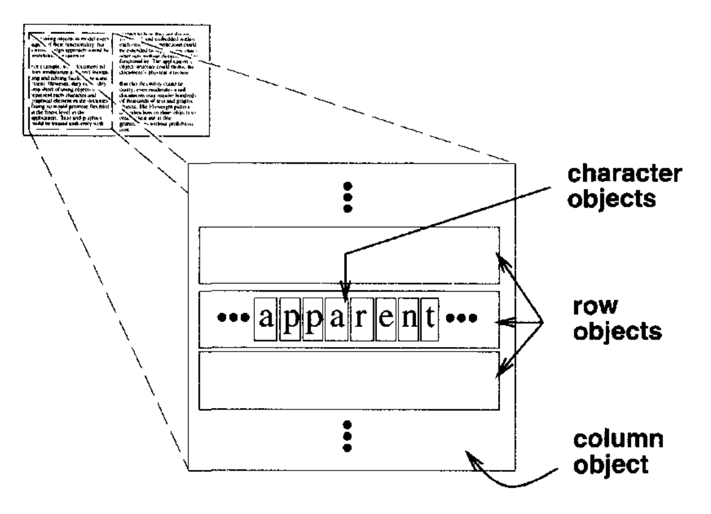
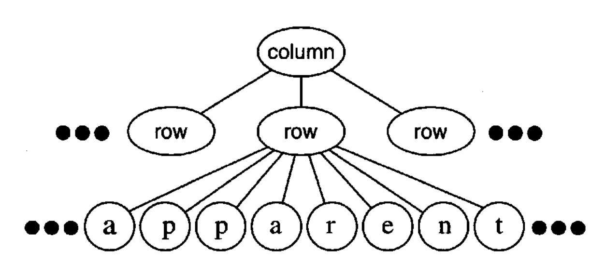
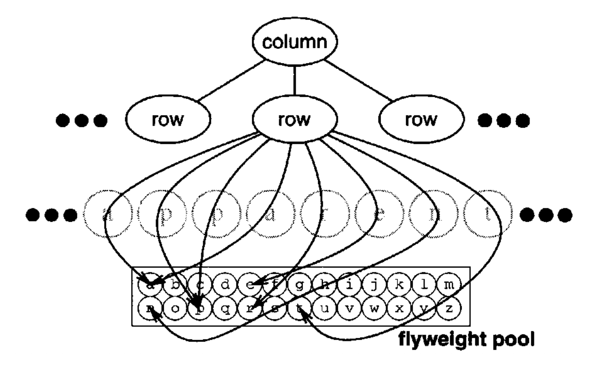
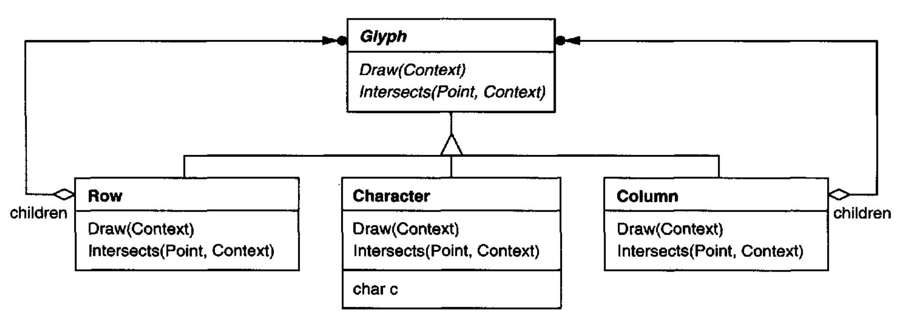
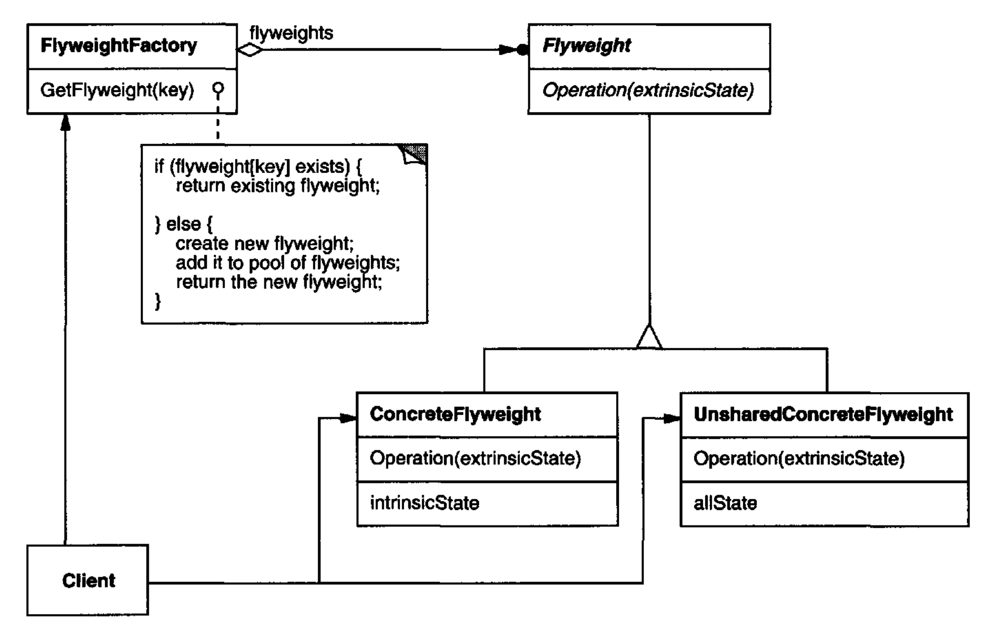
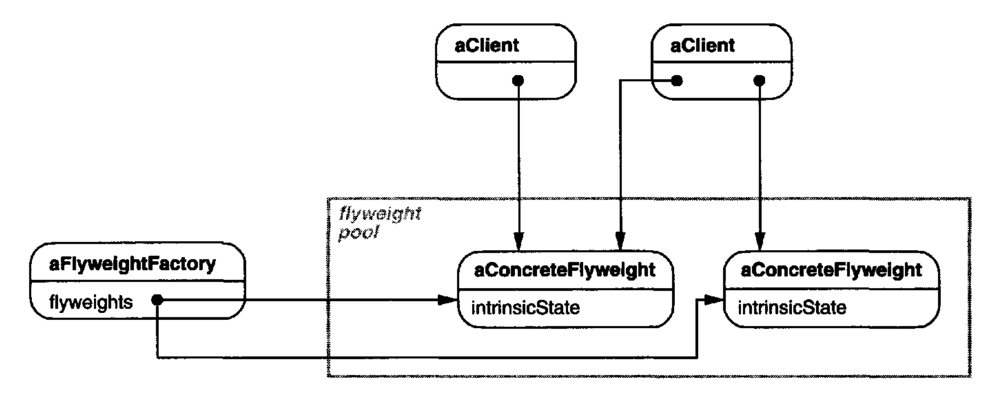
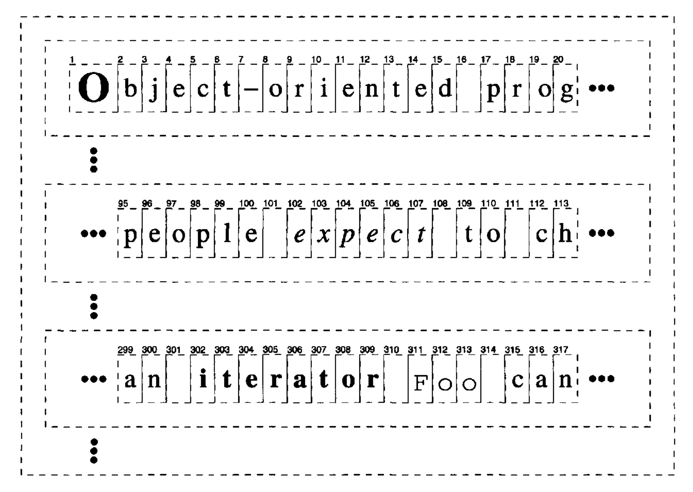
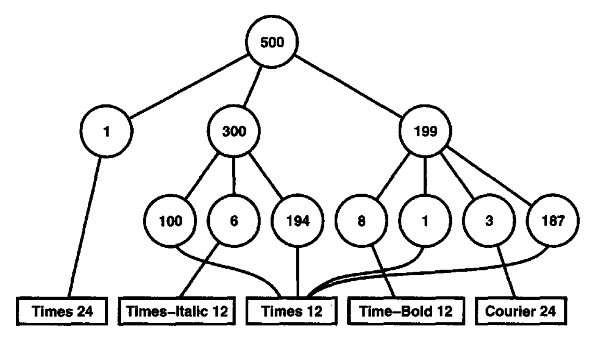
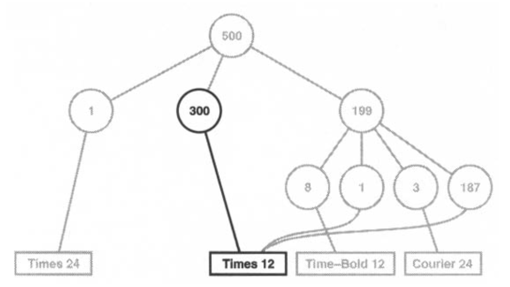
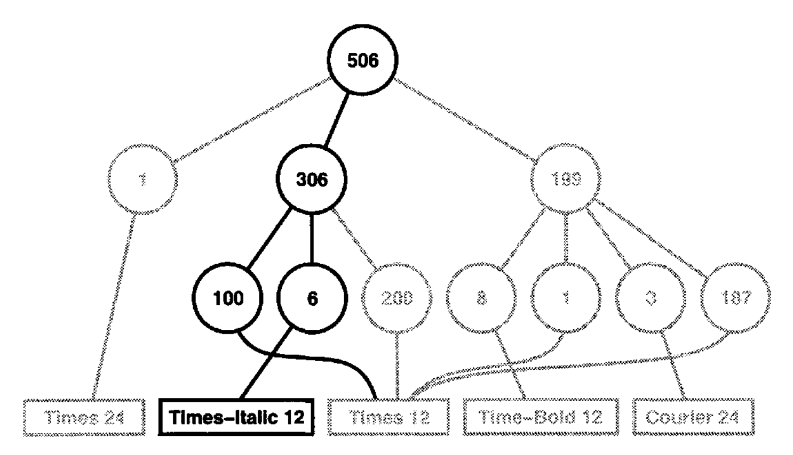

# Flyweight （对象结构型）

## 意图

使用共享来高效支持大量细粒度对象。

## 动机

一些应用程序可以从在整个设计中使用对象中获益，但朴素实现会昂贵得令人望而却步。

例如，大多数文档编辑器实现都有在某种程度上模块化的文本格式化和编辑设施。
面向对象文档编辑器通常使用对象来表示嵌入元素，如表格和图形。
然而，它们通常不会为文档中的每个字符都使用一个对象，即使这样做会促进应用程序最细粒度层面的灵活性。
字符和嵌入元素随后可以在如何绘制和格式化方面被统一对待。
应用程序可以被扩展以支持新的字符集，而不干扰其他功能。
应用程序的对象结构可以模仿文档的物理结构。
下图显示了文档编辑器如何使用对象来表示字符。

<br/>

这种设计的缺点是其成本。
即使是中等大小的文档也可能需要数十万个字符对象，这会消耗大量内存，并可能带来不可接受的运行时开销。
Flyweight 模式描述如何共享对象，以允许在细粒度上使用它们而不产生过高的成本。

**Flyweight** 是一个共享对象，可以同时在多个语境中使用。
flyweight 在每个语境中作为独立对象行事 —— 它与未被共享的对象实例无法区分。
flyweight 不能对它操作的语境做假设。
<ins>这里的关键概念是 **内在 (intrinsic)** 状态与 **外在 (extrinsic)** 状态之间的区别。
内在状态存储在 flyweight 中；它由独立于 flyweight 语境的信息组成，从而使它可以被共享。
外在状态取决于 flyweight 的语境并随其变化，因此不能被共享。
客户端对象负责在 flyweight 需要时把外在状态传递给它。</ins>

<ins>Flyweight 建模的是通常数量太多而无法用对象表示的概念或实体。</ins>
例如，文档编辑器可以为字母表中的每个字母创建一个 flyweight。
每个 flyweight 存储一个字符代码，但它在文档中的坐标位置及其排版样式，可以根据字符出现处生效的文本布局算法和格式化命令来确定。
字符代码是内在状态，而其他信息是外在状态。

从逻辑上讲，文档中给定字符的每次出现都有一个对象：

<br/>

然而，在物理上，每个字符有一个共享的 flyweight 对象，并且它在文档结构中出现在不同的上下文中。
特定字符对象的每一次出现都指向 flyweight 对象共享池中的同一个实例：

<br/>

这些对象的类结构如下所示。
`Glyph` 是图形对象的抽象类，其中部分图形对象可以是 flyweight 对象。
依赖外部状态的操作会将外部状态以参数形式传入。
例如，`Draw` 与 `Intersects` 必须先知晓图形所处的上下文，才能执行相应操作。

<br/>

代表字母 “a” 的 flyweight 仅保存对应的字符编码，无需存储位置或字体信息。
客户端提供 flyweight 完成自身绘制所需的上下文相关信息。
例如，`Row` 图形元素知晓其子元素的绘制位置，使子元素能够水平平铺显示，
因此它可以在绘制请求中将各自的位置传递给每一个子元素。

由于不同字符对象的数量远少于文档中的字符数量，对象总数会远少于朴素实现所使用的数量。
一个其中所有字符都以相同字体和颜色出现的文档，
无论其长度如何，都会分配大约 100 个字符对象（大致相当于 ASCII 字符集的大小）。
而且由于大多数文档使用的字体-颜色组合不超过 10 种，这个数字在实践中不会有明显增长。
因此，对象抽象对单个字符而言变得可行。

## 适用性

Flyweight 模式的有效性在很大程度上取决于如何使用它以及在何处使用它。
当以下所有条件都成立时，请应用 Flyweight 模式：

- 应用程序使用了大量的对象。

- 由于对象数量庞大，存储开销很高。

- 大多数对象状态都可以变为外部状态。

- 一旦移除了外部状态，许多组对象就可以被相对较少的共享对象所替代。

- 应用程序不依赖于对象标识。
由于 Flyweight 对象可能被共享，因此标识测试对于概念上不同的对象也会返回真。

## 结构

<br/>

下面的对象图展示了 flyweight 的共享方式。

<br/>

## 参与者

- **Flyweight** （Glyph）
  - 声明接口，flyweight 可通过该接口接收外部状态并基于外部状态执行操作。

- **ConcreteFlyweight** （Character）
  - 实现 Flyweight 接口，并在需要时保存内部状态。
  `ConcreteFlyweight` 对象必须支持共享。
  它保存的所有状态都必须是内部状态，即该状态独立于 `ConcreteFlyweight` 对象的上下文。

- **UnsharedConcreteFlyweight** （Row、Column）
  - 并非所有 `Flyweight` 子类都需要被共享。
  `Flyweight` 接口提供共享能力，但不强制共享。
  `UnsharedConcreteFlyweight` 对象通常会在 flyweight 对象结构的某一层包含 `ConcreteFlyweight` 子对象（就像 `Row` 和 `Column` 类那样）。

- **FlyweightFactory**
  - 创建并管理 flyweight 对象。

  - 保证 flyweight 被正确共享。
  当客户端请求一个 flyweight 时，`FlyweightFactory` 对象返回已有实例；若无实例，则新建实例。

- **Client**
  - 持有 flyweight 对象的引用。

  - 计算或保存 flyweight 对象的外部状态。

## 协作

- flyweight 正常工作所需的状态必须划分为内部状态或外部状态。
内部状态保存在 `ConcreteFlyweight` 对象中；外部状态由 `Client` 对象保存或计算。
`Client` 在调用 flyweight 的操作时，会将该状态传递给 flyweight。

- `Client` 不应该直接实例化 `ConcreteFlyweight`。
`Client` 必须仅通过 `FlyweightFactory` 对象获取 `ConcreteFlyweight` 对象，以保证对象被正确共享。

## 结果

flyweight 可能会引入与传递、查找和/或计算外部状态相关的运行时开销，尤其是当外部状态原本是作为内部状态存储时。
不过，这类开销会被节省的存储空间抵消，且共享的 flyweight 越多，节省的空间就越大。

存储空间的节省由多个因素决定：
- 共享带来的实例总数的减少量
- 每个对象所持有的内部状态的大小
- 外部状态是实时计算还是持久存储

共享的 flyweight 越多，节省的存储空间就越多。
共享状态的体量越大，节省的空间也就越多。
当对象同时持有大量内部状态与外部状态，且外部状态可以通过计算得到而非直接存储时，节省效果最佳。
此时可以从两个维度节约存储：共享降低内部状态的存储成本，同时用计算时间换取外部状态的存储空间。

Flyweight 模式常与 [Composite (163)](3.md) 模式结合，用带有共享叶子节点的图结构表达层级结构。
共享带来的一个结果是，作为叶子节点的 flyweight 无法保存指向父节点的指针。
取而代之，父节点指针会作为外部状态的一部分传递给 flyweight。
这会对层级结构内对象之间的通信方式产生重大影响。

## 实现

实现 Flyweight 模式时需考虑以下问题：

1. *剥离外部状态。*
该模式的适用程度很大程度上取决于识别外部状态并将其从共享对象中剥离的难易程度。
若外部状态的种类数量和共享前的对象数量一样多，剥离外部状态就无法帮助降低存储开销。
理想情况下，外部状态可以从独立的对象结构中计算得出，该结构所需的存储空间要小得多。

   以我们的文档编辑器为例，我们可以在独立结构中保存排版信息 map，而不是在每个字符对象里存储字体和文字样式。
   该 map 记录拥有相同排版属性的字符段。
   字符执行自身绘制时，会在绘制遍历过程中间接获得排版属性。
   由于文档通常仅使用少数几种字体与样式，将该信息存储在各个字符对象外部，远比存在对象内部高效。

2. *管理共享对象。*
由于对象是共享的，`Client` 不应该直接实例化它们。
`FlyweightFactory` 允许 `Client` 查找特定的 flyweight。
`FlyweightFactory` 对象通常使用关联存储，让 `Client` 查询所需的 flyweight。
例如，文档编辑器示例中的 flyweight 工厂可以维护一张以字符编码为索引的 flyweight 表。
管理器根据传入的编码返回对应的 flyweight；若该 flyweight 不存在，则新建实例。

   可共享性意味着需要某种引用计数或垃圾回收机制，以便在 flyweight 不再被使用时回收其占用的存储空间。
   但如果 flyweight 的数量固定且较少（例如 ASCII 字符集对应的 flyweight），则二者都不是必需的。
   在这种场景下，flyweight 可以永久保留。

## 示例代码

回到文档格式化器示例，我们可以为 flyweight 图形对象定义一个 `Glyph` 基类。
从逻辑上看，glyph 属于 Composite（参见 [Composite (163)](3.md) ），具备图形属性并且可以绘制自身。
这里我们仅聚焦字体属性，但同样的方法也可用于 glyph 可能拥有的其他任意图形属性。

```cpp
class Glyph {
public:
    virtual ~Glyph();

    virtual void Draw(Window*, GlyphContext&);

    virtual void SetFont(Font*, GlyphContext&);
    virtual Font* GetFont(GlyphContext&);

    virtual void First(GlyphContext&);
    virtual void Next(GlyphContext&);
    virtual bool IsDone(GlyphContext&);
    virtual Glyph* Current(GlyphContext&);

    virtual void Insert(Glyph*, GlyphContext&);
    virtual void Remove(GlyphContext&);
protected:
    Glyph();
};
```

`Character` 子类仅保存一个字符编码：

```cpp
class Character : public Glyph {
public:
    Character(char);

    virtual void Draw(Window*, GlyphContext&);
private:
    char _charcode;
};
```

为了避免在每一个 glyph 中都分配字体属性的存储空间，我们将该属性作为外部状态保存在 `GlyphContext` 对象中。
`GlyphContext` 充当外部状态的存储库。
它维护 glyph 在不同上下文下与其字体（以及其他可能存在的图形属性）之间的紧凑映射 (compact mapping)。
任何需要在指定上下文中获取 glyph 字体的操作，都会接收一个 `GlyphContext` 实例作为参数。
该操作随后可以向 `GlyphContext` 查询该上下文对应的字体。
上下文由 glyph 在 glyph 结构中的位置决定。
因此 `Glyph` 的子元素迭代与操作方法在调用时，都必须更新 `GlyphContext`。

```cpp
class GlyphContext {
public:
    GlyphContext();
    virtual ~GlyphContext();

    virtual void Next(int step = 1);
    virtual void Insert(int quantity = 1);

    virtual Font* GetFont();
    virtual void SetFont(Font*, int span = 1);
private:
    int _index;
    BTree* _fonts;
};
```

遍历 glyph 结构的过程中，`GlyphContext` 必须感知当前位置。
`GlyphContext::Next` 会随着遍历推进递增 `_index`。
拥有子元素的 `Glyph` 子类（例如 `Row` 和 `Column`）必须实现 `Next`，使其在遍历的每个节点调用 `GlyphContext::Next`。

`GlyphContext::GetFont` 使用该 `_index` 作为键，查询存储 glyph 到字体映射的 `BTree` 结构。
树中的每个节点都标注了该节点提供字体信息的字符串长度。
树的叶子节点指向字体，而内部节点会将字符串拆分为多个子串，每个子串对应一个子节点。

参考下面一段 glyph 组合的节选：

<br/>

存储字体信息的 `BTree` 结构大致如下：

<br/>

内部节点定义 glyph 索引的区间。
`BTree` 会在字体发生变更，以及 glyph 被新增或从 glyph 结构移除时更新。
例如，假设遍历进行到索引 102 的位置，下面这段代码将单词 "expect" 内每个字符的字体设置为周围文本的字体（即 `times12`，代表 12 磅 Times Roman 的 `Font` 实例）：

```cpp
GlyphContext gc;
Font* times12 = new Font("Times-Roman-12");
Font* timesItalic12 = new Font("Times-Italic-12");
// ...

gc.SetFont(times12, 6);
```

更新后的 `BTree` 结构（变更部分用黑色标出）大致如下：

<br/>

假设我们在 "expect" 前面插入单词 "don't "（包含末尾空格），字体使用 12 磅 Times Italic。
假设仍处在索引 102 的位置，下面这段代码通知 `gc` 该变更：

```cpp
gc.Insert(6);
gc.SetFont(timesItalic12, 6);
```

`BTree` 结构变为：

<br/>

当查询 `GlyphContext` 获取当前 glyph 的字体时，它会向下遍历 `BTree`，沿途累加索引，直至找到当前索引对应的字体。
由于字体变更的发生频率相对较低，相较于 glyph 结构的规模，这棵树会保持较小体量。
这既控制了存储开销，也不会造成查询时间的过度增加 ³。

³ 该方案的查询时间与字体变更频率成正比。最坏情况是每个字符都发生字体变更，但在实际场景中这种情况并不常见。

我们还需要最后一个对象：`FlyweightFactory`，用于创建 glyph 并保证它们被正确共享。
`GlyphFactory` 类实例化 `Character` 以及其他类型的 glyph。
我们仅共享 `Character` 对象；组合 glyph 的数量少得多，并且它们的核心状态（即子元素）本身就是内部状态。

```cpp
const int NCHARCODES = 128;

class GlyphFactory {
public:
    GlyphFactory();
    virtual ~GlyphFactory();

    virtual Character* CreateCharacter(char);
    virtual Row* CreateRow();
    virtual Column* CreateColumn();
    // . . .
private:
    Character* _character[NCHARCODES];
};
```

`_character` 数组存放指向 `Character` glyph 的指针，以字符编码作为索引。
该数组在构造函数中初始化为 0。

```cpp
GlyphFactory::GlyphFactory () {
    for (int i = 0; i < NCHARCODES; ++i) {
        _character[i] = 0;
    }
}
```
`CreateCharacter` 在数组中查找对应字符的 glyph，若存在则返回该 glyph。
若不存在，则由 `CreateCharacter` 创建该 glyph，存入数组后返回：

```cpp
Character* GlyphFactory::CreateCharacter (char c) {
    if (!_character[c]) {
        _character[c] = new Character(c);
    }

    return _character[c];
}
```

其余方法每次调用都会直接实例化新对象，因为非字符类 glyph 不会被共享：

```cpp
Row* GlyphFactory::CreateRow () {
    return new Row;
}

Column* GlyphFactory::CreateColumn () {
    return new Column;
}
```

我们也可以去掉这些方法，让 `Client` 直接实例化不可共享的 glyph。
但如果后续我们决定让这些 glyph 支持共享，就必须修改创建它们的 `Client` 代码。

## 已知应用

flyweight 对象的概念最早在 InterViews 3.0 [CL90](../biblio.md#cl90) 中作为一种设计技术被提出与研究。
该项目的开发者构建了一款名为 Doc 的强大文档编辑器，用于概念验证 [CL92](../biblio.md#cl92)。
Doc 使用 glyph 对象表示文档中的每一个字符。
编辑器为每种特定样式（样式定义图形属性）的字符创建一个 `Glyph` 实例；
因此字符的内部状态包含字符编码及其样式信息（样式表的索引）⁴。
这意味着仅有位置属于外部状态，这让 Doc 拥有出色性能。
文档由 `Document` 类表示，该类同时充当 `FlyweightFactory`。
对 Doc 的测试表明，共享 flyweight 字符的方案效果显著。
在典型场景下，一份包含 180000 个字符的文档，仅需分配 480 个字符对象。

⁴ 在前面给出的示例代码中，样式信息被设置为外部状态，仅保留字符编码作为唯一的内部状态。

ET++ [WGM88](../biblio.md#wgm88) 使用 flyweight 来支持外观与风格的解耦⁵。
外观风格标准会影响用户界面元素（例如滚动条、按钮、菜单，统称为 "widgets"）的布局以及装饰效果（例如阴影、斜面）。
widget 将全部布局与绘制行为委托给独立的 `Layout` 对象。
更换 `Layout` 对象即可改变外观风格，该变更甚至可以在运行时完成。

⁵ 另一种实现外观与风格解耦的方案参见 [Abstract Factory (87)](../ch3/1.md)。

每一类 widget 都有对应的 `Layout` 类（例如 `ScrollbarLayout`、`MenubarLayout` 等）。
该方案存在一个明显问题：使用独立的布局对象会让用户界面对象数量翻倍，每一个界面对象都会额外配套一个 `Layout` 对象。
为消除这项开销，`Layout` 对象被实现为 flyweight。
`Layout` 对象很适合作为 flyweight，因为它们主要用于定义行为，布局或绘制对象所需的少量外部状态可以很方便地传入。

`Layout` 对象由 `Look` 对象创建并管理。
`Look` 类是一个 [Abstract Factory (87)](../ch3/1.md)，它通过 `GetButtonLayout`、`GetMenuBarLayout` 这类方法获取特定的 `Layout` 对象。
每种外观风格标准都对应一个 `Look` 子类（例如 `MotifLook`、`OpenLook`），由它提供配套的 `Layout` 对象。

顺带一提，`Layout` 对象本质上就是 strategy（参见 [Strategy (315)](../ch5/9.md) ）。
这是将 strategy 对象实现为 flyweight 的一个实例。

## 相关模式

Flyweight 模式常与 [Composite (163)](3.md) 模式结合，基于带有共享叶子节点的有向无环图实现逻辑上的层级结构。

将 [State (305)](../ch5/8.md) 和 [Strategy (315)](../ch5/9.md) 对象实现为 flyweight 通常是最佳选择。
