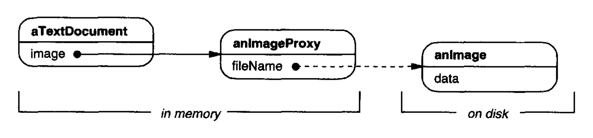
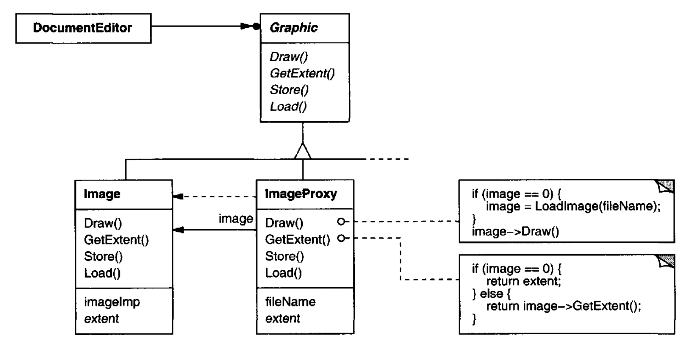
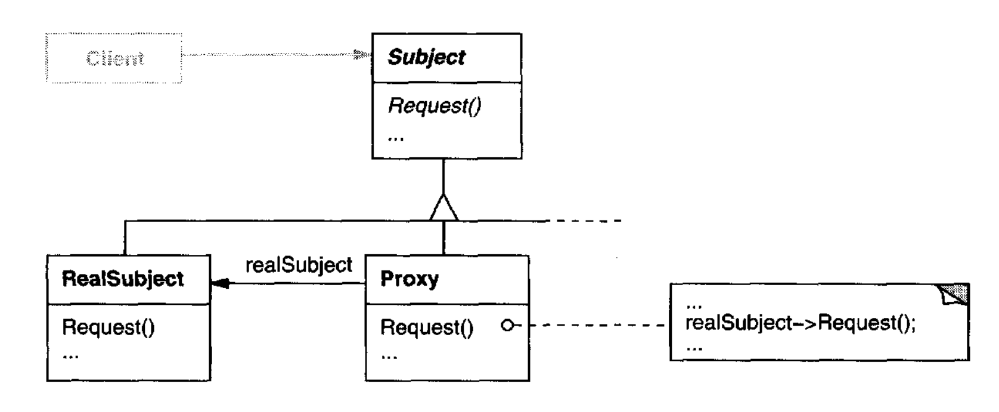
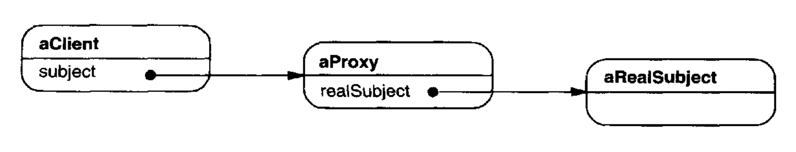

# Proxy （结构型对象模式）

## 意图

为另一个对象提供一个代理或占位符，以控制对它的访问。

## 别名

Surrogate

## 动机

控制对对象访问的一个原因是，把创建和初始化它的全部成本推迟到我们真正需要使用它时。
考虑一个可以在文档中嵌入图形对象的文档编辑器。
一些图形对象，比如大型光栅图像，创建起来可能很昂贵。
但打开文档应当很快，所以当文档被打开时，我们应当避免一次性创建所有昂贵的对象。
这反正也不必要，因为并非所有这些对象都会同时在文档中可见。

这些约束会建议按需创建每个昂贵的对象，在这种情况下，这发生在图像变得可见时。
但我们在文档中用什么来代替图像呢？
我们如何隐藏图像是按需创建的这一事实，以免使编辑器的实现复杂化？
例如，这种优化不应当影响渲染和格式化代码。

解决方案是使用另一个对象，一个图像 **代理 (proxy)** ，作为真实图像的替身 (stand-in)。
代理的行为就像图像一样，并在需要时负责实例化它。

<br/>

图像代理只有在文档编辑器通过调用其 `Draw` 操作要求它显示自己时，才创建真实图像。
代理把后续请求直接转发给图像。
因此，它在创建图像后必须保留对图像的引用。

假设图像存储在单独的文件中。
在这种情况下，我们可以使用文件名作为对真实对象的引用。
代理还存储其范围，也就是它的宽度和高度。
范围让代理可以响应格式化器对其尺寸的请求，而不必实际实例化图像。

下面的类图更详细地说明了这个例子。

<br/>

文档编辑器通过抽象类 `Graphic` 定义的接口访问嵌入图像。
`ImageProxy` 是用于按需创建图像的类。
`ImageProxy` 维护文件名作为对磁盘上图像的引用。
文件名作为参数传递给 `ImageProxy` 构造函数。

`ImageProxy` 还存储图像的边界框以及对真实 `Image` 实例的引用。
这个引用在代理实例化真实图像之前不会有效。
`Draw` 操作确保在把请求转发给图像之前先实例化它。
`GetExtent` 只在图像已实例化时才把请求转发给它；否则 `ImageProxy` 返回它存储的范围。

## 适用性

只要需要对一个对象提供比简单指针更通用或更复杂的引用，Proxy 就适用。
以下是 Proxy 模式适用的几种常见情况：

1. **远程代理 (remote proxy)** 为不同地址空间中的对象提供本地代表。
NEXTSTEP [Add94](../biblio.md#add94) 为此使用类 `NXProxy`。
Coplien [Cop92](../biblio.md#cop92) 称这种代理为 “Ambassador”。

2. **虚拟代理 (virtual proxy)** 按需创建昂贵的对象。
"动机" 中描述的 `ImageProxy` 就是这种代理的一个例子。

3. **保护代理 (protection proxy)** 控制对原对象的访问。
当对象应当有不同的访问权限时，保护代理很有用。
例如，Choices 操作系统 [CIRM93](../biblio.md#cirm93) 中的 `KernelProxy` 提供对操作系统对象的受保护访问。

4. **智能引用 (smart reference)** 是裸指针的替代品，在访问对象时执行额外动作。
典型用途包括

- 计数对真实对象的引用数量，以便在没有更多引用时自动释放它（也称为 **智能指针 (smart pointers)** [Ede92](../biblio.md#ede92) ）。

- 在持久对象首次被引用时把它加载到内存中。

- 在访问真实对象之前检查它是否被锁定，以确保没有其他对象可以改变它。

## 结构

<br/>

这是一个代理结构在运行时的可能对象图。

<br/>

## 参与者

- **Proxy** （`ImageProxy`）
  - 维护一个引用，让代理可以访问真实主体。如果 `RealSubject` 和 `Subject` 接口相同，Proxy 可以引用 `Subject`。

  - 提供与 `Subject` 相同的接口，以便代理可以替代真实主体。

  - 控制对真实主体的访问，并可能负责创建和删除它。

  - 其他职责取决于代理的种类：

    - *远程代理* 负责编码请求及其参数，并把编码后的请求发送到不同地址空间中的真实主体。

    - *虚拟代理* 可以缓存关于真实主体的额外信息，以便推迟访问它。例如，动机中的 `ImageProxy` 缓存真实图像的范围。

    - *保护代理* 检查调用者是否具有执行请求所需的访问权限。

- **Subject** （`Graphic`）
  - 定义 `RealSubject` 和 `Proxy` 的公共接口，以便 `Proxy` 可以用在任何期望 `RealSubject` 的地方。

- **RealSubject** （`Image`）
  - 定义代理所表示的真实对象。

## 协作

- 根据代理的种类，Proxy 在适当的时候把请求转发给 `RealSubject`。

## 效果

Proxy 模式在访问对象时引入了一层间接。额外的间接有许多用途，取决于代理的种类：

1. 远程代理可以隐藏一个对象位于不同地址空间这一事实。

2. 虚拟代理可以执行诸如按需创建对象这样的优化。

3. 保护代理和智能引用都允许在访问对象时执行额外的内务 (housekeeping) 任务。

Proxy 模式还可以对客户端隐藏另一种优化。
它被称为 **写时复制 (copy-on-write)** ，与按需创建相关。
复制一个大而复杂的对象可能是一项昂贵的操作。
如果副本从未被修改，那么就没有必要承担这一成本。
通过使用代理来推迟复制过程，我们确保只有在对象被修改时才付出复制它的代价。

要让写时复制工作，`Subject` 必须进行引用计数。
复制 `Proxy` 时只会递增这个引用计数。
只有当客户端请求一个修改主体的操作时，`Proxy` 才真正复制它。
在这种情况下，`Proxy` 还必须递减 `Subject` 的引用计数。
当引用计数降为零时，`Subject` 被删除。
写时复制可以显著降低复制重量级 `Subject` 的成本。

## 实现

Proxy 模式可以利用以下语言特性：

1. *在 C++ 中重载成员访问运算符。*
C++ 支持重载 `operator->`，即成员访问运算符。
重载这个运算符让你可以在对象被解引用时执行额外工作。
这对实现某些种类的代理很有帮助；代理的行为就像指针一样。

   下面的例子说明了如何使用这种技术实现一个名为 `ImagePtr` 的虚拟代理。

   ```cpp
   class Image;
   extern Image* LoadAnImageFile(const char*);
   // external function
   
   class ImagePtr {
   public:
       ImagePtr(const char* imageFile);
       virtual ~ImagePtr();

       virtual Image* operator->();
       virtual Image& operator*();
   private:
       Image* LoadImage();
   private:
       Image * _image;
       const char* _imageFile;
   };
   
   ImagePtr::ImagePtr (const char* theImageFile) {
       _imageFile = theImageFile;
       _image = 0;
   }
   
   Image* ImagePtr::LoadImage () {
       if (_image ==0) {
           _image = LoadAnImageFile(_imageFile);
       }
       return _image;
   }
   ```

   重载的 `->` 和 `*` 运算符使用 `LoadImage` 把 `_image` 返回给调用者（必要时加载它）。

   ```cpp
   Image* ImagePtr::operator-> () {
       return LoadImage();
   }

   Image& ImagePtr::operator* () {
       return *LoadImage();
   }
   ```

   这种方法让你可以通过 `ImagePtr` 对象调用 `Image` 操作，而不必费事地把这些操作变成 `ImagePtr` 接口的一部分：

   ```cpp
   ImagePtr image = ImagePtr("anImageFileName");
   image->Draw(Point(50, 100));
   // (image.operator->()->Draw(Point(50, 100)));
   ```

   注意图像代理如何像指针一样行事，但它并没有被声明为指向 `Image` 的指针。
   这意味着你不能把它完全像真实指向 `Image` 的指针那样使用。
   因此，在这种方法中，客户端必须区别对待 `Image` 和 `ImagePtr` 对象。

   重载成员访问运算符并不是对所有种类的代理都是一个好的解决方案。
   有些代理需要精确知道哪个操作被调用，而在这些情况下重载成员访问运算符不起作用。

   考虑 "动机" 中的虚拟代理例子。
   图像应当在特定时间加载 ——也就是当 `Draw` 操作被调用时—— 而不是每当图像被引用时就加载。
   重载访问运算符不允许这种区分。
   在这种情况下，我们必须手动实现每个把请求转发给主体的代理操作。

   正如示例代码所展示的，这些操作通常彼此非常相似。
   通常所有操作都会验证请求是合法的、原对象存在等，然后再把请求转发给主体。
   一遍又一遍地写这种代码很乏味。所以常见做法是使用预处理器来自动生成它。

2. *在 Smalltalk 中使用 `doesNotUnderstand`。*
Smalltalk 提供了一个钩子，你可以用它来支持自动转发请求。
当客户端向一个没有对应方法的接收者发送消息时，Smalltalk 调用 `doesNotUnderstand:` `aMessage`。
Proxy 类可以重定义 `doesNotUnderstand`，以便把消息转发给它的主体。

   为确保请求被转发给主体，而不是仅仅被代理静默吸收，你可以定义一个不理解任何消息的 Proxy 类。
   Smalltalk 让你通过把 Proxy 定义为一个没有超类的类来做到这一点。⁶

   `doesNotUnderstand:` 的主要缺点是，大多数 Smalltalk 系统都有几条由虚拟机直接处理的特殊消息，这些消息不会引起通常的方法查找。
   通常唯一在 `Object` 中实现（因此可能影响代理）的是标识操作 `==`。

   如果你打算使用 `doesNotUnderstand:` 来实现 Proxy，那么你必须围绕这个问题进行设计。
   你不能期望代理上的标识意味着其真实主体上的标识。
   另一个缺点是，`doesNotUnderstand:` 是为错误处理而开发的，不是为构建代理而开发的，所以它通常不是很快速。

   ⁶ NEXTSTEP [Add94](../biblio.md#add94) 中分布式对象的实现（具体来说是类 `NXProxy`）使用了这种技术。
   该实现重定义了 `forward`，即 NEXTSTEP 中对应的钩子。

3. *代理不必总是知道真实主体的类型。*
如果一个 Proxy 类可以仅通过抽象接口处理其主体，那么就不需要为每个 `RealSubject` 类都创建一个 Proxy 类；
代理可以统一处理所有 `RealSubject` 类。
但如果代理要实例化 `RealSubject`（比如在虚拟代理中），那么它们必须知道具体类。

另一个实现问题涉及如何在主体被实例化之前引用它。
有些代理必须引用其主体，无论它是在磁盘上还是在内存中。
这意味着它们必须使用某种与地址空间无关的对象标识符。
在 "动机" 中，我们为此使用了文件名。

## 示例代码

以下代码实现了两种代理：动机部分描述的虚拟代理，以及用 `doesNotUnderstand:` 实现的代理。⁷

⁷ [Iterator (257)](../ch5/4.md) 在第 [266](../ch5/4.md#sample-code-5) 页描述了另一种代理。

1. *虚拟代理。* `Graphic` 类为图形对象定义接口：

   ```cpp
   class Graphic {
   public:
       virtual ~Graphic();

       virtual void Draw(const Point& at) = 0;
       virtual void HandleMouse(Event& event) = 0;

       virtual const Point& GetExtent() = 0;

       virtual void Load(istream& from) = 0;
       virtual void Save(ostream& to) = 0;
   protected:
       Graphic();
   };
   ```

   `Image` 类实现 `Graphic` 接口以显示图像文件。
   `Image` 重写 `HandleMouse`，让用户可以交互式地调整图像大小。

   ```cpp
   class Image : public Graphic {
   public:
       Image(const char* file); // loads image from a file
       virtual ~Image();

       virtual void Draw(const Point& at);
       virtual void HandleMouse(Event& event);

       virtual const Point& GetExtent();

       virtual void Load(istream& from);
       virtual void Save(ostream& to);
   private:
       // . . .
   };
   ```

   `ImageProxy` 与 `Image` 具有相同的接口：

   ```cpp
   class ImageProxy : public Graphic {
   public:
       ImageProxy(const char* imageFile);
       virtual ~ImageProxy();

       virtual void Draw(const Point& at);
       virtual void HandleMouse(Event& event);

       virtual const Point& GetExtent();

       virtual void Load(istream& from);
       virtual void Save(ostream& to);
   protected:
       Image* GetImage();
   private:
       Image* _image;
       Point _extent;
       char* _fileName;
   };
   ```
   
   构造函数保存存储图像的文件名的本地副本，并初始化 `_extent` 和 `_image`：
   
   ```cpp
   ImageProxy::ImageProxy (const char* fileName) {
       _fileName = strdup(fileName);
       _extent = Point::Zero; // don't know extent yet
       _image = 0;
   }
   
   Image* ImageProxy::GetImage() {
       if (_image ==0) {
           _image = new Image(_fileName);
       }
       return _image;
   }
   ```

   `GetExtent` 的实现尽可能返回缓存的范围；否则从文件加载图像。
   `Draw` 加载图像，而 `HandleMouse` 把事件转发给真实图像。
   
   ```cpp
   const Point& ImageProxy::GetExtent () {
       if (_extent == Point::Zero) {
           _extent = GetImage()->GetExtent();
       }
       return _extent;
   }
   
   void ImageProxy::Draw (const Point& at) {
       GetImage()->Draw(at);
   }
   
   void ImageProxy::HandleMouse (Event& event) {
       GetImage()->HandleMouse(event);
   }
   ```
   
   `Save` 操作把缓存的图像范围和图像文件名保存到流中。`Load` 取回这些信息并初始化相应成员。
   
   ```cpp
   void ImageProxy::Save (ostream& to) {
       to << _extent << _fileName;
   }
   ```

   ```cpp
   void ImageProxy::Load (istream& from) {
       from >> _extent >> _fileName;
   }
   ```
   
   最后，假设我们有一个可以包含 `Graphic` 对象的类 `TextDocument`：
   
   ```cpp
   class TextDocument {
   public:
       TextDocument();

       void Insert(Graphic*);
       // . . .
   };
   ```
   
   我们可以像这样把一个 `ImageProxy` 插入文本文档：
   
   ```cpp
   TextDocument* text = new TextDocument;
   // . . .
   text->Insert(new ImageProxy("anImageFileName"));
   ```

2. *使用 `doesNotUnderstand` 的代理。*
你可以通过在 Smalltalk 中定义超类为 nil 的类⁸，并定义 `doesNotUnderstand:` 方法来处理消息，从而制作通用代理。

   ⁸ 几乎所有类最终都以 `Object` 作为超类。因此，这等同于说 “定义一个不以 `Object` 为超类的类”。

   下面的方法假设代理有一个返回其真实主体的 `realSubject` 方法。
   在 `ImageProxy` 的情况下，这个方法会检查 `Image` 是否已经被创建，必要时创建它，最后返回它。
   它使用 `perform:withArguments:` 在被捕获的消息的真实主体上执行该消息。

   ```smalltalk
   doesNotUnderstand: aMessage
       ^ self realSubject
           perform: aMessage selector
           withArguments: aMessage arguments
   ```
   
   `doesNotUnderstand:` 的参数是一个 `Message` 实例，表示代理不理解的消息。
   所以代理通过确保真实主体存在，再把消息转发给它，来响应所有消息。

   `doesNotUnderstand:` 的优点之一是它可以执行任意处理。
   例如，我们可以通过指定一个接受消息的集合 `legalMessages`，然后给代理以下方法，来生成一个保护代理：

   ```smalltalk
   doesNotUnderstand: aMessage
       ^ (legalMessages includes: aMessage selector)
           ifTrue: [self realSubject
               perform: aMessage selector
               withArguments: aMessage arguments]
           ifFalse: [self error: 'Illegal operator']
   ```

   这个方法在把消息转发给真实主体之前检查它是否合法。
   如果它不合法，那么它会向代理发送 `error:`，除非代理定义了 `error:`，否则会导致无限错误循环。
   因此，`error:` 的定义应当连同它使用的任何方法一起从 `Object` 类复制过来。

## 已知应用

"动机" 部分中的虚拟代理例子来自 ET++ 文本构建块类。

NEXTSTEP [Add94](../biblio.md#add94) 使用代理（类 `NXProxy` 的实例）作为可能分布式对象的本地代表。
当客户端请求远程对象时，服务器为它们创建代理。
在接收到消息时，代理把消息及其参数编码，然后把编码后的消息转发给远程主体。
类似地，主体编码任何返回结果并把它们发送回 `NXProxy` 对象。

McCullough [McC87](../biblio.md#mcc87) 讨论了在 Smalltalk 中使用代理来访问远程对象。
Pascoe [Pas86](../biblio.md#pas86) 描述了如何用“封装器”在方法调用和访问控制上提供副作用。

## 相关模式

[Adapter (139)](1.md)：适配器为它所适配的对象提供不同的接口。
相比之下，代理提供与其主体相同的接口。
然而，用于访问保护的代理可能拒绝执行主体将执行的操作，所以它的接口实际上可能是主体接口的子集。

[Decorator (175)](4.md)：尽管装饰器可以有与代理相似的实现，但装饰器有不同目的。
装饰器给对象添加一个或多个职责，而代理控制对对象的访问。

代理在实现方式上与装饰器的相似程度各不相同。
保护代理可能被实现得与装饰器完全相同。
另一方面，远程代理不会包含对其真实主体的直接引用，而只包含间接引用，例如 “主机 ID 和主机上的本地地址”。
虚拟代理会以间接引用（例如文件名）开始，但最终会获得并使用直接引用。
