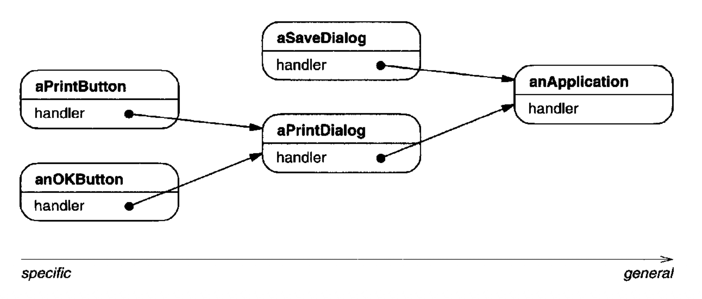
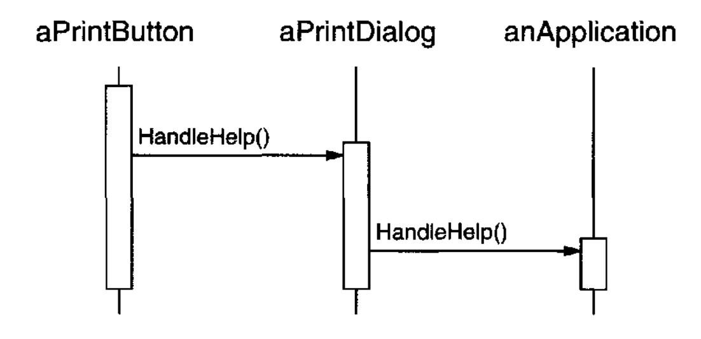
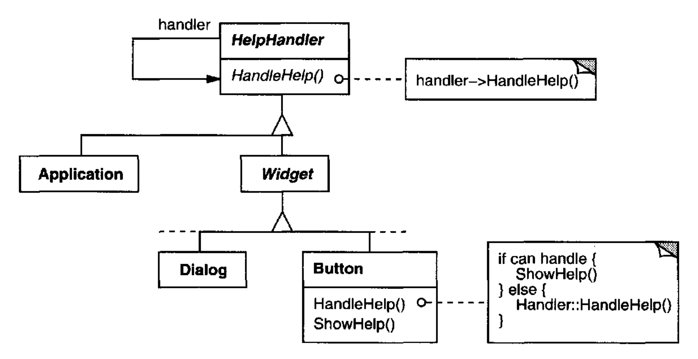
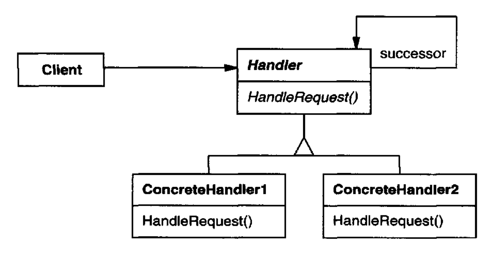
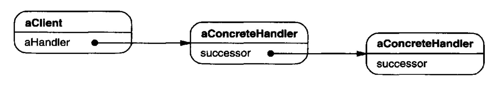

# Chain of Responsibility （对象行为型）

## 意图

通过给予多个对象处理请求的机会，避免将请求的发送者与其接收者耦合。
将接收对象串成一条链，并沿着该链传递请求，直到某个对象处理它。

## 动机

考虑一个用于图形用户界面的上下文敏感帮助设施。
用户只需点击界面中的任何部分，就可以获得该部分的帮助信息。
所提供的帮助取决于被选中的界面部分及其上下文；
例如，对话框中的一个按钮组件可能具有与主窗口中类似按钮不同的帮助信息。
如果该界面部分不存在特定的帮助信息，那么帮助系统应显示关于直接上下文的更通用帮助消息 —— 例如，整个对话框。

因此，按照帮助信息的通用性来组织它是很自然的 —— 从最具体到最通用。
此外，很明显，一个帮助请求由若干用户界面对象之一处理；
具体由哪一个处理取决于上下文以及可用帮助的具体程度。

这里的问题在于，最终 *提供* 帮助的对象并不被 *发起* 帮助请求的对象（例如按钮）显式知晓。
我们需要一种方式，将发起帮助请求的按钮与可能提供帮助信息的对象解耦。
职责链 (Chain of Responsibility) 模式定义了这是如何发生的。

这个模式的思想是：通过给予多个对象处理请求的机会来解耦发送者和接收者。
请求沿着一条对象链传递，直到其中一个对象处理它。

<br/>

链中的第一个对象接收请求，要么处理它，要么将其转发给链上的下一个候选对象，后者也同样处理。
发出请求的对象并不显式知道谁会处理它 —— 我们说该请求有一个 **隐式接收者 (implicit receiver)** 。

假设用户点击一个标记为 “Print” 的按钮 widget 以获取帮助。
该按钮包含在一个 `PrintDialog` 实例中，而该实例知道它所属的应用程序对象（见前面的对象图）。
下面的交互图说明了帮助请求如何沿着链被转发：

<br/>

在这种情况下，`aPrintButton` 和 `aPrintDialog` 都不处理该请求；
它停在 `anApplication` 处，而 `anApplication` 可以处理它或忽略它。
发出请求的客户端并不直接引用最终满足该请求的对象。

为了沿着链转发请求，并确保接收者保持隐式，链上的每个对象都共享一个用于处理请求以及访问其链上 **后继者 (successor)** 的公共接口。
例如，帮助系统可能定义一个 `HelpHandler` 类，并带有相应的 `HandleHelp` 操作。
`HelpHandler` 可以作为候选对象类的父类，也可以定义为 mixin 类。
这样，想要处理帮助请求的类就可以让 `HelpHandler` 成为父类：

<br/>

`Button`、`Dialog` 和 `Application` 类使用 `HelpHandler` 操作来处理帮助请求。`HelpHandler` 的 `HandleHelp` 操作默认将请求转发给后继者。
子类可以重写此操作，以在适当情况下提供帮助；否则它们可以使用默认实现来转发请求。

## 适用性

在以下情况下使用职责链：

- 多个对象可能处理一个请求，而处理者在事先并不已知。处理者应被自动确定。

- 你想向若干对象之一发出请求，而不显式指定接收者。

- 可以处理请求的对象集合应被动态指定。

## 结构

<br/>

一个典型的对象结构可能如下所示：

<br/>

## 参与者

- **Handler** （`HelpHandler`）

  - 定义一个用于处理请求的接口。

  - （可选）实现后继者链接。

- **ConcreteHandler** （`PrintButton`、`PrintDialog`）

  - 处理它负责的请求。

  - 可以访问它的后继者。

  - 如果 `ConcreteHandler` 能够处理该请求，它就处理；否则它将请求转发给它的后继者。

- **Client**

  - 向链上的一个 `ConcreteHandler` 对象发起请求。

## 协作

- 当一个客户端发出请求时，请求沿着链传播，直到某个 `ConcreteHandler` 对象承担处理它的责任。

## 结果

职责链具有以下优点和缺点：

1. *降低耦合。*
该模式使一个对象无需知道哪个其他对象处理请求。
一个对象只需知道请求会被 “适当地” 处理。
接收者和发送者都不显式知道彼此，而且链中的一个对象也不必知道链的结构。

   因此，职责链可以简化对象互连。
   对象不必维护对所有候选接收者的引用，而是只保留对其后继者的单个引用。

2. *在向对象分配责任时增加了灵活性。*
职责链在对象之间分配责任时为你提供了额外的灵活性。
你可以通过在运行时添加到链或以其他方式更改链，来添加或更改处理请求的责任。
你可以将此与子类化结合，以静态方式特化处理者。

3. *不保证接收。*
由于请求没有显式接收者，因此不能保证它会被处理 —— 请求可能从链的末端掉出而从未被处理。
当链未正确配置时，请求也可能得不到处理。

## 实现

以下是在职责链中需要考虑的实现问题：

1. *实现后继者链。* 有两种可能的方式来实现后继者链：

   - (a) 定义新的链接（通常在 `Handler` 中，但 `ConcreteHandler` 也可以改为定义它们）。

   - (b) 使用现有的链接。

   到目前为止，我们的示例定义的是新链接，但通常你可以使用现有的对象引用来形成后继者链。
   例如，部分-整体 (part-whole) 层次结构中的父引用可以定义一个部分 (part) 的后继者。
   一个 widget 结构可能已经具有这样的链接。
   [Composite (163)](../ch4/3.md) 更详细地讨论了父引用。

   当现有链接支持你需要的链时，使用现有链接效果很好。
   它使你无需显式定义链接，并且节省空间。
   但如果该结构不反映你的应用程序所需的职责链，那么你就必须定义冗余链接。

2. *连接后继者。*
如果不存在用于定义链的已有引用，那么你就必须自己引入它们。
在这种情况下，`Handler` 不仅定义请求的接口，通常还维护后继者。
这使处理者能够提供 `HandleRequest` 的默认实现，将请求转发给后继者（如果有）。
如果某个 `ConcreteHandler` 子类对该请求不感兴趣，它不必重写转发操作，因为其默认实现会无条件转发。

   下面是一个维护后继者链接的 `HelpHandler` 基类：

   ```cpp
   class HelpHandler {
   public:
       HelpHandler(HelpHandler* s) : _successor(s) { }
       virtual void HandleHelp();
   private:
       HelpHandler* _successor;
   };
   
   void HelpHandler::HandleHelp () {
    if (_successor) {
        _successor->HandleHelp();
    }
   }
   ```

3. *表示请求。*
表示请求有不同的选项。
在最简单的形式中，请求是硬编码的操作调用，如 `HandleHelp` 的情况。
这既方便又安全，但你只能转发 `Handler` 类定义的固定请求集。

   另一种选择是使用单个 `handler` 函数，它接受请求代码（例如，整数常量或字符串）作为参数。
   这支持开放式的请求集。
   唯一的要求是发送者和接收者就请求应如何编码达成一致。

   这种方法更灵活，但它需要条件语句来根据请求代码分派请求。
   此外，没有类型安全的方式传递参数，因此必须手动打包和解包。
   显然，这不如直接调用操作安全。

   为了解决参数传递问题，我们可以使用单独的 request 对象来捆绑请求参数。
   一个 `Request` 类可以显式表示请求，而新的请求种类可以通过子类化来定义。
   子类可以定义不同的参数。
   处理者必须知道请求的种类（也就是说，它们使用的是哪个 `Request` 子类）才能访问这些参数。

   为了标识请求，`Request` 可以定义一个访问器函数，返回该类的标识符。
   或者，如果实现语言支持，接收者可以使用运行时类型信息。

   下面是一个使用 request 对象来标识请求的分派函数草图。在基类 `Request` 中定义的 `GetKind` 操作标识请求的种类：

   ```cpp
   void Handler::HandleRequest (Request* theRequest) {
       switch (theRequest->GetKind()) {
       case Help:
           // cast argument to appropriate type
           HandleHelp((HelpRequest*) theRequest);
           break;

       case Print:
           HandlePrint((PrintRequest*) theRequest);
           // . . .
           break;

       default:
           // . . .
           break;
       }
   }
   ```

   子类可以通过重写 `HandleRequest` 来扩展分派。
   子类只处理它感兴趣的请求；其他请求被转发给父类。
   通过这种方式，子类实际上扩展（而不是重写）了 `HandleRequest` 操作。
   例如，下面是一个 `ExtendedHandler` 子类如何扩展 `Handler` 版本的 `HandleRequest`：

   ```cpp
   class ExtendedHandler : public Handler {
   public:
       virtual void HandleRequest(Request* theRequest);
       // . . .
   };

   void ExtendedHandler::HandleRequest (Request* theRequest) {
       switch (theRequest->GetKind()) {
       case Preview:
           // handle the Preview request
           break;

       default:
           // let Handler handle other requests
           Handler::HandleRequest(theRequest);
       }
   }
   ```

4. *Smalltalk 中的自动转发。*
你可以使用 Smalltalk 中的 `doesNotUnderstand` 机制来转发请求。
没有对应方法的消息会在 `doesNotUnderstand` 的实现中被捕获，而该实现可以被重写，以将消息转发给对象的后继者。
因此，不必手动实现转发；类只处理它感兴趣的请求，并依赖 `doesNotUnderstand` 来转发所有其他请求。

## 示例代码

下面的示例说明了职责链如何像前面描述的那样处理在线帮助系统的请求。
帮助请求是一个显式操作。
我们将使用部件层次结构中，现有的父引用来在链中的部件之间传播请求，
并且我们将在 `Handler` 类中定义一个引用，以在链中的非部件之间传播帮助请求。

`HelpHandler` 类定义处理帮助请求的接口。
它维护一个帮助主题（默认情况下为空），并保留对帮助处理者链上后继者的引用。
关键操作是 `HandleHelp`，子类会重写它。
`HasHelp` 是一个便利操作，用于检查是否存在关联的帮助主题。

```cpp
typedef int Topic;
const Topic NO_HELP_TOPIC = -1;

class HelpHandler {
public:
    HelpHandler(HelpHandler* = 0, Topic = NO_HELP_TOPIC);
    virtual bool HasHelp();
    virtual void SetHandler(HelpHandler*, Topic);
    virtual void HandleHelp();
private:
    HelpHandler* _successor;
    Topic _topic;
};

HelpHandler::HelpHandler (
    HelpHandler* h, Topic t
) : _successor(h), _topic(t) { }

bool HelpHandler::HasHelp () {
    return _topic != NO_HELP_TOPIC;
}

void HelpHandler::HandleHelp () {
    if (_successor != 0) {
        _successor->HandleHelp();
    }
}
```

所有部件都是 `Widget` 抽象类的子类。
`Widget` 是 `HelpHandler` 的子类，因为所有用户界面元素都可以有关联的帮助。
（我们同样也可以使用基于 mixin 的实现。）

```cpp
class Widget : public HelpHandler {
protected:
    Widget(Widget* parent, Topic t = NO_HELP_TOPIC);
private:
    Widget* _parent;
};

Widget::Widget (Widget* w, Topic t) : HelpHandler(w, t) {
    _parent = w;
}
```

在我们的示例中，按钮是链上的第一个处理者。
`Button` 类是 `Widget` 的子类。
`Button` 构造函数接受两个参数：对其外围部件的引用以及帮助主题。

```cpp
class Button : public Widget {
public:
    Button(Widget* d, Topic t = NO_HELP_TOPIC);

    virtual void HandleHelp();
    // Widget operations that Button overrides...
};
```

`Button` 版本的 `HandleHelp` 首先测试是否存在针对按钮的帮助主题。
如果开发者没有定义帮助主题，那么请求将使用 `HelpHandler` 中的 `HandleHelp` 操作转发给后继者。
如果存在帮助主题，那么按钮会显示它，搜索结束。

```cpp
Button::Button (Widget* h, Topic t) : Widget(h, t) { }

void Button::HandleHelp () {
    if (HasHelp()) {
        // offer help on the button
    } else {
        HelpHandler::HandleHelp();
    }
}
```

`Dialog` 实现了一个类似的方案，不同之处在于它的后继者不是部件，而是任何帮助处理者。
在我们的应用程序中，这个后继者将是一个 `Application` 实例。

```cpp
class Dialog : public Widget {
public:
    Dialog(HelpHandler* h, Topic t = NO_HELP_TOPIC);
    virtual void HandleHelp();

    // Widget operations that Dialog overrides...
    // . . .
};

Dialog::Dialog (HelpHandler* h, Topic t) : Widget(0) {
    SetHandler(h, t);
}

void Dialog::HandleHelp () {
    if (HasHelp()) {
        // offer help on the dialog
    } else {
        HelpHandler::HandleHelp();
    }
}
```

在链的末端是一个 `Application` 实例。
它不是部件 ，因此 `Application` 直接继承自 `HelpHandler`。
当帮助请求传播到这一层时，应用程序可以提供关于应用程序的一般信息，或者它可以提供不同帮助主题的列表：

```cpp
class Application : public HelpHandler {
public:
    Application(Topic t) : HelpHandler(0, t) { }

    virtual void HandleHelp();
    // application-specific operations...
};

void Application::HandleHelp () {
    // show a list of help topics
};
```

下面的代码创建并连接这些对象。
这里对话框关注打印，因此这些对象被分配了与打印相关的主题。

```cpp
const Topic PRINT_TOPIC = 1;
const Topic PAPER_ORIENTATION_TOPIC = 2;
const Topic APPLICATION_TOPIC = 3;

Application* application = new Application(APPLICATION_TOPIC);
Dialog* dialog = new Dialog(application, PRINT_TOPIC);
Button* button = new Button(dialog, PAPER_ORIENTATION_TOPIC);
```

我们可以通过调用链上任何对象的 `HandleHelp` 来发起帮助请求。
要从按钮对象开始搜索，只需在它上面调用 `HandleHelp`：

```cpp
button->HandleHelp();
```

在这种情况下，按钮会立即处理该请求。
注意，任何 `HelpHandler` 类都可以成为 `Dialog` 的后继者。
此外，它的后继者可以被动态更改。
因此，无论对话框在何处使用，你都能为它获得正确的、依赖上下文的帮助信息。

## 已知应用

若干类库使用职责链模式来处理用户事件。
它们为 `Handler` 类使用了不同的名称，但思想是相同的：当用户点击鼠标或按下按键时，一个事件会被生成并沿着链传递。
MacApp [App89](../biblio.md#app89) 和 ET++ [WGM88](../biblio.md#wgm88) 将其称为 “Event-Handler”，
Symantec 的 TCL 库 [Sym93b](../biblio.md#sym93b) 将其称为 “Bureaucrat”，
而 NeXT 的 AppKit [Add94](../biblio.md#add94) 使用名称 “Responder”。

用于图形编辑器的 Unidraw 框架定义了 `Command` 对象，用来封装对 `Component` 和 `ComponentView` 对象的请求 [VL90](../biblio.md#vl90)。
命令在如下意义上就是请求：一个组件或组件视图 (component view) 可以解释一个命令以执行某个操作。
这对应于实现中描述的 “请求即对象” 方法。
组件和组件视图可以按层次结构组织。
一个组件或组件视图可以将命令解释转发给它的父对象，父对象又可以将其转发给它的父对象，依此类推，从而形成一条职责链。

ET++ 使用职责链来处理图形更新。
一个图形对象每当必须更新其外观的一部分时，就会调用 `InvalidateRect` 操作。
一个图形对象无法自行处理 `InvalidateRect`，因为它对自己的上下文了解得不够。
例如，一个图形对象可能被包含在诸如 `Scroller` 或 `Zoomer` 之类的对象中，这些对象会变换它的坐标系。
这意味着该对象可能被滚动或缩放，以至于它部分地位于视图之外。
因此，`InvalidateRect` 的默认实现将请求转发给外围容器对象。
转发链中的最后一个对象是一个 `Window` 实例。
当 `Window` 接收到该请求时，失效矩形保证已被正确变换。
`Window` 通过通知窗口系统接口并请求更新来处理 `InvalidateRect`。

## 相关模式

职责链通常与 [Composite (163)](../ch4/3.md) 结合使用。在那里，一个组件的父对象可以作为它的后继者。
