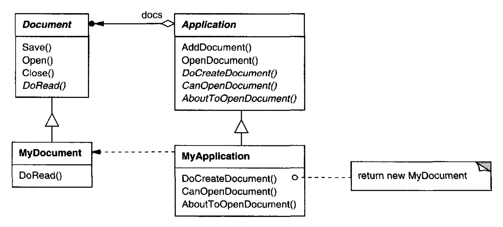
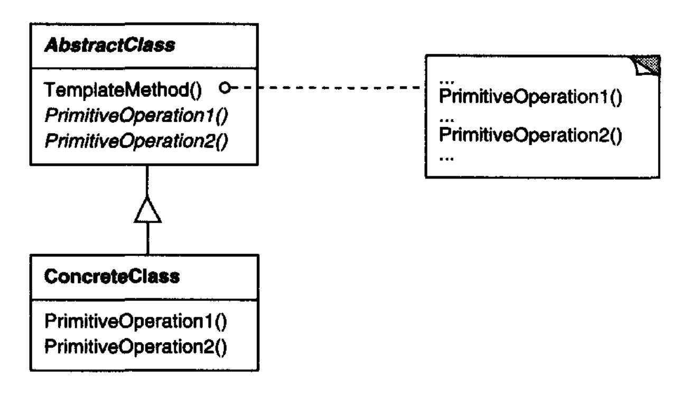

# Template Method （类行为型）

## 意图

在一个操作中定义一个算法的骨架，将某些步骤延迟到子类中实现。
Template Method 让子类重新定义算法的某些步骤，而不改变算法的结构。

## 动机

考虑一个提供 `Application` 和 `Document` 类的应用框架。
`Application` 类负责打开以外部格式（例如文件）存储的现有文档。
`Document` 对象表示从文件读取后文档中的信息。

用该框架构建的应用可以子类化 `Application` 和 `Document` 以满足特定需求。
例如，绘图应用定义 `DrawApplication` 和 `DrawDocument` 子类；
电子表格应用定义 `SpreadsheetApplication` 和 `SpreadsheetDocument` 子类。

<br/>

`Application` 抽象类在其 `OpenDocument` 操作中定义打开和读取文档的算法：

```cpp
void Application::OpenDocument (const char* name) {
    if (!CanOpenDocument(name)) {
        // cannot handle this document
        return;
    }

    Document* doc = DoCreateDocument();

    if (doc) {
        _docs->AddDocument(doc);
        AboutToOpenDocument(doc);
        doc->Open();
        doc->DoRead();
    }
}
```

`OpenDocument` 定义打开文档的每个步骤。
它检查文档是否可以打开，创建应用程序特定的 `Document` 对象，将其加入文档集合，并从文件中读取该 `Document`。

我们把 `OpenDocument` 称为 **Template method** 。
Template method 用抽象操作来定义一个算法，子类重写这些抽象操作以提供具体行为。
`Application` 子类定义算法中的步骤，检查文档是否可以打开（`CanOpenDocument`）以及创建 `Document`（`DoCreateDocument`）。
`Document` 类定义读取文档（`DoRead`）的步骤。
Template method 还定义一个操作，让 `Application` 子类知道文档即将被打开（`AboutToOpenDocument`），如果它们关心这一点的话。

通过使用抽象操作定义算法的某些步骤，Template method 固定了这些步骤的顺序，但它让 `Application` 和 `Document` 子类能够根据自己的需要改变这些步骤。

## 适用性

Template Method 模式应在以下情况下使用：

- 实现算法中不变的部分一次，并将可变行为留给子类实现。

- 当子类之间的公共行为应当被提取并局部化到一个公共类中，以避免代码重复时。
这是 Opdyke 和 Johnson [OJ93](../biblio.md#oj93) 所描述的 “重构以泛化” 的一个好例子。
你首先识别现有代码中的差异，然后将这些差异分离到新的操作中。
最后，你用调用这些新操作之一的 Template method 替换有差异的代码。

- 控制子类的扩展。
你可以定义一个 Template method，在特定点调用 “hook” 操作（见后果），从而只允许在这些点进行扩展。

## 结构

<br/>

## 参与者

- **AbstractClass** （`Application`）

  - 定义抽象 **原始操作 (primitive operations)** ，具体子类定义这些操作以实现算法的各个步骤。

  - 实现一个定义算法骨架的 Template method。
  该 Template method 调用原始操作以及 `AbstractClass` 中定义的操作或其他对象的操作。

- **ConcreteClass** （`MyApplication`）

  - 实现原始操作，以执行算法中特定于子类的步骤。

## 协作

- `ConcreteClass` 依赖 `AbstractClass` 来实现算法中不变的步骤。

## 效果

Template method 是代码复用的基本技术。
它们在类库中尤为重要，因为它们是提取库类中公共行为的手段。

Template method 导致一种反转的控制结构，有时被称为 “好莱坞原则”，即 “不要调用我们，我们会调用你” [Swe85](../biblio.md#swe85)。
这指的是父类调用子类的操作，而不是反过来。

Template method 调用以下种类的操作：

- 具体操作（要么在 `ConcreteClass` 上，要么在客户端类上）；

- 具体的 `AbstractClass` 操作（即，通常对子类有用的操作）；

- 原始操作（即，抽象操作）；

- 工厂方法（见 [Factory Method (107)](../ch3/3.md) ）；以及

- **hook 操作** ，它提供默认行为，子类可以在必要时扩展。hook 操作通常默认什么都不做。

对 Template method 来说，重要的是明确哪些操作是 hook（可以重写），哪些是抽象操作（必须重写）。
为了有效地复用抽象类，子类编写者必须理解哪些操作是为重写而设计的。

子类可以通过重写某个操作并显式调用父类操作来扩展父类操作的行为：

```cpp
void DerivedClass::Operation () {
    ParentClass::Operation();
    // DerivedClass extended behavior
}
```

不幸的是，很容易忘记调用继承的操作。
我们可以将这样的操作转换为 Template method，让父类控制子类如何扩展它。
其思想是在父类的 Template method 中调用一个 hook 操作。
然后子类可以重写这个 hook 操作：

```cpp
void ParentClass::Operation () {
    // ParentClass behavior
    HookOperation();
}
```

`HookOperation` 在 `ParentClass` 中什么都不做：

```cpp
void ParentClass::HookOperation () { }
```

子类重写 `HookOperation` 以扩展其行为：

```cpp
void DerivedClass::HookOperation () {
    // derived class extension
}
```

## 实现

有三个实现问题值得注意：

1. *使用 C++ 访问控制。*
在 C++ 中，Template method 调用的原始操作可以声明为 protected 成员。
这确保它们只由 Template method 调用。
必须被重写的原始操作被声明为纯虚函数。
Template method 本身不应被重写；因此，你可以将 Template method 设为非虚成员函数。

2. *最小化原始操作。*
设计 Template method 的一个重要目标，是尽量减少子类为充实算法而必须重写的原始操作数量。
需要重写的操作越多，客户端的事情就越繁琐。

3. *命名约定。*
你可以通过给操作名称添加前缀来标识那些应被重写的操作。
例如，用于 Macintosh 应用的 MacApp 框架 [App89](../biblio.md#app89) 会给 Template method 名称加上 “Do-” 前缀：“DoCreateDocument”、“DoRead”，等等。

## 示例代码

下面的 C++ 示例展示了一个父类如何为其子类强制一个不变式。
这个示例来自 NeXT 的 AppKit [Add94](../biblio.md#add94)。
考虑一个支持在屏幕上绘制的 `View` 类。
`View` 强制这样一个不变式：其子类只有在它成为 “焦点” 之后才能绘制到 view 中，而成为焦点需要正确设置某些绘制状态（例如颜色和字体）。

我们可以使用一个 `Display` Template method 来设置这种状态。
`View` 定义两个具体操作 `SetFocus` 和 `ResetFocus`，分别用于设置和清理绘制状态。
`View` 的 `DoDisplay` hook 操作执行实际绘制。
`Display` 在 `DoDisplay` 之前调用 `SetFocus` 以设置绘制状态；
`Display` 在 `DoDisplay` 之后调用 `ResetFocus` 以释放绘制状态。

```cpp
void View::Display () {
    SetFocus();
    DoDisplay();
    ResetFocus();
}
```

为了维持该不变式，view 的客户端总是调用 `Display`，而 `View` 子类总是重写 `DoDisplay`。

`DoDisplay` 在 `View` 中什么都不做：

```cpp
void View::DoDisplay () { }
```

子类重写它，以添加自己特定的绘制行为：

```cpp
void MyView::DoDisplay () {
    // render the view's contents
}
```

## 已知应用

Template method 如此基础，以至于几乎可以在每个抽象类中找到它们。
Wirfs-Brock 等人 [WBWW90](../biblio.md#wbww90)、[WBJ90](../biblio.md#wbj90) 对 Template method 提供了很好的概述和讨论。

## 相关模式

[Factory Method (107)](../ch3/3.md) 经常被 Template method 调用。
在 "动机" 示例中，工厂方法 `DoCreateDocument` 由 Template method `OpenDocument` 调用。

[Strategy (315)](9.md)：Template method 使用继承来改变算法的一部分。
Strategy 使用委托来改变整个算法。
