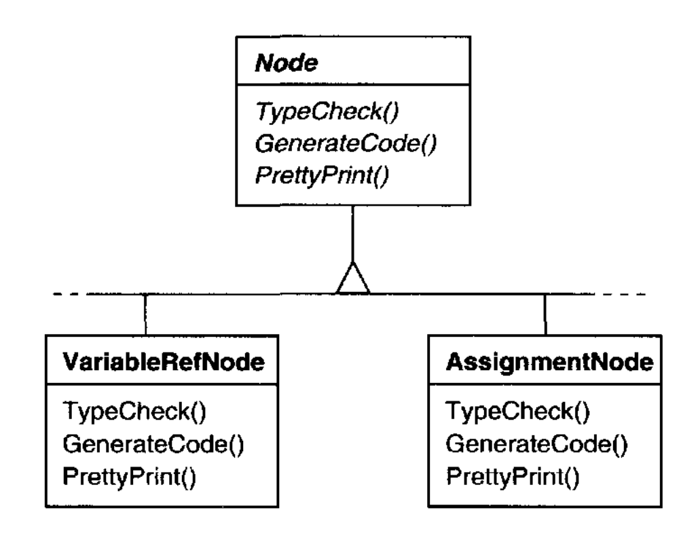
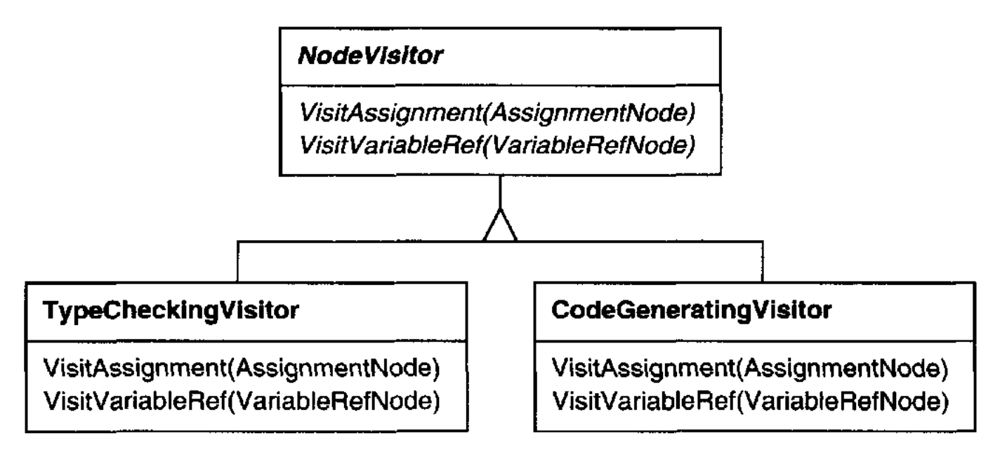
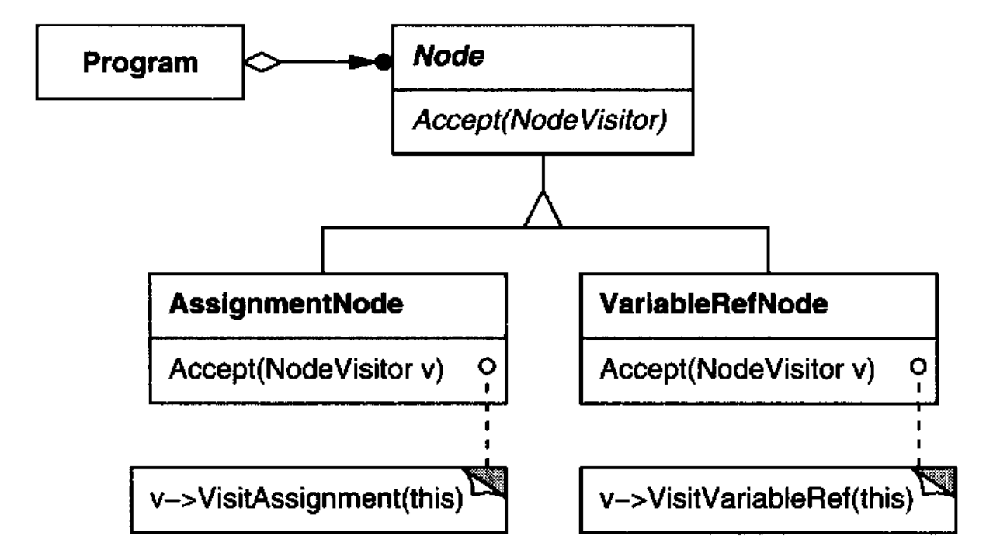
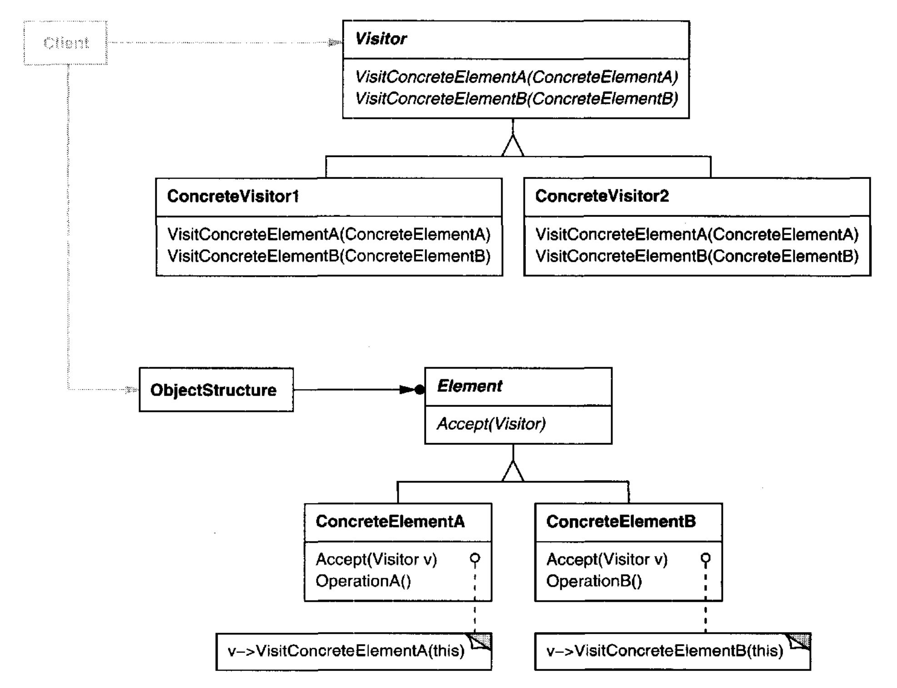
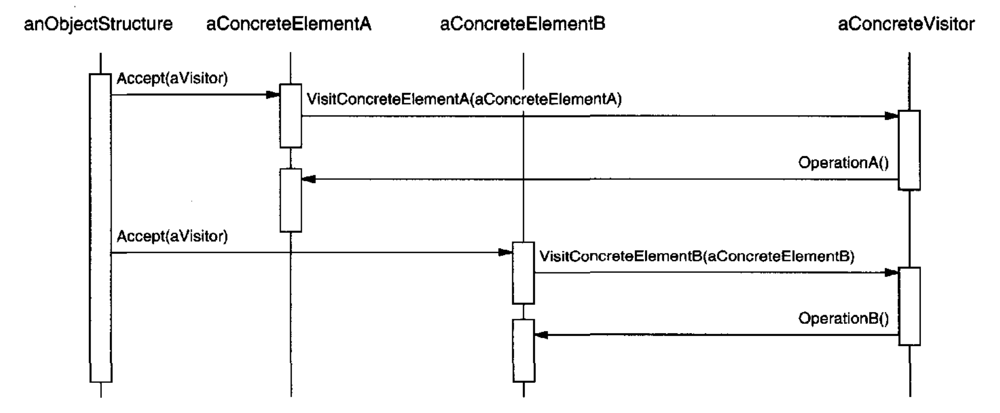

# Visitor （对象行为型）

## 意图

表示一个作用于某对象结构中各个元素上的操作。Visitor 让你能够定义一个新操作，而不必更改这些元素所属的类。

## 动机

考虑一个将程序表示为抽象语法树的编译器。
它需要为 “静态语义” 分析（例如检查所有变量都已定义）对抽象语法树执行操作。
它还需要生成代码。
因此，它可能定义用于类型检查、代码优化、流分析、检查变量是否在使用前被赋值等操作。
此外，我们还可以将抽象语法树用于 pretty-printing、程序重构、代码插桩，以及计算程序的各种度量。

这些操作中的大多数都需要对表示赋值语句的节点与表示变量或算术表达式的节点区别对待。
因此，会有一个用于赋值语句的类、另一个用于变量访问的类、另一个用于算术表达式的类，依此类推。
当然，节点类的集合取决于正在编译的语言，但对于给定语言，它不会有太大变化。

<br/>

这个图展示了 `Node` 类层次结构的一部分。
这里的问题是，将所有这些操作分布到各个 node 类中，会导致系统难以理解、维护和更改。
类型检查代码与 pretty-printing 代码或流分析代码混在一起会令人困惑。
此外，添加一个新操作通常需要重新编译所有这些类。
如果每个新操作都能单独添加，并且 node 类独立于作用于它们的操作，那就更好了。

我们可以通过将每个类中的相关操作打包到一个单独的对象中，称为 **visitor** ，并在遍历抽象语法树时将其传递给抽象语法树的元素，来同时实现这两点。
当一个元素 “接受” 该 visitor 时，它向该 visitor 发送一个请求，该请求编码了该元素的类。
它还将该元素作为参数包含在内。
然后，visitor 将为该元素执行操作 —— 该操作过去位于该元素的类中。

例如，一个不使用 visitor 的编译器可能通过在其抽象语法树上调用 `TypeCheck` 操作来对过程进行类型检查。
每个 node 都会通过在其组件上调用 `TypeCheck` 来实现 `TypeCheck`（见前面的类图）。
如果该编译器使用 visitor 对过程进行类型检查，
那么它会创建一个 `TypeCheckingVisitor` 对象，并以该对象为参数在抽象语法树上调用 `Accept` 操作。
每个 node 都会通过回调 visitor 来实现 `Accept`：
赋值节点在 visitor 上调用 `VisitAssignment` 操作，而变量引用则调用 `VisitVariableReference`。
过去在 `AssignmentNode` 类中的 `TypeCheck` 操作，现在是 `TypeCheckingVisitor` 上的 `VisitAssignment` 操作。

为了让 visitor 不仅适用于类型检查，我们需要一个抽象父类 `NodeVisitor`，用于抽象语法树的所有 visitor。
`NodeVisitor` 必须为每个 node 类声明一个操作。
一个需要计算程序度量的应用将定义 `NodeVisitor` 的新子类，并且不再需要向 node 类添加应用特定的代码。
Visitor 模式将每个编译阶段的操作封装在与该阶段相关联的一个 `Visitor` 中。

<br/>

<br/>

<ins>使用 Visitor 模式时，你定义两个类层次结构：一个用于被操作的元素（`Node` 层次结构），
另一个用于定义对这些元素的操作的 visitor（`NodeVisitor` 层次结构）。
你通过向 visitor 类层次结构添加一个新的子类来创建一个新操作。</ins>
只要编译器所接受的语法不变（也就是说，我们不必添加新的 `Node` 子类），我们就可以简单地通过定义新的 `NodeVisitor` 子类来添加新功能。

## 适用性

在以下情况下使用 Visitor 模式：

- 一个对象结构包含许多具有不同接口的类的对象，并且你想对这些对象执行依赖于其具体类的操作。

- 需要对一个对象结构中的对象执行许多不同且不相关的操作，并且你想避免用这些操作 “污染” 它们的类。
`Visitor` 让你能够通过将相关操作定义在一个类中，使它们保持在一起。
当对象结构被许多应用共享时，使用 `Visitor` 将操作只放入那些需要它们的应用中。

- 定义对象结构的类很少变化，但你经常想在该结构上定义新操作。
更改对象结构类需要为所有 visitor 重新定义接口，这可能代价高昂。
如果对象结构类经常变化，那么可能最好在这些类中定义操作。

## 结构

<br/>

## 参与者

- **Visitor** （`NodeVisitor`）

  - 为对象结构中每个 `ConcreteElement` 类声明一个 `Visit` 操作。
  该操作的名称和签名标识了向 visitor 发送 `Visit` 请求的类。
  这让 visitor 能够确定被访问元素的具体类。
  然后，visitor 可以通过该元素的特定接口直接访问它。

- **ConcreteVisitor** （`TypeCheckingVisitor`）

  - 实现 `Visitor` 声明的每个操作。
  每个操作实现为结构中相应对象类所定义的算法的一个片段。
  `ConcreteVisitor` 为该算法提供上下文，并存储其局部状态。
  该状态通常在遍历结构的过程中累积结果。

- **Element** （`Node`）

  - 定义一个以 visitor 为参数的 `Accept` 操作。

- **ConcreteElement** （`AssignmentNode`、`VariableRefNode`）

  - 实现一个以 visitor 为参数的 `Accept` 操作。

- **ObjectStructure** （`Program`）

  - 可以枚举其元素。

  - 可以提供高层接口，以允许 visitor 访问其元素。

  - 可以是一个 composite（见 [Composite (163)](../ch4/3.md) ），也可以是一个集合（collection），例如列表或集合（set）。

## 协作

- 使用 Visitor 模式的客户端必须创建一个 `ConcreteVisitor` 对象，然后遍历对象结构，用该 visitor 访问每个元素。

- 当一个元素被访问时，它调用与其类相对应的 `Visitor` 操作。
该元素将自己作为参数提供给该操作，以便 visitor 在必要时访问其状态。

  下面的交互图说明了一个对象结构、一个 visitor 和两个元素之间的协作：

  <br/>

## 效果

Visitor 模式的一些优点和缺点如下：

1. *`Visitor` 使添加新操作变得容易。*
Visitor 使添加依赖于复杂对象组件的操作变得容易。
你可以简单地通过添加一个新的 visitor 来在对象结构上定义一个新操作。
相反，如果你将功能分散到许多类中，那么你必须更改每个类来定义新操作。

2. *一个 visitor 收集相关操作并分离不相关操作。*
相关行为不会分散到定义对象结构的类中；它被局部化在一个 visitor 中。
不相关的行为集合被划分到它们自己的 visitor 子类中。
这既简化了定义元素的类，也简化了 visitor 中定义的算法。
任何算法特定的数据结构都可以隐藏在 visitor 中。

3. *添加新的 `ConcreteElement` 类很困难。*
`Visitor` 模式使添加新的 `Element` 子类变得困难。
每个新的 `ConcreteElement` 都会在 `Visitor` 上产生一个新的抽象操作，并在每个 `ConcreteVisitor` 类中产生相应的实现。
有时可以在 `Visitor` 中提供一个默认实现，让大多数 `ConcreteVisitor` 继承它，但这是例外而非常规。

   因此，应用 Visitor 模式时的关键考虑是：你更可能更改作用于对象结构的算法，还是更可能更改构成该结构的对象类。
   当频繁添加新的 `ConcreteElement` 类时，`Visitor` 类层次结构可能难以维护。
   在这种情况下，直接在构成该结构的类上定义操作可能更容易。
   如果 `Element` 类层次结构稳定，但你不断添加操作或更改算法，那么 Visitor 模式将帮助你管理这些变化。

4. *跨类层次结构访问。*
一个 iterator（见 [Iterator (257)](4.md) ）可以在遍历结构中的对象时，通过调用它们的操作来访问这些对象。
但 iterator 无法在具有不同类型元素的对象结构之间工作。
例如，第 [263](4.md#iterator-interface) 页定义的 `Iterator` 接口只能访问 `Item` 类型的对象：

   ```cpp
   template <class Item>
   class Iterator {
       // . . .
       Item CurrentItem() const;
   };
   ```
   
   这意味着 iterator 可以访问的所有元素都有一个公共父类 `Item`。

   Visitor 没有这个限制。
   它可以访问没有公共父类的对象。
   你可以将任何类型的对象添加到 `Visitor` 接口中。例如，在

   ```cpp
   class Visitor {
   public:
       // . . .
       void VisitMyType(MyType*);
       void VisitYourType(YourType*);
   };
   ```

   中，`MyType` 和 `YourType` 完全不必通过继承相关联。

5. *累积状态。*
Visitor 在访问对象结构中的每个元素时可以累积状态。
如果没有 visitor，这种状态将作为额外参数传递给执行遍历的操作，或者可能表现为全局变量。

6. *破坏封装。*
Visitor 的方式假定 `ConcreteElement` 接口足够强大，能让 visitor 完成其工作。
结果，该模式常常迫使你提供访问元素内部状态的公共操作，这可能损害其封装。

## 实现

每个对象结构都会有一个关联的 `Visitor` 类。
这个抽象 visitor 类为定义该对象结构的每个 `ConcreteElement` 类声明一个 `VisitConcreteElement` 操作。
`Visitor` 上的每个 `Visit` 操作都将其参数声明为某个特定的 `ConcreteElement`，从而允许 `Visitor` 直接访问该 `ConcreteElement` 的接口。
具体 `Visitor` 类重写每个 `Visit` 操作，以实现针对相应 `ConcreteElement` 类的 visitor 特定行为。

在 C++ 中，`Visitor` 类会这样声明：

```cpp
class Visitor {
public:
    virtual void VisitElementA(ElementA*);
    virtual void VisitElementB(ElementB*);
    // and so on for other concrete elements
protected:
    Visitor();
};
```

每个 `ConcreteElement` 类都实现一个 `Accept` 操作，
该操作为该 `ConcreteElement` 调用 visitor 上匹配的 `Visit...` 操作。
因此，最终被调用的操作取决于元素所属的类和 visitor 所属的类。¹⁰

¹⁰ 我们可以使用函数重载来给这些操作取同一个简单名称，比如 `Visit`，因为这些操作已经通过所传入的参数被区分开了。
这种重载有利有弊。
一方面，它强化了这样一个事实：每个操作都涉及同样的分析，尽管作用于不同的参数。
另一方面，这可能会使阅读代码的人在调用处不太容易看出发生了什么。
归根结底，这取决于你是否认为函数重载是好的。

这些具体元素声明如下：

```cpp
class Element {
public:
    virtual ~Element();
    virtual void Accept(Visitor&) = 0;
protected:
    Element();
};

class ElementA : public Element {
public:
    ElementA();
    virtual void Accept(Visitor& v) { v.VisitElementA(this); }
};

class ElementB : public Element {
public:
    ElementB();
    virtual void Accept(Visitor& v) { v.VisitElementB(this); }
};
```

一个 `CompositeElement` 类可能这样实现 `Accept`：

```cpp
class CompositeElement : public Element {
public:
    virtual void Accept(Visitor&);
private:
    List<Element*>* _children;
};

void CompositeElement::Accept (Visitor& v) {
    ListIterator<Element*> i(_children);

    for (i.First(); !i.IsDone(); i.Next()) {
        i.CurrentItem()->Accept(v);
    }
    v.VisitCompositeElement(this);
}
```

在应用 Visitor 模式时，还会出现另外两个实现问题：

1. *双重分派。*
实际上，Visitor 模式让你能够在不更改类的情况下向类添加操作。
Visitor 通过一种称为 **双重分派 (double-dispatch)** 的技术实现这一点。
这是一种众所周知的技术。
事实上，一些编程语言直接支持它（例如 CLOS）。
像 C++ 和 Smalltalk 这样的语言支持 **单分派 (single-dispatch)** 。

   在单分派语言中，两个标准决定哪个操作将满足请求：请求的名称和接收者的类型。
   例如，`GenerateCode` 请求将调用哪个操作取决于你请求的 node 对象的类型。
   在 C++ 中，在 `VariableRefNode` 实例上，
   调用 `GenerateCode` 将调用 `VariableRefNode::GenerateCode`（它为变量引用生成代码）。
   在 `AssignmentNode` 上调用 `GenerateCode` 将调用 `AssignmentNode::GenerateCode`（它为赋值生成代码）。
   被执行的操作既取决于请求的种类，也取决于接收者的类型。

   “双重分派” 简单来说意味着被执行的操作取决于请求的种类以及两个接收者的类型。
   `Accept` 是一个双重分派操作。
   它的含义取决于两个类型：`Visitor` 的类型和 `Element` 的类型。
   双重分派让 visitor 能够对每一类元素请求不同的操作。¹¹

   ¹¹ 如果我们可以有双重分派，那么为什么不能有三重、四重或任意数量的分派呢？
   实际上，双重分派只是多重分派的一个特例，在多重分派中，操作根据任意数量的类型来选择。
   （CLOS 实际上支持多重分派。）支持双重分派或多重分派的语言减少了对 Visitor 模式的需求。

   这是 Visitor 模式的关键：被执行的操作既取决于 `Visitor` 的类型，也取决于它所访问的 `Element` 的类型。
   与其将操作静态绑定到 `Element` 接口中，你可以将操作合并到一个 `Visitor` 中，并使用 `Accept` 在运行时进行绑定。
   扩展 `Element` 接口相当于定义一个 `Visitor` 子类，而不是许多新的 `Element` 子类。

2. *谁负责遍历对象结构？*
一个 visitor 必须访问对象结构中的每个元素。
问题在于，它如何到达那里？
我们可以将遍历责任放在三个地方中的任何一个：对象结构中、visitor 中，或一个单独的 iterator 对象中（见 [Iterator (257)](4.md) ）。

   通常，由对象结构负责迭代。
   一个集合会简单地遍历其元素，对每个元素调用 `Accept` 操作。
   一个 composite 通常通过让每个 `Accept` 操作遍历该元素的子节点并递归地对每个子节点调用 `Accept` 来遍历自身。

   另一种解决方案是使用 iterator 来访问元素。
   在 C++ 中，你可以使用内部 iterator 或外部 iterator，取决于可用的是什么以及什么最高效。
   在 Smalltalk 中，你通常使用 `do:` 和 block 构成的内部 iterator。
   由于内部 iterator 由对象结构实现，使用内部 iterator 很像让对象结构负责迭代。
   主要区别在于，内部 iterator 不会引起双重分派 ——
   它会以元素为参数在 visitor 上调用操作，而不是以 visitor 为参数在元素上调用操作。
   但如果 visitor 上的操作只是调用元素上的操作而不递归，那么将 `Visitor` 模式与内部 iterator 一起使用也很容易。

   你甚至可以将遍历算法放在 visitor 中，
   尽管你最终会在每个聚合 `ConcreteElement` 的每个 `ConcreteVisitor` 中重复遍历代码。
   将遍历策略放在 visitor 中的主要原因是实现一种特别复杂的遍历，这种遍历取决于对对象结构进行操作的结果。
   我们将在示例代码中给出这种情况的一个例子。

## 示例代码

由于 visitor 通常与 composite 相关联，我们将使用 [Composite (163)](../ch4/3.md) 示例代码中定义的 `Equipment` 类来说明 `Visitor` 模式。
我们将使用 `Visitor` 来定义用于计算材料库存和一件设备总成本的操作。
`Equipment` 类非常简单，使用 `Visitor` 实际上并不必要，但它们让人容易看出实现该模式涉及什么。

这里再次给出 [Composite (163)](../ch4/3.md) 中的 `Equipment` 类。
我们为它增加了一个 `Accept` 操作，让它能够与 visitor 一起工作。

```cpp
class Equipment {
public:
    virtual ~Equipment();

    const char* Name() { return _name; }

    virtual Watt Power();
    virtual Currency NetPrice();
    virtual Currency DiscountPrice();

    virtual void Accept(EquipmentVisitor&);
protected:
    Equipment(const char*);
private:
    const char* _name;
};
```

`Equipment` 的操作返回一件设备的属性，例如其功耗和成本。
子类针对特定类型的设备（例如机箱、驱动器和主板）适当地重新定义这些操作。

所有设备 visitor 的抽象类为每个设备子类都有一个虚函数，如下所示。所有虚函数默认什么都不做。

```cpp
class EquipmentVisitor {
public:
    virtual ~EquipmentVisitor();

    virtual void VisitFloppyDisk(FloppyDisk*);
    virtual void VisitCard(Card*);
    virtual void VisitChassis(Chassis*);
    virtual void VisitBus(Bus*);

    // and so on for other concrete subclasses of Equipment
protected:
    EquipmentVisitor();
};
```

`Equipment` 子类以基本相同的方式定义 `Accept`：
它调用与接收 `Accept` 请求的类相对应的 `EquipmentVisitor` 操作，如下所示：

```cpp
void FloppyDisk::Accept (EquipmentVisitor& visitor) {
    visitor.VisitFloppyDisk(this);
}
```

包含其他设备的设备（特别是 `Composite` 模式中的 `CompositeEquipment` 子类）通过遍历其子节点并对每个子节点调用 `Accept` 来实现 `Accept`。
然后它照常调用 `Visit` 操作。
例如，`Chassis::Accept` 可以如下遍历机箱中的所有部件：

```cpp
void Chassis::Accept (EquipmentVisitor& visitor) {
    for (
        ListIterator<Equipment*> i(_parts);
        !i.IsDone();
        i.Next()
    ) {
        i.CurrentItem()->Accept(visitor);
    }
    visitor.VisitChassis(this);
}
```

`EquipmentVisitor` 的子类在设备结构上定义特定算法。
`PricingVisitor` 计算设备结构的成本。
它计算所有简单设备（例如软盘）的净价，以及所有复合设备（例如机箱和总线）的折扣价。

```cpp
class PricingVisitor : public EquipmentVisitor {
public:
    PricingVisitor();

    Currency& GetTotalPrice();

    virtual void VisitFloppyDisk(FloppyDisk*);
    virtual void VisitCard(Card*);
    virtual void VisitChassis(Chassis*);
    virtual void VisitBus(Bus*);
    // . . .
private:
    Currency _total;
};

void PricingVisitor::VisitFloppyDisk (FloppyDisk* e) {
    _total += e->NetPrice();
}

void PricingVisitor::VisitChassis (Chassis* e) {
    _total += e->DiscountPrice();
}
```

`PricingVisitor` 将计算设备结构中所有节点的总成本。
注意，`PricingVisitor` 通过分派到对应的成员函数，为一类设备选择适当的定价策略。
更重要的是，我们可以仅通过更改 `PricingVisitor` 类来更改设备结构的定价策略。

我们可以这样定义一个用于计算库存的 visitor：

```cpp
class InventoryVisitor : public EquipmentVisitor {
public:
    InventoryVisitor();

    Inventory& GetInventory();

    virtual void VisitFloppyDisk(FloppyDisk*);
    virtual void VisitCard(Card*);
    virtual void VisitChassis(Chassis*);
    virtual void VisitBus(Bus*);
    // . . .

private:
    Inventory _inventory;
};
```

`InventoryVisitor` 累积对象结构中每种设备的总数。
`InventoryVisitor` 使用一个 `Inventory` 类，该类定义一个用于添加设备的接口（我们在这里不打算定义它）。

```cpp
void InventoryVisitor::VisitFloppyDisk (FloppyDisk* e) {
    _inventory.Accumulate(e);
}

void InventoryVisitor::VisitChassis (Chassis* e) {
    _inventory.Accumulate(e);
}
```

下面是我们如何在设备结构上使用 `InventoryVisitor`：

```cpp
Equipment* component;
InventoryVisitor visitor;

component->Accept(visitor);
cout << "Inventory "
     << component->Name()
     << visitor.GetInventory();
```

现在我们将展示如何用 Visitor 模式实现 Interpreter 模式中的 Smalltalk 示例（见第 [248](3.md#regexp-example) 页）。
与前一个示例一样，这个示例太小，`Visitor` 可能不会给我们带来太多好处，但它很好地说明了如何使用该模式。
此外，它还说明了一种由 visitor 负责迭代的情况。

对象结构（正则表达式）由四个类组成，它们都有一个 `accept:` 方法，该方法以 visitor 为参数。
在 `SequenceExpression` 类中，`accept:` 方法是

```smalltalk
accept: aVisitor
    ^ aVisitor visitSequence: self
```

在 `RepeatExpression` 类中，`accept:` 方法发送 `visitRepeat:` 消息。
在 `AlternationExpression` 类中，它发送 `visitAlternation:` 消息。
在 `LiteralExpression` 类中，它发送 `visitLiteral:` 消息。

这四个类还必须具有 visitor 可以使用的访问函数。
对于 `SequenceExpression`，这些是 `expression1` 和 `expression2`；
对于 `AlternationExpression`，这些是 `alternative1` 和 `alternative2`；
对于 `RepeatExpression`，它是 `repetition`；
对于 `LiteralExpression`，这些是 `components`。

`ConcreteVisitor` 类是 `REMatchingVisitor`。
它负责遍历，因为它的遍历算法是不规则的。
最大的不规律之处在于，一个 `RepeatExpression` 会重复遍历其组件。
`REMatchingVisitor` 类有一个实例变量 `inputState`。
它的方法本质上与 Interpreter 模式中表达式类的 `match:` 方法相同，
只是它们将名为 `inputState` 的参数替换为正在匹配的表达式节点。
不过，它们仍然返回该表达式将匹配的流集合，以标识当前状态。

```smalltalk
visitSequence: sequenceExp
    inputState := sequenceExp expression1 accept: self.
    ^ sequenceExp expression2 accept: self.

visitRepeat: repeatExp
    | finalState |
    finalState := inputState copy.
    [inputState isEmpty]
        whileFalse:
            [inputState := repeatExp repetition accept: self.
            finalState addAll: inputState].
    ^ finalState

visitAlternation: alternateExp
    | finalState originalState |
    originalState := inputState.
    finalState := alternateExp alternative1 accept: self.
    inputState := originalState.
    finalState addAll: (alternateExp alternative2 accept: self).
    ^ finalState

visitLiteral: literalExp
    | finalState tStream |
    finalState := Set new.
    inputState
        do:
            [:stream | tStream := stream copy.
            (tStream nextAvailable:
                literalExp components size
            ) = literalExp components
                ifTrue: [finalState add: tStream]
            ].
    ^ finalState
```

## 已知应用

Smalltalk-80 编译器有一个名为 `ProgramNodeEnumerator` 的 `Visitor` 类。
它主要用于各种分析源代码的算法。
它没有用于代码生成或 pretty-printing，尽管它可以用于这些用途。

IRIS Inventor [Str93](../biblio.md#str93) 是一个用于开发 3-D 图形应用的工具包。
Inventor 将三维场景表示为节点的层次结构，每个节点表示一个几何对象或一个几何对象的属性。
诸如渲染场景或映射输入事件之类的操作需要以不同方式遍历该层次结构。
Inventor 使用称为 “action” 的 visitor 来完成这一点。
针对渲染、事件处理、搜索、归档以及确定边界框，有不同的 visitor。

为了更容易添加新节点，Inventor 为 C++ 实现了一种双重分派方案。
该方案依赖运行时类型信息和一张二维表，其中行表示 visitor，列表示 node 类。
单元格存储绑定到 visitor 和 node 类的函数指针。

Mark Linton 在 X Consortium 的 Fresco Application Toolkit 规范 [LP93](../biblio.md#lp93) 中创造了术语 “Visitor”。

## 相关模式

[Composite (163)](../ch4/3.md)：Visitor 可用于在一个由 Composite 模式定义的对象结构上应用操作。

[Interpreter (243)](3.md)：可以应用 Visitor 来进行解释。
