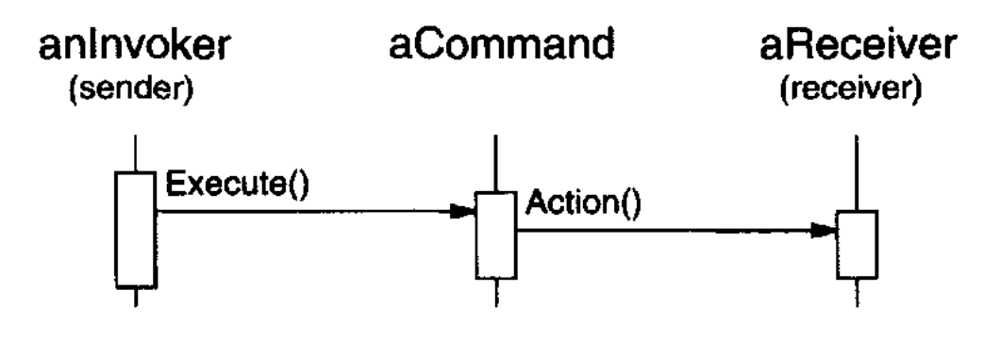
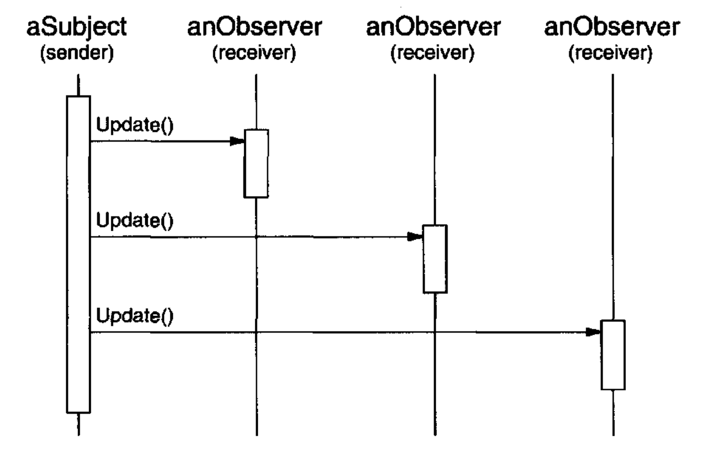
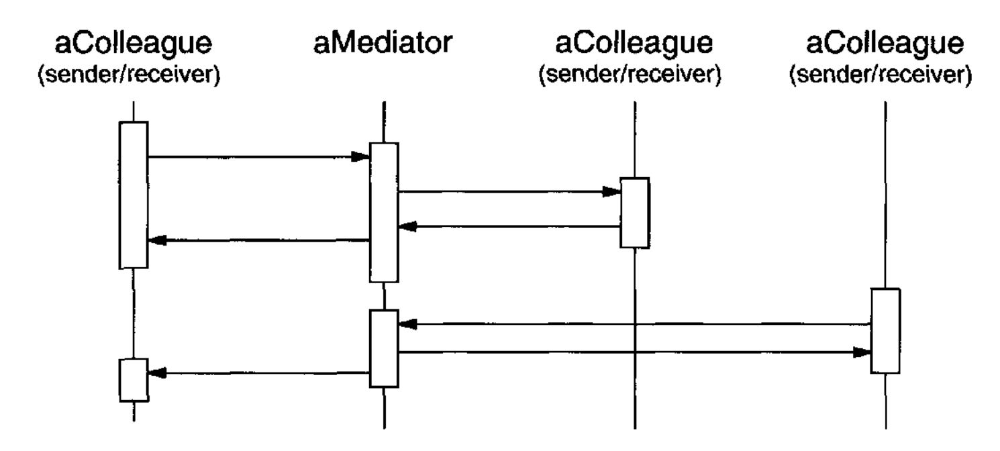
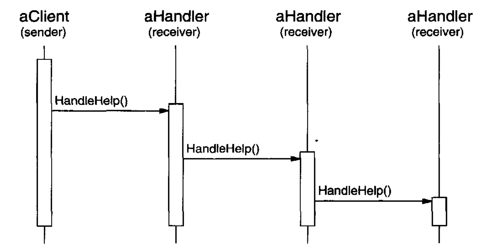

# 行为型模式讨论

## 封装变化

封装变化是许多行为模式的主题。
当程序的某个方面频繁变化时，这些模式定义一个封装该方面的对象。
然后，程序中依赖该方面的其他部分可以与这个对象协作。
这些模式通常定义一个描述该封装对象的抽象类，而模式从该对象获得其名称。¹² 例如，

- 一个 `Strategy` 对象封装一个算法（[Strategy (315)](9.md)），
- 一个 `State` 对象封装一个依赖状态的行为（[State (305)](8.md)），
- 一个 `Mediator` 对象封装对象之间的协议（[Mediator (273)](5.md)），以及
- 一个 `Iterator` 对象封装你访问和遍历聚合对象各组件的方式（[Iterator (257)](4.md)）。

¹² 这一主题也贯穿其他种类的模式。
[Abstract Factory (87)](../ch3/1.md)、[Builder (97)](../ch3/2.md) 和 [Prototype (117)](../ch3/4.md) 都封装关于对象如何创建的知识。
[Decorator (175)](../ch4/4.md) 封装可以添加到对象上的责任。
[Bridge (151)](../ch4/2.md) 将抽象与其实现分离，让它们能够独立变化。

这些模式描述了程序中可能发生变化的一些方面。
大多数模式有两类对象：封装该方面的新对象，以及使用这些新对象的现有对象。
通常，如果不是因为该模式，新对象的功能会成为现有对象不可分割的一部分。
例如，`Strategy` 的代码很可能被接入 strategy 的 `Context` 中，而 `State` 的代码会直接在 state 的 `Context` 中实现。

但并非所有对象行为模式都像这样划分功能。
例如，[Chain of Responsibility (223)](1.md) 处理任意数量的对象（即一条链），而所有这些对象可能都已经存在于系统中。

`Chain of Responsibility` 说明了行为模式的另一个差异：并非所有模式都定义类之间的静态通信关系。
`Chain of Responsibility` 规定在开放数量的对象之间进行通信。
其他模式则涉及作为参数传递的对象。

## 对象作为参数

有几种模式引入了一个总是作为参数使用的对象。
其中之一是 [Visitor (331)](11.md)。
`Visitor` 对象是它所访问对象上的多态 `Accept` 操作的参数。
visitor 从不被视为那些对象的一部分，尽管该模式的传统替代方案是将 `Visitor` 代码分布到对象结构类中。

其他模式定义的对象则充当 “魔法令牌 (magic tokens)”，被传来传去，并在稍后被调用。
[Command (233)](2.md) 和 [Memento (283)](6.md) 都属于这一类。
在 Command 中，令牌表示一个请求；在 Memento 中，它表示某个对象在特定时刻的内部状态。
在这两种情况下，令牌都可以具有复杂的内部表示，但客户端从不知道它。
不过即使在这里也有差异。
多态在 Command 模式中很重要，因为执行 `Command` 对象是一个多态操作。
相比之下，`Memento` 接口非常窄，以至于 memento 只能作为值传递。
因此，它很可能完全不向其客户端呈现任何多态操作。

## 通信应当被封装还是分布？

[Mediator (273)](5.md) 和 [Observer (293)](7.md) 是相互竞争的模式。
它们之间的区别在于，Observer 通过引入 `Observer` 和 `Subject` 对象来分布通信，
而 `Mediator` 对象则封装其他对象之间的通信。

在 Observer 模式中，没有单个对象封装某个约束。
相反，`Observer` 和 `Subject` 必须协作来维护该约束。
通信模式由 observer 和 subject 相互连接的方式决定：一个 subject 通常有许多 observer，
而有时一个 subject 的 observer 又是另一个 observer 的 subject。
Mediator 模式则集中而非分布。
它将维护约束的责任明确地放在 mediator 中。

我们发现，创建可复用的 `Observer` 和 `Subject` 比创建可复用的 `Mediator` 更容易。
Observer 模式促进 `Observer` 和 `Subject` 之间的划分和松散耦合，这会产生粒度更细的类，而这些类更可能被复用。

另一方面，Mediator 中的通信流比 Observer 中的更容易理解。
observer 和 subject 通常在创建后不久就连接起来，而在程序后期很难看出它们是如何连接的。
如果你了解 Observer 模式，那么你会明白 observer 和 subject 的连接方式很重要，并且你也知道应该寻找哪些连接。
然而，Observer 引入的间接性仍然会使系统更难理解。

在 Smalltalk 中，observer 可以用消息参数化，以访问 `Subject` 状态，因此它们比在 C++ 中更可复用。
这使得在 Smalltalk 中 Observer 比 Mediator 更有吸引力。
因此，Smalltalk 程序员经常会在 C++ 程序员会使用 Mediator 的地方使用 Observer。

## 解耦发送者和接收者

当协作对象直接相互引用时，它们就会相互依赖，这可能对系统的分层和可复用性产生不利影响。
Command、Observer、Mediator 和 Chain of Responsibility 都讨论了如何解耦发送者和接收者，但有不同的权衡。

Command 模式通过使用一个 `Command` 对象来定义发送者与接收者之间的绑定，从而支持解耦：

 

`Command` 对象为发出请求（即 `Execute` 操作）提供一个简单接口。
在单独的对象中定义发送者-接收者连接，使发送者能够与不同的接收者协作。
它使发送者与接收者保持解耦，从而使发送者易于复用。
此外，你可以复用 `Command` 对象，用不同的发送者来参数化一个接收者。
Command 模式名义上要求为每个发送者-接收者连接提供一个子类，尽管该模式描述了避免子类化的实现技术。

Observer 模式通过定义一个用于发出 subject 变化信号的接口，将发送者（subject）与接收者（observer）解耦。
Observer 定义的发送者-接收者绑定比 Command 更松散，因为一个 subject 可以有多个 observer，而且它们的数量可以在运行时变化。

 

Observer 模式中的 `Subject` 和 `Observer` 接口是为通信变化而设计的。
因此，当对象之间存在数据依赖时，Observer 模式最适合解耦这些对象。

Mediator 模式通过让对象经由一个 `Mediator` 对象间接相互引用来解耦它们。

 

一个 `Mediator` 对象在 `Colleague` 对象之间路由请求，并集中它们的通信。
因此，colleague 只能通过 `Mediator` 接口相互交谈。
由于该接口是固定的，mediator 可能必须实现自己的分派方案以增加灵活性。
请求可以被编码，参数可以被打包，使得 colleague 能够请求开放式的操作集。

Mediator 模式可以减少系统中的子类化，因为它将通信行为集中在一个类中，而不是把它分布到各子类中。
然而，临时性的分派方案通常会降低类型安全性。

最后，`Chain of Responsibility` 模式通过沿一条潜在接收者链传递请求，将发送者与接收者解耦：

 

由于发送者与接收者之间的接口是固定的，Chain of Responsibility 也可能需要一种定制的分派方案。
因此，它具有与 Mediator 相同的类型安全缺点。
如果该链已经是系统结构的一部分，并且多个对象之一可能处于能够处理请求的位置，
那么 Chain of Responsibility 是解耦发送者与接收者的一种好方法。
此外，该模式还提供了额外的灵活性，因为该链可以很容易地被更改或扩展。

## 总结

除少数例外，行为型设计模式彼此补充并相互强化。
例如，一个职责链中的类很可能至少包含一次 [Template Method (325)](10.md) 的应用。
Template method 可以使用原始操作来确定该对象是否应处理请求，并选择要转发到的对象。
该链可以使用 Command 模式将请求表示为对象。
[Interpreter (243)](3.md) 可以使用 State 模式来定义解析上下文。
一个 iterator 可以遍历一个聚合，而一个 visitor 可以对聚合中的每个元素应用一个操作。

行为模式也能很好地与其他模式协作。
例如，一个使用 [Composite (163)](../ch4/3.md) 模式的系统可能使用 visitor 来对 composition 的组件执行操作。
它可以使用 Chain of Responsibility 让组件通过其父对象访问全局属性。
它还可以使用 [Decorator (175)](../ch4/4.md) 在 composition 的某些部分上覆盖这些属性。
它可以使用 Observer 模式将一个对象结构连接到另一个对象结构，
并使用 State 模式让一个组件在其状态变化时改变其行为。
composition 本身可能使用 [Builder (97)](../ch3/2.md) 中的方法来创建，
并且它可能被系统的其他某个部分当作 [Prototype (117)](../ch3/4.md) 对待。

设计良好的面向对象系统正是如此 ——它们内嵌了多个模式—— 但并不是因为其设计者一定以这些术语来思考。
在模式层面而不是类或对象层面进行组合，让我们能够更轻松地实现同样的协同效应。
