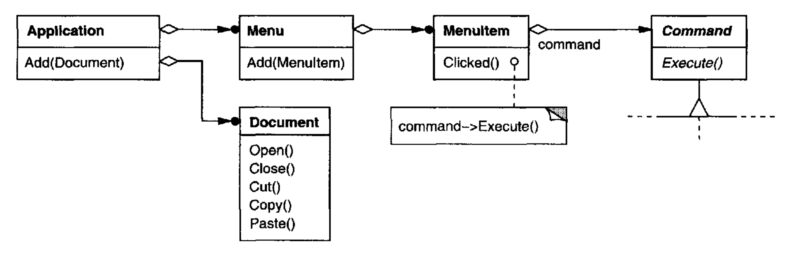
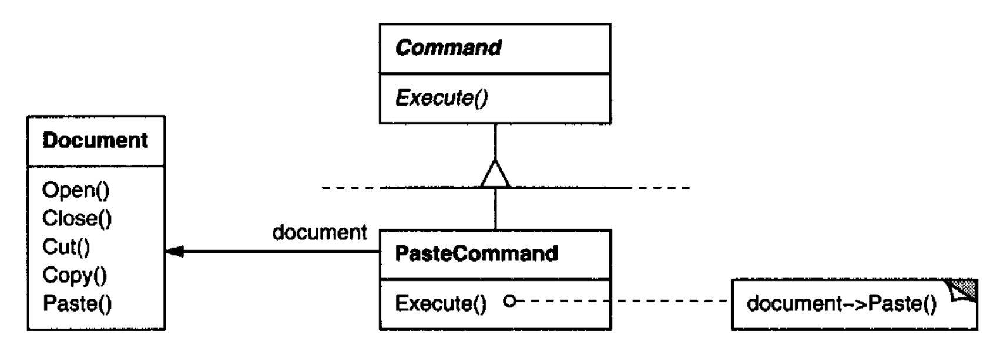
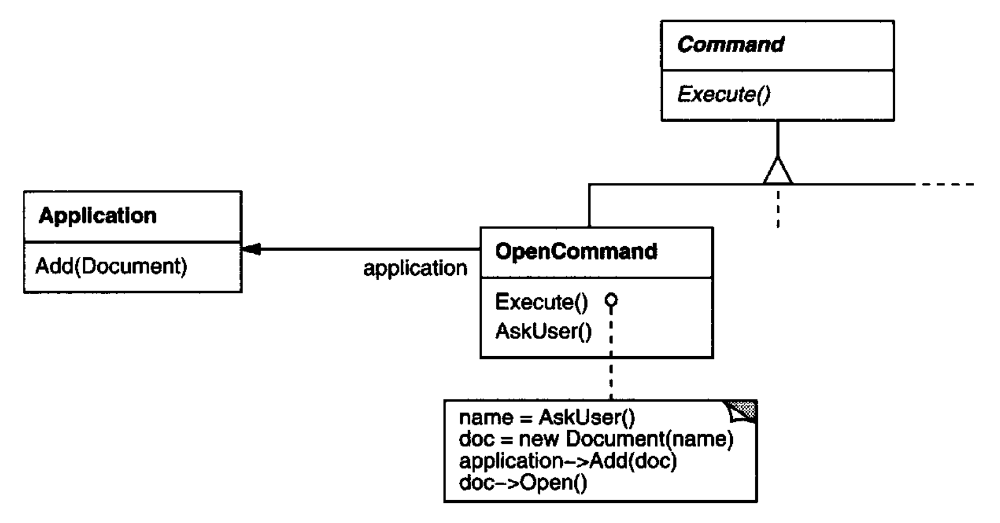
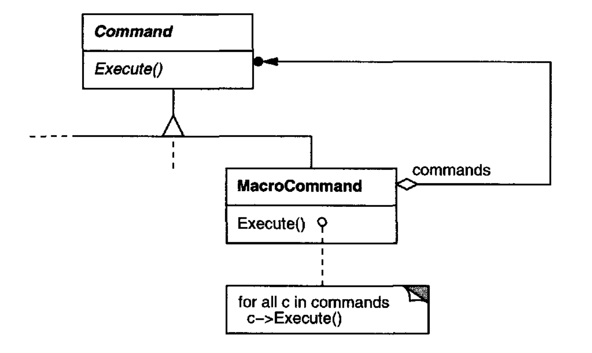
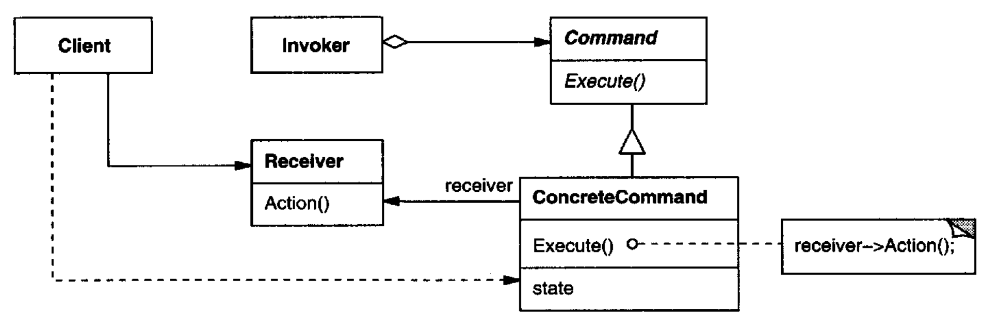
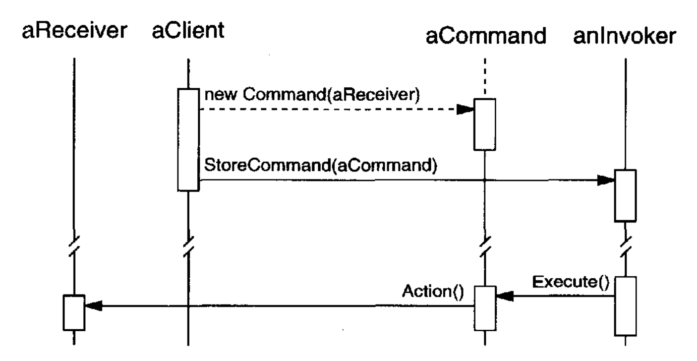

# Command （行为型对象模式）

## 意图

将一个请求封装为一个对象，从而使你可以用不同的请求对客户端进行参数化，对请求进行排队或记录，并支持可撤销操作。

## 别名

Action, Transaction

## 动机

有时有必要向对象发出请求，而不需要知道被请求的操作或请求的接收者的任何信息。
例如，用户界面工具包包含诸如按钮和菜单之类的对象，它们响应用户输入来执行请求。
但工具包无法在按钮或菜单中显式实现该请求，因为只有使用该工具包的应用程序才知道应该在哪个对象上做什么。
作为工具包设计者，我们无法知道请求的接收者或将要执行它的操作。

Command 模式通过将请求本身变成一个对象，使工具包对象能够向未指定的应用程序对象发出请求。
这个对象可以像其他对象一样被存储和传递。
这个模式的关键是一个抽象 `Command` 类，它声明用于执行操作的接口。
在最简单的形式中，这个接口包括一个抽象 `Execute` 操作。
具体的 `Command` 子类通过将接收者存储为实例变量，并实现 `Execute` 来调用请求，
从而指定一个 receiver-action 对。
接收者拥有执行请求所需的知识。

<br/>

菜单可以很容易地用 `Command` 对象来实现。
`Menu` 中的每个选项都是一个 `MenuItem` 类的实例。
一个 `Application` 类会创建这些菜单及其菜单项，以及用户界面的其余部分。
`Application` 类还跟踪用户已打开的 `Document` 对象。

应用程序使用一个具体 `Command` 子类的实例来配置每个 `MenuItem`。
当用户选择一个 `MenuItem` 时，`MenuItem` 会在其 command 上调用 `Execute`，而 `Execute` 执行该操作。
`MenuItem` 不知道它们使用的是哪个 `Command` 子类。
`Command` 子类存储请求的接收者，并在接收者上调用一个或多个操作。

例如，`PasteCommand` 支持将文本从剪贴板粘贴到 `Document` 中。
`PasteCommand` 的接收者是在实例化时提供给它的 `Document` 对象。
`Execute` 操作在接收的 `Document` 上调用 `Paste`。

<br/>

`OpenCommand` 的 `Execute` 操作不同：它提示用户输入文档名，创建一个相应的 `Document` 对象，将该文档添加到接收它的应用程序中，并打开该文档。

<br/>

有时一个 `MenuItem` 需要执行一串命令。
例如，一个用于将页面按正常大小居中的 `MenuItem` 可以由一个 `CenterDocumentCommand` 对象和一个 `NormalSizeCommand` 对象构造而成。
由于以这种方式将命令串接起来很常见，我们可以定义一个 `MacroCommand` 类，以允许一个 `MenuItem` 执行开放数量的命令。
`MacroCommand` 是一个具体 `Command` 子类，它只是执行一串 `Command`。
`MacroCommand` 没有显式接收者，因为它所串接的命令定义了自己的接收者。

<br/>

在这些示例中的每一个里，注意 `Command` 模式如何将调用操作的对象，与拥有执行该操作所需知识的对象解耦。
这在我们设计用户界面时提供了很大的灵活性。
一个应用程序可以仅通过让菜单和按钮共享同一个具体 `Command` 子类的实例，就为某个功能同时提供菜单和按钮界面。
我们可以动态替换命令，这对于实现上下文敏感菜单很有用。
我们还可以通过将命令组合成更大的命令来支持命令脚本。
所有这些之所以可能，是因为发出请求的对象只需要知道如何发出请求；它不需要知道请求将如何被执行。

## 适用性

在以下情况下使用 `Command` 模式：

- 通过要执行的动作来参数化对象，如上面的 `MenuItem` 对象所做的那样。
你可以在过程式语言中用 **回调 (callback)** 函数来表达这种参数化，也就是说，一个在某个地方注册以便稍后被调用的函数。
Command 是回调的面向对象替代品。

- 在不同的时间指定、排队和执行请求。
一个 `Command` 对象的生命周期可以独立于最初的请求。
如果请求的接收者可以用一种与地址空间无关的方式表示，那么你可以将该请求的 command 对象传输到另一个进程，并在那里满足该请求。

- 支持撤销。
`Command` 的 `Execute` 操作可以在 command 本身中存储用于反转其效果的状态。
`Command` 接口必须增加一个 `Unexecute` 操作，用于反转先前对 `Execute` 调用的效果。
已执行的 command 被存储在一个历史列表中。
无限级撤销和重做通过分别向后和向前遍历该列表，调用 `Unexecute` 和 `Execute` 来实现。

- 支持记录更改，以便在系统崩溃时可以重新应用这些更改。
通过用 `load` 和 `store` 操作增强 `Command` 接口，你可以保留更改的持久日志。
从崩溃中恢复涉及从磁盘重新加载已记录的 command，并用 `Execute` 操作重新执行它们。

- 围绕建立在原始操作之上的高层操作来组织系统。
这种结构在支持 **事务 (transactions)** 的信息系统中很常见。
一个事务封装了一组对数据的更改。
`Command` 模式提供了一种对事务建模的方式。
Command 具有公共接口，让你可以用同样的方式调用所有事务。
该模式还使系统易于用新事务进行扩展。

## 结构

<br/>

## 参与者

- **Command**

  - 声明一个用于执行操作的接口。

- **ConcreteCommand** （`PasteCommand`、`OpenCommand`）

  - 定义一个 `Receiver` 对象与一个动作之间的绑定。
  - 通过在 `Receiver` 上调用相应的操作来实现 `Execute`。

- **Client** （`Application`）

  - 创建一个 `ConcreteCommand` 对象并设置其接收者。

- **Invoker** （`MenuItem`）

  - 要求 command 执行请求。

- **Receiver** （`Document`、`Application`）

  - 知道如何执行与满足请求相关的操作。任何类都可以充当 `Receiver`。

## 协作

- `client` 创建一个 `ConcreteCommand` 对象并指定其接收者。

- 一个 `Invoker` 对象存储该 `ConcreteCommand` 对象。

- 调用者通过在 command 上调用 `Execute` 来发出请求。
当 command 可撤销时，`ConcreteCommand` 会在调用 `Execute` 之前存储用于撤销该 command 的状态。

- `ConcreteCommand` 对象在其接收者上调用操作以执行请求。

下面的图展示了这些对象之间的交互。
它说明了 `Command` 如何将调用者与接收者（以及它所执行的请求）解耦。

<br/>

## 效果

`Command` 模式具有以下效果：

1. Command 将调用操作的对象与知道如何执行该操作的对象解耦。

2. Command 是一等对象。它们可以像任何其他对象一样被操作和扩展。

3. 你可以将 command 组合成复合 command。
一个例子是前面描述的 `MacroCommand` 类。
一般来说，复合 command 是 [Composite (163)](../ch4/3.md) 模式的一个实例。

4. 很容易添加新的 `Command`，因为你不必更改现有类。

## 实现

在实现 `Command` 模式时，考虑以下问题：

1. *一个 command 应该有多智能？*
一个 command 可以具有范围很广的能力。
在一个极端，它仅仅定义一个接收者与执行请求的动作之间的绑定。
在另一个极端，它自己实现一切，完全不委托给接收者。
后一个极端在你想要定义独立于现有类的 command 时、当不存在合适的接收者时，
或者当一个 command 隐式知道其接收者时很有用。
例如，一个创建另一个应用程序窗口的 command，可能和任何其他对象一样有能力创建该窗口。
在这两个极端之间的某个位置，是那些拥有足够知识以动态找到其接收者的 command。

2. *支持撤销和重做。*
如果提供了一种反转其执行的方式（例如，一个 `Unexecute` 或 `Undo` 操作），`Command` 就可以支持撤销和重做能力。
一个 `ConcreteCommand` 类可能需要存储额外的状态来做到这一点。
这种状态可以包括：

   - `Receiver` 对象，它实际上响应请求来执行操作，

   - 在接收者上执行的操作的参数，以及

   - 接收者中可能因处理请求而改变的任何原始值。
   接收者必须提供操作，让 command 能够将接收者恢复到其先前的状态。

   为了支持一级撤销，一个应用程序只需要存储最后执行的那个 command。
   对于多级撤销和重做，应用程序需要一个已执行 command 的 **历史列表** ，其中列表的最大长度决定了撤销/重做的级数。
   历史列表存储已执行 command 的序列。
   向后遍历该列表并反向执行 command 会取消它们的效果；向前遍历并执行 command 会重新执行它们。

   一个可撤销的 command 在被放入历史列表之前可能必须被复制。
   这是因为执行最初请求的 command 对象 ——比如来自一个 `MenuItem` 的请求—— 会在以后执行其他请求。
   如果同一个 command 的状态可能在不同调用之间变化，就需要复制，以区分它的不同调用。

   例如，一个删除所选对象的 `DeleteCommand` 每次执行时都必须存储不同的对象集合。
   因此，`DeleteCommand` 对象在执行后必须被复制，而副本被放入历史列表。
   如果 command 的状态在执行时从不改变，那么就不需要复制 —— 只需将对 command 的引用放入历史列表即可。
   那些在被放入历史列表之前必须被复制的 command 充当原型（见 [Prototype (117)](../ch3/4.md) ）。

3. *避免撤销过程中的错误累积。*
在确保可靠、保持语义的撤销/重做机制时，迟滞可能是一个问题。
当 command 被反复执行、取消执行和重新执行时，错误可能会累积，从而使应用程序的状态最终偏离原始值。
因此，可能有必要在 command 中存储更多信息，以确保对象被恢复到其原始状态。
[Memento (283)](6.md) 模式可以被应用来让 command 访问这些信息，而不会暴露其他对象的内部结构。

4. *使用 C++ 模板。*
对于 (1) 不可撤销且 (2) 不需要参数的 command，
我们可以使用 C++ 模板来避免为每种动作和接收者都创建一个 `Command` 子类。
我们将在示例代码部分展示如何做到这一点。

## 示例代码

这里展示的 C++ 代码勾勒了 "动机" 部分中 `Command` 类的实现。
我们将定义 `OpenCommand`、`PasteCommand` 和 `MacroCommand`。
首先是抽象 `Command` 类：

```cpp
class Command {
public:
    virtual ~Command();

    virtual void Execute() = 0;
protected:
    Command();
};
```

`OpenCommand` 打开一个由用户提供名称的文档。
`OpenCommand` 必须在其构造函数中传入一个 `Application` 对象。
`AskUser` 是一个实现例程，用于提示用户输入要打开的文档的名称。

```cpp
class OpenCommand : public Command {
public:
    OpenCommand(Application*);

    virtual void Execute();
protected:
    virtual const char* AskUser();
private:
    Application* _application;
    char* _response;
};

OpenCommand::OpenCommand (Application* a) {
    _application = a;
}

void OpenCommand::Execute () {
    const char* name = AskUser();

    if (name != 0) {
        Document* document = new Document(name);
        _application->Add(document);
        document->Open();
    }
}
```

一个 `PasteCommand` 必须传入一个 `Document` 对象作为其接收者。
该接收者作为参数提供给 `PasteCommand` 的构造函数。

```cpp
class PasteCommand : public Command {
public:
    PasteCommand(Document*);

    virtual void Execute();
private:
    Document* _document;
};

PasteCommand::PasteCommand (Document* doc) {
    _document = doc;
}

void PasteCommand::Execute () {
    _document->Paste();
}
```

对于简单、不可撤销且不需要参数的 command，我们可以使用类模板来参数化 command 的接收者。
我们将为这类 command 定义一个模板子类 `SimpleCommand`。
`SimpleCommand` 由 `Receiver` 类型参数化，
并维护一个接收者对象与一个动作之间的绑定，该动作存储为指向成员函数的指针。

```cpp
template <class Receiver>
class SimpleCommand : public Command {
public:
    typedef void (Receiver::* Action)();

    SimpleCommand(Receiver* r, Action a) :
        _receiver(r), _action(a) { }

    virtual void Execute();
private:
    Action _action;
    Receiver* _receiver;
};
```

构造函数将接收者和动作存储在相应的实例变量中。`Execute` 只是将该动作应用于接收者。

```cpp
template <class Receiver>
void SimpleCommand<Receiver>::Execute () {
    (_receiver->*_action)();
}
```

要创建一个在 `MyClass` 类实例上调用 `Action` 的 command，客户端只需这样写：

```cpp
MyClass* receiver = new MyClass;
// . . .
Command* aCommand =
    new SimpleCommand<MyClass>(receiver, &MyClass::Action);
// . . .
aCommand->Execute();
```

请记住，这种解决方案只适用于简单 command。
更复杂的 command 不仅要跟踪其接收者，还要跟踪参数和/或撤销状态，因此需要 `Command` 子类。

一个 `MacroCommand` 管理一串子 command，并提供添加和移除子 command 的操作。
不需要显式接收者，因为子 command 已经定义了自己的接收者。

```cpp
class MacroCommand : public Command {
public:
    MacroCommand();
    virtual ~MacroCommand();

    virtual void Add(Command*);
    virtual void Remove(Command*);

    virtual void Execute();
private:
    List<Command*>* _cmds;
};
```

`MacroCommand` 的关键是它的 `Execute` 成员函数。
它会遍历所有子 command，并对每个子 command 执行 `Execute`。

```cpp
void MacroCommand::Execute () {
    ListIterator<Command*> i(_cmds);
    for (i.First(); !i.IsDone(); i.Next()) {
        Command* c = i.CurrentItem();
        c->Execute();
    }
}
```

注意，如果 `MacroCommand` 要实现一个 `Unexecute` 操作，那么它的子 command 必须按照与 `Execute` 实现相反的顺序被取消执行。

最后，`MacroCommand` 必须提供管理其子 command 的操作。
`MacroCommand` 还负责删除其子 command。

```cpp
void MacroCommand::Add (Command* c) {
    _cmds->Append(c);
}

void MacroCommand::Remove (Command* c) {
    _cmds->Remove(c);
}
```

## 已知应用

也许 Command 模式的第一个例子出现在 Lieberman 的一篇论文中 [Lie85](../biblio.md#lie85)。
MacApp [App89](../biblio.md#app89) 普及了使用 command 来实现可撤销操作的概念。
ET++ [WGM88](../biblio.md#wgm88)、InterViews [LCI+92](../biblio.md#lci92) 和 Unidraw [VL90](../biblio.md#vl90) 也定义了遵循 Command 模式的类。
InterViews 定义了一个 `Action` 抽象类，提供 command 功能。
它还定义了一个 `ActionCallback` 模板，由 action 方法参数化，可以自动实例化 command 子类。

THINK 类库 [Sym93b](../biblio.md#sym93b) 也使用 command 来支持可撤销动作。
THINK 中的 command 被称为 “Task”。
Task 对象沿着一条 [Chain of Responsibility (223)](1.md) 传递以供消费。

Unidraw 的 command 对象独特之处在于它们可以像消息一样行为。
一个 Unidraw command 可以被发送到另一个对象进行解释，而解释的结果随接收对象而变化。
此外，接收者可以将解释委托给另一个对象，通常是在更大结构中接收者的父对象，就像在职责链中一样。
因此，Unidraw command 的接收者是计算出来的，而不是存储的。
Unidraw 的解释机制依赖于运行时类型信息。

Coplien 描述了如何在 C++ 中实现 **functors** ，即作为函数的对象 [Cop92](../biblio.md#cop92)。
他通过重载函数调用运算符（`operator()`）在一定程度上实现了使用时的透明性。
这个 Command 模式不同；它的重点是在接收者和函数（即 action）之间维护绑定，而不仅仅是维护一个函数。

## 相关模式

[Composite (163)](../ch4/3.md) 可以用来实现 `MacroCommand`。

[Memento (283)](6.md) 可以保存 command 撤销其效果所需的状态。

一个在放入历史列表之前必须被复制的 command 充当 [Prototype (117)](../ch3/4.md)。
