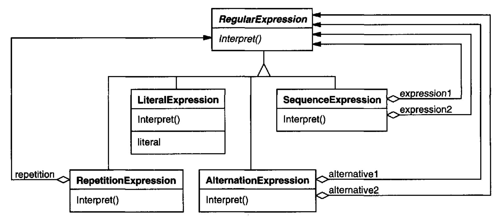
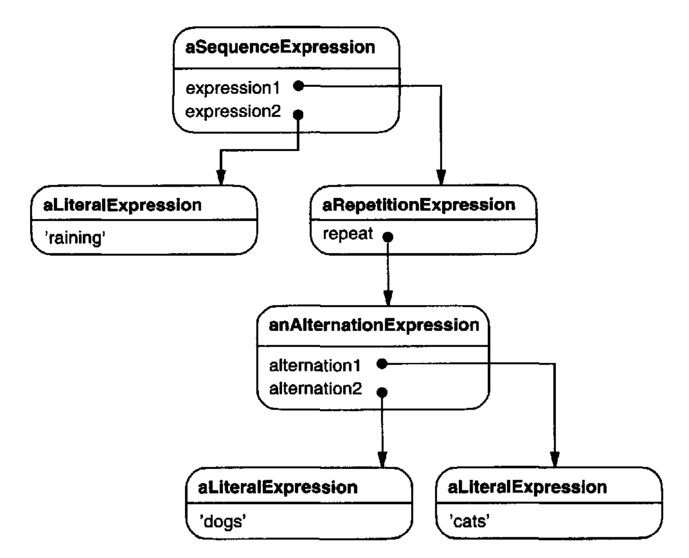
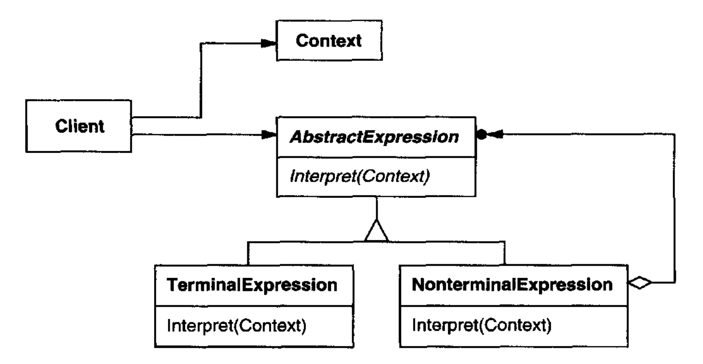

# Interpreter （行为型类模式）

## 意图

给定一种语言，定义其语法的表示，并定义一个解释器，该解释器使用该表示来解释语言中的句子。

## 动机

如果某类问题出现得足够频繁，那么将这类问题的实例表示为一种简单语言中的句子可能是值得的。
然后你可以构建一个解释器 (interpreter)，通过解释这些句子来解决问题。

例如，搜索匹配某个模式的字符串是一个常见问题。
正则表达式是指定字符串模式的标准语言。
搜索算法可以解释一个指定要匹配的字符串集合的正则表达式，而不是为每个模式构建定制的字符串匹配算法。

Interpreter 模式描述了如何为简单语言定义语法、表示该语言中的句子，以及解释这些句子。
在这个例子中，该模式描述了如何为正则表达式定义语法、表示一个特定的正则表达式，以及如何解释该正则表达式。

假设以下语法定义了正则表达式：

```text
expression ::= literal | alternation | sequence | repetition | '(' expression ')'
alternation ::= expression '|' expression
sequence ::= expression '&' expression
repetition ::= expression '*'
literal ::= 'a' | 'b' | 'c' | ... { 'a' | 'b' | 'c' | ... }*
```

符号 `expression` 是开始符号，而 `literal` 是定义简单单词的终结符 (terminal symbol)。

<a id="five-classes"></a>
Interpreter 模式使用一个类来表示每条语法规则。
规则右侧的符号是这些类的实例变量。
上面的语法由五个类表示：一个抽象类 `RegularExpression` 及其四个子类 `LiteralExpression`、`AlternationExpression`、`SequenceExpression` 和 `RepetitionExpression`。
最后三个类定义了保存子表达式的变量。

<br/>

由该语法定义的每个正则表达式都由一棵抽象语法树表示，该树由这些类的实例构成。
例如，抽象语法树

<br/>

表示正则表达式

```text
raining & (dogs | cats) *
```

我们可以通过在每个 `RegularExpression` 的子类上定义 `Interpret` 操作，为这些正则表达式创建一个解释器。
`Interpret` 接受一个参数，即解释该表达式所在的上下文。
该上下文包含输入字符串以及到目前为止已匹配多少内容的信息。
`RegularExpression` 的每个子类都实现 `Interpret`，以根据当前上下文匹配输入字符串的下一部分。例如，

- `LiteralExpression` 将检查输入是否匹配它所定义的字面量 (literal)，

- `AlternationExpression` 将检查输入是否匹配其任一备选项，

- `RepetitionExpression` 将检查输入是否具有多个它所重复的表达式，

依此类推。

## 适用性

当你有一种要解释的语言，并且可以将该语言中的语句表示为抽象语法树时，使用 Interpreter 模式。
Interpreter 模式在以下情况下效果最好：

- 语法很简单。
对于复杂语法，用于该语法的类层次结构会变得庞大且难以管理。
在这种情况下，诸如 parser generator 之类的工具是更好的替代方案。
它们可以解释表达式而无需构建抽象语法树，这可以节省空间，也可能节省时间。

- 效率不是关键问题。
最高效的解释器通常不是通过直接解释解析树来实现的，而是先将它们翻译成另一种形式。
例如，正则表达式通常被转换为状态机。
但即便如此，*转换器 (translator)* 也可以用 Interpreter 模式实现，因此该模式仍然适用。

## 结构

<br/>

## 参与者

- **AbstractExpression** （`RegularExpression`）
  - 声明一个抽象 `Interpret` 操作，该操作对抽象语法树中的所有节点都是公共的。

- **TerminalExpression** （`LiteralExpression`）
  - 实现与语法中终结符 (terminal symbols) 相关联的 `Interpret` 操作。

  - 句子中的每个终结符都需要一个实例。

- **NonterminalExpression** （`AlternationExpression`、`RepetitionExpression`、`SequenceExpression`）
  - 对语法中的每条规则 `R ::= R1 R2 ... Rn` 都需要一个这样的类。

  - 为符号 `R1` 到 `Rn` 中的每一个维护 `AbstractExpression` 类型的实例变量。

  - 为语法中的非终结符实现一个 `Interpret` 操作。`Interpret` 通常会在表示 `R1` 到 `Rn` 的变量上递归调用自身。

- **Context**
  - 包含对解释器全局的信息。

- **Client**
  - 构建（或被给予）一棵抽象语法树，表示该语法所定义语言中的一个特定语句。
  该抽象语法树由 `NonterminalExpression` 和 `TerminalExpression` 类的实例组装而成。

  - 调用 `Interpret` 操作。

## 协作

- `Client` 将句子构建（或被给予）为一棵由 `NonterminalExpression` 和 `TerminalExpression` 实例组成的抽象语法树。
然后初始化 `context` 并调用 `Interpret` 操作。

- 每个 `NonterminalExpression` 节点都根据对其每个子表达式的 `Interpret` 来定义 `Interpret`。
每个 `TerminalExpression` 的 `Interpret` 操作定义递归的基础 (base case)。

- 每个节点上的 `Interpret` 操作使用 `context` 来存储和访问解释器的状态。

## 效果

Interpreter 模式具有以下优点和缺点：

1. *容易更改和扩展语法。*
由于该模式使用类来表示语法规则，你可以使用继承来更改或扩展语法。
现有表达式可以被增量修改，而新表达式可以定义为旧表达式的变体。

2. *实现语法也很容易。*
定义抽象语法树中节点的类具有相似的实现。
这些类容易编写，而且它们的生成通常可以通过编译器或 parser generator 自动化。

3. *复杂语法难以维护。*
Interpreter 模式至少为语法中的每条规则定义一个类（使用 BNF 定义的语法规则可能需要多个类）。
因此，包含许多规则的语法可能难以管理和维护。
可以应用其他设计模式来缓解这个问题（见实现）。
但当语法非常复杂时，诸如 parser 或编译器生成器之类的其他技术更合适。

4. *添加解释表达式的新方式。*
Interpreter 模式使以新方式求值表达式变得更容易。
例如，你可以通过在表达式类上定义新操作来支持对表达式进行优美打印或类型检查。
如果你不断创建解释表达式的新方式，那么考虑使用 [Visitor (331)](11.md) 模式来避免更改语法类。

## 实现

Interpreter 和 [Composite (163)](../ch4/3.md) 模式共享许多实现问题。
以下问题是 Interpreter 特有的：

1. *创建抽象语法树。*
Interpreter 模式没有说明如何创建抽象语法树。
换句话说，它没有涉及解析。
抽象语法树可以由表驱动的 parser 创建，由手工编写的（通常是递归下降）parser 创建，或由客户端直接创建。

2. *定义 `Interpret` 操作。*
你不必在表达式类中定义 `Interpret` 操作。
如果创建一个新解释器很常见，那么最好使用 [Visitor (331)](11.md) 模式，将 `Interpret` 放在一个单独的 “visitor” 对象中。
例如，一种编程语言的语法会有许多作用于抽象语法树的操作，例如类型检查、优化、代码生成等等。
更可能使用 visitor 来避免在每个语法类上定义这些操作。

3. *使用 Flyweight 模式共享终结符。*
其句子包含许多终结符出现次数的语法，可能会受益于共享该符号的单个副本。
计算机程序的语法就是很好的例子 —— 每个程序变量都会在整个代码中的许多地方出现。
在 "动机" 示例中，一个句子可能有许多次出现终结符 `dog`（由 `LiteralExpression` 类建模）。

   终结节点通常不存储有关其在抽象语法树中位置的信息。
   父节点在解释期间向它们传递它们所需的任何上下文。
   因此，共享的（内在）状态与传入的（外在）状态之间存在区别，而 Flyweight 模式适用。
   例如，`dog` 的每个 `LiteralExpression` 实例都会接收一个包含到目前为止已匹配子字符串的 context。
   而且每个这样的 `LiteralExpression` 在其 `Interpret` 操作中都做同样的事情 ——它检查输入的下一个部分是否包含 `dog`—— 无论该实例出现在树中的什么位置。

## 示例代码

<a id="regexp-example"></a>
这里有两个示例。
第一个是完整的 Smalltalk 示例，用于检查一个序列是否匹配某个正则表达式。
第二个是用于求值布尔表达式的 C++ 程序。

正则表达式匹配器测试一个字符串是否属于该正则表达式所定义的语言。
该正则表达式由以下语法定义：

```text
expression ::= literal | alternation | sequence | repetition | '(' expression ')'
alternation ::= expression '|' expression
sequence ::= expression '&' expression
repetition ::= expression 'repeat'
literal ::= 'a' | 'b' | 'c' | ... { 'a' | 'b' | 'c' | ... }*
```

这个语法是对 "动机" 示例的轻微修改。
我们稍微改变了正则表达式的具体语法，因为符号 "*" 在 Smalltalk 中不能作为后缀操作。
所以我们改用 `repeat`。例如，正则表达式

```text
(('dog ' | 'cat ') repeat & 'weather')
```

匹配输入字符串 “dog dog cat weather”。

为了实现该匹配器，我们定义第 [243](#five-classes) 页描述的那五个类。
`SequenceExpression` 类具有实例变量 `expression1` 和 `expression2`，用于其在抽象语法树中的子节点。
`AlternationExpression` 将其备选项存储在实例变量 `alternative1` 和 `alternative2` 中，
而 `RepetitionExpression` 将其重复的表达式保存在其 `repetition` 实例变量中。
`LiteralExpression` 有一个 `components` 实例变量，保存一个对象列表（可能是字符）。
这些对象表示必须匹配输入序列的字面字符串。

> 译注：原文中 `LiteralExpression` 有一个 `literal` 实例变量，没有 `components` 实例变量。

`match:` 操作实现了一个用于该正则表达式的解释器。
定义抽象语法树的每个类都实现该操作。
它接受输入 `State` 作为参数，表示匹配过程的当前状态，即已经读取了输入字符串的一部分。

这个当前状态由一组输入流来刻画，表示该正则表达式到目前为止可能已经接受的输入集合。
（这大致相当于记录等价有限状态自动机，在识别到当前输入流时可能处于的所有状态。）

当前状态对 `repeat` 操作最为重要。
例如，如果正则表达式是

```text
'a' repeat
```

那么解释器可以匹配 “a”、“aa”、“aaa”，依此类推。如果它是

```text
'a' repeat & 'bc'
```

那么它可以匹配 “abc”、“aabc”、“aaabc”，依此类推。但如果正则表达式是

```text
'a' repeat & 'abc'
```

那么将输入 “aabc” 与子表达式 “`'a' repeat`” 匹配会产生两个输入流，一个已匹配输入的一个字符，另一个已匹配两个字符。
只有已接受一个字符的那个流会匹配剩余的 “abc”。

现在我们考虑定义正则表达式的每个类的 `match:` 定义。
`SequenceExpression` 的定义按顺序匹配它的每个子表达式。
通常它会从 `inputState` 中消除一些输入流。

```smalltalk
match: inputState
    ^ expression2 match: (expression1 match: inputState).
```

一个 `AlternationExpression` 将返回一个状态，该状态由任一备选项的状态并集组成。
`AlternationExpression` 的 `match:` 定义是

```smalltalk
match: inputState
    | finalState |
    finalState := alternative1 match: inputState.
    finalState addAll: (alternative2 match: inputState).
    ^ finalState
```

`RepetitionExpression` 的 `match:` 操作尝试找到尽可能多的可能匹配状态：

```smalltalk
match: inputState
    | aState finalState |
    aState := inputState.
    finalState := inputState copy.
    [aState isEmpty]
        whileFalse:
            [aState := repetition match: aState.
            finalState addAll: aState].
        ^ finalState
```

它的输出状态通常比输入状态包含更多状态，
因为一个 `RepetitionExpression` 可以匹配输入状态上的一次、两次或多次 repetition。
输出状态表示所有这些可能性，从而允许正则表达式的后续元素决定哪个状态是正确的。

最后，`LiteralExpression` 的 `match:` 定义尝试将其 `components` 与每个可能的输入流进行匹配。它只保留那些匹配的输入流：

```smalltalk
match: inputState
    | finalState tStream |
    finalState := Set new.
    inputState
        do:
            [:stream | tStream := stream copy.
            (tStream nextAvailable:
                components size
            ) = components
                ifTrue: [finalState add: tStream]
            ].
        ^ finalState
```

`nextAvailable:` 消息会推进输入流。
这是唯一会推进流的 `match:` 操作。
注意，返回的状态包含输入流的一个副本，从而确保匹配字面量永远不会改变输入流。
这很重要，因为 `AlternationExpression` 的每个备选项都应该看到输入流的相同副本。

既然我们已经定义了构成抽象语法树的类，我们就可以描述如何构建它。
我们不会为正则表达式编写 parser，而是在 `RegularExpression` 类上定义一些操作，使得求值一个 Smalltalk 表达式会为相应的正则表达式生成一棵抽象语法树。
这让我们可以使用内置的 Smalltalk 编译器，就像它是正则表达式的 parser 一样。

为了构建抽象语法树，我们需要将 “`|`”、“`repeat`” 和 “`&`” 定义为 `RegularExpression` 上的操作。
这些操作在 `RegularExpression` 类中定义如下：

```smalltalk
& aNode
    ^ SequenceExpression new
        expression1: self expression2: aNode asRExp

repeat
    ^ RepetitionExpression new repetition: self

| aNode
    ^ AlternationExpression new
        alternative1: self alternative2: aNode asRExp

asRExp
    ^ self
```

`asRExp` 操作会将字面量转换为 `RegularExpression`。这些操作定义在 `String` 类中：

```smalltalk
& aNode
    ^ SequenceExpression new
        expression1: self asRExp expression2: aNode asRExp

repeat
    ^ RepetitionExpression new repetition: self

| aNode
    ^ AlternationExpression new
        alternative1: self asRExp alternative2: aNode asRExp

asRExp
    ^ LiteralExpression new components: self
```

如果我们在类层次结构中更高的位置定义这些操作
（在 Smalltalk-80 中是 `SequenceableCollection`，在 Smalltalk/V 中是 `IndexedCollection`），
那么它们也会为诸如 `Array` 和 `OrderedCollection` 之类的类定义。
这将使正则表达式能够匹配任何类型对象的序列。

第二个示例是一个用 C++ 实现的、用于操作和求值布尔表达式的系统。
该语言中的终结符是布尔变量，也就是常量 `true` 和 `false`。
非终结符表示包含运算符 `and`、`or` 和 `not` 的表达式。
语法定义如下¹：

```text
BooleanExp ::= VariableExp | Constant | OrExp | AndExp | NotExp | '(' BooleanExp ')'
AndExp ::= BooleanExp 'and' BooleanExp
OrExp ::= BooleanExp 'or' BooleanExp
NotExp ::= 'not' BooleanExp
Constant ::= 'true' | 'false'
VariableExp ::= 'A' | 'B' | ... | 'X' | 'Y' | 'Z'
```

¹ 为简单起见，我们忽略运算符优先级，并假定这是构造语法树的任何对象的责任。

我们在布尔表达式上定义两个操作。
第一个是 `Evaluate`，它在为每个变量赋予 true 或 false 值的上下文中求值一个布尔表达式。
第二个操作是 `Replace`，它通过用一个表达式替换一个变量来产生一个新的布尔表达式。
`Replace` 展示了 `Interpreter` 模式如何不仅可用于求值表达式。
在这种情况下，它操作表达式本身。

我们这里只给出 `BooleanExp`、`VariableExp` 和 `AndExp` 类的细节。
`OrExp` 和 `NotExp` 类与 `AndExp` 类似。
`Constant` 类表示布尔常量。

`BooleanExp` 为所有定义布尔表达式的类定义接口：

```cpp
class BooleanExp {
public:
    BooleanExp();
    virtual ~BooleanExp();

    virtual bool Evaluate(Context&) = 0;
    virtual BooleanExp* Replace(const char*, BooleanExp&) = 0;
    virtual BooleanExp* Copy() const = 0;
};
```

`Context` 类定义从变量到布尔值的映射，我们用 C++ 常量 `true` 和 `false` 表示布尔值。`Context` 具有以下接口：

```cpp
class Context {
public:
    bool Lookup(const char*) const;
    void Assign(VariableExp*, bool);
};
```

一个 `VariableExp` 表示一个命名变量：

```cpp
class VariableExp : public BooleanExp {
public:
    VariableExp(const char*);
    virtual ~VariableExp();

    virtual bool Evaluate(Context&);
    virtual BooleanExp* Replace(const char*, BooleanExp&);
    virtual BooleanExp* Copy() const;
private:
    char* _name;
};
```

构造函数以变量的名称作为参数：

```cpp
VariableExp::VariableExp (const char* name) {
    _name = strdup(name);
}
```

求值一个变量会返回它在当前上下文中的值。

```cpp
bool VariableExp::Evaluate (Context& aContext) {
    return aContext.Lookup(_name);
}
```

复制一个变量会返回一个新的 `VariableExp`：

```cpp
BooleanExp* VariableExp::Copy () const {
    return new VariableExp(_name);
}
```

要用一个表达式替换一个变量，我们检查该变量是否与作为参数传入的变量同名：

```cpp
BooleanExp* VariableExp::Replace (
    const char* name, BooleanExp& exp
) {
    if (strcmp(name, _name) == 0) {
        return exp.Copy();
    } else {
        return new VariableExp(_name);
    }
}
```

一个 `AndExp` 表示由两个布尔表达式相 AND 而成的表达式。

```cpp
class AndExp : public BooleanExp {
public:
    AndExp(BooleanExp*, BooleanExp*);
    virtual ~AndExp();

    virtual bool Evaluate(Context&);
    virtual BooleanExp* Replace(const char*, BooleanExp&);
    virtual BooleanExp* Copy() const;
private:
    BooleanExp* _operand1;
    BooleanExp* _operand2;
};

AndExp::AndExp (BooleanExp* op1, BooleanExp* op2) {
    _operand1 = op1;
    _operand2 = op2;
}
```

求值一个 `AndExp` 会求值它的操作数，并返回结果的逻辑 “and”。

```cpp
bool AndExp::Evaluate (Context& aContext) {
    return
        _operand1->Evaluate(aContext) &&
        _operand2->Evaluate(aContext);
}
```

一个 `AndExp` 通过在其操作数上进行递归调用来实现 `Copy` 和 `Replace`：

```cpp
BooleanExp* AndExp::Copy () const {
    return
        new AndExp(_operand1->Copy(), _operand2->Copy());
}

BooleanExp* AndExp::Replace (const char* name, BooleanExp& exp) {
    return
        new AndExp(
            _operand1->Replace(name, exp),
            _operand2->Replace(name, exp)
        );
}
```

现在我们可以定义布尔表达式

```text
(true and x) or (y and (not x))
```

并针对变量 `x` 和 `y` 的给定 true 或 false 赋值来求值它：

```cpp
BooleanExp* expression;
Context context;

VariableExp* x = new VariableExp("X");
VariableExp* y = new VariableExp("Y");

expression = new OrExp(
    new AndExp(new Constant(true), x),
    new AndExp(y, new NotExp(x))
);

context.Assign(x, false);
context.Assign(y, true);

bool result = expression->Evaluate(context);
```

对于 `x` 和 `y` 的这种赋值，该表达式的求值结果为 true。
我们可以通过更改上下文，用不同的变量赋值来求值该表达式。

最后，我们可以用一个新的表达式替换变量 `y`，然后重新求值它：

```cpp
VariableExp* z = new VariableExp("Z");
NotExp not_z(z);

BooleanExp* replacement = expression->Replace("Y", not_z);

context.Assign(z, true);
result = replacement->Evaluate(context);
```

这个示例说明了关于 Interpreter 模式的一个重要点：许多种操作都可以 “解释” 一个句子。
在为 `BooleanExp` 定义的三个操作中，`Evaluate` 最接近我们对解释器应该做什么的理解 —— 也就是说，它解释一个程序或表达式并返回一个简单结果。

然而，`Replace` 也可以被视为一个解释器。
它是一个解释器，其上下文是被替换变量的名称以及用于替换它的表达式，而其结果是一个新表达式。
甚至 `Copy` 也可以被视为一个具有空上下文的解释器。
将 `Replace` 和 `Copy` 视为解释器可能看起来有点奇怪，因为这些只是树上的基本操作。
[Visitor (331)](11.md) 中的示例说明了这三个操作如何都能被重构为一个单独的 “interpreter” visitor，从而表明这种相似性是深层的。

Interpreter 模式不仅仅是一个分布在使用了 [Composite (163)](../ch4/3.md) 模式的类层次结构上的操作。
我们将 `Evaluate` 视为解释器，是因为我们把 `BooleanExp` 类层次结构看作是在表示一种语言。
给定一个用于表示汽车零件装配的类似类层次结构，我们不太可能将 `Weight` 和 `Copy` 之类的操作视为解释器，
尽管它们分布在使用了 `Composite` 模式的类层次结构上 —— 我们只是不把汽车零件看作一种语言。
这是一个视角问题；如果我们开始发布汽车零件的语法，那么我们就能把对这些零件的操作视为解释该语言的方式。

## 已知应用

Interpreter 模式广泛用于用面向对象语言实现的编译器中，例如 Smalltalk 编译器。
SPECTalk 使用该模式来解释输入文件格式的描述 [Sza92](../biblio.md#sza92)。
QOCA 约束求解工具包使用它来求值约束 [HHMV92](../biblio.md#hhmv92)。

从其最一般的形式来看（即，一个分布在基于 `Composite` 模式的类层次结构上的操作），几乎每一次对 `Composite` 模式的使用也都会包含 Interpreter 模式。
但 Interpreter 模式应保留给那些你想把类层次结构视为定义一种语言的情况。

## 相关模式

[Composite (163)](../ch4/3.md)：抽象语法树是 Composite 模式的一个实例。

[Flyweight (195)](../ch4/6.md) 展示了如何在抽象语法树中共享终结符号。

[Iterator (257)](4.md)：解释器可以使用 Iterator 来遍历结构。

[Visitor (331)](11.md) 可用于将抽象语法树中每个节点的行为维护在一个类中。
