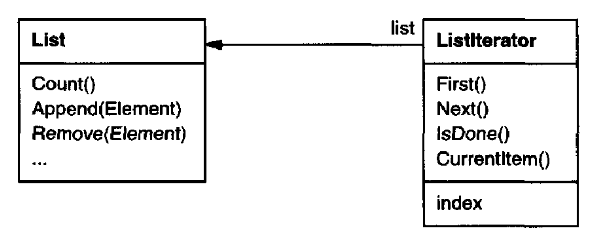
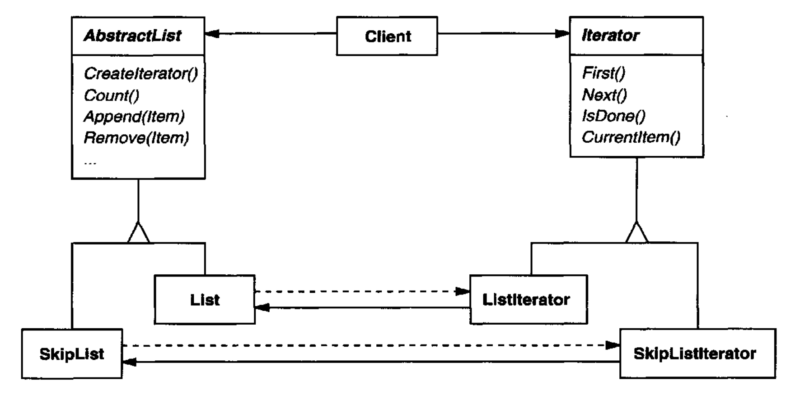
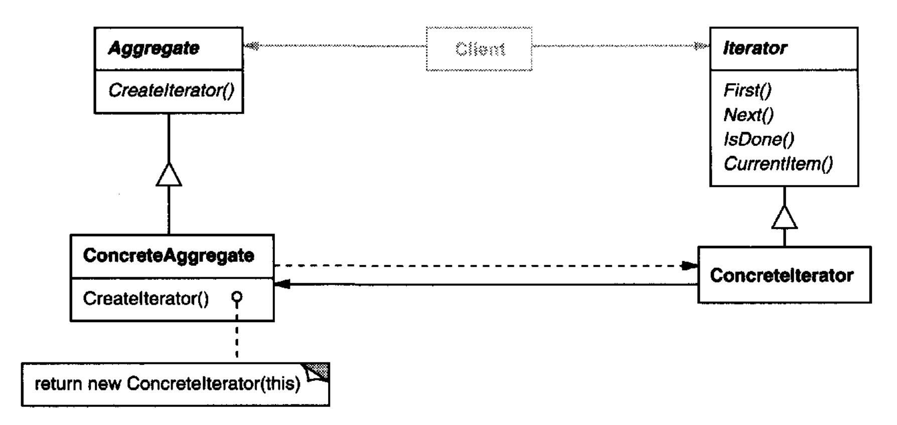

# Iterator （对象行为型）

## 意图

提供一种顺序访问聚合对象元素的方式，而不暴露其底层表示。

## 别名

Cursor

## 动机

像列表这样的聚合对象应该提供一种访问其元素的方式，而不暴露其内部结构。
此外，你可能希望根据想要完成的任务，以不同方式遍历该列表。
但你可能不希望用不同遍历方式的操作来膨胀 `List` 接口，即使你能够预见到自己将需要哪些操作。
你可能还需要在同一个列表上同时进行多个遍历。

`Iterator` 模式让你能够做到所有这些。
这个模式的关键思想是将访问和遍历的责任从列表对象中取出，放入一个 **iterator** 对象中。
`Iterator` 类定义用于访问列表元素的接口。
iterator 对象负责跟踪当前元素；也就是说，它知道哪些元素已经被遍历过。

例如，一个 `List` 类会要求一个 `ListIterator`，它们之间具有以下关系：

<br/>

在实例化 `ListIterator` 之前，你必须提供要遍历的 `List`。
一旦有了 `ListIterator` 实例，你就可以顺序访问该列表的元素。
`CurrentItem` 操作返回列表中的当前元素，`First` 将当前元素初始化为第一个元素，
`Next` 将当前元素推进到下一个元素，而 `IsDone` 测试我们是否已经越过最后一个元素——也就是说，我们已完成遍历。

将遍历机制与 `List` 对象分离，使我们能够为不同的遍历策略定义 iterator，而不必在 `List` 接口中枚举它们。
例如，`FilteringListIterator` 可能只提供对那些满足特定过滤约束的元素的访问。

注意，iterator 和列表是耦合的，而且客户端必须知道它遍历的是一个列表，而不是某种其他聚合结构。
因此，客户端承诺了某种特定的聚合结构。
如果我们能够在不更改客户端代码的情况下更改聚合类，那就更好了。
我们可以通过泛化 iterator 概念以支持 **多态迭代 (polymorphic iteration)** 来做到这一点。

举个例子，假设我们还有一个列表的 `SkipList` 实现。
skiplist [Pug90](../biblio.md#pug90) 是一种概率数据结构，其特征类似于平衡树。
我们希望能够编写同时适用于 `List` 和 `SkipList` 对象的代码。

我们定义一个 `AbstractList` 类，为操作列表提供公共接口。
类似地，我们需要一个抽象 `Iterator` 类，定义公共迭代接口。然后我们可以为不同的列表实现定义具体的 `Iterator` 子类。
结果是，迭代机制变得独立于具体聚合类。

<br/>

剩下的问题是如何创建 iterator。
由于我们想编写独立于具体 `List` 子类的代码，我们不能简单地实例化一个特定类。
相反，我们让列表对象负责创建其对应的 iterator。
这需要一个类似 `CreateIterator` 的操作，客户端通过它请求一个 iterator 对象。

`CreateIterator` 是工厂方法的一个例子（见 [Factory Method (107)](../ch3/3.md)）。
我们在这里使用它，让客户端能够向一个列表对象请求合适的 iterator。
Factory Method 方法产生了两个类层次结构，一个用于列表，另一个用于 iterator。
`CreateIterator` 工厂方法 “连接” 了这两个层次结构。

## 适用性

在以下情况下使用 Iterator 模式：

- 访问聚合对象的内容而不暴露其内部表示。

- 支持对聚合对象的多次遍历。

- 为遍历不同聚合结构提供统一接口（也就是说，支持多态迭代）。

## 结构

<br/>

## 参与者

- **Iterator**
  - 定义用于访问和遍历元素的接口。

- **ConcreteIterator**
  - 实现 `Iterator` 接口。

  - 跟踪聚合遍历中的当前位置。

- **Aggregate**
  - 定义用于创建 `Iterator` 对象的接口。

- **ConcreteAggregate**
  - 实现 `Iterator` 创建接口，以返回适当的 `ConcreteIterator` 实例。

## 协作

- 一个 `ConcreteIterator` 跟踪聚合中的当前对象，并可以计算遍历中的后继对象。

## 效果

Iterator 模式有三个重要效果：

1. *它支持以不同方式遍历聚合。*
复杂聚合可以以许多方式遍历。
例如，代码生成和语义检查都涉及遍历解析树。
代码生成可以按中序或前序遍历该解析树。
`Iterator` 使更改遍历算法变得容易：只需将 iterator 实例替换为另一个实例。
你还可以定义 `Iterator` 子类来支持新的遍历。

2. *Iterator 简化了 `Aggregate` 接口。*
Iterator 的遍历接口消除了在 `Aggregate` 中需要类似接口的必要，从而简化了聚合的接口。

3. *一个聚合上可以同时进行多个遍历。*
一个 iterator 跟踪自己的遍历状态。
因此，你可以同时进行多个遍历。

## 实现

Iterator 有许多实现变体和替代方案。下面是一些重要的变体。
权衡往往取决于你的语言所提供的控制结构。
有些语言（例如 CLU [LG86](../biblio.md#lg86) ）甚至直接支持这个模式。

1. *谁控制迭代？*
一个基本问题是决定由哪一方控制迭代，是 iterator 还是使用 iterator 的客户端。
当客户端控制迭代时，该 iterator 被称为 **外部 iterator** ；
当 iterator 控制迭代时，该 iterator 是 **内部 iterator** 。² 
使用外部 iterator 的客户端必须推进遍历，并显式地从 iterator 请求下一个元素。
相反，client 交给内部 iterator 一个要执行的操作，而 iterator 将该操作应用于聚合中的每个元素。

   ² Booch 分别将外部 iterator 和内部 iterator 称为主动 iterator 和被动 iterator [Boo94] (../biblio.md#boo94)。
   “主动” 和 “被动” 这两个术语描述的是客户端的角色，而不是 iterator 中活动的级别。

   外部 iterator 比内部 iterator 更灵活。
   例如，使用外部 iterator 很容易比较两个集合是否相等，但使用内部 iterator 几乎不可能做到。
   在像 C++ 这样不提供匿名函数、闭包或 continuation 的语言中，内部 iterator 尤其弱，而 Smalltalk 和 CLOS 则提供这些。
   但另一方面，内部 iterator 更容易使用，因为它们为你定义了迭代逻辑。

2. *谁定义遍历算法？*
iterator 并不是唯一可以定义遍历算法的地方。
聚合可以定义遍历算法，并仅使用 iterator 来存储迭代状态。
我们把这种 iterator 称为 **cursor** ，因为它仅仅指向聚合中的当前位置。
客户端将在聚合上调用 `Next` 操作，并将 cursor 作为参数，而 `Next` 操作将更改 cursor 的状态。³

   ³ Cursor 是 [Memento (283)](6.md) 模式的一个简单例子，并共享它的许多实现问题。

   如果由 iterator 负责遍历算法，那么在同一个聚合上使用不同的迭代算法就很容易，而且在不同聚合上复用同一个算法也会更容易。
   另一方面，遍历算法可能需要访问聚合的私有变量。
   如果是这样，把遍历算法放在 iterator 中会违反聚合的封装。

3. *iterator 的健壮性如何？*
在遍历聚合时修改聚合可能是危险的。
如果从聚合中添加或删除元素，你最终可能会访问某个元素两次或完全错过它。
一个简单的解决方案是复制聚合并遍历副本，但一般来说这样做代价太高。

   **健壮的 iterator** 确保插入和移除不会干扰遍历，并且它是在不复制聚合的情况下做到这一点的。
   实现健壮 iterator 有许多方式。
   大多数依赖于将 iterator 注册到聚合中。
   在插入或移除时，聚合要么调整它所生成的 iterator 的内部状态，要么在内部维护信息以确保正确遍历。

   Kofler 对 ET++ 中如何实现健壮 iterator 进行了很好的讨论 [Kof93](../biblio.md#kof93)。
   Murray 讨论了 USL StandardComponents 的 `List` 类的健壮 iterator 实现 [Mur93](../biblio.md#mur93)。

4. *额外的 Iterator 操作。*
Iterator 的最小接口由 `First`、`Next`、`IsDone` 和 `CurrentItem` 这些操作组成。⁴
一些额外的操作可能被证明是有用的。
例如，有序聚合可以有一个 `Previous` 操作，将 iterator 定位到前一个元素。
`SkipTo` 操作对于已排序或带索引的集合很有用。
`SkipTo` 将 iterator 定位到匹配特定条件的对象。

   ⁴ 我们可以通过将 `Next`、`IsDone` 和 `CurrentItem` 合并为一个推进到下一个对象并返回它的操作，使这个接口更小。
   如果遍历已完成，那么该操作返回一个特殊值（例如 0），标记迭代结束。

5. *在 C++ 中使用多态 iterator。*
多态 iterator 有其代价。
它们要求 iterator 对象由工厂方法动态分配。
因此，只有在需要多态时才应使用它们。
否则使用具体 iterator，它们可以在栈上分配。

   多态 iterator 还有另一个缺点：客户端负责删除它们。
   这容易出错，因为当你用完一个堆分配的 iterator 对象时，很容易忘记释放它。
   当一个操作中有多个退出点时，这种情况尤其可能发生。
   而且如果触发异常，iterator 对象将永远不会被释放。

   [Proxy (207)](../ch4/7.md) 模式提供了一种补救办法。
   我们可以使用一个栈分配的 proxy 作为真实 iterator 的替身。
   该 proxy 在其析构函数中删除 iterator。
   因此，当 proxy 离开作用域时，真实 iterator 将随之被释放。
   即使面对异常，该 proxy 也能确保正确清理。
   这是著名的 C++ 技术 “资源分配即初始化” 的一个应用 [ES90](../biblio.md#es90)。
   示例代码给出了一个例子。

6. *Iterator 可能拥有特权访问。*
一个 iterator 可以被视为创建它的聚合的扩展。
iterator 和聚合是紧密耦合的。
我们可以通过在 C++ 中将 iterator 设为其聚合的 `friend` 来表达这种紧密关系。
这样，你就不需要定义那些唯一目的就是让 iterator 高效实现遍历的聚合操作。

   然而，这种特权访问可能使定义新的遍历变得困难，因为它将需要更改聚合接口以添加另一个 `friend`。
   为避免这个问题，Iterator 类可以包含受保护的操作，用于访问聚合中重要但公开不可用的成员。
   Iterator 子类（且只有 Iterator 子类）可以使用这些受保护的操作来获得对聚合的特权访问。

7. *用于 composite 的 iterator。*
外部 iterator 可能难以在像 [Composite (163)](../ch4/3.md) 模式中那样的递归聚合结构上实现，因为结构中的一个位置可能跨越许多层嵌套聚合。
因此，外部 iterator 必须存储一条穿过 Composite 的路径，以跟踪当前对象。
有时，使用内部 iterator 更容易。
它可以通过简单地递归调用自身来记录当前位置，从而将路径隐式存储在调用栈中。

   如果 Composite 中的节点具有用于从某个节点移动到其兄弟节点、父节点和子节点的接口，那么基于 cursor 的 iterator 可能提供更好的替代方案。
   cursor 只需要跟踪当前节点；它可以依赖节点接口来遍历 Composite。

   Composite 通常需要以不止一种方式遍历。
   前序、后序、中序和广度优先遍历都很常见。
   你可以用不同类别的 iterator 来支持每种遍历。

8. *Null iterator。*
**NullIterator** 是一种退化 iterator，有助于处理边界条件。
根据定义，NullIterator 总是完成遍历；也就是说，它的 `IsDone` 操作总是求值为 true。

   NullIterator 可以使遍历树状聚合（例如 Composite）更容易。
   在遍历中的每个点，我们向当前元素请求其子节点的 iterator。
   聚合元素像往常一样返回一个具体 iterator。
   但叶子元素返回一个 NullIterator 实例。
   这让我们能够以统一的方式实现对整个结构的遍历。

## 示例代码

我们将看一个简单 List 类的实现，它是我们基础库的一部分（附录 C）。
我们将展示两个 Iterator 实现，一个用于从前到后遍历 List，另一个用于从后到前遍历（基础库只支持第一个）。
然后我们展示如何使用这些 iterator，以及如何避免限定于某个特定实现。
之后，我们更改设计以确保 iterator 被正确删除。
最后一个示例展示一个内部 iterator，并将其与外部对应物进行比较。

1. *`List` 和 `Iterator` 接口。*
首先让我们看看 `List` 接口中与实现 iterator 相关的部分。
完整接口请参考 [附录 C](../appendix-c.md) 。

   ```cpp
   template <class Item>
   class List {
   public:
       List(long size = DEFAULT_LIST_CAPACITY);
   
       long Count() const;
       Item& Get(long index) const;
       // . . .
   };
   ```

   `List` 类提供了一种通过其公共接口支持迭代的相当高效的方式。
   它足以实现这两种遍历。
   因此，没有必要给 iterator 对底层数据结构的特权访问；
   也就是说，iterator 类不是 `List` 的 friend。
   为了能够透明地使用不同的遍历，我们定义一个抽象 `Iterator` 类，它定义 iterator 接口。

   ```cpp
   template <class Item>
   class Iterator {
   public:
       virtual void First() = 0;
       virtual void Next() = 0;
       virtual bool IsDone() const = 0;
       virtual Item CurrentItem() const = 0;
   protected:
       Iterator();
   };
   ```

2. *`Iterator` 子类实现。*
`ListIterator` 是 `Iterator` 的子类。

   ```cpp
   template <class Item>
   class ListIterator : public Iterator<Item> {
   public:
       ListIterator(const List<Item>* aList);
       virtual void First();
       virtual void Next();
       virtual bool IsDone() const;
       virtual Item CurrentItem() const;

   private:
       const List<Item>* _list;
       long _current;
   };
   ```

   `ListIterator` 的实现很直接。它存储 `List` 以及一个指向列表中的索引 `_current`：

   ```cpp
   template <class Item>
   ListIterator<Item>::ListIterator (
       const List<Item>* aList
   ) : _list(aList), _current(0) {
   }
   ```

   `First` 将 iterator 定位到第一个元素：

   ```cpp
   template <class Item>
   void ListIterator<Item>::First () {
       _current = 0;
   }
   ```

   `Next` 推进当前元素：

   ```cpp
   template <class Item>
   void ListIterator<Item>::Next () {
       _current++;
   }
   ```

   `IsDone` 检查该索引是否指向 `List` 中的某个元素：

   ```cpp
   template <class Item>
   bool ListIterator<Item>::IsDone () const {
       return _current >= _list->Count();
   }
   ```

   最后，`CurrentItem` 返回当前索引处的项。
   如果迭代已经终止，那么我们抛出 `IteratorOutOfBounds` 异常：

   ```cpp
   template <class Item>
   Item ListIterator<Item>::CurrentItem () const {
       if (IsDone()) {
           throw IteratorOutOfBounds;
       }
       return _list->Get(_current);
   }
   ```

   `ReverseListIterator` 的实现相同，不同之处在于它的 `First` 操作将 `_current` 定位到列表末尾，而 `Next` 将 `_current` 递减，朝第一个项移动。

3. *使用 iterator。*
假设我们有一个 `Employee` 对象的 `List`，并且我们想打印其中包含的所有 employee。
`Employee` 类通过 `Print` 操作支持这一点。
为了打印该 list，我们定义一个 `PrintEmployees` 操作，它接受一个 iterator 作为参数。
它使用该 iterator 来遍历并打印该 list。

   ```cpp
   void PrintEmployees (Iterator<Employee*>& i) {
       for (i.First(); !i.IsDone(); i.Next()) {
           i.CurrentItem()->Print();
       }
   }
   ```

   由于我们既有用于从后到前遍历的 iterator，也有用于从前到后遍历的 iterator，我们可以复用这个操作来按两种顺序打印 employee。

   ```cpp
   List<Employee*>* employees;
   // . . .
   ListIterator<Employee*> forward(employees);
   ReverseListIterator<Employee*> backward(employees);
   
   PrintEmployees(forward);
   PrintEmployees(backward);
   ```

4. *避免限定于特定的 list 实现。*
让我们考虑 `List` 的 skiplist 变体将如何影响我们的迭代代码。
`List` 的 `SkipList` 子类必须提供一个实现 `Iterator` 接口的 `SkipListIterator`。
在内部，`SkipListIterator` 必须维护的不仅仅是索引，才能高效地进行迭代。
但由于 `SkipListIterator` 符合 `Iterator` 接口，当 employee 存储在 `SkipList` 对象中时，也可以使用 `PrintEmployees` 操作。

   ```cpp
   SkipList<Employee*>* employees;
   // . . .

   SkipListIterator<Employee*> iterator(employees);
   PrintEmployees(iterator);
   ```

   尽管这种方法可行，但如果我们不必限定于特定的 `List` 实现（即 `SkipList`），那就更好了。
   我们可以引入一个 `AbstractList` 类，为不同的列表实现标准化列表接口。
   `List` 和 `SkipList` 成为 `AbstractList` 的子类。

   为了支持多态迭代，`AbstractList` 定义一个工厂方法 `CreateIterator`，子类重写它以返回其对应的 iterator：

   ```cpp
   template <class Item>
   class AbstractList {
   public:
       virtual Iterator<Item>* CreateIterator() const = 0;
       // . . .
   };
   ```

   另一种选择是定义一个通用 mixin 类 `Traversable`，它定义用于创建 iterator 的接口。
   聚合类可以混入 `Traversable` 以支持多态迭代。

   `List` 重写 `CreateIterator` 以返回一个 `ListIterator` 对象：

   ```cpp
   template <class Item>
   Iterator<Item>* List<Item>::CreateIterator () const {
       return new ListIterator<Item>(this);
   }
   ```

   现在我们可以编写独立于具体表示来打印 employee 的代码。

   ```cpp
   // we know only that we have an AbstractList
   AbstractList<Employee*>* employees;
   // . . .

   Iterator<Employee*>* iterator = employees->CreateIterator();
   PrintEmployees(*iterator);
   delete iterator;
   ```

5. *确保 iterator 被删除。* <a id="sample-code-5"></a>
注意，`CreateIterator` 返回一个新分配的 iterator 对象。我们有责任删除它。
如果我们忘记了，那么就造成了存储泄漏。
为了让客户端的生活更轻松，我们将提供一个 `IteratorPtr`，它充当 iterator 的 proxy。
它负责在离开作用域时清理 `Iterator` 对象。

   `IteratorPtr` 总是分配在栈 (stack) 上。⁵ 
   C++ 会自动负责调用其析构函数，从而删除真正的 iterator。
   `IteratorPtr` 重载了 `operator->` 和 `operator*`，使得 `IteratorPtr` 可以像指向 iterator 的指针一样被使用。
   `IteratorPtr` 的成员都实现为内联的；因此它们不会带来额外开销。

   ⁵ 你可以通过声明私有的 `new` 和 `delete` 运算符来在编译期确保这一点。不需要附带的实现。

   ```cpp
   template <class Item>
   class IteratorPtr {
   public:
       IteratorPtr(Iterator<Item>* i): _i(i) { }
       ~IteratorPtr() { delete _i; }
   
       Iterator<Item>* operator->() { return _i; }
       Iterator<Item>& operator*() { return *_i; }
   private:
       // disallow copy and assignment to avoid
       // multiple deletions of _i:

       IteratorPtr(const IteratorPtr&);
       IteratorPtr& operator=(const IteratorPtr&);
   private:
       Iterator<Item>* _i;
   };
   ```

   `IteratorPtr` 让我们能够简化打印代码：

   ```cpp
   AbstractList<Employee*>* employees;
   // . . .

   IteratorPtr<Employee*> iterator(employees->CreateIterator());
   PrintEmployees(*iterator);
   ```

6. *一个内部 `ListIterator`。*
作为最后一个示例，让我们看看内部或被动 `ListIterator` 类的一种可能实现。
在这里，iterator 控制迭代，并对每个元素应用一个操作。

   在这种情况下，问题是如何用我们想对每个元素执行的操作来参数化 iterator。
   C++ 不支持其他语言为此提供的匿名函数或闭包。
   至少有两种选择：(1) 传入一个函数指针（全局或静态），或 (2) 依赖子类化。
   在第一种情况下，iterator 在迭代中的每个点调用传给它的操作。
   在第二种情况下，iterator 调用一个由子类重写以实施特定行为的操作。

   这两种选择都不完美。
   通常你希望在迭代期间累积状态，而函数并不适合这一点；我们将不得不使用静态变量来记住状态。
   `Iterator` 子类为我们提供了一个方便的地方来存储累积状态，比如放在实例变量中。
   但是为每一种不同遍历创建一个子类工作量更大。

   下面是第二种选择（使用子类化）的骨架。
   我们把内部 iterator 称为 `ListTraverser`。

   ```cpp
   template <class Item>
   class ListTraverser {
   public:
       ListTraverser(List<Item>* aList);
       bool Traverse();
   protected:
       virtual bool ProcessItem(const Item&) = 0;
   private:
       ListIterator<Item> _iterator;
   };
   ```

   `ListTraverser` 接受一个 `List` 实例作为参数。
   在内部，它使用一个外部 `ListIterator` 来进行遍历。
   `Traverse` 启动遍历，并为每个项调用 `ProcessItem`。
   内部 iterator 可以通过从 `ProcessItem` 返回 false 来选择终止遍历。
   `Traverse` 返回遍历是否提前终止。

   ```cpp
   template <class Item>
   ListTraverser<Item>::ListTraverser (
       List<Item>* aList
   ) : _iterator(aList) { }
   
   template <class Item>
   bool ListTraverser<Item>::Traverse () {
       bool result = false;

       for (
           _iterator.First();
           !_iterator.IsDone();
           _iterator.Next()
       ) {
           result = ProcessItem(_iterator.CurrentItem());

           if (result == false) {
               break;
           }
       }
       return result;
   }
   ```

   让我们使用一个 `ListTraverser` 来打印 employee 列表中的前 10 个 employee。
   为此，我们必须子类化 `ListTraverser` 并重写 `ProcessItem`。
   我们在一个 `_count` 实例变量中统计已打印的 employee 数量。

   ```cpp
   class PrintNEmployees : public ListTraverser<Employee*> {
   public:
       PrintNEmployees(List<Employee*>* aList, int n) :
           ListTraverser<Employee*>(aList),
           _total(n), _count(0) { }

   protected:
       bool ProcessItem(Employee* const&);
   private:
       int _total;
       int _count;
   };
   
   bool PrintNEmployees::ProcessItem (Employee* const& e) {
       _count++;
       e->Print();
       return _count < _total;
   }
   ```

   下面是 `PrintNEmployees` 如何打印列表中的前 10 个 employee：

   ```cpp
   List<Employee*>* employees;
   // . . .

   PrintNEmployees pa(employees, 10);
   pa.Traverse();
   ```

   注意，客户端没有指定迭代循环。
   整个迭代逻辑都可以被复用。
   这是内部 iterator 的主要好处。
   不过，它比外部 iterator 工作量稍大，因为我们必须定义一个新类。
   与此相比，使用外部 iterator：

   ```cpp
   ListIterator<Employee*> i(employees);
   int count = 0;

   for (i.First(); !i.IsDone(); i.Next()) {
       count++;
       i.CurrentItem()->Print();

       if (count >= 10) {
           break;
       }
   }
   ```

   内部 iterator 可以封装不同种类的迭代。
   例如，`FilteringListTraverser` 封装了一种迭代，只处理满足某个测试的项：

   ```cpp
   template <class Item>
   class FilteringListTraverser {
   public:
       FilteringListTraverser(List<Item>* aList);
       bool Traverse();
   protected:
       virtual bool ProcessItem(const Item&) = 0;
       virtual bool TestItem(const Item&) = 0;
   private:
       ListIterator<Item> _iterator;
   };
   ```

   这个接口与 `ListTraverser` 的接口相同，只是增加了一个定义测试的 `TestItem` 成员函数。
   子类重写 `TestItem` 来指定该测试。

   `Traverse` 根据测试的结果决定是否继续遍历：

   ```cpp
   template <class Item>
   bool FilteringListTraverser<Item>::Traverse () {
       bool result = false;

       for (
           _iterator.First();
           !_iterator.IsDone();
           _iterator.Next()
       ) {
           if (TestItem(_iterator.CurrentItem())) {
               result = ProcessItem(_iterator.CurrentItem());

               if (result == false) {
                   break;
               }
           }
       }
       return result;
   }
   ```

   这个类的一个变体可以定义 `Traverse`，使其在至少有一个项满足测试时返回。⁶

   ⁶ 这些示例中的 `Traverse` 操作是一个 [Template Method (325)](10.md)，其原始操作为 `TestItem` 和 `ProcessItem`。

## 已知应用

Iterator 在面向对象系统中很常见。
大多数集合类库都以某种形式提供 iterator。

下面是一个来自 Booch components [Boo94](../biblio.md#boo94) 的例子，这是一个流行的集合类库。
它为队列 (queue) 提供了固定大小（有界）和动态增长（无界）两种实现。
队列接口由一个抽象 `Queue` 类定义。
为了支持对不同队列实现的多态迭代，队列 iterator 是根据抽象 `Queue` 类接口实现的。
这种变体的优点是，你不需要工厂方法来向队列实现请求其合适的 iterator。
然而，它要求抽象 `Queue` 类的接口足够强大，以便高效地实现 iterator。

在 Smalltalk 中，iterator 不必被显式定义。
标准集合类（`Bag`、`Set`、`Dictionary`、`OrderedCollection`、`String` 等）定义了一个内部 iterator 方法 `do:`，它接受一个 block（即闭包）作为参数。
集合中的每个元素都被绑定到 block 中的局部变量；然后执行该 block。
Smalltalk 还包括一组支持类似 iterator 接口的 `Stream` 类。
`ReadStream` 本质上是一个 Iterator，它可以充当所有顺序集合的外部 iterator。
对于像 `Set` 和 `Dictionary` 这样的非顺序集合，没有标准的外部 iterator。

多态 iterator 和前面描述的清理 `Proxy` 由 ET++ 容器类提供 [WGM88](../biblio.md#wgm88)。
Unidraw 图形编辑框架类使用基于 cursor 的 iterator [VL90](../biblio.md#vl90)。

ObjectWindows 2.0 [Bor94](../biblio.md#bor94) 为容器提供了一种类层次结构的 iterator。
你可以用同样的方式遍历不同的容器类型。
ObjectWindows 的迭代语法依赖于重载后自增运算符 `++` 来推进迭代。

## 相关模式

[Composite (163)](../ch4/3.md)：Iterator 通常应用于诸如 Composite 之类的递归结构。

[Factory Method (107)](../ch3/3.md)：多态 iterator 依赖工厂方法来实例化适当的 Iterator 子类。

[Memento (283)](6.md) 通常与 Iterator 模式结合使用。
一个 iterator 可以使用 memento 来捕获迭代的状态。
iterator 在内部存储该 memento。
