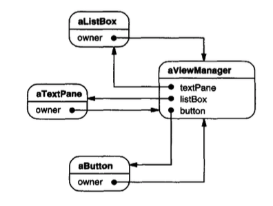

# Mediator （行为型对象模式）

## 意图

定义一个对象，封装一组对象如何交互。
Mediator 通过避免对象彼此显式引用来促进松散耦合，并让你能够独立地改变它们的交互。

## 动机

面向对象设计鼓励将行为分布到对象之间。
这种分布可能导致对象结构中对象之间存在许多连接；在最坏的情况下，每个对象最终都会知道其他所有对象。

尽管将系统划分为许多对象通常能增强可复用性，但激增的互连往往会再次降低可复用性。
大量互连使一个对象更不可能在没有其他对象支持的情况下工作 —— 系统表现得就好像它是一个单体。
此外，由于行为分布在许多对象中，以任何显著方式更改系统的行为都可能很困难。
结果，你可能被迫定义许多子类来定制系统的行为。

作为一个例子，考虑图形用户界面中对话框的实现。
一个对话框使用一个窗口来呈现一组部件 (widget)，例如按钮、菜单和输入字段，如下所示：

<br/>

对话框中的部件之间常常存在依赖关系。
例如，当某个输入字段为空时，一个按钮会被禁用。
在选择列表（称为 **list box** ）中选择一个条目可能会更改某个输入字段的内容。
反过来，在输入字段中键入文本可能会自动选中 list box 中一个或多个对应条目。
一旦文本出现在输入字段中，其他按钮可能变为可用，让用户能对该文本执行某些操作，例如更改或删除它所指向的内容。

不同的对话框会有不同的部件间依赖关系。
因此，即使对话框显示相同种类的部件，它们也不能简单地复用现成的部件类；
它们必须被定制，以反映对话框特定的依赖关系。
通过子类化逐个定制它们会很繁琐，因为涉及许多类。

你可以通过将集体行为封装在一个单独的 **mediator** 对象中来避免这些问题。
mediator 负责控制和协调一组对象的交互。
mediator 充当一个中介，防止该组中的对象彼此显式引用。
这些对象只知道 mediator，从而减少了互连的数量。

例如，`FontDialogDirector` 可以是一个对话框内部件之间的 mediator。
一个 `FontDialogDirector` 对象知道对话框中的部件，并协调它们的交互。
它充当部件之间通信的枢纽：

<br/>

下面的交互图说明了这些对象如何协作来处理 list box 选择的变化：

<br/>

下面是一个 list box 的选择传递到输入字段所经历的事件序列：

1. list box 告诉它的 director 它已经改变。
2. director 从 list box 获取选择。
3. director 将该选择传递给输入字段。
4. 现在输入字段包含了一些文本，director 启用用于启动某个操作的按钮（例如，“demibold”、“oblique”）。

注意 director 如何在 list box 和输入字段之间进行中介。
部件之间只通过 director 间接通信。
它们不必彼此了解；它们只知道 director。
此外，由于行为被局部化在一个类中，因此可以通过扩展或替换该类来更改或替换该行为。

下面是如何将 `FontDialogDirector` 抽象集成到类库中：

<br/>

`DialogDirector` 是一个抽象类，定义对话框的整体行为。
客户端调用 `ShowDialog` 操作以在屏幕上显示对话框。
`CreateWidgets` 是用于创建对话框部件的抽象操作。
`WidgetChanged` 是另一个抽象操作；部件调用它来通知其 director 它们已经改变。
`DialogDirector` 子类重写 `CreateWidgets` 来创建适当的部件，并重写 `WidgetChanged` 来处理这些变化。

## 适用性

在以下情况下使用 Mediator 模式：

- 一组对象以定义良好但复杂的方式进行通信。由此产生的相互依赖关系是非结构化的，并且难以理解。

- 复用一个对象很困难，因为它引用许多其他对象并与它们通信。

- 分布在若干类之间的行为应当可以在不需要大量子类化的情况下被定制。

## 结构

<br/>

一个典型的对象结构可能如下所示：

<br/>

## 参与者

- **Mediator** （`DialogDirector`）

  - 定义一个用于与 `Colleague` 对象通信的接口。

- **ConcreteMediator** （`FontDialogDirector`）

  - 通过协调 `Colleague` 对象来实现协作行为。
  - 知道并维护它的 colleague。

- **Colleague 类** （`ListBox`、`EntryField`）

  - 每个 `Colleague` 类都知道它的 `Mediator` 对象。
  - 每个 colleague 在原本会与另一个 colleague 通信时，改为与其 mediator 通信。

## 协作

- `Colleague` 向 `Mediator` 对象发送请求并从其接收请求。mediator 通过在适当的 colleague 之间路由请求来实现协作行为。

## 效果

Mediator 模式具有以下优点和缺点：

1. *它限制了子类化。*
mediator 将原本会分布到若干对象中的行为局部化。
更改这种行为只需要子类化 `Mediator`；`Colleague` 类可以原样复用。

2. *它解耦了 colleague。*
mediator 促进 colleague 之间的松散耦合。
你可以独立地变化和复用 `Colleague` 和 `Mediator` 类。

3. *它简化了对象协议。*
mediator 将多对多交互替换为 mediator 与其 colleague 之间的一对多交互。
一对多关系更容易理解、维护和扩展。

4. *它将对象协作的方式抽象出来。*
将中介 (mediation) 作为一个独立概念，并将其封装在一个对象中，让你能够专注于对象如何交互，而不必关注它们的个体行为。
这有助于阐明系统中的对象如何交互。

5. *它集中了控制。*
Mediator 模式以交互的复杂性换取 mediator 的复杂性。
由于 mediator 封装协议，它可能变得比任何单个 colleague 都更复杂。
这可能使 mediator 本身成为一个难以维护的单体。

## 实现

以下实现问题与 Mediator 模式相关：

1. *省略抽象 `Mediator` 类。*
当 colleague 只与一个 mediator 协作时，无需定义抽象 `Mediator` 类。
`Mediator` 类所提供的抽象耦合让 colleague 能够与不同的 `Mediator` 子类协作，反之亦然。

2. *Colleague-Mediator 的通信。*
当关注的事件发生时，colleague 必须与其 mediator 通信。
一种方法是使用 [Observer (293)](7.md) 模式将 `Mediator` 实现为 `Observer`。
`Colleague` 类充当 `Subject`，每当它们改变状态时就向 mediator 发送通知。
mediator 通过将变化的影响传播给其他 colleague 来响应。

   另一种方法在 `Mediator` 中定义一个专门的通知接口，让 colleague 在通信中更直接。
  Smalltalk/V for Windows 使用一种委托形式：当与 mediator 通信时，colleague 将自己作为参数传入，从而允许 mediator 识别发送者。
  "示例代码" 使用这种方法，"已知应用" 中会进一步讨论 Smalltalk/V 实现。

## 示例代码

我们将使用一个 `DialogDirector` 来实现动机中展示的字体对话框。抽象类 `DialogDirector` 定义 director 的接口。

```cpp
class DialogDirector {
public:
    virtual ~DialogDirector();

    virtual void ShowDialog();
    virtual void WidgetChanged(Widget*) = 0;
protected:
    DialogDirector();
    virtual void CreateWidgets() = 0;
};
```

`Widget` 是部件的抽象基类。一个部件知道它的 director。

```cpp
class Widget {
public:
    Widget(DialogDirector*);
    virtual void Changed();

    virtual void HandleMouse(MouseEvent& event);
    // . . .
private:
    DialogDirector* _director;
};
```

`Changed` 调用 director 的 `WidgetChanged` 操作。部件在其 director 上调用 `WidgetChanged`，以将重要事件告知它。

```cpp
void Widget::Changed () {
    _director->WidgetChanged(this);
}
```

`DialogDirector` 的子类重写 `WidgetChanged` 来影响相应的部件。
部件将自身的引用作为参数传入 `WidgetChanged`，让 director 能够识别发生变化的部件。
`DialogDirector` 子类重新定义纯虚函数 `CreateWidgets`，以构造对话框中的部件。

`ListBox`、`EntryField` 和 `Button` 是 `Widget` 的子类，用于专门的用户界面元素。
`ListBox` 提供 `GetSelection` 操作以获取当前选择，而 `EntryField` 的 `SetText` 操作将新文本放入该字段。

```cpp
class ListBox : public Widget {
public:
    ListBox(DialogDirector*);

    virtual const char* GetSelection();
    virtual void SetList(List<char*>* listItems);
    virtual void HandleMouse(MouseEvent& event);
    // . . .
};

class EntryField : public Widget {
public:
    EntryField(DialogDirector*);

    virtual void SetText(const char* text);
    virtual const char* GetText();
    virtual void HandleMouse(MouseEvent& event);
    // ...
};
```

`Button` 是一个简单的部件，每当它被按下时就调用 `Changed`。这在其 `HandleMouse` 的实现中完成：

```cpp
class Button : public Widget {
public:
    Button(DialogDirector*);

    virtual void SetText(const char* text);
    virtual void HandleMouse(MouseEvent& event);
    // . . .
};

void Button::HandleMouse (MouseEvent& event) {
    // . . .
    Changed();
}
```

`FontDialogDirector` 类在对话框中的部件之间进行中介 (mediates)。`FontDialogDirector` 是 `DialogDirector` 的子类：

```cpp
class FontDialogDirector : public DialogDirector {
public:
    FontDialogDirector();
    virtual ~FontDialogDirector();
    virtual void WidgetChanged(Widget*);

protected:
    virtual void CreateWidgets();

private:
    Button* _ok;
    Button* _cancel;
    ListBox* _fontList;
    EntryField* _fontName;
};
```

`FontDialogDirector` 跟踪它显示的部件。它重新定义 `CreateWidgets` 来创建这些部件并初始化对它们的引用：

```cpp
void FontDialogDirector::CreateWidgets () {
    _ok = new Button(this);
    _cancel = new Button(this);
    _fontList = new ListBox(this);
    _fontName = new EntryField(this);
    // fill the listBox with the available font names
    // assemble the widgets in the dialog
}
```

`WidgetChanged` 确保这些部件正确地协同工作：

```cpp
void FontDialogDirector::WidgetChanged (
    Widget* theChangedWidget
) {
    if (theChangedWidget == _fontList) {
        _fontName->SetText(_fontList->GetSelection());

    } else if (theChangedWidget == _ok) {
        // apply font change and dismiss dialog
        // . . .
    } else if (theChangedWidget == _cancel) {
        // dismiss dialog
    }
}
```

`WidgetChanged` 的复杂性随着对话框复杂性的增加而成比例增加。
当然，大型对话框出于其他原因也是不可取的，但 mediator 的复杂性可能会在其他应用中削弱该模式的优点。

## 已知应用

ET++ [WGM88](../biblio.md#wgm88) 和 THINK C 类库 [Sym93b](../biblio.md#sym93b) 都在对话框中使用类似 director 的对象作为部件之间的 mediator。

Smalltalk/V for Windows 的应用架构基于 mediator 结构 [LaL94](../biblio.md#lal94)。
在该环境中，一个应用程序由一个包含一组 pane 的 `Window` 组成。
该库包含若干预定义的 `Pane` 对象；示例包括 `TextPane`、`ListBox`、`Button` 等。
这些 pane 可以在不进行子类化的情况下使用。
应用程序开发者只对 `ViewManager` 进行子类化，该类负责进行 pane 间协调。
`ViewManager` 是 `Mediator`，每个 pane 只知道它的 view manager，而 view manager 被视为该 pane 的 “所有者”。
Pane 之间不直接相互引用。

下面的对象图展示了运行时一个应用程序的快照：

<br/>

Smalltalk/V 使用事件机制进行 `Pane` 与 `ViewManager` 之间的通信。
当一个 pane 想要从 mediator 获取信息，或想要通知 mediator 发生了某些重要事情时，它会生成一个事件。
一个事件定义一个符号（例如 `#select`）来标识该事件。
为了处理该事件，view manager 向该 pane 注册一个方法选择器 (method selector)。
该选择器是事件的处理器；每当事件发生时，它就会被调用。

下面的代码摘录展示了如何在一个 `ViewManager` 子类中创建 `ListPane` 对象，以及 `ViewManager` 如何为 `#select` 事件注册事件处理器：

```smalltalk
self addSubpane: (ListPane new
    paneName: 'myListPane';
    owner: self;
    when: #select perform: #listSelect:).
```

`Mediator` 模式的另一个应用是协调复杂的更新。
一个例子是 [Observer (293)](7.md) 中提到的 `ChangeManager` 类。
`ChangeManager` 在 subject 和 observer 之间进行中介，以避免冗余更新。
当一个对象发生变化时，它通知 `ChangeManager`，后者进而通过通知该对象的依赖者来协调更新。

一个类似的应用出现在 Unidraw 绘图框架 [VL90](../biblio.md#vl90) 中，并使用一个名为 `CSolver` 的类来强制 “连接器” 之间的连接约束。
图形编辑器中的对象可以以不同方式表现出彼此粘附 (stick to)。
连接器在自动维护连接性的应用中很有用，例如图表编辑器和电路设计系统。
`CSolver` 是连接器之间的 mediator。
它求解连接约束，并更新连接器的位置以反映这些约束。

## 相关模式

[Facade (185)](../ch4/5.md) 与 `Mediator` 的不同之处在于，它将由对象构成的子系统抽象出来，以提供更方便的接口。
它的协议是单向的；也就是说，Facade 对象向子系统类发出请求，但反之则不然。
相反，Mediator 则实现了 colleague 对象自身不提供、也无法提供的协作行为，而且其协议是多向的。

Colleague 可以使用 [Observer (293)](7.md) 模式与 mediator 通信。
