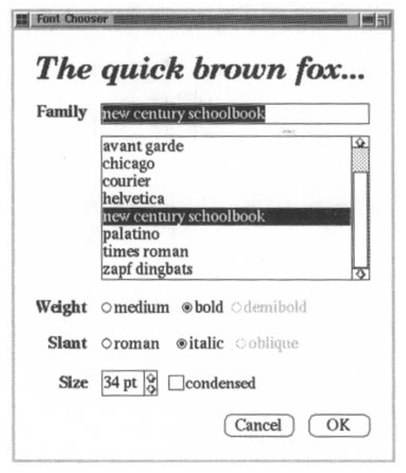
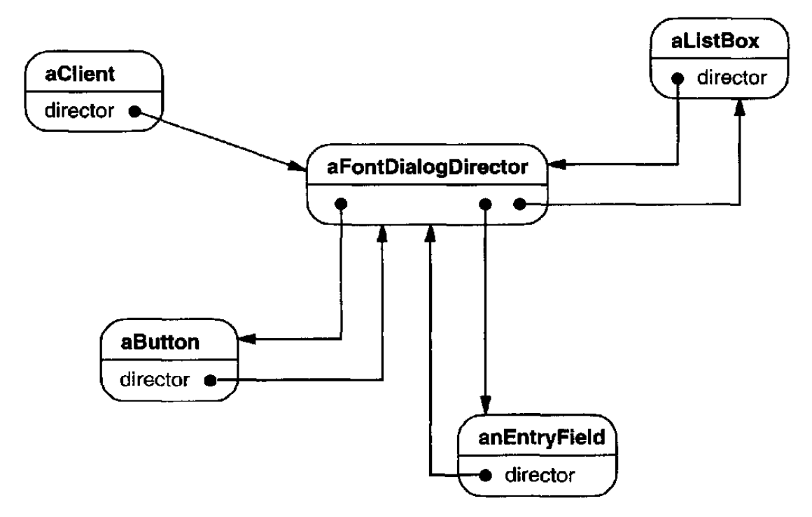
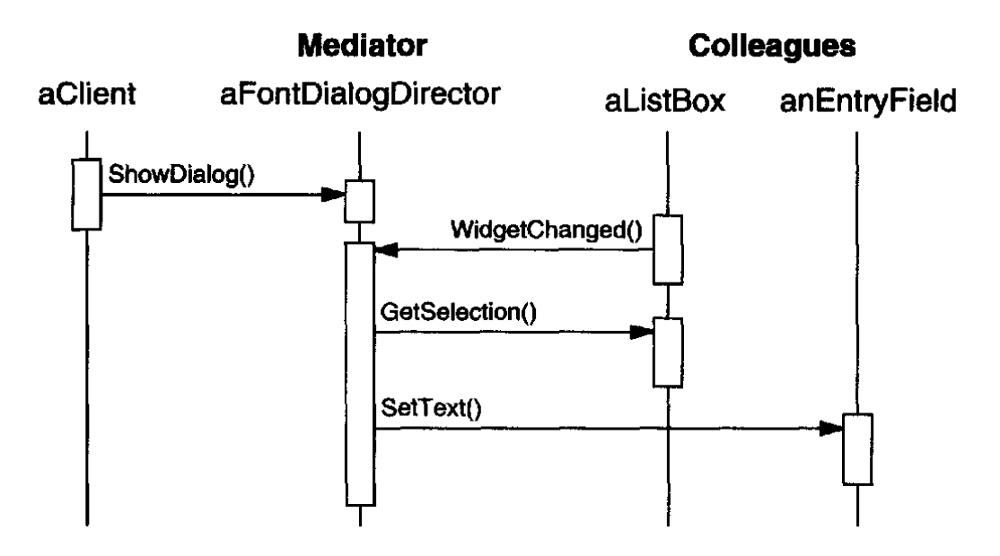
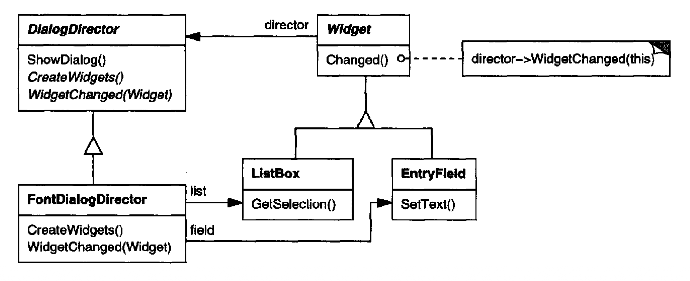
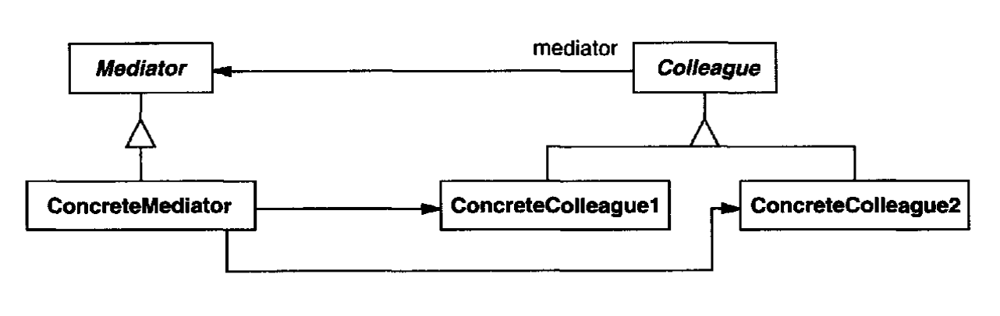
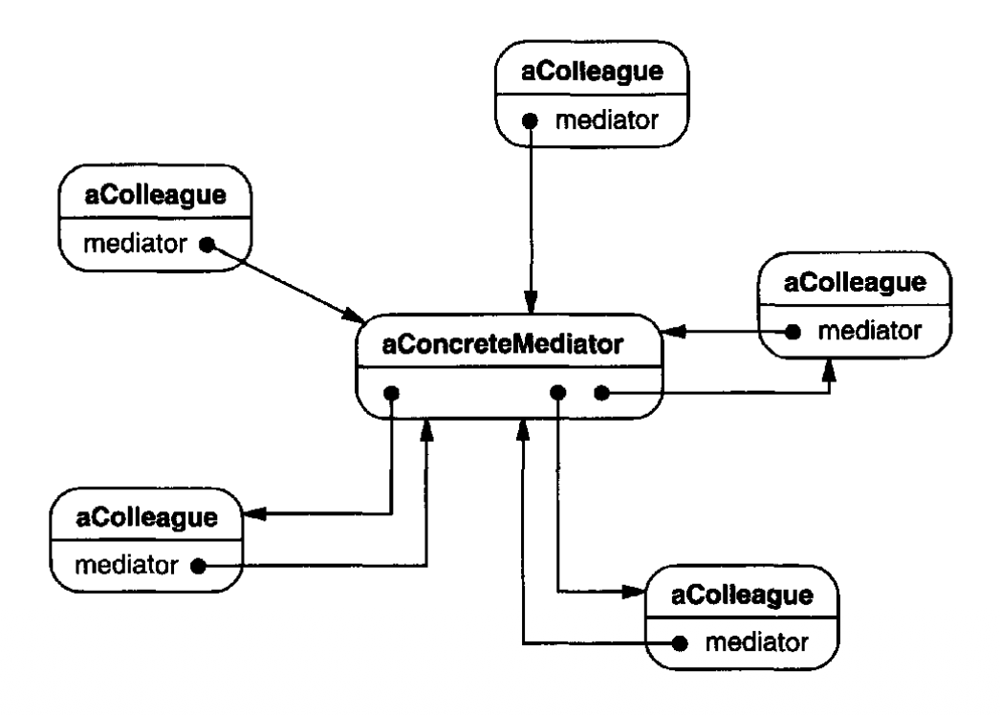

# Mediator （对象行为型）

## 意图

定义一个对象，封装一组对象如何交互。
Mediator 通过避免对象彼此显式引用来促进松散耦合，并让你能够独立地改变它们的交互。

## 动机

面向对象设计鼓励将行为分布到对象之间。
这种分布可能导致对象结构中对象之间存在许多连接；在最坏的情况下，每个对象最终都会知道其他所有对象。

尽管将系统划分为许多对象通常能增强可复用性，但激增的互连往往会再次降低可复用性。
大量互连使一个对象更不可能在没有其他对象支持的情况下工作 —— 系统表现得就好像它是一个单体。
此外，由于行为分布在许多对象中，以任何显著方式更改系统的行为都可能很困难。
结果，你可能被迫定义许多子类来定制系统的行为。

作为一个例子，考虑图形用户界面中对话框的实现。
一个对话框使用一个窗口来呈现一组部件 (widget)，例如按钮、菜单和输入字段，如下所示：

 

对话框中的部件之间常常存在依赖关系。
例如，当某个输入字段为空时，一个按钮会被禁用。
在选择列表（称为 **list box** ）中选择一个条目可能会更改某个输入字段的内容。
反过来，在输入字段中键入文本可能会自动选中 list box 中一个或多个对应条目。
一旦文本出现在输入字段中，其他按钮可能变为可用，让用户能对该文本执行某些操作，例如更改或删除它所指向的内容。

不同的对话框会有不同的部件间依赖关系。
因此，即使对话框显示相同种类的部件，它们也不能简单地复用现成的部件类；
它们必须被定制，以反映对话框特定的依赖关系。
通过子类化逐个定制它们会很繁琐，因为涉及许多类。

你可以通过将集体行为封装在一个单独的 **mediator** 对象中来避免这些问题。
mediator 负责控制和协调一组对象的交互。
mediator 充当一个中介，防止该组中的对象彼此显式引用。
这些对象只知道 mediator，从而减少了互连的数量。

例如，`FontDialogDirector` 可以是一个对话框内部件之间的 mediator。
一个 `FontDialogDirector` 对象知道对话框中的部件，并协调它们的交互。
它充当部件之间通信的枢纽：

 

下面的交互图说明了这些对象如何协作来处理 list box 选择的变化：

 

下面是一个 list box 的选择传递到输入字段所经历的事件序列：

1. list box 告诉它的 director 它已经改变。
2. director 从 list box 获取选择。
3. director 将该选择传递给输入字段。
4. 现在输入字段包含了一些文本，director 启用用于启动某个操作的按钮（例如，“demibold”、“oblique”）。

注意 director 如何在 list box 和输入字段之间进行中介。
部件之间只通过 director 间接通信。
它们不必彼此了解；它们只知道 director。
此外，由于行为被局部化在一个类中，因此可以通过扩展或替换该类来更改或替换该行为。

下面是如何将 `FontDialogDirector` 抽象集成到类库中：

 

`DialogDirector` 是一个抽象类，定义对话框的整体行为。
客户端调用 `ShowDialog` 操作以在屏幕上显示对话框。
`CreateWidgets` 是用于创建对话框部件的抽象操作。
`WidgetChanged` 是另一个抽象操作；部件调用它来通知其 director 它们已经改变。
`DialogDirector` 子类重写 `CreateWidgets` 来创建适当的部件，并重写 `WidgetChanged` 来处理这些变化。

## 适用性

在以下情况下使用 Mediator 模式：

- 一组对象以定义良好但复杂的方式进行通信。由此产生的相互依赖关系是非结构化的，并且难以理解。

- 复用一个对象很困难，因为它引用许多其他对象并与它们通信。

- 分布在若干类之间的行为应当可以在不需要大量子类化的情况下被定制。

## 结构

 

一个典型的对象结构可能如下所示：

 
