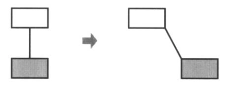
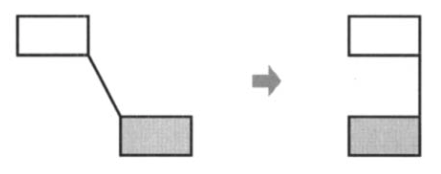
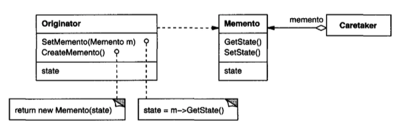
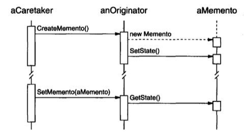

# Memento （行为型对象模式）

## 意图

在不违反封装的情况下，捕获并外部化一个对象的内部状态，以便该对象之后可以恢复到这一状态。

## 别名

Token

## 动机

有时有必要记录一个对象的内部状态。
在实现检查点和撤销机制时，这是必需的，这些机制让用户能够退出试探性操作或从错误中恢复。
你必须将状态信息保存在某个地方，以便能够将对象恢复到先前的状态。
但对象通常封装其部分或全部状态，使其他对象无法访问这些状态，也无法从外部保存它们。
暴露这些状态会违反封装，这可能损害应用的可靠性和可扩展性。

例如，考虑一个支持对象之间连接性的图形编辑器。
用户可以用一条线连接两个矩形，并且当用户移动其中任一矩形时，这些矩形保持连接。
编辑器确保该线拉伸以维持连接。

<br/>

维护对象之间连接关系的一种众所周知的方法是使用约束求解系统 (constraint-solving system)。
我们可以将此功能封装在一个 **ConstraintSolver** 对象中。
ConstraintSolver 在建立连接时记录它们，并生成描述这些连接的数学方程。
每当用户建立连接或以其他方式修改图时，它都会求解这些方程。
ConstraintSolver 使用其计算结果重新排列图形，以便它们保持正确的连接。

在此应用中支持撤销并不像看起来那么容易。
撤销移动操作的一种显而易见的方法是存储原始移动距离，并将对象移回等效距离。
然而，这并不能保证所有对象都会出现在它们之前所在的位置。
假设连接中存在一些松弛量 (slack)。
在这种情况下，仅仅将矩形移回其原始位置不一定能达到预期效果。

<br/>

一般来说，ConstraintSolver 的公共接口可能不足以精确撤销它对其他对象造成的影响。
撤销机制必须与 ConstraintSolver 更紧密地协作，以重建先前的状态；
但我们也应避免将 ConstraintSolver 的内部结构暴露给撤销机制。

我们可以用 Memento 模式解决这个问题。
**memento** 是一个对象，它存储另一个对象 ——即 memento 的 **originator**—— 的内部状态快照。
当撤销机制需要对 originator 的状态设置检查点时，它会向 originator 请求一个 memento。
originator 用刻画其当前状态的信息初始化该 memento。
只有 originator 才能从 memento 中存储和检索信息 —— memento 对其他对象是 “不透明的”。

在刚才讨论的图形编辑器示例中，ConstraintSolver 可以充当 originator。以下事件序列刻画了撤销过程：

1. 作为移动操作的副作用，编辑器向 ConstraintSolver 请求一个 memento。

2. ConstraintSolver 创建并返回一个 memento，在这种情况下是 SolverState 类的一个实例。
SolverState memento 包含描述 ConstraintSolver 内部方程和变量当前状态的数据结构。

3. 之后当用户撤销该移动操作时，编辑器将 SolverState 交还给 ConstraintSolver。

4. 根据 SolverState 中的信息，ConstraintSolver 更改其内部结构，使其方程和变量恢复到确切的先前状态。

这种安排让 ConstraintSolver 能够将恢复到先前状态所需的信息托付给其他对象，而不暴露其内部结构和表示。

## 适用性

在以下情况下使用 Memento 模式：

- 必须保存一个对象（某部分）状态的快照，以便之后可以恢复到该状态，并且

- 用于获取该状态的直接接口会暴露实现细节并破坏对象的封装。

## 结构

<br/>

## 参与者

- **Memento** （`SolverState`）

  - 存储 `Originator` 对象的内部状态。
  memento 可以按 originator 自行决定的详略程度，存储其内部状态中必要的部分。

  - 防止 originator 以外的对象访问。
  memento 实际上有两个接口。
  `Caretaker` 看到的是 `Memento` 的窄接口 —— 它只能将 memento 传递给其他对象。
  相反，`Originator` 看到的是宽接口，该接口让它能够访问将自身恢复到先前状态所需的所有数据。
  理想情况下，只有生成该 memento 的 originator 才被允许访问 memento 的内部状态。

- **Originator** （`ConstraintSolver`）

  - 创建一个包含其当前内部状态快照的 memento。

  - 使用该 memento 恢复其内部状态。

- **Caretaker** （撤销机制）

  - 负责保管 memento。

  - 从不对 memento 的内容进行操作或检查。

## 协作

- 一个 caretaker 向 originator 请求一个 memento，保存它一段时间，然后将其交还给 originator，如下面的交互图所示：

  <br/>

  有时 caretaker 不会将 memento 交还给 originator，因为 originator 可能永远不需要恢复到较早的状态。

- Memento 是被动的。只有创建某个 memento 的 originator 才会设置或检索其状态。

## 效果

Memento 模式具有以下效果：

1. *保持封装边界。*
`Memento` 避免暴露只应由 originator 管理、但又必须存储在 originator 外部的信息。
该模式使其他对象无法接触可能复杂的 Originator 内部结构，从而保持封装边界。

2. *它简化了 `Originator`。*
在其他保持封装的设计中，`Originator` 会保存客户端所请求的内部状态版本。
这会把所有存储管理负担都放在 `Originator` 上。
让客户端管理它们所请求的状态，可以简化 `Originator`，并使客户端不必在完成后通知 originator。

3. *使用 memento 可能代价高昂。*
如果 `Originator` 必须复制大量信息以存储在 memento 中，
或者如果客户端足够频繁地创建 memento 并将其返回给 originator，那么 memento 可能会带来相当大的开销。
除非封装和恢复 `Originator` 状态的成本很低，否则该模式可能并不合适。
参见实现部分中关于增量性的讨论。

4. *定义窄接口和宽接口。*
在某些语言中，可能难以确保只有 originator 才能访问 memento 的状态。

5. *保管 memento 的隐藏成本。*
caretaker 负责删除它保管的 memento。
然而，caretaker 并不知道 memento 中有多少状态。
因此，一个原本轻量的 caretaker 在存储 memento 时可能会产生很大的存储成本。

## 实现

在实现 Memento 模式时，需要考虑两个问题：

1. *语言支持。*
Memento 有两个接口：一个供 originator 使用的宽接口，以及一个供其他对象使用的窄接口。
理想情况下，实现语言应支持两个级别的静态保护。
C++ 允许你通过将 `Originator` 设为 `Memento` 的 friend，并将 `Memento` 的宽接口设为 private 来实现这一点。
只有窄接口应被声明为 public。例如：

   ```cpp
   class State;
   
   class Originator {
   public:
       Memento* CreateMemento();
       void SetMemento(const Memento*);
       // . . .
   private:
       State* _state; // internal data structures
       // . . .
   };
   
   class Memento {
   public:
       // narrow public interface
       virtual ~Memento();
   private:
       // private members accessible only to Originator
       friend class Originator;
       Memento();
   
       void SetState(State*);
       State* GetState();
       // . . .
   private:
       State* _state;
       // . . .
   };
   ```

2. *存储增量变化。*
当 memento 以可预测的顺序被创建并交还给其 originator 时，`Memento` 可以只保存对 originator 内部状态的增量变化。

   例如，历史列表中的可撤销 command 可以使用 memento 来确保 command 在被撤销时恢复到其确切状态（见 [Command (233)](2.md)）。
   历史列表定义了 command 可以被撤销和重做的特定顺序。
   这意味着 memento 可以只存储某个 command 所做的增量变化，而不是存储它影响的每个对象的完整状态。
   在前面给出的动机示例中，约束求解器可以只存储那些发生变化以保持矩形之间连线的内部结构，而不是存储这些对象的绝对位置。

## 示例代码

这里给出的 C++ 代码说明了前面讨论的 `ConstraintSolver` 示例。
我们使用 `MoveCommand` 对象（见 [Command (233)](2.md)）来执行（及撤销）一个图形对象从一个位置到另一个位置的平移。
图形编辑器调用 command 的 `Execute` 操作来移动一个图形对象，并调用 `Unexecute` 来撤销该移动。
该 command 存储其目标、移动距离，以及一个 `ConstraintSolverMemento` 实例，后者是包含约束求解器状态的 memento。

```cpp
class Graphic;
// base class for graphical objects in the graphical editor

class MoveCommand {
public:
    MoveCommand(Graphic* target, const Point& delta);
    void Execute();
    void Unexecute();
private:
    ConstraintSolverMemento* _state;
    Point _delta;
    Graphic* _target;
};
```

连接约束由 `ConstraintSolver` 类建立。
它的关键成员函数是 `Solve`，用于求解通过 `AddConstraint` 操作注册的约束。
为支持撤销，`ConstraintSolver` 的状态可以通过 `CreateMemento` 外部化为一个 `ConstraintSolverMemento` 实例。
通过调用 `SetMemento`，约束求解器可以返回到先前的状态。`ConstraintSolver` 是一个 [Singleton (127)](../ch3/5.md)。

```cpp
class ConstraintSolver {
public:
    static ConstraintSolver* Instance();

    void Solve();
    void AddConstraint(
        Graphic* startConnection, Graphic* endConnection
    );
    void RemoveConstraint(
        Graphic* startConnection, Graphic* endConnection
    );
    ConstraintSolverMemento* CreateMemento();
    void SetMemento(ConstraintSolverMemento*);
private:
    // nontrivial state and operations for enforcing
    // connectivity semantics
};

class ConstraintSolverMemento {
public:
    virtual ~ConstraintSolverMemento();
private:
    friend class ConstraintSolver;
    ConstraintSolverMemento();

    // private constraint solver state
};
```

给定这些接口，我们可以如下实现 `MoveCommand` 的成员 `Execute` 和 `Unexecute`：

```cpp
void MoveCommand::Execute () {
    ConstraintSolver* solver = ConstraintSolver::Instance();
    _state = solver->CreateMemento(); // create a memento
    _target->Move(_delta);
    solver->Solve();
}

void MoveCommand::Unexecute () {
    ConstraintSolver* solver = ConstraintSolver::Instance();
    _target->Move(-_delta);
    solver->SetMemento(_state); // restore solver state
    solver->Solve();
}
```

`Execute` 在移动图形之前获取一个 `ConstraintSolverMemento` memento。
`Unexecute` 将图形移回，将约束求解器的状态设置为先前状态，最后告诉约束求解器求解约束。

## 已知应用

前面的示例代码基于 Unidraw 通过其 CSolver 类对连接性的支持 [VL90](../biblio.md#vl90)。

Dylan [App92](../biblio.md#app92) 中的集合提供了一个反映 Memento 模式的迭代接口。
Dylan 的集合具有 “状态” 对象的概念，它是一个表示迭代状态的 memento。
每个集合可以以它选择的任何方式表示当前迭代状态；该表示对客户端完全隐藏。
Dylan 的迭代方法可以按如下方式转换为 C++：

```cpp
template <class Item>
class Collection {
public:
    Collection();

    IterationState* CreateInitialState();
    void Next(IterationState*);
    bool IsDone(const IterationState*) const;
    Item CurrentItem(const IterationState*) const;
    IterationState* Copy(const IterationState*) const;

    void Append(const Item&);
    void Remove(const Item&);
    // . . .
};
```

`CreateInitialState` 为集合返回一个已初始化的 `IterationState` 对象。
`Next` 将状态对象推进到迭代中的下一个位置；它实际上递增迭代索引。
`IsDone` 如果 `Next` 已经越过集合中的最后一个元素，则返回 true。
`CurrentItem` 解引用状态对象，并返回它所指向的集合中的元素。
`Copy` 返回给定状态对象的副本。这对于标记迭代中的某个点很有用。

给定一个 `ItemType` 类，我们可以如下遍历其实例的集合⁷：

```cpp
class ItemType {
public:
    void Process();
    // . . .
};

Collection<ItemType*> aCollection;
IterationState* state;

state = aCollection.CreateInitialState();

while (!aCollection.IsDone(state)) {
    aCollection.CurrentItem(state)->Process();
    aCollection.Next(state);
}
delete state;
```

⁷ 注意，我们的示例在迭代结束时删除状态对象。
但如果 `ProcessItem` 抛出异常，`delete` 就不会被调用，从而产生垃圾。
这在 C++ 中是一个问题，但在具有垃圾回收的 Dylan 中不是问题。
我们在第 [266](4.md#sample-code-5) 页讨论该问题的一个解决方案。

基于 memento 的迭代接口有两个有趣的优点：

1. 多个状态可以作用于同一个集合。（[Iterator (257)](4.md) 模式也是如此。）

2. 它不需要为了支持迭代而破坏集合的封装。
memento 只由集合本身解释；其他任何人都无法访问它。
其他迭代方法则要求通过让 iterator 类成为其集合类的 friend 来破坏封装（见 [Iterator (257)](4.md)）。
在基于 memento 的实现中，情况正好相反：`Collection` 是 `IteratorState` 的 friend。

> 译注：原书正文此处写作 `IteratorState`，与本章代码中的类名 `IterationState` 不一致。

QOCA 约束求解工具包将增量信息存储在 memento 中 [HHMV92](../biblio.md#hhmv92)。
客户端可以获得一个 memento，该 memento 刻画约束系统当前解的特征。
该 memento 只包含自上次求解以来发生变化的那些约束变量。
通常，对于每个新解，求解器变量中只有一小部分会发生变化。
这个子集足以让求解器返回到前一个解；要恢复到更早的解，需要从中间各个解恢复 memento。
因此，你不能以任意顺序设置 memento；QOCA 依赖历史机制来恢复到更早的解。

## 相关模式

[Command (233)](2.md)：Command 可以使用 memento 来维护可撤销操作的状态。

[Iterator (257)](4.md)：Memento 可以如前所述用于迭代。
