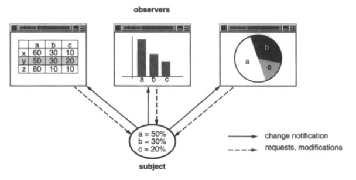
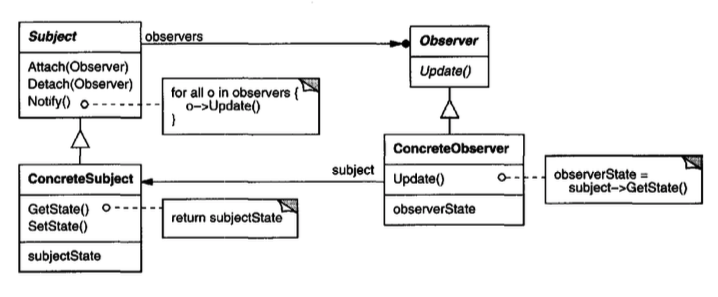
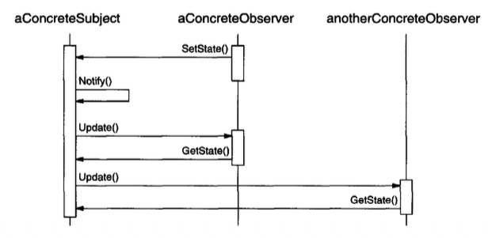
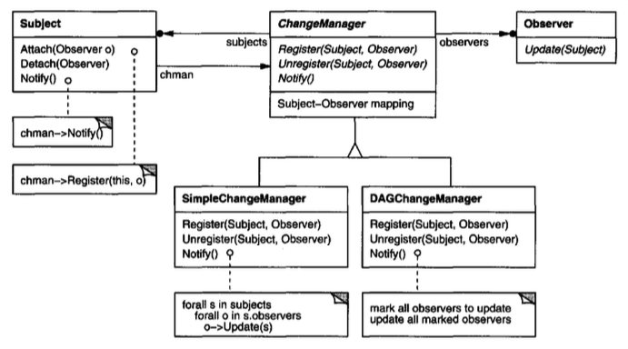

# Observer （行为型对象模式）

## 意图

定义对象之间的一对多依赖关系，使得当一个对象改变状态时，它的所有依赖者都会自动收到通知并更新。

## 别名

Dependents, Publish-Subscribe

## 动机

将系统划分为一组协作类时，一个常见的副作用是需要在相关对象之间维护一致性。
你不希望通过让这些类紧密耦合来实现一致性，因为那会降低它们的可复用性。

例如，许多图形用户界面工具包将用户界面的表示方面与底层应用数据分离 [KP88](../biblio.md#kp88), [LVC89](../biblio.md#lvc89), [P+88](../biblio.md#p88), [WGM88](../biblio.md#wgm88)。
定义应用数据和表示形式的类可以独立复用。
它们也可以协同工作。
电子表格对象和条形图对象都可以使用不同的表示形式，来描绘同一个应用数据对象中的信息。
电子表格和条形图彼此并不知道对方，从而让你只复用自己需要的那一个。
但它们的行为却好像彼此知道一样。当用户更改电子表格中的信息时，条形图会立即反映这些变化，反之亦然。

<br/>

这种行为意味着电子表格和条形图依赖于该数据对象，因此应当在该对象状态发生任何变化时收到通知。
而且没有理由将依赖对象的数量限制为两个；同一个数据可以有任意数量的不同用户界面。

Observer 模式描述了如何建立这些关系。
该模式中的关键对象是 **subject** 和 **observer**。
一个 subject 可以有任意数量的依赖 observer。
每当 subject 的状态发生变化时，所有 observer 都会收到通知。
作为响应，每个 observer 都会查询 subject，以使其状态与 subject 的状态同步。

这种交互也称为 **publish-subscribe**。
subject 是通知的发布者。
它发出这些通知，而不必知道其 observer 是谁。
任意数量的 observer 都可以订阅以接收通知。

## 适用性

在以下任何情况下使用 Observer 模式：

- 当一个抽象有两个方面，且一个方面依赖于另一个方面时。
将这两个方面封装在单独的对象中，可以让你独立地变化和复用它们。

- 当一个对象的更改需要更改其他对象，而你又不知道需要更改多少个对象时。

- 当一个对象应当能够通知其他对象，而又不假设这些对象是谁时。换句话说，你不希望这些对象紧密耦合。

## 结构

<br/>

## 参与者

- **Subject**

  - 知道它的 observer。任意数量的 `Observer` 对象都可以观察一个 subject。

  - 提供用于附加和分离 `Observer` 对象的接口。

- **Observer**

  - 为应当收到 subject 变化通知的对象定义一个更新接口。

- **ConcreteSubject**

  - 存储 `ConcreteObserver` 对象感兴趣的状态。

  - 当其状态发生变化时，向其 observer 发送通知。

- **ConcreteObserver**

  - 维护对 `ConcreteSubject` 对象的引用。

  - 存储应当与 subject 的状态保持一致的状态。

  - 实现 `Observer` 更新接口，以使其状态与 subject 的状态保持一致。

## 协作

- `ConcreteSubject` 每当发生可能使其 observer 的状态与自身状态不一致的变化时，就通知其 observer。

- 在得知具体 subject 发生变化后，`ConcreteObserver` 对象可以查询该 subject 以获取信息。
`ConcreteObserver` 使用这些信息来协调其状态与 subject 的状态。

  下面的交互图说明了一个 subject 与两个 observer 之间的协作：

  <br/>

  注意发起更改请求的 `Observer` 对象如何推迟其更新，直到它收到来自 subject 的通知。`Notify` 并不总是由 subject 调用。它可以由 observer 调用，也可以完全由另一种对象调用。实现部分讨论了一些常见的变体。

## 效果

Observer 模式让你能够独立地变化 subject 和 observer。
你可以复用 subject 而不复用其 observer，反之亦然。
它让你能够添加 observer 而不修改 subject 或其他 observer。

Observer 模式的进一步优点和缺点包括：

1. *抽象 Subject 与 Observer 之间的耦合。*
subject 只知道它有一个 observer 列表，其中每个 observer 都符合抽象 `Observer` 类的简单接口。
subject 不知道任何 observer 的具体类。
因此，subject 与 observer 之间的耦合是抽象的并且最小。

   由于 `Subject` 和 `Observer` 不是紧密耦合的，它们可以属于系统中不同的抽象层次。
   一个较低层的 subject 可以与一个较高层的 observer 通信并向其通知，从而保持系统的分层完整。
   如果 `Subject` 和 `Observer` 被混在一起，那么产生的对象要么必须跨越两层（从而违反分层），
   要么必须被迫位于某一层中（这可能损害分层抽象）。

2. *支持广播通信。*
与普通请求不同，subject 发送的通知无需指定其接收者。
该通知会自动广播给所有订阅了它的感兴趣对象。
subject 不关心存在多少个感兴趣对象；它唯一的责任是通知其 observer。
这让你能够随时自由地添加和移除 observer。
由 observer 决定处理还是忽略通知。

3. *意外的更新。*
由于 observer 不知道彼此的存在，它们可能对更改 subject 的最终代价一无所知。
对 subject 的一个看似无害的操作，可能导致对 observer 及其依赖对象的一连串更新。
此外，未明确定义或维护的依赖标准，通常会导致伪更新，而这些可能难以追踪。

   简单的更新协议不提供关于 subject 中什么发生变化的细节，这一事实加剧了该问题。
   如果没有额外的协议来帮助 observer 发现什么发生了变化，它们可能被迫费力推断这些变化。

## 实现

本节讨论与依赖机制实现相关的几个问题。

1. *将 subject 映射到其 observer。*
subject 跟踪它应通知的 observer 的最简单方式，是在 subject 中显式存储对它们的引用。
然而，当 subject 很多而 observer 很少时，这种存储可能代价太高。
一种解决方案是通过使用关联查找（例如哈希表）来维护 subject 到 observer 的映射，以空间换时间。
这样，一个没有 observer 的 subject 就不会产生存储开销。
另一方面，这种方法会增加访问 observer 的成本。

2. *观察多个 subject。*
在某些情况下，一个 observer 依赖多个 subject 是有意义的。
例如，一个电子表格可能依赖多个数据源。
在这种情况下，有必要扩展 `Update` 接口，让 observer 知道是哪个 subject 在发送通知。
subject 可以简单地将自身作为参数传入 `Update` 操作，从而让 observer 知道应检查哪个 subject。

3. *谁触发更新？*
subject 及其 observer 依赖通知机制来保持一致。
但究竟是哪个对象实际调用 `Notify` 来触发更新？这里有两个选项：

  - (a) 让 `Subject` 上的状态设置操作在更改 subject 的状态后调用 `Notify`。
  这种方法的优点是客户端不必记得在 subject 上调用 `Notify`。
  缺点在于，多个连续操作会导致多次连续更新，这可能效率不高。

  - (b) 让客户端负责在正确的时间调用 `Notify`。
  这里的优点是，客户端可以等到一系列状态更改完成后再触发更新，从而避免不必要的中间更新。
  缺点是客户端增加了触发更新的责任。
  这会使错误更可能发生，因为客户端可能忘记调用 `Notify`。

4. *对已删除 subject 的悬空引用。*
删除一个 subject 不应在其 observer 中产生悬空引用。
避免悬空引用的一种方式是让 subject 在删除时通知其 observer，以便它们可以重置对它的引用。
一般来说，简单地删除 observer 并不是一个选项，因为其他对象可能引用它们，或者它们可能还在观察其他 subject。

5. *在通知之前确保 `Subject` 状态自洽。*
在调用 `Notify` 之前确保 `Subject` 状态自洽很重要，因为 observer 在更新自身状态的过程中会向 subject 查询其当前状态。

   当 `Subject` 子类操作调用继承的操作时，这条自洽规则很容易被无意中违反。
   例如，在下面的代码序列中，通知是在 subject 处于不一致状态时触发的：

   ```cpp
   void MySubject::Operation (int newValue) {
       BaseClassSubject::Operation(newValue);
           // trigger notification

       _myInstVar += newValue;
           // update subclass state (too late!)
   }
   ```

   你可以通过从抽象 `Subject` 类中的模板方法（ [Template Method (325)](10.md) ）发送通知来避免这个陷阱。
   定义一个供子类重写的原始操作，并让 `Notify` 成为模板方法中的最后一个操作，这将确保当子类重写 `Subject` 操作时对象是自洽的。

   ```cpp
   void Text::Cut (TextRange r) {
       ReplaceRange(r);       // redefined in subclasses
       Notify();
   }
   ```
   
   顺便说一句，记录哪些 `Subject` 操作会触发通知始终是一个好主意。

6. *避免 observer 特定的更新协议：push 模型和 pull 模型。*
Observer 模式的实现常常让 subject 广播关于变化的额外信息。
subject 将这些信息作为参数传递给 `Update`。信息量可能差异很大。

   在一个极端，我们称之为 **push 模型** ，subject 向 observer 发送关于变化的详细信息，无论它们是否需要。
   另一个极端是 **pull 模型** ；subject 只发送最少的通知，之后 observer 显式地询问细节。

   pull 模型强调 subject 对其 observer 一无所知，而 push 模型假定 subject 对其 observer 的需求有所了解。
   push 模型可能使 observer 的可复用性降低，因为 `Subject` 类对 `Observer` 类作出假设，而这些假设可能并不总是成立。
   另一方面，pull 模型可能效率不高，因为 `Observer` 类必须在没有 `Subject` 帮助的情况下查明发生了什么变化。

7. *显式指定感兴趣的变化。*
你可以通过扩展 subject 的注册接口来提高更新效率，使得只为特定感兴趣的事件注册 observer。
当这样的事件发生时，subject 只通知那些已注册对该事件感兴趣的 observer。
实现这一目标的一种方式是使用 `Subject` 对象的 **aspect** 概念。
为了注册对特定事件的兴趣，observer 使用以下方式附加到其 subject：

   ```cpp
   void Subject::Attach(Observer*, Aspect& interest);
   ```

   其中 `interest` 指定感兴趣的事件。在通知时，subject 将发生变化的 aspect 作为 `Update` 操作的参数提供给其 observer。例如：

   ```cpp
   void Observer::Update(Subject*, Aspect& interest);
   ```

8. *封装复杂的更新语义。*
当 subject 和 observer 之间的依赖关系特别复杂时，可能需要一个维护这些关系的对象。
我们把这样的对象称为 **ChangeManager** 。
其目的是尽量减少使 observer 反映其 subject 变化所需的工作。
例如，如果一个操作涉及对若干相互依赖的 subject 的更改，
你可能必须确保在所有 subject 都被修改后才通知它们的 observer，以避免对 observer 通知不止一次。

   `ChangeManager` 有三项职责：

   - (a) 它将 subject 映射到其 observer，并提供用于维护此映射的接口。
   这消除了 subject 维护对其 observer 的引用以及反之亦然的需要。

   - (b) 它定义一种特定的更新策略。

   - (c) 它应 subject 的请求更新所有依赖 observer。

   下图描绘了一个基于 `ChangeManager` 的简单 `Observer` 模式实现。
   有两个专门的 `ChangeManager`。
   `SimpleChangeManager` 比较朴素，因为它总是更新每个 subject 的所有 observer。
   相反，`DAGChangeManager` 处理 subject 与其 observer 之间依赖关系的有向无环图。
   当一个 observer 观察多个 subject 时，`DAGChangeManager` 比 `SimpleChangeManager` 更可取。
   在这种情况下，两个或更多 subject 的变化可能导致冗余更新。
   `DAGChangeManager` 确保 observer 只收到一次更新。
   当多次更新不是问题时，`SimpleChangeManager` 就可以了。

   <br/>
 
   `ChangeManager` 是 [Mediator (273)](5.md) 模式的一个实例。
   通常只有一个 `ChangeManager`，并且它是全局已知的。[Singleton (127)](../ch3/5.md) 模式在这里会很有用。

9. *组合 `Subject` 和 `Observer` 类。*
用缺乏多重继承的语言（如 Smalltalk）编写的类库通常不定义单独的 `Subject` 和 `Observer` 类，而是将它们的接口组合在一个类中。
这让你可以定义同时充当 subject 和 observer 的对象，而无需多重继承。
例如，在 Smalltalk 中，`Subject` 和 `Observer` 接口定义在根类 `Object` 中，使所有类都可以使用它们。

## 示例代码

一个抽象类定义 `Observer` 接口：

```cpp
class Subject;

class Observer {
public:
    virtual ~Observer();
    virtual void Update(Subject* theChangedSubject) = 0;
protected:
    Observer();
};
```

这个实现支持每个 observer 拥有多个 subject。
传给 `Update` 操作的 subject 让 observer 在观察多个 subject 时能够确定是哪个 subject 发生了变化。

类似地，一个抽象类定义 `Subject` 接口：

```cpp
class Subject {
public:
    virtual ~Subject();

    virtual void Attach(Observer*);
    virtual void Detach(Observer*);
    virtual void Notify();
protected:
    Subject();
private:
    List<Observer*> *_observers;
};

void Subject::Attach (Observer* o) {
    _observers->Append(o);
}

void Subject::Detach (Observer* o) {
    _observers->Remove(o);
}

void Subject::Notify () {
    ListIterator<Observer*> i(_observers);
    for (i.First(); !i.IsDone(); i.Next()) {
        i.CurrentItem()->Update(this);
    }
}
```

`ClockTimer` 是一个具体 subject，用于存储和维护一天中的时间。
它每秒通知其 observer。
`ClockTimer` 提供用于检索各个时间单位（例如小时、分钟和秒）的接口。

```cpp
class ClockTimer : public Subject {
public:
    ClockTimer();

    virtual int GetHour();
    virtual int GetMinute();
    virtual int GetSecond();

    void Tick();
};
```

`Tick` 操作由内部定时器按固定间隔调用，以提供准确的时间基准。
`Tick` 更新 `ClockTimer` 的内部状态，并调用 `Notify` 将变化告知 observer：

```cpp
void ClockTimer::Tick () {
    // update internal time-keeping state
    // . . .
    Notify();
}
```

现在我们可以定义一个显示时间的 `DigitalClock` 类。
它从用户界面工具包提供的 `Widget` 类继承图形功能。
`Observer` 接口通过继承 `Observer` 混入 `DigitalClock` 接口。

```cpp
class DigitalClock: public Widget, public Observer {
public:
    DigitalClock(ClockTimer*);
    virtual ~DigitalClock();

    virtual void Update(Subject*);
        // overrides Observer operation

    virtual void Draw();
        // overrides Widget operation;
        // defines how to draw the digital clock
private:
    ClockTimer* _subject;
};

DigitalClock::DigitalClock (ClockTimer* s) {
    _subject = s;
    _subject->Attach(this);
}

DigitalClock::~DigitalClock () {
    _subject->Detach(this);
}
```

在 `Update` 操作绘制钟面之前，它检查以确保发出通知的 subject 是该时钟的 subject：

```cpp
void DigitalClock::Update (Subject* theChangedSubject) {
    if (theChangedSubject == _subject) {
        Draw();
    }
}

void DigitalClock::Draw () {
    // get the new values from the subject

    int hour = _subject->GetHour();
    int minute = _subject->GetMinute();
    // etc.

    // draw the digital clock
}
```

`AnalogClock` 类可以用同样的方式定义。

```cpp
class AnalogClock : public Widget, public Observer {
public:
    AnalogClock(ClockTimer*);
    virtual void Update(Subject*);
    virtual void Draw();
    // . . .
};
```

下面的代码创建了一个 `AnalogClock` 和一个 `DigitalClock`，它们始终显示相同的时间：

```cpp
ClockTimer* timer = new ClockTimer;
AnalogClock* analogClock = new AnalogClock(timer);
DigitalClock* digitalClock = new DigitalClock(timer);
```

每当 timer 滴答时，这两个时钟都会被更新，并适当地重新显示自身。

## 已知应用

Observer 模式的第一个、也许是最著名的例子出现在 Smalltalk Model/View/Controller（MVC）中，这是 Smalltalk 环境中的用户界面框架 [KP88](../biblio.md#kp88)。
MVC 的 Model 类扮演 `Subject` 的角色，而 View 是 observer 的基类。
Smalltalk、ET++ [WGM88](../biblio.md#wgm88) 和 THINK 类库 [Sym93b](../biblio.md#sym93b) 通过将 `Subject` 和 `Observer` 接口放入系统中所有其他类的父类，提供了一种通用的依赖机制。

采用该模式的其他用户界面工具包包括 InterViews [LVC89](../biblio.md#lvc89)、Andrew Toolkit [P+88](../biblio.md#p88) 和 Unidraw [VL90](../biblio.md#vl90)。
InterViews 显式定义了 `Observer` 和 `Observable`（用于 subject）类。
Andrew 分别将它们称为 “view” 和 “data object”。
Unidraw 将图形编辑器对象拆分为 `View`（用于 observer）和 `Subject` 部分。

## 相关模式

[Mediator (273)](5.md)：通过封装复杂的更新语义，`ChangeManager` 充当 subject 和 observer 之间的 mediator。

[Singleton (127)](../ch3/5.md)：`ChangeManager` 可以使用 `Singleton` 模式使其唯一且可全局访问。
