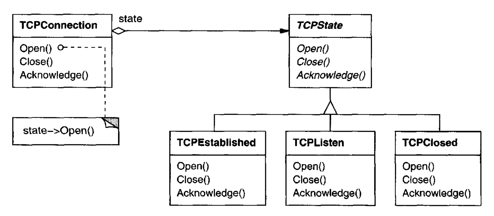
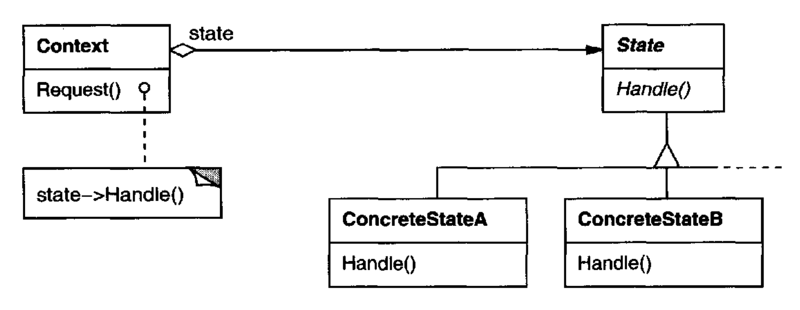
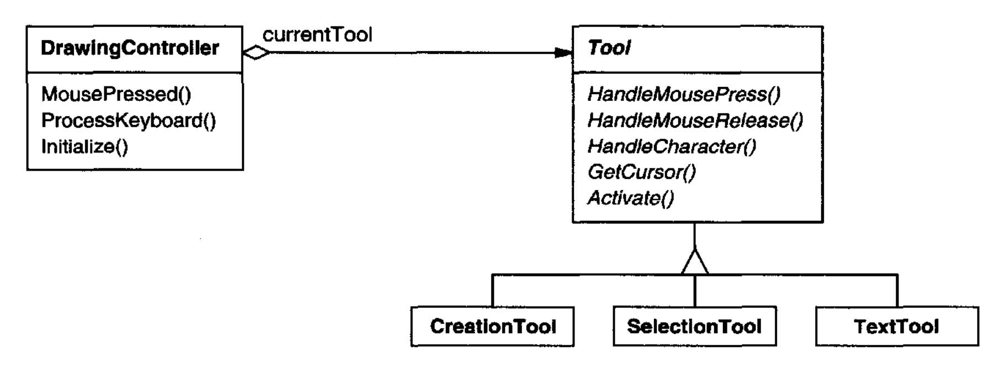

# State （对象行为型）

## 意图

允许一个对象在其内部状态改变时改变其行为。该对象看起来像是改变了它的类。

## 别名

Objects for States

## 动机

考虑一个表示网络连接的 `TCPConnection` 类。
一个 `TCPConnection` 对象可以处于若干不同状态之一：`Established`、`Listening`、`Closed`。
当一个 `TCPConnection` 对象接收来自其他对象的请求时，它会根据其当前状态作出不同响应。
例如，`Open` 请求的效果取决于该连接处于 `Closed` 状态还是 `Established` 状态。
State 模式描述了 `TCPConnection` 如何在每个状态中表现出不同行为。

该模式的关键思想是引入一个称为 `TCPState` 的抽象类来表示网络连接的状态。
`TCPState` 类声明一个对所有表示不同操作状态的类都公共的接口。
`TCPState` 的子类实现状态特定的行为。
例如，`TCPEstablished` 和 `TCPClosed` 类实现 TCPConnection 的 `Established` 和 `Closed` 状态所特有的行为。

<br/>

`TCPConnection` 类维护一个 state 对象（`TCPState` 某个子类的实例），该对象表示 TCP 连接的当前状态。
`TCPConnection` 类将所有状态特定的请求委托给这个 state 对象。
`TCPConnection` 使用其 `TCPState` 子类实例来执行该连接状态所特有的操作。

每当连接改变状态时，`TCPConnection` 对象就会更改它使用的 state 对象。
例如，当连接从 established 变为 closed 时，`TCPConnection` 将用 `TCPClosed` 实例替换其 `TCPEstablished` 实例。

## 适用性

在以下任一情况下使用 State 模式：

- 一个对象的行为取决于其状态，并且它必须在运行时根据该状态改变其行为。

- 操作包含依赖于该对象状态的大型、多分支条件语句。
这种状态通常由一个或多个枚举常量表示。
通常，多个操作会包含相同的条件结构。
State 模式将条件的每个分支放入单独的类中。
这让你能够将该对象的状态视为一个独立的对象，它可以独立于其他对象而变化。

## 结构

<br/>

## 参与者

- **Context** （`TCPConnection`）

  - 定义客户端感兴趣的接口。

  - 维护一个 `ConcreteState` 子类的实例，该实例定义当前状态。

- **State** （`TCPState`）

  - 定义一个接口，用于封装与 `Context` 的某个特定状态相关联的行为。

- **ConcreteState**  子类（`TCPEstablished`、`TCPListen`、`TCPClosed`）

  - 每个子类实现与 `Context` 的某个状态相关联的行为。

## 协作

- `Context` 将状态特定的请求委托给当前的 `ConcreteState` 对象。

- `Context` 可以将自身作为参数传递给处理该请求的 `State` 对象。这让 `State` 对象在必要时能够访问 context。

- `Context` 是客户端的主要接口。客户端可以用 `State` 对象配置一个 context。
一旦 context 被配置好，其客户端就不必直接与 `State` 对象打交道。

- 无论是 `Context` 还是 `ConcreteState` 子类，都可以决定哪个状态接替另一个状态，以及在什么情况下接替。

## 效果

State 模式具有以下后果：

1. *它局部化状态特定的行为，并按不同状态划分行为。*
State 模式将与某个特定状态相关联的所有行为放入一个对象中。
由于所有状态特定的代码都位于一个 `State` 子类中，因此可以通过定义新的子类轻松添加新的状态和转换。

   另一种选择是使用数据值来定义内部状态，并让 `Context` 操作显式检查这些数据。
   但那样的话，我们就会在 `Context` 的实现中散布着外观相似的条件语句或 case 语句。
   添加一个新状态可能需要更改多个操作，这会使维护复杂化。

   State 模式避免了这个问题，但可能引入另一个问题，因为该模式将不同状态的行为分布到若干 `State` 子类中。
   这增加了类的数量，并且不如单个类紧凑。
   但如果状态很多，这种分布实际上是有益的，否则将需要大型条件语句。

   像长过程一样，大型条件语句是不可取的。
   它们是单体的，往往使代码不够明确，进而使它们难以修改和扩展。
   State 模式提供了一种更好的方式来组织状态特定的代码。
   确定状态转换的逻辑并不驻留在单体的 `if` 或 `switch` 语句中，而是划分到 `State` 子类之间。
   将每个状态转换和动作封装在一个类中，把执行状态的概念提升为完整的对象地位。
   这为代码施加了结构，并使其意图更清晰。

2. *它使状态转换显式化。*
当一个对象仅用内部数据值来定义其当前状态时，它的状态转换没有显式表示；它们只表现为对某些变量的赋值。
为不同状态引入单独的对象会使转换更加显式。

   此外，`State` 对象可以保护 `Context` 免于不一致的内部状态，
   因为从 `Context` 的角度看，状态转换是原子的 —— 它们通过重新绑定一个变量（`Context` 的 `State` 对象变量）发生，而不是多个变量 [dCLF93](../biblio.md#dclf93)。

3. *`State` 对象可以被共享。*
如果 `State` 对象没有实例变量 ——也就是说，它们表示的状态完全编码在其类型中—— 那么 context 可以共享一个 `State` 对象。
当状态以这种方式被共享时，它们本质上是没有内在状态、只有行为的 flyweight（见 [Flyweight (195)](../ch4/6.md)）。

## 实现

State 模式引出了各种实现问题：

1. *谁定义状态转换？*
State 模式没有规定哪个参与者定义状态转换的标准。
如果这些标准是固定的，那么它们可以完全在 `Context` 中实现。
然而，通常更灵活且更合适的做法是让 `State` 子类自身指定其后继状态以及何时进行转换。
这要求向 `Context` 添加一个接口，让 `State` 对象能够显式设置 `Context` 的当前状态。

   以这种方式分散转换逻辑，使得通过定义新的 `State` 子类来修改或扩展该逻辑变得容易。
   分散的一个缺点是，一个 `State` 子类将至少知道另一个子类，这引入了子类之间的实现依赖。

2. *一种基于表的替代方案。*
在 *C++ Programming Style* [Car92](../biblio.md#car92) 中，Cargill 描述了另一种为状态驱动代码施加结构的方式：他使用表将输入映射到状态转换。
对于每个状态，一张表将每个可能的输入映射到一个后继状态。
实际上，这种方法将条件代码（在 State 模式的情况下是虚函数）转换为表查找。

   表的主要优点是它们的规律性：你可以通过修改数据而不是更改程序代码来更改转换标准。然而，也有一些缺点：

   - 表查找通常比（虚）函数调用效率更低。

   - 将转换逻辑放入统一、表格化的格式会使转换标准不够显式，因此更难理解。

   - 通常很难在状态转换时添加伴随动作。表驱动方法捕获状态及其转换，但必须对其进行增强，才能在每次转换时执行任意计算。

   表驱动状态机与 State 模式之间的关键区别可以这样总结：State 模式对状态特定的行为建模，而表驱动方法侧重于定义状态转换。

3. *创建和销毁 `State` 对象。*
一个值得考虑的常见实现权衡是：(1) 仅在需要时创建 `State` 对象，之后销毁它们，还是 (2) 提前创建它们并且从不销毁它们。

   当将要进入的状态在运行时未知，并且 context 不频繁改变状态时，第一种选择更可取。
   这种方法避免创建不会被使用的对象，这在 `State` 对象存储大量信息时很重要。
   当状态变化发生得很快时，第二种方法更好，在这种情况下，你希望避免销毁状态，因为它们可能很快又会被需要。
   实例化成本一次性预先支付，而且完全没有销毁成本。
   不过，这种方法可能不方便，因为 `Context` 必须保留对可能进入的所有状态的引用。

4. *使用动态继承。*
改变对某个特定请求的行为，通过在运行时更改对象的类来实现，但这在大多数面向对象编程语言中这是不可能的。
例外包括 Self [US87](../biblio.md#us87) 和其他基于委托的语言，它们提供这样的机制，因而直接支持 State 模式。
Self 中的对象可以将操作委托给其他对象，以实现一种动态继承形式。
在运行时更改委托目标实际上改变了继承结构。
这种机制让对象能够改变其行为，相当于改变它们的类。

## 示例代码

下面的示例给出了 "动机" 部分描述的 TCP 连接示例的 C++ 代码。
这个示例是 TCP 协议的一个简化版本；它没有描述完整的协议或 TCP 连接的所有状态。⁸

⁸ 这个示例基于 Lynch 和 Rose [LR93](../biblio.md#lr93) 描述的 TCP 连接协议。

首先，我们定义 `TCPConnection` 类，它提供用于传输数据的接口，并处理更改状态的请求。

```cpp
class TCPOctetStream;
class TCPState;

class TCPConnection {
public:
    TCPConnection();

    void ActiveOpen();
    void PassiveOpen();
    void Close();

    void Send();
    void Acknowledge();
    void Synchronize();

    void ProcessOctet(TCPOctetStream*);
private:
    friend class TCPState;
    void ChangeState(TCPState*);
private:
    TCPState* _state;
};
```

`TCPConnection` 在 `_state` 成员变量中保存一个 `TCPState` 类的实例。
`TCPState` 类重复了 `TCPConnection` 的状态更改接口。
每个 `TCPState` 操作都接受一个 `TCPConnection` 实例作为参数，让 `TCPState` 能够访问 `TCPConnection` 的数据并更改连接的状态。

```cpp
class TCPState {
public:
    virtual void Transmit(TCPConnection*, TCPOctetStream*);
    virtual void ActiveOpen(TCPConnection*);
    virtual void PassiveOpen(TCPConnection*);
    virtual void Close(TCPConnection*);
    virtual void Synchronize(TCPConnection*);
    virtual void Acknowledge(TCPConnection*);
    virtual void Send(TCPConnection*);
protected:
    void ChangeState(TCPConnection*, TCPState*);
};
```

`TCPConnection` 将所有状态特定的请求委托给其 `TCPState` 实例 `_state`。
`TCPConnection` 还提供一个操作，用于将此变量更改为新的 `TCPState`。
`TCPConnection` 的构造函数将该对象初始化为 `TCPClosed` 状态（稍后定义）。

```cpp
TCPConnection::TCPConnection () {
    _state = TCPClosed::Instance();
}

void TCPConnection::ChangeState (TCPState* s) {
    _state = s;
}

void TCPConnection::ActiveOpen () {
    _state->ActiveOpen(this);
}

void TCPConnection::PassiveOpen () {
    _state->PassiveOpen(this);
}

void TCPConnection::Close () {
    _state->Close(this);
}

void TCPConnection::Acknowledge () {
    _state->Acknowledge(this);
}

void TCPConnection::Synchronize () {
    _state->Synchronize(this);
}
```

`TCPState` 为委托给它的所有请求实现默认行为。
它还可以通过 `ChangeState` 操作更改 `TCPConnection` 的状态。
`TCPState` 被声明为 `TCPConnection` 的 friend，以便获得对该操作的特权访问。

```cpp
void TCPState::Transmit (TCPConnection*, TCPOctetStream*) { }
void TCPState::ActiveOpen (TCPConnection*) { }
void TCPState::PassiveOpen (TCPConnection*) { }
void TCPState::Close (TCPConnection*) { }
void TCPState::Synchronize (TCPConnection*) { }

void TCPState::ChangeState (TCPConnection* t, TCPState* s) {
    t->ChangeState(s);
}
```

`TCPState` 的子类实现状态特定的行为。
一个 TCP 连接可以处于许多状态：`Established`、`Listening`、`Closed` 等，并且每个状态都有一个 `TCPState` 的子类。
我们将详细讨论三个子类：`TCPEstablished`、`TCPListen` 和 `TCPClosed`。

```cpp
class TCPEstablished : public TCPState {
public:
    static TCPState* Instance();

    virtual void Transmit(TCPConnection*, TCPOctetStream*);
    virtual void Close(TCPConnection*);
};

class TCPListen : public TCPState {
public:
    static TCPState* Instance();

    virtual void Send(TCPConnection*);
    // . . .
};

class TCPClosed : public TCPState {
public:
    static TCPState* Instance();

    virtual void ActiveOpen(TCPConnection*);
    virtual void PassiveOpen(TCPConnection*);
    // . . .
};
```

`TCPState` 子类不维护局部状态，因此它们可以被共享，并且每个子类只需要一个实例。
每个 `TCPState` 子类的唯一实例通过静态 `Instance` 操作获得。⁹

⁹ 这使每个 `TCPState` 子类成为一个 [Singleton (127)](../ch3/5.md)。

每个 `TCPState` 子类为该状态中的有效请求实现状态特定的行为：

```cpp
void TCPClosed::ActiveOpen (TCPConnection* t) {
    // send SYN, receive SYN, ACK, etc.

    ChangeState(t, TCPEstablished::Instance());
}

void TCPClosed::PassiveOpen (TCPConnection* t) {
    ChangeState(t, TCPListen::Instance());
}

void TCPEstablished::Close (TCPConnection* t) {
    // send FIN, receive ACK of FIN

    ChangeState(t, TCPListen::Instance());
}

void TCPEstablished::Transmit (
    TCPConnection* t, TCPOctetStream* o
) {
    t->ProcessOctet(o);
}

void TCPListen::Send (TCPConnection* t) {
    // send SYN, receive SYN, ACK, etc.

    ChangeState(t, TCPEstablished::Instance());
}
```

在执行状态特定的工作之后，这些操作调用 `ChangeState` 操作来更改 `TCPConnection` 的状态。
`TCPConnection` 本身对 TCP 连接协议一无所知；是 `TCPState` 子类定义了 TCP 中的每个状态转换和动作。

## 已知应用

Johnson 和 Zweig [JZ91](../biblio.md#jz91) 刻画了 State 模式及其在 TCP 连接协议中的应用。

大多数流行的交互式绘图程序提供 “工具”，用于通过直接操作执行操作。
例如，线条绘制工具让用户通过点击并拖动来创建一条新线。
选择工具让用户选择形状。
通常有一个此类工具的调色板可供选择。
用户将这种活动视为拿起一个工具并使用它，但实际上编辑器的行为会随当前工具而变化：
当绘图工具处于活动状态时，我们创建形状；
当选择工具处于活动状态时，我们选择形状；
依此类推。
我们可以使用 State 模式，根据当前工具来改变编辑器的行为。

我们可以定义一个抽象 `Tool` 类，并从中定义实现工具特定行为的子类。
绘图编辑器维护一个当前 `Tool` 对象，并将请求委托给它。
当用户选择新工具时，它会替换此对象，从而使绘图编辑器的行为相应改变。

这种技术在 HotDraw [Joh92](../biblio.md#joh92) 和 Unidraw [VL90](../biblio.md#vl90) 绘图编辑器框架中都被使用。
它让客户端能够轻松定义新种类的工具。
在 HotDraw 中，`DrawingController` 类将请求转发给当前 `Tool` 对象。
在 Unidraw 中，对应的类是 `Viewer` 和 `Tool`。
下面的类图勾勒了 `Tool` 和 `DrawingController` 接口：

<br/>

Coplien 的 Envelope-Letter 惯用法 [Cop92](../biblio.md#cop92) 与 State 相关。
Envelope-Letter 是一种在运行时改变对象类的技术。
State 模式更具体，侧重于如何处理一个行为取决于其状态的对象。

## 相关模式

[Flyweight (195)](../ch4/6.md) 模式说明了何时以及如何共享 `State` 对象。

`State` 对象通常是 [Singleton (127)](../ch3/5.md)。
