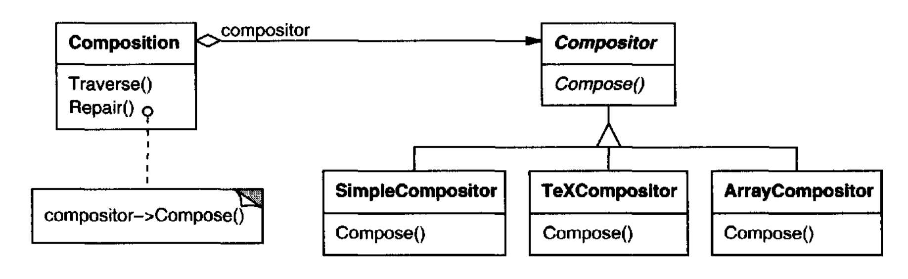
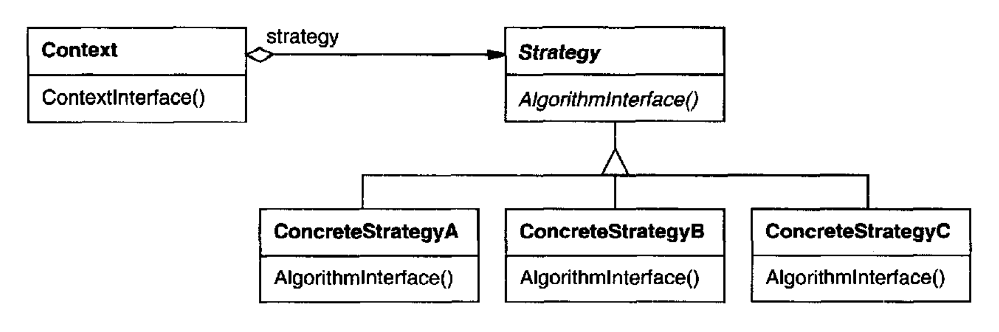

# Strategy （对象行为型）

## 意图

定义一族算法，将每个算法封装起来，并使它们可以互换。
Strategy 让算法能够独立于使用它的客户端而变化。

## 别名

Policy

## 动机

将文本流断成行有许多算法。由于若干原因，将所有这些算法硬编码到需要它们的类中并不可取：

- 需要断行的客户端如果包含断行代码，会变得更加复杂。这会使客户端更大且更难维护，特别是当它们支持多种断行算法时。

- 不同算法会在不同时间适用。如果我们并不使用所有断行算法，就不希望支持它们。

- 当断行是客户端不可分割的一部分时，很难添加新算法并改变现有算法。

我们可以通过定义封装不同断行算法的类来避免这些问题。以这种方式封装的算法称为 **strategy** 。

<br/>

假设一个 `Composition` 类负责维护和更新文本查看器中显示文本的换行。
换行策略并不是由 `Composition` 类实现的。
相反，它们由抽象 `Compositor` 类的子类单独实现。
`Compositor` 子类实现不同的策略：

- `SimpleCompositor` 实现一种简单策略，一次确定一个换行。

- `TeXCompositor` 实现用于查找换行的 TeX 算法。该策略尝试全局优化换行，也就是说，一次优化一个段落。

- `ArrayCompositor` 实现一种选择断点的策略，使每一行具有固定数量的项 (item)。例如，它对于将一组图标断成多行很有用。

一个 `Composition` 维护对 `Compositor` 对象的引用。
每当 `Composition` 重新格式化其文本时，它就把这一责任转发给它的 `Compositor` 对象。
`Composition` 的客户端通过将其所需的 `Compositor` 安装到 `Composition` 中，来指定应使用哪个 `Compositor`。

## 适用性

在以下情况下使用 Strategy 模式：

- 许多相关类仅在行为上不同。Strategy 提供了一种用多种行为之一来配置类的方式。

- 你需要算法的不同变体。例如，你可能定义反映不同空间/时间权衡的算法。
当这些变体被实现为算法的类层次结构时，可以使用 Strategy [HO87](../biblio.md#ho87)。

- 一个算法使用客户端不应知道的数据。使用 Strategy 模式来避免暴露复杂的、算法特定的数据结构。

- 一个类定义许多行为，而这些行为在其操作中表现为多个条件语句。
与其使用许多条件语句，不如将相关的条件分支移入它们自己的 `Strategy` 类。

## 结构

<br/>

## 参与者

- **Strategy** （`Compositor`）

  - 声明一个对所有支持的算法都公共的接口。`Context` 使用此接口来调用由 `ConcreteStrategy` 定义的算法。

- **ConcreteStrategy** （`SimpleCompositor`、`TeXCompositor`、`ArrayCompositor`）

  - 使用 `Strategy` 接口实现该算法。

- **Context** （`Composition`）

  - 用一个 `ConcreteStrategy` 对象进行配置。

  - 维护对 `Strategy` 对象的引用。

  - 可以定义一个接口，让 `Strategy` 访问其数据。

## 协作

- `Strategy` 和 `Context` 交互以实现所选择的算法。
context 可以在调用算法时，将算法所需的所有数据传递给 strategy。
或者，context 可以将自身作为参数传递给 `Strategy` 操作。
这让 strategy 能够根据需要回调 context。

- 一个 context 将其客户端的请求转发给它的 strategy。
客户端通常创建一个 `ConcreteStrategy` 对象并将其传递给 context；此后，客户端只与 context 交互。
通常有一族 `ConcreteStrategy` 类供客户端选择。

## 效果

Strategy 模式具有以下优点和缺点：

1. *相关算法族。*
Strategy 类的层次结构为 context 定义了一族可复用的算法或行为。继承有助于提取算法的公共功能。

2. *子类化的一种替代方案。*
继承提供了另一种支持多种算法或行为的方式。
你可以直接子类化一个 `Context` 类，赋予它不同的行为。
但这会把行为硬编码到 `Context` 中。
它把算法实现与 `Context` 的实现混在一起，使 `Context` 更难理解、维护和扩展。
而且你无法动态改变算法。
你最终会得到许多相关类，它们唯一的区别在于所采用的算法或行为。
将算法封装在单独的 `Strategy` 类中，让你能够独立于其 context 改变算法，从而更容易切换、理解和扩展。

3. *Strategy 消除了条件语句。*
Strategy 模式为选择所需行为提供了一种替代条件语句的方式。
当不同行为被混在一个类中时，很难避免使用条件语句来选择正确的行为。
将行为封装在单独的 `Strategy` 类中，就消除了这些条件语句。

   例如，在没有 strategy 的情况下，将文本断成行的代码可能看起来像：

   ```cpp
   void Composition::Repair () {
       switch (_breakingStrategy) {
       case SimpleStrategy:
           ComposeWithSimpleCompositor();
           break;
       case TeXStrategy:
           ComposeWithTeXCompositor();
           break;
       // . . .
       }
       // merge results with existing composition, if necessary
   }
   ```

   Strategy 模式通过将断行任务委托给一个 `Strategy` 对象来消除这个 `case` 语句：

   ```cpp
   void Composition::Repair () {
       _compositor->Compose();
       // merge results with existing composition, if necessary
   }
   ```

   包含许多条件语句的代码通常表明需要应用 `Strategy` 模式。

4. *实现的选择。*
Strategy 可以提供同一行为的不同实现。
客户端可以在具有不同时间与空间权衡的 strategy 之间进行选择。

5. *客户端必须了解不同的 `Strategy`。*
该模式有一个潜在缺点：客户端必须先理解各 `Strategy` 之间的差异，才能选择合适的 strategy。
客户端可能会接触到实现问题。
因此，只有当行为变化与客户端相关时，你才应使用 `Strategy` 模式。

6. *`Strategy` 与 `Context` 之间的通信开销。*
`Strategy` 接口由所有 `ConcreteStrategy` 类共享，无论它们实现的算法是简单还是复杂。
因此，某些 `ConcreteStrategy` 很可能不会使用通过该接口传给它们的全部信息；
简单的 `ConcreteStrategy` 甚至可能完全不用其中任何信息！
这意味着有时 context 会创建并初始化从未被使用的参数。
如果这是一个问题，那么你需要在 `Strategy` 与 `Context` 之间建立更紧的耦合。

7. *对象数量增加。*
Strategy 会增加应用中对象的数量。
有时你可以通过将 strategy 实现为 context 可以共享的无状态对象来减少这种开销。
任何剩余状态都由 context 维护，context 在每次请求中将其传递给 `Strategy` 对象。
共享 strategy 不应在多次调用之间维护状态。
[Flyweight (195)](../ch4/6.md) 模式更详细地描述了这种方法。

## 实现

考虑以下实现问题：

1. *定义 `Strategy` 和 `Context` 接口。*
`Strategy` 和 `Context` 接口必须让 `ConcreteStrategy` 能够高效访问它从 context 所需的任何数据，反之亦然。

   一种方法是让 `Context` 在参数中将数据传递给 `Strategy` 操作 —— 换句话说，把数据带给 strategy。
   这使 `Strategy` 和 `Context` 保持解耦。
   另一方面，`Context` 可能传递 strategy 不需要的数据。

   另一种技术是让 context 将自身作为参数传递，而 strategy 显式地从 context 请求数据。
   或者，strategy 可以存储对其 context 的引用，从而完全不需要传递任何东西。
   无论哪种方式，strategy 都可以只请求它需要的内容。
   但现在 `Context` 必须为其数据定义一个更精细的接口，这会使 `Strategy` 和 `Context` 耦合得更紧。

   特定算法的需求及其数据要求将决定最佳技术。

2. *Strategy 作为模板参数。*
在 C++ 中，模板可用于用一个 strategy 配置一个类。
这种技术仅在以下情况下适用：(1) `Strategy` 可以在编译期选择，并且 (2) 它不必在运行时更改。
在这种情况下，要配置的类（例如 `Context`）被定义为一个模板类，并以一个 `Strategy` 类作为参数：

   ```cpp
   template <class AStrategy>
   class Context {
       void Operation() { theStrategy.DoAlgorithm(); }
       // . . .
   private:
       AStrategy theStrategy;
   };
   ```

   然后，该类在实例化时用一个 `Strategy` 类进行配置：

   ```cpp
   class MyStrategy {
   public:
       void DoAlgorithm();
   };
   
   Context<MyStrategy> aContext;
   ```

   使用模板时，无需定义一个定义 `Strategy` 接口的抽象类。
   将 `Strategy` 用作模板参数还让你能够将 `Strategy` 静态绑定到其 `Context`，这可以提高效率。

3. *使 `Strategy` 对象可选。*
如果 “没有 `Strategy` 对象” 是有意义的，那么 `Context` 类可以被简化。
`Context` 在访问其 `Strategy` 对象之前先检查它是否存在。
如果存在，那么 `Context` 正常使用它。
如果不存在 strategy，那么 `Context` 执行默认行为。
这种方法的好处是，除非客户端不喜欢默认行为，否则它们根本不必处理 `Strategy` 对象。

## 示例代码

我们将给出动机示例的高层代码，它基于 InterViews [LCI+92](../biblio.md#lci92) 中 `Composition` 和 `Compositor` 类的实现。

`Composition` 类维护一个 `Component` 实例的集合，这些实例表示文档中的文本和图形元素。
一个 composition 使用一个 `Compositor` 子类的实例将 component 对象排列成行，该子类封装了一种换行策略。
每个 component 都有一个关联的自然尺寸、可拉伸性和可收缩性。
可拉伸性定义该 component 可以超出其自然尺寸增长多少；可收缩性定义它可以收缩多少。
composition 将这些值传递给 compositor，后者使用它们来确定换行的最佳位置。

```cpp
class Composition {
public:
    Composition(Compositor*);
    void Repair();
private:
    Compositor* _compositor;
    Component* _components;    // the list of components
    int _componentCount;       // the number of components
    int _lineWidth;            // the Composition's line width
    int* _lineBreaks;          // the position of linebreaks
                               // in components
    int _lineCount;            // the number of lines
};
```

当需要新的布局时，composition 要求其 compositor 确定在哪里放置换行。
composition 向 compositor 传递三个数组，它们定义 component 的自然尺寸、可拉伸性和可收缩性。
它还传递 component 的数量、行宽，以及一个数组，compositor 将每个换行的位置填入该数组。
compositor 返回计算出的断行数量。

`Compositor` 接口让 composition 能够将 compositor 所需的所有信息传递给它。
这是 “把数据带给 strategy” 的一个例子：

```cpp
class Compositor {
public:
    virtual int Compose(
        Coord natural[], Coord stretch[], Coord shrink[],
        int componentCount, int lineWidth, int breaks[]
    ) = 0;
protected:
    Compositor();
};
```

注意，`Compositor` 是一个抽象类。具体子类定义特定的换行策略。

composition 在其 `Repair` 操作中调用其 compositor。
`Repair` 首先用每个 component 的自然尺寸、可拉伸性和可收缩性初始化数组（为简洁起见，我们省略其细节）。
然后它调用 compositor 来获取换行位置，最后根据这些断行来布局 component（同样省略）：

```cpp
void Composition::Repair () {
    Coord* natural;
    Coord* stretchability;
    Coord* shrinkability;
    int componentCount;
    int* breaks;

    // prepare the arrays with the desired component sizes
    // . . .

    // determine where the breaks are:
    int breakCount;
    breakCount = _compositor->Compose(
        natural, stretchability, shrinkability,
        componentCount, _lineWidth, breaks
    );

    // lay out components according to breaks
    // . . .
}
```

现在我们来看 `Compositor` 子类。
`SimpleCompositor` 一次检查一行的 component，以确定断行应放在哪里：

```cpp
class SimpleCompositor : public Compositor {
public:
    SimpleCompositor();

    virtual int Compose(
        Coord natural[], Coord stretch[], Coord shrink[],
        int componentCount, int lineWidth, int breaks[]
    );
    // ...
};
```

`TeXCompositor` 使用更具全局性的策略。
它一次检查一个段落，考虑 component 的尺寸和可拉伸性。
它还试图通过最小化 component 之间的空白，使段落具有均匀的 “颜色”。

```cpp
class TeXCompositor : public Compositor {
public:
    TeXCompositor();
    virtual int Compose(
        Coord natural[], Coord stretch[], Coord shrink[],
        int componentCount, int lineWidth, int breaks[]
    );
    // ...
};
```

`ArrayCompositor` 按固定间隔将 component 断成行。

```cpp
class ArrayCompositor : public Compositor {
public:
    ArrayCompositor(int interval);
    virtual int Compose(
        Coord natural[], Coord stretch[], Coord shrink[],
        int componentCount, int lineWidth, int breaks[]
    );
    // . . .
};
```

这些类并没有使用 `Compose` 中传入的所有信息。
`SimpleCompositor` 忽略 component 的可拉伸性，只考虑它们的自然宽度。
`TeXCompositor` 使用传给它的所有信息，而 `ArrayCompositor` 什么都不忽略。

要实例化 `Composition`，你要向它传入你想使用的 compositor：

```cpp
Composition* quick = new Composition(new SimpleCompositor);
Composition* slick = new Composition(new TeXCompositor);
Composition* iconic = new Composition(new ArrayCompositor(100));
```

`Compositor` 的接口经过精心设计，以支持子类可能实现的所有布局算法。
你不希望每新增一个子类都必须更改这个接口，因为那将需要更改现有的子类。
一般来说，`Strategy` 和 `Context` 接口决定了该模式实现其意图的程度。

## 已知应用

ET++ [WGM88](../biblio.md#wgm88) 和 InterViews 都使用 strategy 来封装不同的换行算法，正如我们所描述的那样。

在用于编译器代码优化的 RTL System [JML92](../biblio.md#jml92) 中，strategy 定义了不同的寄存器分配方案（`RegisterAllocator`）和指令集调度策略（`RISCscheduler`、`CISCscheduler`）。
这为针对不同机器架构定制优化器提供了灵活性。

ET++ SwapsManager 计算引擎框架为不同的金融工具计算价格 [EG92](../biblio.md#eg92)。
它的关键抽象是 `Instrument` 和 `YieldCurve`。
不同的工具被实现为 `Instrument` 的子类。
`YieldCurve` 计算贴现因子，这些因子决定未来现金流的现值。
这两个类都将某些行为委托给 `Strategy` 对象。
该框架提供了一族 `ConcreteStrategy` 类，用于生成现金流、为 swaps 估值以及计算贴现因子。
你可以通过用不同的 `ConcreteStrategy` 对象配置 `Instrument` 和 `YieldCurve` 来创建新的计算引擎。
这种方法支持混合和匹配现有的 `Strategy` 实现，也支持定义新的实现。

Booch components [BV90](../biblio.md#bv90) 将 strategy 用作模板参数。
Booch 集合类支持三种不同的内存分配策略：managed（从池中分配）、controlled（分配/释放由锁保护）和 unmanaged（普通内存分配器）。
这些 strategy 在集合类被实例化时作为模板参数传递给它。
例如，使用 unmanaged 策略的 `UnboundedCollection` 被实例化为 `UnboundedCollection<MyItemType*, Unmanaged>`。

RApp 是一个用于集成电路布局的系统 [GA89](../biblio.md#ga89), [AG90](../biblio.md#ag90)。
RApp 必须布局和布线连接电路上子系统的导线。
RApp 中的布线算法被定义为抽象 `Router` 类的子类。
`Router` 是一个 `Strategy` 类。

Borland 的 ObjectWindows [Bor94](../biblio.md#bor94) 在对话框中使用 strategy 来确保用户输入有效数据。
例如，数字可能必须位于某个范围内，而数字输入字段应只接受数字。
验证字符串是否正确可能需要表查找。

ObjectWindows 使用 `Validator` 对象来封装验证 strategy。
`Validator` 是 `Strategy` 对象的例子。
数据输入字段将验证 strategy 委托给一个可选的 `Validator` 对象。
如果需要进行验证，客户端会将 validator 附加到字段上（这是一个可选 strategy 的例子）。
当对话框关闭时，输入字段要求其 validator 验证数据。
该类库为常见情况提供 validator，例如用于数字的 `RangeValidator`。
通过子类化 `Validator` 类，可以轻松定义新的客户端特定验证 strategy。

## 相关模式

[Flyweight (195)](../ch4/6.md)：`Strategy` 对象通常很适合作为 flyweight。
