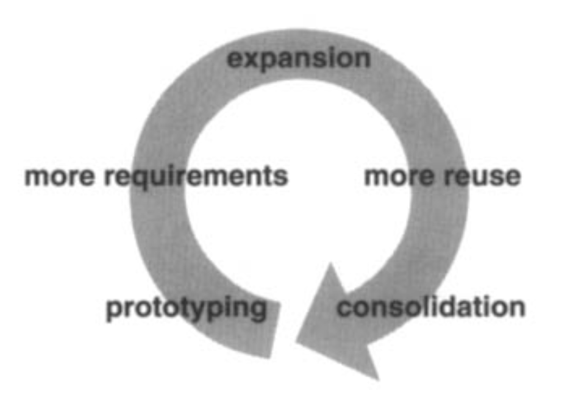

# 6.1 可以从设计模式中期待什么

基于我们日常使用设计模式的经验，下面是本书中的设计模式可以影响你设计面向对象软件方式的几种途径。

## 一种通用的设计词汇

对使用传统语言的专家程序员的研究表明，知识和经验并不是简单地围绕语法组织起来的，而是组织在更大的概念结构中，
例如算法、数据结构和惯用法 [AS85](../biblio.md#as85), [Cop92](../biblio.md#cop92), [Cur89](../biblio.md#cur89), [SS86](../biblio.md#ss86)，以及实现特定目标的计划 [SE84](../biblio.md#se84)。
设计者可能不会过多思考他们用来记录设计的记号，
而更多是试图将当前设计情境与他们过去学到的计划、算法、数据结构和惯用法相匹配。

计算机科学家为算法和数据结构命名并编目，但我们通常不会为其他种类的模式命名。
设计模式为设计者提供了一种通用词汇，用来交流、记录和探索设计替代方案。
设计模式通过让你能够在比设计记号或编程语言更高的抽象层次上谈论系统，使系统显得不那么复杂。
设计模式提高了你进行设计以及与同事讨论设计的层次。

一旦你吸收了本书中的设计模式，你的设计词汇几乎肯定会改变。
你将直接以设计模式的名称来讲话。
你会发现自己在说诸如 “我们这里用一个 Observer 吧”，或者 “我们把这些类做成一个 Strategy 吧” 之类的话。

## 文档和学习辅助

了解本书中的设计模式，可以让你更容易理解现有系统。
大多数大型面向对象系统都使用这些设计模式。
学习面向对象编程的人常常抱怨，他们使用的系统以复杂难懂的方式使用继承，并且很难跟踪控制流。
很大程度上，这是因为他们不理解系统中的设计模式。
学习这些设计模式将帮助你理解现有的面向对象系统。

这些设计模式还可以让你成为更好的设计者。
它们为常见问题提供解决方案。
如果你在面向对象系统中工作足够久，你可能会自己学会这些设计模式。
但阅读本书将帮助你更快地学会它们。
学习这些模式将帮助新手表现得更像专家。

此外，用系统所使用的设计模式来描述一个系统，会使其容易理解得多。
否则，人们将不得不对设计进行逆向工程，以发掘它所使用的模式。
拥有通用词汇意味着你不必描述整个设计模式；你可以只说出它的名称，并期望读者知道它。
不了解这些模式的读者起初将不得不查阅它们，但这仍然比逆向工程更容易。

我们自己的设计中也使用这些模式，并发现它们非常宝贵。
然而，我们使用这些模式的方式可以说是朴素的。
我们用它们为类选择名称，思考并教授良好的设计，以及用我们所应用的设计模式序列来描述设计 [BJ94](../biblio.md#bj94)。
很容易想象更复杂的使用模式的方式，例如基于模式的 CASE 工具或超文本文档。
但即使没有复杂的工具，模式也能提供很大帮助。

## 对现有方法的补充

面向对象设计方法本应促进良好设计，教导新设计者如何设计得好，并标准化设计的开发方式。
一种设计方法通常定义一组记号（通常是图形化的），用于对设计的各个方面建模，
同时定义一组规则，规定如何以及何时使用每种记号。
设计方法通常描述设计中会出现的问题、如何解决这些问题，以及如何评估设计。
但它们一直未能捕捉专家设计者的经验。

我们相信，我们的设计模式是面向对象设计方法中一直缺失的一块重要拼图。
设计模式展示了如何使用对象、继承和多态等基本技术。
它们展示了如何用一个算法、一种行为、一个状态或它应当创建的对象种类来参数化一个系统。
设计模式提供了一种方式，可以描述设计中更多的 “为什么”，而不仅仅是记录你决策的结果。
设计模式中的适用性、效果和实现部分，可以帮助指导你做出必须做出的决策。

设计模式在将分析模型转化为实现模型时尤其有用。
尽管许多说法承诺从面向对象分析到设计的平滑过渡，但在实践中，这种过渡绝非平滑。
一个灵活且可复用的设计会包含分析模型中不存在的对象。
你使用的编程语言和类库会影响设计。
分析模型常常必须重新设计才能变得可复用。
目录中的许多设计模式都处理这些问题，这就是为什么我们称它们为设计模式。

一个成熟的设计方法需要的不仅仅是设计模式，还需要更多种类的模式。
还可能有分析模式、用户界面设计模式或性能调优模式。
但设计模式是必不可少的一部分，而这一部分直到现在一直缺失。

## 重构的目标

开发可复用软件的问题之一是，它常常必须被重新组织或 **重构 (refactored)** [OJ90](../biblio.md#oj90)。
设计模式帮助你确定如何重新组织设计，并且它们可以减少你以后需要进行的重构量。

面向对象软件的生命周期有几个阶段。
Brian Foote 将这些阶段确定为 **原型阶段** 、**扩张阶段** 和 **巩固阶段** [Foo92](../biblio.md#foo92)。

原型阶段是一阵密集的活动，通过快速原型和增量更改让软件活起来，直到它满足一组初始需求并进入青春期。
此时，软件通常由紧密反映初始问题域中实体的类层次结构组成。
主要的复用类型是通过继承进行的白盒复用。

一旦软件进入青春期并投入使用，它的演化就受两种相互冲突的需求支配：(1) 软件必须满足更多需求；(2) 软件必须更具可复用性。
新需求通常会添加新的类和操作，也许还会添加整个类层次结构。
软件经历一个扩张阶段以满足新需求。
然而，这种情况不能持续太久。
最终，软件将变得过于不灵活和僵化，无法进一步更改。
类层次结构将不再匹配任何问题域。
相反，它们将反映许多问题域，而类将定义许多不相关的操作和实例变量。

为了继续演化，软件必须在一个称为重构的过程中被重新组织。
这是框架常常出现的阶段。
重构涉及将类拆分为专用和通用组件、将操作沿类层次结构上移或下移，以及合理化类的接口。
这个巩固阶段会产生许多新种类的对象，通常通过分解现有对象并使用对象组合而不是继承来实现。
因此，黑盒复用取代了白盒复用。
持续满足更多需求的需要，连同对更多复用的需要，推动面向对象软件经历反复的扩张和巩固阶段 —— 在满足新需求时扩张，在软件变得更通用时巩固。

 

这个循环不可避免。
但优秀的设计者会意识到那些可能促使重构的变化。
优秀的设计者也了解有助于避免重构的类和对象结构 —— 他们的设计在面对需求变化时是健壮的。
彻底的需求分析将突出那些在软件生命周期中可能发生变化的需求，而良好的设计将对它们是健壮的。

我们的设计模式捕捉了许多由重构产生的结构。
在设计生命周期的早期使用这些模式可以防止后来的重构。
但即使你直到构建完系统之后才发现如何应用某个模式，该模式仍然可以向你展示如何更改它。
因此，设计模式为你的重构提供了目标。
