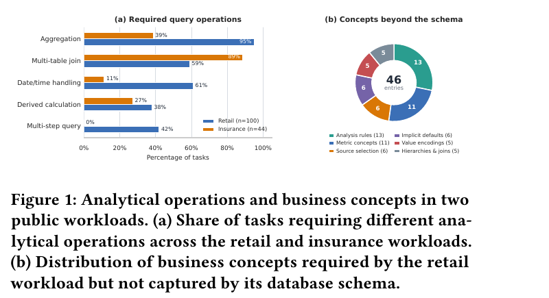
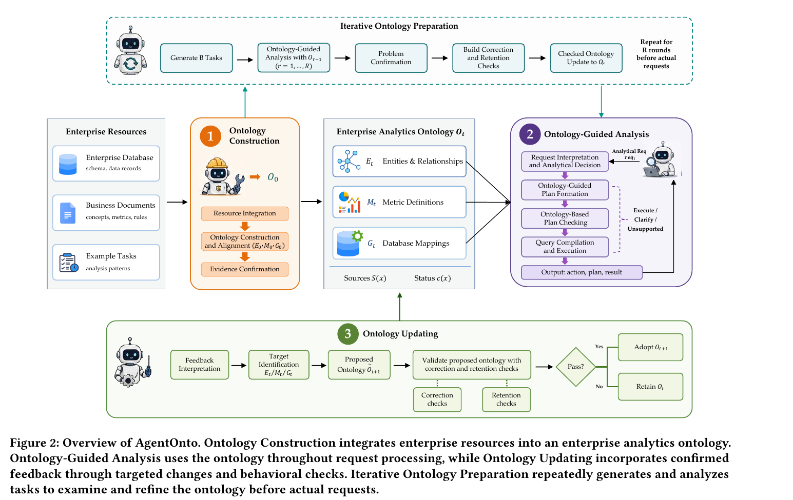
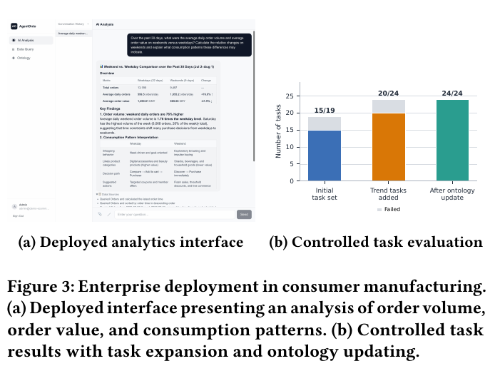

# AgentOnto：本体引导的面向企业数据分析的 LLM Agent

**AgentOnto: Ontology-Guided LLM Agents for Enterprise Data Analytics**

Dayan Pan¹, Bincheng Zuo², Xiaojian Wang², Daogang Zhang², Jingyuan Wang¹

¹ 北京航空航天大学计算机学院，中国北京
² Omaha AIGC，中国上海

> 原文发表于 KDD '27（The 33rd ACM SIGKDD Conference on Knowledge Discovery and Data Mining），2026 年 10 月 16 日 arXiv 预印本 v1（arXiv:2610.23317v1 [cs.AI]）。

## 摘要

企业数据分析要求 Agent 把分析请求与分散在数据库、业务文档和既有示例任务中的知识连接起来。
如果缺乏对这些知识的显式表示，Agent 可能给出错误的分析结果，也无法可靠地吸收反馈。
本文提出 AgentOnto，一个本体引导的、面向企业数据分析的 LLM Agent。
AgentOnto 将异构的企业知识组织为一个本体，由该本体直接引导分析，并吸收经过确认的反馈。
迭代式本体准备（Iterative Ontology Preparation）进一步通过自生成的分析任务改进本体。
我们在两个公开数据源上评估 AgentOnto：它在总体上显著优于代表性方法；模块级评估也验证了本体构建、分析与更新各自的有效性。
真实生产环境的部署进一步证明了它在企业分析中的实用价值。
这些结果表明，显式地构建、使用和更新企业知识，能够支撑可靠且可适应的数据分析。

## CCS 概念

- 信息系统 → 数据挖掘（Data mining）
- 应用计算 → 企业本体、分类体系与词表（Enterprise ontologies, taxonomies and vocabularies）

## 关键词

企业数据分析（Enterprise Data Analytics）、大语言模型 Agent（Large Language Model Agents）、基于本体的分析（Ontology-Based Analysis）

## 1 引言

企业决策越来越依赖数据分析。
随着企业数据源、业务知识和分析需求不断增长，预定义仪表盘与固定工作流已无法满足分析需求在广度与复杂度上的要求。

大语言模型（LLM）Agent 结合了语言理解、推理、数据库访问与工具调用能力，提供了一种灵活的分析接口。
近期的企业商业智能系统，包括 SiriusBI [[11]](#ref11) 与 CoeusBI [[14]](#ref14)，已经展示了这种基于 Agent 的方法在企业分析中的实用价值。
然而，准确的企业分析要求 Agent 识别相关的业务实体与关系，并把它们正确地应用到可用数据上。
本体提供了显式的概念模型，用于组织这类业务知识并将其与企业数据库连接。
诸如 SODA [[2]](#ref2) 与 ATHENA [[23]](#ref23) [[24]](#ref24) 这类基于本体的数据访问（OBDA）系统，利用这些模型与映射把用户问题翻译为数据库操作 [[32]](#ref32)。
与此并行，LLM 数据分析 Agent 把自然语言查询扩展到包含规划、工具调用与执行反馈的能力，并且近期工作已开始使用 LLM 构建本体或可复用知识 [[8]](#ref8) [[21]](#ref21)。
这些研究把本体与企业数据连接起来，为 Agent 提供了更广泛的分析能力。
尽管如此，为企业分析构建本体引导的 Agent 仍存在三个关键挑战。

**（1）异构来源使本体构建变得复杂。** 企业分析知识分散在数据库、业务文档和既有示例任务中，它们分别描述数据结构、业务概念与分析模式。
一个构建良好的企业分析本体，应当围绕实体与关系整合这些来源中的知识，并附带支撑证据。
然而现有方法通常只关注单一来源 [[18]](#ref18) 或单一本体构件 [[15]](#ref15)，对整合异构证据的支持有限。

**（2）本体集成不足制约 Agent 的分析能力。** 把本体提供给 Agent 并不保证其分析行为正确。
现有方法用本体支持查询生成或结果检查 [[1]](#ref1) [[24]](#ref24)，但高答案覆盖率并不能保证正确性，因为 Agent 可能返回错误结果，或执行本不应被执行的请求，从而造成**静默语义错误（silent semantic error）**。
因此，有效的本体引导应同时支持正确的分析决策与准确的执行结果。

**（3）静态本体限制了持续适应能力。** 企业知识随时间演化，分析反馈会揭示本体中缺失或错误的部分。
现有的演化与编辑方法有助于修订本体 [[5]](#ref5) [[17]](#ref17) [[20]](#ref20) [[27]](#ref27) [[33]](#ref33)，但对验证这些修订对后续分析的影响支持有限。
因此，有效的本体更新应当在修正目标问题的同时，保持本应不变的分析行为。

我们在图 1 中对两个公开的零售与保险工作负载（workload，即一组分析任务）所做的分析，为上述挑战提供了进一步的经验证据 [[22]](#ref22) [[25]](#ref25)。
这些任务组合了多种分析操作，并且零售工作负载需要 46 个未被其数据库 schema 捕获的业务概念。
这些发现促使我们让 AgentOnto 把企业知识组织为显式本体，由该本体引导分析，并通过分析反馈对其进行改进。

**图 1：两个公开工作负载（分析任务集）中的分析操作与业务概念。**
(a) 零售与保险工作负载中需要不同分析操作的任务占比。
(b) 零售工作负载所需但未被其数据库 schema 捕获的业务概念的分布。

为解决上述挑战，我们提出 AgentOnto，一个本体引导的、面向企业数据分析的 LLM Agent。
AgentOnto 把本体构建、数据分析与本体更新整合为统一工作流，并由一个企业分析本体贯穿整个过程。

- **(i) 本体构建（Ontology Construction）**：把企业数据、业务文档和既有示例任务中的知识整合为一个带有支撑证据的企业分析本体。
- **(ii) 本体引导的分析（Ontology-Guided Analysis）**：使用本体引导计划的形成、检查与执行。
- **(iii) 本体更新（Ontology Updating）**：把经过确认的反馈转化为有针对性的修改，并验证目标问题已被修正、而其他既有行为得以保持。

在这些方法之上，AgentOnto 还引入**迭代式本体准备（Iterative Ontology Preparation）**：它在处理真实分析任务之前，利用自生成的分析任务来检查并改进本体。

我们使用两个公开数据源评估 AgentOnto：世界发展指标（World Development Indicators, WDI）与美国环保署空气质量系统（U.S. EPA Air Quality System, AQS）。
我们将其与基于静态本体、多阶段 SQL 生成、数据库 Agent 工具使用的方法进行比较。
AgentOnto 取得 **87.5%** 的分析准确率，而最强基线为 **55.0%**。
对三个核心方法的评估进一步表明，AgentOnto 在两个领域上都改进了本体构建、分析与更新。
综合来看，这些结果表明：一个显式的企业分析本体能够通过引导分析、吸收业务需求变化，提升相关请求上的可靠性。
我们还通过真实部署对 AgentOnto 进行了量化评估，展示了它支持可靠且可适应的企业数据分析的能力。

本文的主要贡献如下：

- 我们把本体引导的 LLM Agent 确立为企业数据分析的一种系统性方法，使用显式、可维护的企业知识表示来支撑可靠分析。
- 我们提出 AgentOnto，它把异构企业知识组织为直接引导分析并吸收反馈的本体。
  迭代式本体准备通过自生成任务进一步改进本体。
- 我们在公开数据集上进行大量实验，表明 AgentOnto 提升了整体分析可靠性，并且其核心方法相对代表性方法更为有效。
  真实部署进一步展示了它在企业分析中的实用价值。

## 2 预备知识

### 2.1 企业分析场景

企业数据分析通过解释给定请求的需求、访问并处理相关企业数据、产出分析结果来回答该请求。
有三类企业资源支撑这一过程：

- **企业数据库（DB）**：包含可用于分析的数据库 schema 与数据记录。
- **业务文档（Docs）**：描述业务概念、指标、单位、适用条件与分析规则。
- **既有示例任务（Examples）**：展示这些知识在实践中如何应用于数据。

一个分析请求 $\text{req}_i$ 用自然语言表达用户的分析目标。
请求可能并不包含分析所需的全部信息，因此处理它需要识别相关的企业知识，并把该知识与 DB 连接起来。
一个成功执行的查询仍可能产生静默语义错误——即其结果在业务含义上是错误的。

### 2.2 企业分析中的本体

本体显式地表示某一领域中的概念、概念之间的关系以及它们的使用规则。
在企业分析中，本体组织可复用的业务知识，并把它与企业数据库连接起来。
由此，它为在相同数据上解释不同的分析请求提供了共同表示。

我们把状态 $t$ 下的企业分析本体表示为：

$$
O_t = (E_t, M_t, G_t)
\tag{1}
$$

其中三个构件捕获互补的企业知识形式：

- $E_t$，**实体与关系（Entities and Relationships）**：表示业务实体、它们的属性与取值，以及它们之间的关系。
- $M_t$，**指标定义（Metric Definitions）**：表示分析指标的业务含义与计算方式，以及其使用条件。
- $G_t$，**数据库映射（Database Mappings）**：把实体、属性、关系和指标连接到 DB 中的表、列与连接路径。

本体中的每个条目 $x \in E_t \cup M_t \cup G_t$ 都记录其支撑来源 $S(x)$ 与确认状态 $c(x)$。
来源指明了证据及其位置，而 $c(x)$ 表示该条目是否已基于该证据得到确认。

### 2.3 本体引导的数据分析

给定分析请求 $\text{req}_i$，本体引导的 Agent 使用 $O_t$ 把请求与 DB 中的企业数据连接起来。
实体、关系与指标定义提供了理解该请求所需的业务知识，而数据库映射把这种理解连接到可执行的数据操作上。
随后，Agent 可以形成一个分析计划，把可复用的本体知识与该请求特有的选择结合起来。

本体既引导请求的解释，也引导其在企业数据上的执行。
它还能帮助 Agent 识别出：可用信息不足以产生有效结果。
因此，本体引导的数据分析能够在依赖相同企业知识的多个请求之间，支撑一致的分析决策与结果。

## 3 AgentOnto 框架

### 3.1 总览

企业分析 Agent 需要整合分散在企业数据、业务文档和既有示例任务中的知识，在整个分析过程中应用这些知识，并吸收分析反馈所揭示的变化。
AgentOnto 通过把企业知识组织为式 1 所定义的企业分析本体，并用该本体引导整个分析过程，来满足这些要求。

图 2 展示了 AgentOnto 框架，它由三个核心方法组成。
**本体构建 (Ontology Construction)** 把企业资源整合为一个包含实体与关系、指标定义和数据库映射的本体，并为每个条目附带支撑证据。
给定一个分析请求， **本体引导的分析 (Ontology-Guided Analysis)** 使用本体来形成并检查分析计划、把计划连接到数据库，并产出分析结果。
当经过确认的反馈揭示本体存在问题时，**本体更新 (Ontology Updating)** 会做出有针对性的修改，并验证预期的修正效果以及本应保持不变的分析行为。
在此基础上，**迭代式本体准备 (Iterative Ontology Preparation)** 使用自生成的分析任务，在处理真实请求之前检查并改进已构建的本体。

综合来看，这些方法使异构企业知识能够被组织为本体、在分析过程中被直接使用，并通过分析反馈得到改进。
迭代式本体准备则在真实请求到来之前，先通过分析性使用来考察本体。
以下各小节描述这些方法与完整的 AgentOnto 工作流。

**图 2：AgentOnto 总览。** 本体构建把企业资源整合为企业分析本体。
本体引导的分析在整个请求处理过程中使用该本体，而本体更新通过有针对性的修改与行为检查来吸收经过确认的反馈。
迭代式本体准备反复生成并分析任务，以便在真实请求之前检查并改进本体。

### 3.2 本体构建、分析与更新

**本体构建（Ontology Construction）。** 企业分析知识分散在不同侧面描述分析的各类资源中。
企业数据库 DB 包含数据库 schema 与数据记录；业务文档 Docs 描述业务概念、指标与分析规则；既有示例任务 Examples 展示知识在分析中如何应用。
本体构建整合这些互补资源，产出初始的企业分析本体：

$$
O_0 = \text{Construct}(\text{DB}, \text{Docs}, \text{Examples})
\tag{2}
$$

其中 Construct 表示本体构建过程，$O_0$ 表示所得初始本体，下标 0 用以区别于之后的本体状态。

按照式 1，$O_0$ 由 $E_0$、$M_0$、$G_0$ 组成，分别表示其实体与关系、指标定义和数据库映射。
AgentOnto 通过识别业务实体与关系、组织可复用的指标定义、建立把它们连接到 DB 中相应表与列的数据库映射，一并构建这些构件。
构建过程会对跨来源的同一企业知识描述进行对齐。
例如，Docs 中描述的业务概念可以被连接到它在 Examples 中的分析用法，以及 DB 中相应的表与列。

对每个构建出的本体条目 $x$，AgentOnto 记录其支撑来源 $S(x)$ 与确认状态 $c(x)$。
来源把该条目连接到 DB、Docs 或 Examples 中的具体证据。
一个独立的模型确认步骤依据这些证据评估该条目，并把结果记入 $c(x)$。
它检查实体、关系和指标定义是否有可用资源支撑，以及数据库映射是否把它们连接到 DB 中对应的数据。

把三个本体构件一并构建，可把企业知识与分析模式连接到 DB 中的对应数据。
因此，所得本体能够直接引导后续在企业数据上的分析。

**本体引导的分析（Ontology-Guided Analysis）。** 本体引导的分析在对一个分析请求的处理全过程中应用企业分析本体。
给定请求 $\text{req}_i$、接收该请求时可用的本体 $O_t$ 与企业数据库 DB，AgentOnto 执行：

$$
(\text{action}_i, \text{plan}_i, \text{result}_i) = \text{Analyze}(\text{req}_i, O_t, \text{DB})
\tag{3}
$$

其中 Analyze 表示完整的分析过程。
下标 $i$ 标识请求及其对应输出，下标 $t$ 标识用于本次分析的本体状态。
输出 $\text{action}_i$ 记录决策：执行请求、请求澄清，或报告该请求不受支持。
对于可执行请求，$\text{plan}_i$ 表示其分析计划，$\text{result}_i$ 表示从 DB 得到的结果。

AgentOnto 通过把 $\text{req}_i$ 中的需求连接到 $O_t$ 中的相关内容来形成 $\text{plan}_i$。
该计划指明相关的本体内容，并记录该请求特有的分析选择。
这些选择通过引用本体来表示，而 $G_t$ 提供把它们连接到 DB 中表、列与连接路径所需的数据库映射。
当必要信息缺失，或可用本体与数据无法支撑该请求时，AgentOnto 利用所识别出的局限来确定相应的分析动作。

对于可执行请求，AgentOnto 依据 $O_t$ 的三个构件检查分析计划：

$$
\text{valid}_i = \text{Check}(\text{plan}_i; E_t, M_t, G_t)
\tag{4}
$$

其中 Check 表示计划检查过程，$\text{valid}_i$ 表示计划是否与本体一致。
该检查验证计划使用 $E_t$ 中已定义的实体与关系、遵循 $M_t$ 中的指标要求，并具备执行所需的 $G_t$ 中的数据库映射。
该步骤能够识别出仅凭数据库执行成功无法揭示的分析错误。

有效计划按下式编译并执行：

$$
\text{query}_i = \text{Compile}(\text{plan}_i; G_t), \quad
\text{result}_i = \text{Execute}(\text{query}_i; \text{DB})
\tag{5}
$$

算子 Compile 使用 $G_t$ 中的数据库映射把 $\text{plan}_i$ 翻译为数据库查询 $\text{query}_i$；算子 Execute 在 DB 上运行该查询以产出 $\text{result}_i$。
只有通过基于本体的检查的计划才会进入编译与执行。

通过这一过程，同一个企业分析本体引导计划形成、计划检查与数据库执行。
显式的分析计划把请求的解释与在企业数据上执行的查询连接起来，使本体知识能够直接影响分析决策与结果。

**本体更新（Ontology Updating）。** 本体更新把经过确认的分析反馈纳入企业分析本体。
给定当前本体 $O_t$、经过确认的反馈 $\text{Feedback}_t$、更新检查 $\text{Checks}_t$ 以及企业数据库 DB，AgentOnto 执行：

$$
O_{t+1} = \text{Update}(O_t, \text{Feedback}_t, \text{Checks}_t, \text{DB})
\tag{6}
$$

其中 Update 表示本体更新过程。
输入 $\text{Feedback}_t$ 包含状态 $t$ 下可用的已确认反馈，$\text{Checks}_t$ 包含用于评估其效果的分析检查。
输出 $O_{t+1}$ 表示更新后的本体，下标 $t+1$ 标识 $O_t$ 之后的状态。

$\text{Feedback}_t$ 中的每一项指明与所观察问题相关的本体条目、所需的修改，以及确认该修改的证据。
目标可能属于实体与关系 $E_t$、指标定义 $M_t$ 或数据库映射 $G_t$。
AgentOnto 利用这些信息对相关本体内容做出有针对性的修改。

更新检查包含两个互补的分组：

$$
\text{Checks}_t = \text{Checks}_t^{\text{corr}} \cup \text{Checks}_t^{\text{ret}}
\tag{7}
$$

上标 corr 表示**修正检查（correction checks）**，指定更新后应当发生变化的分析行为；上标 ret 表示**保持检查（retention checks）**，指定应当保持不变的分析行为。
每项检查包含一个分析请求及其期望结果，包括期望的分析决策，以及（对于可执行请求）期望的结果。

AgentOnto 应用针对性修改以产出候选本体 $\tilde{O}_{t+1}$，并通过本体引导的分析评估两组检查。
波浪号用以区分该候选本体与检查后所采纳的本体：

$$
O_{t+1} =
\begin{cases}
\tilde{O}_{t+1}, & \text{若 } \text{CheckUpdate}(\tilde{O}_{t+1}, \text{Checks}_t, \text{DB}) = \text{true} \\
O_t, & \text{否则}
\end{cases}
\tag{8}
$$

算子 CheckUpdate 使用修正检查与保持检查评估候选本体。
当候选本体修正了目标问题，并保持了本应不变的分析行为时，AgentOnto 采纳 $\tilde{O}_{t+1}$；否则保留 $O_t$。

因此，本体更新通过一项修改对后续分析的影响来评估它。
经过确认的反馈对可复用的企业知识产生有针对性的修改，而修正检查与保持检查确保该修改达到预期的分析效果。

### 3.3 迭代式本体准备

本体构建把可用企业资源整合为初始本体。
该初始本体仍可能包含影响后续分析的缺失或错误知识。
迭代式本体准备通过自生成的分析任务，在真实分析任务之前检查并改进本体。

从 $O_0$ 出发，AgentOnto 执行 $R$ 轮准备，每轮生成 $B$ 个分析任务。
这里 $R$ 表示总轮数，$B$ 表示每轮生成的任务数。
在第 $r$ 轮，AgentOnto 依据 DB、Docs、Examples 以及前一轮产出的本体 $O_{r-1}$ 生成任务集 $\text{PrepTasks}_r$。
这些任务检查当前本体能否在其实体、关系、指标与数据库映射上支撑分析。

AgentOnto 使用 $O_{r-1}$ 分析所生成的任务。
一个独立的模型确认步骤依据企业资源审查分析结果，并针对缺失或错误的本体内容产出已确认反馈 $\text{Feedback}_r$。
随后 AgentOnto 导出修正检查与保持检查 $\text{Checks}_r$ 并更新本体：

$$
O_r = \text{Update}(O_{r-1}, \text{Feedback}_r, \text{Checks}_r, \text{DB}), \quad r = 1, \dots, R
\tag{9}
$$

其中 $O_r$ 表示第 $r$ 轮产出的本体。
该更新在修正已确认问题的同时，检查本应保持不变的分析行为。
更新后的本体 $O_r$ 用于在下一轮生成并分析任务。
经过 $R$ 轮后，所得本体 $O_R$ 已经通过分析性使用被反复检查与改进，并被用于后续分析任务。

迭代式本体准备进一步考察已构建本体能否支撑数据分析。
即使尚无真实任务的反馈，自生成任务也会暴露在分析过程中应用与组合本体知识时出现的问题。
已确认的问题通过受检查的更新纳入可复用本体，使所得修正能够支撑后续请求。

### 3.4 AgentOnto 工作流

AgentOnto 首先构建并准备企业分析本体，随后使用所得本体进行真实分析及后续更新。

该工作流通过企业分析本体把三个核心方法连接起来。
准备阶段检查并改进初始构建的本体，而后续的更新则吸收经过确认的反馈，使之后的请求使用被修正的企业知识。

## 4 实验

我们通过四个研究问题评估完整的 AgentOnto 工作流及其三个核心方法：

- **RQ1（整体有效性）**：完整的 AgentOnto 工作流在处理企业分析请求时效果如何？
- **RQ2（本体构建）**：本体构建在多大程度上把异构企业知识组织成可连接数据并支撑分析的本体？
- **RQ3（本体引导的分析）**：在固定本体的情况下，本体引导的分析如何影响分析决策与执行的正确性？
- **RQ4（本体更新）**：本体更新能否在修正目标问题的同时保持本应不变的分析行为？

### 4.1 实验设置

**数据集。** 我们在来自不同领域的两个公开数据源上评估 AgentOnto。
世界发展指标（WDI）[[31]](#ref31) 包含国家与地区层面的发展数据，例如跨年度的人口与经济指标。
美国环保署空气质量系统（AQS）[[28]](#ref28) 包含监测站点随时间采集的污染物（如臭氧与 PM2.5）测量数据。
这两个领域提供了不同的企业知识、数据关系与分析请求，用于评估 AgentOnto。

对每个领域，我们准备了一个企业数据库、业务文档以及示例分析任务，以展示企业知识如何应用于数据。
基准包含 **606** 个分析请求（WDI 282 个、AQS 324 个），还包括 **44** 个已确认反馈事件与 **174** 个更新后分析请求，用于评估本体更新。

**基线选择。** 四个研究问题评估不同能力，因此我们为每个 RQ 分别选择基线。
我们使用其公开实现，并把其中调用的 LLM 替换为 AgentOnto 所用的模型。
具体基线在对应的 RQ 小节中介绍。

**评估协议。** 根据 RQ 的不同，我们分别评估各方法的本体内容、数据库连接、分析决策与结果，或更新效果。
具体的评估标准与指标在对应的 RQ 小节中介绍。
我们分别报告 WDI 与 AQS 的结果，并给出二者的领域平均值作为汇总。

**实现细节。** 所有生成式方法均使用 `gpt-5.6-terra` 模型。
参考构建与独立审查使用单独的 `gpt-5.6-sol` 调用。
AgentOnto 执行两轮迭代式本体准备，每轮生成四个分析任务。

### 4.2 整体有效性（RQ1）

我们在本体构建与两轮迭代式本体准备之后，在全部 606 个评估请求上评估完整的 AgentOnto 工作流。

**对比方法。** 我们将 AgentOnto 与 DIN-SQL [[19]](#ref19)、ReFoRCE-v8 [[4]](#ref4)、MAC-SQL [[30]](#ref30) 和 Vanna [[29]](#ref29) 进行比较。
每种对比方法在处理相同请求前各自完成自己的准备工作。
DIN-SQL、ReFoRCE-v8 与 MAC-SQL 代表多阶段 SQL 生成方法，Vanna 代表数据库 Agent 工具使用方法。

**表 1：WDI 与 AQS 上的分析准确率及领域平均。** 粗体与下划线分别表示最优与次优结果。

| 方法 | WDI (N=282) 正确数 | WDI 准确率 (%) | AQS (N=324) 正确数 | AQS 准确率 (%) | 领域平均 (%) |
|---|---|---|---|---|---|
| DIN-SQL | 125 | 44.3 | 213 | 65.7 | 55.0 |
| ReFoRCE-v8 | 122 | 43.3 | 205 | 63.3 | 53.3 |
| MAC-SQL | 125 | 44.3 | 142 | 43.8 | 44.1 |
| Vanna | 131 | 46.5 | 131 | 40.4 | 43.4 |
| **AgentOnto** | **223** | **79.1** | **311** | **96.0** | **87.5** |

**指标。** 我们用分析准确率评估完整工作流。
当分析决策正确，且在需要执行时返回结果也正确，该请求才算正确。

**结果。** AgentOnto 正确处理的请求为 WDI 223/282、AQS 311/324，分析准确率分别为 79.1% 与 96.0%，在两个领域上分别超过最强基线 32.6 与 30.3 个百分点。
其领域平均达到 87.5%，而 DIN-SQL 为 55.0%。
两个领域上的一致提升表明，完整的 AgentOnto 工作流在不同的企业知识与数据分析需求下都保持有效。
以下各 RQ 进一步考察其三个核心方法对这一整体结果的贡献。

### 4.3 本体构建（RQ2）

我们从相同的数据库、业务文档与示例分析任务出发，评估各方法构建出的企业分析本体。

**对比方法。** 我们将 AgentOnto Construction 与 Single-Prompt LLM、OntoEKG [[18]](#ref18)、Memoryless CQ-by-CQ [[15]](#ref15) 和 Ontop [[3]](#ref3) 进行比较。
我们区分**本体内容**（包含实体、关系与指标定义）与**数据库映射**（把这些知识连接到表与列）。
AgentOnto Construction 与 Single-Prompt LLM 构建两部分；OntoEKG 与 Memoryless CQ-by-CQ 只构建本体内容、不含数据库映射；Ontop 从数据库 schema 构建数据库映射。

**指标。** 我们使用本体内容 F1、数据库连接准确率与分析准确率。
本体内容 F1 衡量所构建本体内容的正确性与覆盖率；数据库连接准确率衡量其映射是否触及所需数据；分析准确率衡量当同一分析方法使用所构建本体时，该本体能否支撑正确的分析决策与结果。
方法不支持的能力对应指标标记为“–”。

**表 2：WDI 与 AQS 上的本体构建结果**，按方法能力分组。
“-”表示该方法不支持的能力。
粗体与下划线分别表示各列的最优与次优结果。

| 能力 | 方法 | WDI 本体 F1 (%) | WDI 数据库连接 (%) | WDI 分析准确率 (%) | AQS 本体 F1 (%) | AQS 数据库连接 (%) | AQS 分析准确率 (%) |
|---|---|---|---|---|---|---|---|
| 本体内容 + 映射 | **AgentOnto Construction** | **93.6** | **84.3** | **70.2** | **76.7** | **69.0** | **67.0** |
| 本体内容 + 映射 | Single-Prompt LLM | 83.0 | 43.1 | 68.1 | 59.1 | 47.6 | 65.1 |
| 仅本体内容 | OntoEKG | 2.9 | - | 22.0 | 5.3 | - | 16.4 |
| 仅本体内容 | Memoryless CQ-by-CQ | 6.5 | - | 20.6 | 25.7 | - | 16.7 |
| 仅数据库映射 | Ontop bootstrap | - | 51.0 | 15.6 | - | 88.1 | 14.5 |

**结果。** AgentOnto 在 WDI 与 AQS 上的本体内容 F1 分别为 93.6% 与 76.7%；数据库连接测试通过数为 WDI 43/51、AQS 29/42，对应 84.3% 与 69.0%。
与 Single-Prompt LLM 相比，AgentOnto 在两个领域上把内容 F1 分别提升 10.6 与 17.6 点，把数据库连接准确率分别提升 41.2 与 21.4 个百分点。
分析准确率的提升较小，WDI 为 2.1 点、AQS 为 1.9 点，说明最大的收益出现在所构建的本体及其与数据的连接上。

只构建所需本体某一部分的方法表现出局限。
OntoEKG 与 Memoryless CQ-by-CQ 不产出数据库映射，分析准确率仅在 16.4% 至 22.0% 之间。
Ontop 在 AQS 上达到 88.1% 的数据库连接准确率，但由于缺乏理解请求所需的企业知识，其分析准确率仅为 14.5%。
这些结果表明，本体内容与数据库映射都对“能支撑企业数据分析的本体”有所贡献。

### 4.4 本体引导的分析（RQ3）

我们在全部 606 个评估请求上评估本体引导的分析。
WDI 包含 206 个可执行请求、30 个需要澄清的请求与 46 个不受支持的请求；AQS 包含 250 个可执行请求、28 个需要澄清的请求与 46 个不受支持的请求。

**对比方法。** 我们将 AgentOnto Analysis 与 Direct Schema、Direct Documents、Direct Ontology、DIN-SQL [[19]](#ref19)、ReFoRCE-v8 [[4]](#ref4)、MAC-SQL [[30]](#ref30) 和 Vanna [[29]](#ref29) 进行比较。
三种 direct 方法直接从各自对应的上下文生成分析决策与查询。
AgentOnto Analysis 接收与 Direct Ontology 相同的输入，并在整个分析过程中使用本体。
DIN-SQL、ReFoRCE-v8 与 MAC-SQL 代表多阶段 SQL 生成方法，Vanna 代表数据库 Agent 方法。

**指标。** 我们主要使用分析准确率与静默语义错误率。
分析准确率要求分析决策正确，且对可执行请求要求结果正确。
静默语义错误率衡量方法返回可执行结果、但决策或结果有误的频率。
我们还报告答案覆盖率，即获得可执行结果的请求占比。
覆盖率更高不一定意味着分析更好，因为并非每个请求都应被执行。

**表 3：WDI 与 AQS 上的分析结果（%）及其领域平均。** 分析准确率越高、静默错误越低表示性能越好。
答案覆盖率提供补充信息，因为并非每个请求都应被执行。
粗体与下划线分别表示分析准确率与静默错误的最优与次优结果。

| 方法 | WDI 分析准确率 ↑ | WDI 静默错误 ↓ | WDI 答案覆盖率 | AQS 分析准确率 ↑ | AQS 静默错误 ↓ | AQS 答案覆盖率 | 领域平均 分析准确率 ↑ | 领域平均 静默错误 ↓ | 领域平均 答案覆盖率 |
|---|---|---|---|---|---|---|---|---|---|
| Direct Schema | 37.9 | 63.0 | 74.8 | 8.6 | 97.3 | 78.7 | 23.3 | 80.1 | 76.8 |
| Direct Documents | 45.4 | 60.2 | 83.7 | 34.9 | 74.4 | 84.3 | 40.1 | 67.3 | 84.0 |
| Direct Ontology | 43.6 | 60.2 | 78.4 | 59.3 | 41.6 | 84.6 | 51.4 | 50.9 | 81.5 |
| DIN-SQL | 44.3 | 55.2 | 98.9 | 65.7 | 32.8 | 97.8 | 55.0 | 44.0 | 98.4 |
| ReFoRCE-v8 | 43.3 | 56.7 | 100.0 | 63.3 | 36.3 | 99.4 | 53.3 | 46.5 | 99.7 |
| MAC-SQL | 44.3 | 54.5 | 97.5 | 43.8 | 49.3 | 86.4 | 44.1 | 51.9 | 92.0 |
| Vanna | 46.5 | 53.5 | 100.0 | 40.4 | 59.4 | 99.7 | 43.4 | 56.5 | 99.8 |
| **AgentOnto Analysis** | **93.6** | **8.7** | 73.4 | **98.1** | **2.4** | 78.1 | **95.9** | **5.5** | 75.7 |

**结果。** AgentOnto Analysis 在 WDI 与 AQS 上的分析准确率分别为 93.6% 与 98.1%，分别超过各领域最强对比方法 47.1 与 32.4 个百分点。
其领域平均达到 95.9%，而 DIN-SQL 为 55.0%。
两个领域上的提升证明了本体引导的分析在不同分析需求下的有效性。

在使用相同的本体与数据库输入时，Direct Ontology 的领域平均分析准确率为 51.4%、静默语义错误率为 50.9%；AgentOnto Analysis 在相同指标上分别为 95.9% 与 5.5%。
这一对比表明，把本体贯穿应用于整个分析过程，比仅将其作为模型上下文能带来更可靠的分析。

AgentOnto Analysis 的领域平均答案覆盖率为 75.7%，接近应被执行请求的比例。
多阶段 SQL 与数据库 Agent 方法对超过 92% 的请求返回了可执行结果，但其静默语义错误率在 44.0% 至 56.5% 之间。
这些结果表明，仅凭答案覆盖率并不能说明分析是正确的。

### 4.5 本体更新（RQ4）

我们在来自 AQS 的 22 个已确认反馈事件上评估本体更新。
评估包含 29 个修正请求、29 个行为保持请求与 29 个泛化请求。

**对比方法。** Static 保留既有本体；Context-Only 把反馈与后续请求一并提供；Memory/Reflection 使用 LLM 解释反馈，并把所得反思作为文本记忆供后续请求使用。

**指标。** 我们依据固定的参考记录评估更新后的本体及其后续分析。
更新准确率把所得本体与期望更新进行比较；修正准确率与泛化准确率衡量目标问题是否被修正、以及更新后的知识能否支撑相关请求。
行为保持率指在更新前回答正确的请求中、更新后仍保持正确的比例。
对于不产出更新本体的方法，更新准确率显示为“–”。

**表 4：在 22 个 AQS 反馈事件与每类行为 29 个请求上的本体更新结果（%）。** 数值越高表示性能越好。
破折号表示该方法不产出更新后的本体。

| 方法 | 更新准确率 | 修正 | 行为保持 | 泛化 |
|---|---|---|---|---|
| Static | 22.7 | 3.4 | 75.9 | 17.2 |
| Context-Only | – | 89.7 | 89.3 | 89.7 |
| Memory/Reflection | – | 89.7 | 86.2 | 89.7 |
| **AgentOnto Updating** | **100.0** | **100.0** | **100.0** | **100.0** |

**结果。** AgentOnto Updating 正确处理了全部 22 个反馈事件以及每类行为下的全部 29 个请求，四项指标均达到 100.0%。
Context-Only 与 Memory/Reflection 的修正与泛化准确率均达到 89.7%，但其行为保持率分别为 89.3% 与 86.2%。
Static 无法吸收反馈，修正准确率仅 3.4%、泛化准确率仅 17.2%。
其本体保持不变，但行为保持率为 22/29（75.9%），因为重复的 LLM 分析未能复现事件之前本已正确的七个结果。
因此，该指标衡量的是在重复分析下分析行为的保持程度。
AgentOnto 是唯一同时稳定具备正确本体更新、修正、行为保持与泛化能力的评估方法。

## 5 企业部署

AgentOnto 已在消费制造、高等教育与交通运输研究三个场景中部署用于企业分析。
下面报告消费制造部署上线后的结果，该部署支撑市场情报与设备数据分析。
市场情报数据覆盖 10 个产品类别，最长的事实表跨越连续 53 个月。
设备数据包含来自 96 个设备型号的约 4.37 亿条报告，并被聚合为 333 个本体对象。
高等教育部署覆盖 3,000 名学生与 36,000 条成绩记录；交通运输研究部署包含七类业务对象、约 53.5K 条聚合记录。

消费制造部署启用了 AgentOnto 的本体构建、本体引导的分析与本体更新。
图 3a 展示了该界面，AgentOnto 在其中分析订单量与订单金额，并解释消费模式。
在一周的观察窗口内，15 个客户账号完成了 144 次分析会话，系统执行了 918 次数据操作。
聚合结果覆盖率（以返回非空结果的聚合操作占比衡量）在上线前测试中为 453/541（84%），在真实用户上线后提升至 106/106（100%）。
端到端延迟通常为 30–60 秒，第 90 百分位为 46 秒。
因此，AgentOnto 支撑了多用户、跨会话的分析。
我们进一步开展了包含三个阶段的受控任务评估：AgentOnto 在初始任务集上通过 15/19，在加入趋势分析任务后通过 20/24；在一次已确认的本体更新之后，它通过了全部 24 个任务。
该更新补充了一条缺失的“按价格段计算总份额”规则，并修正了四个场景中的失败。
这些结果表明，本体规则引导了部署中的分析，而有针对性的更新修正了受影响的分析行为。
该消费制造客户随后在同一天内集成了第二个产品线领域；该集成新增了其数据与分析定义，但未改动 AgentOnto 的核心方法，说明本体扩展能够通过相同的分析流程支撑新领域。

**图 3：消费制造中的企业部署。**
(a) 已部署界面，展示对订单量、订单金额与消费模式的分析。
(b) 含任务扩展与本体更新的受控任务结果。

## 6 相关工作

### 6.1 面向数据分析的 LLM Agent

基于 LLM 的数据分析已从基于提示的 text-to-SQL 发展到能够检索上下文、分解请求、使用数据库工具并吸收执行反馈的 Agent。
现有方法在请求分解、示例选择、schema 探索、多 Agent 协作与执行引导的纠错方面取得改进 [[4]](#ref4) [[7]](#ref7) [[19]](#ref19) [[30]](#ref30)。
企业 BI 系统进一步把这些能力与企业知识连接起来。
SiriusBI [[11]](#ref11) 检索知识并生成中间表示，CoeusBI [[14]](#ref14) 构建可复用视图并编译为统一的查询表示。
这些系统展示了上下文检索、工具使用与可复用分析知识的价值。
然而，企业知识仍然分散在上下文、提示、视图与记忆之中。
AgentOnto 把这些知识组织为显式本体，在整个分析过程中使用它，并通过更新吸收经过确认的反馈。

### 6.2 基于本体的数据管理

基于本体的数据管理组织领域知识并把它连接到数据库。
Ontop [[3]](#ref3) 与 OBDA 文献 [[32]](#ref32) 结合本体、数据库映射与查询重写。
现有系统通过术语与自然语言问题提供基于本体的访问 [[2]](#ref2) [[12]](#ref12) [[23]](#ref23) [[24]](#ref24)。
分析式语义层同样为查询编译组织实体、度量与数据库关系 [[10]](#ref10) [[13]](#ref13) [[22]](#ref22)。
AI 辅助的本体工程使用语言模型与检索，从文档与既有知识中识别概念、关系、定义与本体结构，代表性系统包括 LLMs4OL [[8]](#ref8)、DRAGON-AI [[26]](#ref26)、OntoChat [[34]](#ref34)，以及生成分类体系或模块化本体的方法 [[6]](#ref6) [[15]](#ref15) [[16]](#ref16) [[18]](#ref18)。
Towards Agentic Schema Refinement [[21]](#ref21) 与迭代式本体准备关系密切，因为它生成分析任务并通过执行验证可复用的数据库视图。
其他研究把本体用于查询回答与检查 [[1]](#ref1) [[25]](#ref25)、本体匹配 [[9]](#ref9) 以及本体演化与变更管理 [[5]](#ref5) [[17]](#ref17) [[20]](#ref20) [[27]](#ref27) [[33]](#ref33)。
这些能力被表述为彼此分离的过程。
AgentOnto 通过一个企业分析本体把本体构建、本体引导的分析与本体更新集成起来；迭代式本体准备则在真实请求之前通过自生成的分析任务检查本体。

## 7 结论

我们提出了 AgentOnto，一个本体引导的 LLM Agent：它把异构企业知识组织为企业分析本体，使用该本体引导分析，并通过有针对性的更新吸收经过确认的反馈。
迭代式本体准备还通过自生成的分析任务进一步改进本体。
在两个公开数据源上的实验表明，AgentOnto 提升了整体分析准确率以及本体构建、分析与更新的有效性；真实部署则展示了它的实用价值。
企业分析本体把可复用的企业知识连接到分析决策，并使经过确认的改进能够支撑后续请求。
这些结果确立了本体引导的 LLM Agent 作为一条实现可靠且可适应的企业数据分析的系统性路径。

## 参考文献

（原文引用列表，保留英文原样）

`[1]` Dean Allemang and Juan Sequeda. 2024. Increasing the accuracy of LLM question-answering systems with ontologies. In International Semantic Web Conference. Springer, 324–339.

`[2]` Lukas Blunschi, Claudio Jossen, Donald Kossman, Magdalini Mori, and Kurt Stockinger. 2012. Soda: Generating sql for business users. arXiv preprint arXiv:1207.0134 (2012).

`[3]` Diego Calvanese, Benjamin Cogrel, Sarah Komla-Ebri, Roman Kontchakov, Davide Lanti, Martin Rezk, Mariano Rodriguez-Muro, and Guohui Xiao. 2016. Ontop: Answering SPARQL queries over relational databases. Semantic Web 8, 3 (2016), 471–487.

`[4]` Minghang Deng, Ashwin Ramachandran, Canwen Xu, Lanxiang Hu, Zhewei Yao, Anupam Datta, and Hao Zhang. 2025. ReFoRCE: a text-to-SQL agent with self-refinement, consensus enforcement, and column exploration. arXiv preprint arXiv:2502.00675 (2025).

`[5]` Giorgos Flouris, Dimitris Manakanatas, Haridimos Kondylakis, Dimitris Plexousakis, and Grigoris Antoniou. 2008. Ontology change: classification and survey. The Knowledge Engineering Review 23, 2 (2008), 117–152.

`[6]` Maurice Funk, Simon Hosemann, Jean Christoph Jung, and Carsten Lutz. 2023. Towards ontology construction with language models. arXiv preprint arXiv:2309.09898 (2023).

`[7]` Dawei Gao, Haibin Wang, Yaliang Li, Xiuyu Sun, Yichen Qian, Bolin Ding, and Jinqren Zhou. 2023. Text-to-sql empowered by large language models: A benchmark evaluation. arXiv preprint arXiv:2308.15363 (2023).

`[8]` Hamed Babaei Giglou, Jennifer D'Souza, and Sören Auer. 2023. LLMs4OL: Large language models for ontology learning. arXiv preprint arXiv:2307.16648 (2023).

`[9]` Sven Hertling and Heiko Paulheim. 2023. Olala: Ontology matching with large language models. In Proceedings of the 12th knowledge capture conference 2023. 131–139.

`[10]` Julian Hyde and John Fremlin. 2024. Measures in SQL. In Companion of the 2024 International Conference on Management of Data. 31–40.

`[11]` Jie Jiang, Haining Xie, Siqi Shen, Yu Shen, Zihan Zhang, Meng Lei, Yifeng Zheng, Yang Li, Chunyou Li, Danqing Huang, et al. 2024. Siriusbi: A comprehensive llm-powered solution for data analytics in business intelligence. arXiv preprint arXiv:2411.06102 (2024).

`[12]` Evgeny Kharlamov, Dag Hovland, Martin G Skjæveland, Dimitris Bilidas, Ernesto Jiménez-Ruiz, Guohui Xiao, Ahmet Soylu, Davide Lanti, Martin Rezk, Dmitriy Zheleznyakov, et al. 2017. Ontology based data access in Statoil. Journal of Web Semantics 44 (2017), 3–36.

`[13]` Ha Jeong Kim, Saksonita Khoeurn, and Ye Ji Yoon. 2026. A Semantic-Layer-Mediated Agent for Natural Language to SQL over Heterogeneous Enterprise Databases. arXiv preprint arXiv:2606.31041 (2026).

`[14]` Jinqing Lian, Chaofan Li, Yingxia Shao, Ming Wang, Yang Dong, Xinyi Liu, Wei Zhang, Chaoxian Gui, Tianqi Wan, and Ming Dong. 2026. CoeusBI: A Comprehensive Interactive Business Intelligence System Powered by LLMs at Baidu [Extended Version]. arXiv preprint arXiv:2606.15384 (2026).

`[15]` Anna Sofia Lippolis, Mohammad Javad Saeedizade, Robin Keskisärkkä, Sara Zuppiroli, Miguel Ceriani, Aldo Gangemi, Eva Blomqvist, and Andrea Giovanni Nuzzolese. 2025. Ontology generation using large language models. In European Semantic Web Conference. Springer, 321–341.

`[16]` Andy Lo, Albert Q Jiang, Wenda Li, and Mateja Jamnik. 2024. End-to-end ontology learning with large language models. Advances in Neural Information Processing Systems 37 (2024), 87184–87225.

`[17]` Natalya F Noy and Michel Klein. 2004. Ontology evolution: Not the same as schema evolution. Knowledge and information systems 6, 4 (2004), 428–440.

`[18]` Abdulsobur Oyewale and Tommaso Soru. 2026. LLM-Driven Ontology Construction for Enterprise Knowledge Graphs. arXiv preprint arXiv:2602.01276 (2026).

`[19]` Mohammadreza Pourreza and Davood Rafiei. 2023. Din-sql: Decomposed in-context learning of text-to-sql with self-correction. Advances in neural information processing systems 36 (2023), 36339–36348.

`[20]` Zhangcheng Qiang, Kerry Taylor, and Weiqing Wang. 2024. OM4OV: Leveraging Ontology Matching for Ontology Versioning. arXiv preprint arXiv:2409.20302 (2024).

`[21]` Agapi Rissaki, Ilias Fountalis, Nikolaos Vasiloglou, and Wolfgang Gatterbauer. 2024. Towards Agentic Schema Refinement. arXiv preprint arXiv:2412.07786 (2024).

`[22]` Michael Rumiantsau and Ivan Fokeev. 2026. Semantic Layers for Reliable LLM-Powered Data Analytics: A Paired Benchmark of Accuracy and Hallucination Across Three Frontier Models. arXiv preprint arXiv:2604.25149 (2026).

`[23]` Diptikalyan Saha, Avrilia Floratou, Karthik Sankaranarayanan, Umar Farooq Minhas, Ashish R Mittal, and Fatma Özcan. 2016. ATHENA: an ontology-driven system for natural language querying over relational data stores. Proceedings of the VLDB Endowment 9, 12 (2016), 1209–1220.

`[24]` Jaydeep Sen, Chuan Lei, Abdul Quamar, Fatma Özcan, Vasilis Efthymiou, Ayushi Dalmia, Greg Stager, Ashish Mittal, Diptikalyan Saha, and Karthik Sankaranarayanan. 2020. Athena++ natural language querying for complex nested sql queries. Proceedings of the VLDB Endowment 13, 12 (2020), 2747–2759.

`[25]` Juan Sequeda, Dean Allemang, and Bryon Jacob. 2024. A benchmark to understand the role of knowledge graphs on large language model's accuracy for question answering on enterprise SQL databases. In Proceedings of the 7th Joint Workshop on Graph Data Management Experiences & Systems (GRADES) and Network Data Analytics (NDA). 1–12.

`[26]` Sabrina Toro, Anna V Anagnostopoulos, Susan M Bello, Kai Blumberg, Rhiannon Cameron, Leigh Carmody, Alexander D Diehl, Damion M Dooley, William D Duncan, Petra Fey, et al. 2024. Dynamic retrieval augmented generation of ontologies using artificial intelligence (DRAGON-AI). Journal of Biomedical Semantics 15, 1 (2024), 19.

`[27]` Tania Tudorache, Csongor Nyulas, Natalya F Noy, and Mark A Musen. 2013. WebProtégé: A collaborative ontology editor and knowledge acquisition tool for the web. Semantic web 4, 1 (2013), 89–99.

`[28]` U.S. Environmental Protection Agency. 2026. Air Quality System: Download Daily Data. https://aqs.epa.gov/aqsweb/airdata/download_files.html.

`[29]` Vanna AI. 2026. Vanna: An Agent Framework for Generating and Executing SQL. https://github.com/vanna-ai/vanna.

`[30]` Bing Wang, Changyu Ren, Jian Yang, Xinnian Liang, Jiaqi Bai, Linzheng Chai, Zhao Yan, Qian-Wen Zhang, Di Yin, Xing Sun, et al. 2025. Mac-sql: A multi-agent collaborative framework for text-to-sql. In Proceedings of the 31st International Conference on Computational Linguistics. 540–557.

`[31]` World Bank. 2026. World Development Indicators. https://databank.worldbank.org/source/world-development-indicators.

`[32]` Guohui Xiao, Diego Calvanese, Roman Kontchakov, Domenico Lembo, Antonella Poggi, Riccardo Rosati, and Michael Zakharyaschev. 2018. Ontology-based data access: A survey. International Joint Conferences on Artificial Intelligence.

`[33]` Fouad Zablith. 2009. Evolva: A comprehensive approach to ontology evolution. In European Semantic Web Conference. Springer, 944–948.

`[34]` Bohui Zhang, Valentina Anita Carriero, Katrin Schreiberhuber, Stefani Tsaneva, Lucía Sánchez González, Jongmo Kim, and Jacopo de Berardinis. 2024. Ontochat: a framework for conversational ontology engineering using language models. In European semantic web conference. Springer, 102–121.
