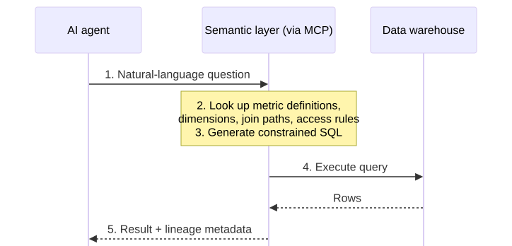
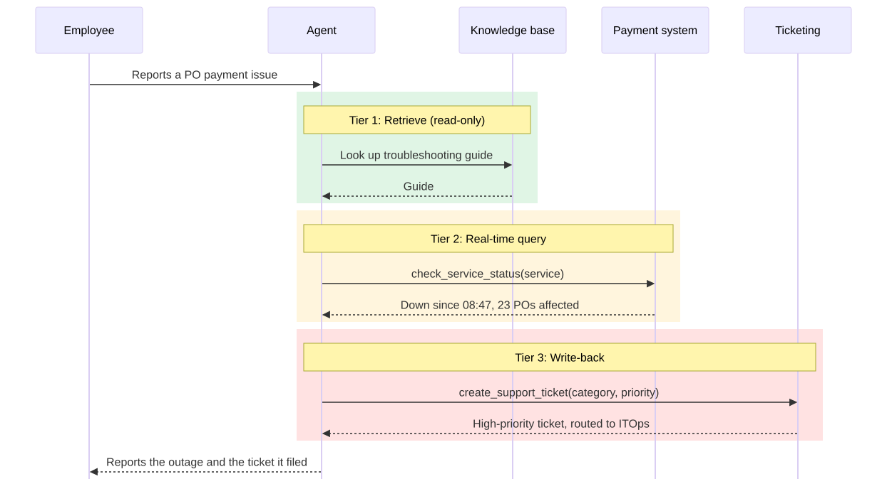

# 让数据为 Agentic AI 做好准备

*三十年来，我们为人类分析师构建数据系统；他们自带上下文、判断力与怀疑精神，因此能绕过那些不完整或错误的数据。
自主 Agent 则完全没有这些能力：它们拿到什么就笃定地照着做什么。
要让数据达到 AI-ready（AI 就绪），我们需要构建一系列层次：让数据变得可信的数据基础、赋予数据正确含义的上下文层，以及支撑并管控 Agent 如何操作这些数据的访问层。
在此过程中，我们还要持续关注可观测性，确保数据得到恰当的治理，并为数据在决策中的使用留下可审计的轨迹。*

|[Pramod Sadalage](https://sadalage.com/)| | [Prem Chandrasekaran](https://premonition.dev)| |
|:---|:---|:---|:---|
| | Pramod 是 Thoughtworks 的杰出工程师（Distinguished Engineer），负责领导北美地区的数据工程与架构服务；他帮助客户应对特别棘手的数据需求，这类需求往往需要新的技术与方法。2000 年代初，他开发了一套技术，使关系型数据库可以基于受版本控制的 Schema 迁移以演进式的方式设计。他参与撰写了五本软件开发著作，包括《Software Architecture: The Hard Parts》与《Refactoring Databases》。|  | Premanand（Prem）Chandrasekaran 是 Thoughtworks 的市场技术总监（Market Tech Director），负责领导一组客户的技术战略与交付，并引导团队做出复杂、高风险的工程决策。他刻意保持亲手实践，与自己领导的团队一起设计并构建生产级系统。他目前的关注点是 AI 如何增强软件开发生命周期——从架构与设计到编码、测试与运维——让开发者跑得更快，同时不牺牲清晰性、安全性与可维护性。 |
|[原文](https://martinfowler.com/articles/making-data-ready-for-agentic-ai.html)| | | 2026/8/27 |

内容
- [数据消费者正在改变](#数据消费者正在改变)
- [在今天，"AI-ready" 必须意味着什么](#在今天ai-ready-必须意味着什么)
- [数据契约与质量：Agent 无法嗅出坏数据](#数据契约与质量agent-无法嗅出坏数据)
  - [Agent 把每个值都当作真理](#agent-把每个值都当作真理)
  - [Schema 即法律：把数据契约写成代码](#schema-即法律把数据契约写成代码)
  - [隔离模式](#隔离模式)
  - [面向 Agent 的奖章架构](#面向-agent-的奖章架构)
  - [非结构化数据适用同样的规则](#非结构化数据适用同样的规则)
  - [置信度阈值路由](#置信度阈值路由)
  - [从何处着手](#从何处着手)
- [可追溯性与治理：审计自主 Agent](#可追溯性与治理审计自主-agent)
  - [审计缺口](#审计缺口)
  - [Agent 血缘](#agent-血缘)
  - [监管是真的有牙齿的](#监管是真的有牙齿的)
  - [分阶段自主](#分阶段自主)
  - [委托访问与即时凭据](#委托访问与即时凭据)
  - [从何处着手](#从何处着手-1)
- [上下文层：教会 Agent 你的数据意味着什么](#上下文层教会-agent-你的数据意味着什么)
  - [你的 Agent 不知道"收入"是什么意思](#你的-agent-不知道收入是什么意思)
  - [上下文层是什么](#上下文层是什么)
  - [名词解释：人们谈论语义层时用的那些词](#名词解释人们谈论语义层时用的那些词)
  - [指标即代码](#指标即代码)
  - [同一个问题，截然不同的 SQL](#同一个问题截然不同的-sql)
  - [Agent 如何使用它](#agent-如何使用它)
  - [从何处着手](#从何处着手-2)
  - [遍历领域模型：知识图谱](#遍历领域模型知识图谱)
- [从可搜索到可操作：面向 Agent 的数据访问](#从可搜索到可操作面向-agent-的数据访问)
  - [你的 Agent 能读，但不能行动](#你的-agent-能读但不能行动)
  - [数据访问谱系](#数据访问谱系)
  - [三个原语，一个协议](#三个原语一个协议)
  - [反模式：把 API 一对一地转换成 MCP](#反模式把-api-一对一地转换成-mcp)
  - [一个能力声明了什么](#一个能力声明了什么)
  - [检索到的文本只提供信息，永不充当闸门](#检索到的文本只提供信息永不充当闸门)
  - [端到端：PO 支付场景](#端到端po-支付场景)
  - [从何处着手](#从何处着手-3)
- [AI-ready 的数据栈](#ai-ready-的数据栈)
- [这些都由谁负责？](#这些都由谁负责)
- [你现在站在哪里？](#你现在站在哪里)
- [四件可以马上开始的事](#四件可以马上开始的事)
- [结尾](#结尾)
  - [致谢](#致谢)
  - [重要修订](#重要修订)

---
眼下，围绕 Agent 框架、编排模式与协议的讨论热度很高。
这些都很重要，但只要跳过数据层，它们几乎都无法交付价值。
在任何 Agent 框架产出有用结果之前，你的数据必须处于一种机器能够消费、信任并据以行动的形态。
本文讨论：要让 agentic AI 从数据中获得价值，数据需要长什么样。

我们曾经花了大量时间为人类消费者构建数据架构。
现在我们即将把这些架构交给一种截然不同的消费者，而其中大多数还没有为此做好准备。

## 数据消费者正在改变

三十多年来，我们一直为人类构建数据系统：仪表盘、报表、分析师查询，全都围绕一个坐在屏幕前的人来设计。
这套体系之所以有效，是因为人类带来了大量隐性上下文，还带着一种好奇心：缺什么，就去找周围的人问清楚。

人类分析师知道你这家组织里"收入（revenue）"具体指什么。
他们知道该查哪些表、该避开哪些表。
他们能察觉某个数字看起来不对、某个总和的整数位可疑得刚好、某个日期落在公共假日上、某个价格低得离谱。
这种直觉在背后完成了大量看不见的上下文与知识处理工作。

> 面对看起来可疑的数据，人类会停下来；Agent 则照样照着它行动。

Agent 身上一点也没有这些能力。
它们无法依赖人们多年积累的部落知识（tribal knowledge）与模式识别能力，因此需要把上下文显式化、需要实时访问能力，也需要可以信赖的数据质量。
而其中最关键的差别在于：当数据感觉不对时，人类会反复核对；Agent 却会自信地照着它行动。
本后续全部讨论，都围绕这一行为差异展开。

## 在今天，"AI-ready" 必须意味着什么

对人类的消费者而言，数据只要*够用*就行，剩下的由分析师补上。
含义、合理性检查、以及"这个数字能否被信任"的判断，全都活在人的脑子里。
当同一份数据被交给 Agent 时，这些原本隐含的劳动必须全部转移到数据本身之中。
它体现为五个属性，每一个都是人类曾经免费提供的某种能力的另一面。

- **可信（Trusted）**：人会因为一个数字感觉不对而停下来；Agent 会照样照着它行动。
  人类过去提供的信心必须被内建，因此数据在被 Agent 看到之前，就必须准确、新鲜且经过校验。
- **有上下文（Contextual）**：人知道你们的"收入"数字已经扣除了退货，也知道你们财年从二月开始；而 Agent 这两件事都必须被明确告知。
  过去存在于某人脑子里的含义，必须在数据中被显式化。
- **可追溯（Traceable）**：人做出决定后，事后能解释为什么；而 Agent 在 30 秒内做出的决定，如果不当场记录，其推理就消失了。
  你必须能够重建 Agent 做了什么、以及为什么这么做。
- **受治理（Governed）**：人的访问范围受其角色与判断力约束；Agent 的访问范围必须由设计来约束。
  访问必须是按范围限定的、受控的、可审计的。
- **可操作（Operational）**：人读完仪表盘之后会去做某件事；而 Agent 必须*能够*去做那件事。
  数据不能只是可读，它必须可操作、可触发动作。

这五点归根到底讲的是同一件事：每一项都是人过去不用思考就完成的职责，现在被推到数据自身之中。
漏掉任何一项，Agent 都不会像人那样优雅降级，而是自信地失败。

这些属性没有一项能自己长出来。
本文余下部分讨论构建它们的四个主题，大致按照你应该处理的顺序展开。

- **数据契约与质量（Data Contracts and Quality）** 让数据变得*可信*。我们从此处开始，因为一个错误的事实会毒化其上构建的每一层。
- **可追溯性与治理（Traceability and Governance）** 记录 Agent 为何如此行动，并限定它能触及什么，使数据*可追溯*且*受治理*。
- **上下文层（The Context Layer）** 把指标与实体的含义编码进去，使数据*有上下文*。
- **从可搜索到可操作（From Searchable to Actionable）** 让 Agent 查询线上系统并写回，使数据*可操作*。

我们会逐个主题展开，说明把每个属性内建进去需要付出什么。
四个主题都做完，这五个属性就不再是抽象目标，而会变成你可以工程化实现的东西——把普通数据变成 AI-ready 的数据。

## 数据契约与质量：Agent 无法嗅出坏数据

人类对坏数据有嗅觉测试：数字看起来不对、日期毫无意义、价格似乎有误，他们都会察觉。
Agent 没有这种本能。
正如 Simon Willison 所说，[语言模型是轻信的](https://simonwillison.net/2023/Oct/14/multi-modal-prompt-injection/)——它们相信交给它们的任何东西并据此行动。
把一个错误的值喂给 AI Agent，它不会停下来想一想，而会直接使用这个数字，产出一个自信却错误的答案。
没有可信数据，agentic AI 里的其他一切都不成立，所以我们从这里开始。

### Agent 把每个值都当作真理

考虑一个具体场景。一个定价 Agent 被要求给出产品 *X* 的当前价格。
昨天价格从 \$49.99 更新为 \$59.99，但 Agent 的数据源尚未刷新，它仍显示旧数字。

Agent 毫不迟疑地取到 \$49.99，向客户报价，客户下单，公司每卖出一件就亏 \$10。
Agent 走的每一步在技术上都正确，它完美地执行了自己的工作流。出问题的是它访问的*数据*。

> 那些最确信自己数据已 AI-ready 的领导者，同时也把数据就绪度列为最大障碍

一位人类销售代表会停下来："等等，上周我们不是改过这个价格吗？"他们会再核对一遍。
他们拥有组织记忆，也对"哪里不对"有感觉。而 Agent 两样都没有。
错误不会触发告警，而会在工作流中静默级联。
这不是罕见的边界情况。在 2026 年的 [State of Data Integrity and AI Readiness](https://www.lebow.drexel.edu/sites/default/files/2026-01/lebow-precisely-state-data-integrity-ai-readiness-2026.pdf) 报告中，
Precisely 与德雷塞尔大学 LeBow 商学院调查了 505 位数据与分析负责人，其中 87% 认为自己的数据已为 AI 做好准备，却有 43% 把数据就绪度列为从 AI 中获取价值的最大单一障碍。
信心与就绪度之间的这道鸿沟，就是定价 Agent 的组织版：自信满满，却是错的。
另一项 [KPMG Global AI Pulse](https://kpmg.com/xx/en/media/press-releases/2026/06/growing-adoption-signals-progress-as-cost-visibility-and-accountability-drive-ai-value.html) 对 2,145 位领导者的调查指向同一结论：如今近半数高管认为 AI 的成本已超过其收益。
大多数企业离上面那个场景，只差一个过期字段。

### Schema 即法律：把数据契约写成代码

那么，如何防止 AI Agent 访问到坏数据或过期数据？答案是*数据契约（data contract）*：把 Schema 当作法律，而不是礼貌的建议。

这逆转了十年来"无模式（schemaless）才灵活"的思路。
对人类的消费者来说，宽松的 Schema 只是不便；而对 AI Agent 来说，它们是危险的。
数据契约用 [Open Data Contract Standard](https://github.com/bitol-io/open-data-contract-standard) 编写——这正是 [Data Contract CLI](https://cli.datacontract.com) 使用的格式（并已入选 [Thoughtworks 技术雷达第 33 期](https://www.thoughtworks.com/radar/tools/data-contract-cli)）——把规则显式地定义下来。
一份 `product_pricing` 契约可能会规定：

- 属性具有严格的逻辑类型。
- 一条质量规则：`price` 必须大于零。
- 对 `currency` 的质量检查：拒绝 USD、EUR、GBP 之外的任何值。
- 关键的一条是*新鲜度 SLA（freshness SLA）*：定价数据必须在最近 24 小时内刷新过。

在 Open Data Contract Standard 中，该契约如下所示。

```yaml
apiVersion: v3.1.0
kind: DataContract
id: product-pricing
name: Product Pricing
version: 1.0.0
status: active
schema:
  - name: product_pricing
    physicalType: table
    properties:
      - name: product_id
        logicalType: string
        physicalType: varchar(64)
        required: true
        unique: true
        primaryKey: true
        primaryKeyPosition: 1
      - name: price
        logicalType: number
        physicalType: decimal
        required: true
        quality:
          - type: sql
            description: 每个价格必须大于零
            query: SELECT min({property}) FROM {object}
            mustBeGreaterThan: 0
      - name: currency
        logicalType: string
        physicalType: varchar(3)
        required: true
        quality:
          - type: sql
            description: 币种必须是受支持的 ISO 代码
            query: SELECT count(*) FROM {object} WHERE {property} NOT IN ('USD', 'EUR', 'GBP')
            mustBe: 0
      - name: ingested_at
        logicalType: timestamp
        physicalType: timestamp
        required: true
slaProperties:
  # 正是这条规则能拦住"过期价格"场景
  - property: latency
    value: 24
    unit: h
    element: product_pricing.ingested_at
```

强制执行沿三个维度展开。

- **Schema 强制**：确保类型与约束被遵守，并由契约显式化。
- **新鲜度 SLA**：为每个数据集定义可接受的最大陈旧程度。当 Agent 要实时回答时，夜间批处理更新已经不够。
  把 SLA 绑定到"数据最近一次成功加载"的时间，而不是"某个值最近一次变更"的时间，这样稳定的数据不会被误判为过期，而停摆的流水线也无法伪装成新鲜。
- **质量门禁**：在 CI/CD 中校验契约，一旦不通过就阻止部署。

注意这如何改变前面的定价场景——它从设计上就被阻止了。
如果定价数据在 24 小时内没有刷新，那么契约在 *Agent 看到数据之前*就已经被违反。

### 隔离模式

定义契约是一回事。当数据违反契约时会发生什么？你需要一个断路器，这就是隔离模式（quarantine pattern）。

流程是这样的：原始数据从源系统、API、数据库、流中到达。
在它进入 Agent 可访问的数据存储之前，先经过一道契约校验闸门，检查三件事：是否符合 Schema、是否在新鲜度 SLA 之内、是否通过质量规则。

三项全部通过，它才流入经过认证、面向 Agent 就绪的层级；任何一项不通过，它就被隔离，路由到死信队列等待人工复核，并触发告警。

> 坏数据落到死信队列，永远不会落到 Agent 面前

关键在于让 Agent 永远看不到坏数据。
它不会被过期价格或损坏的嵌入向量（embedding）毒化。
在定价场景中，如果 `ingested_at` 时间戳超过 24 小时，契约即被违反、记录被隔离，于是被问到价格时，Agent 会说"我没有当前的定价数据"，而不是自信地报出错误数字。
这是一种好得多的失败方式。而且这是数据架构的职责，不是模型的职责：更好的模型救不了坏数据。

### 面向 Agent 的奖章架构

奖章架构（medallion architecture）是一种分析型数据设计模式，用于在 [lakehouse](https://www.databricks.com/blog/what-is-data-lakehouse) 中组织数据，由 [Databricks](https://www.databricks.com/blog/what-is-medallion-architecture) 推广开来。

坏数据被隔离了，但*好*数据去哪里？这正是奖章架构要组织的事，其前三个层级已经相当成熟：

- **青铜层（Bronze）**：原始、不可变的摄取，全部保留，用于审计轨迹与血缘。
- **白银层（Silver）**：经过校验与去重，施加 Schema、强制执行数据契约，隔离模式就住在这里。
- **黄金层（Gold）**：经过认证，语义模型编译时针对这一层，访问受治理，指标可信。

对 Agent 架构来说，值得再加第四个层级。
在下面所示的**自适应黄金层（Adaptive Gold）**中，Agent 不只是消费数据，还会*策展*数据。
它们观察自己的查询模式，把反复用到的组合物化出来，从真实使用中构建数仓视图。
这并非空想。在 [DataHub 的 CONTEXT 2025 峰会](https://datahub.com/blog/context-2025-highlights/)上，Apple 介绍了让 Agent 充当其数据目录的"数字管家"，持续扫描元数据、标记缺口、提出更新。
Apple 的 Agent 策展的是*目录*；自适应黄金层把同样的模式指向*数据集*，那就是下一步。
这仍处于早期，但一旦你 Agent 的查询模式稳定下来，就值得一试。


**图 1：面向 Agent 的奖章层级。** 数据从原始青铜层，经校验的白银层，流到认证的黄金层，再到由 Agent 策展的自适应黄金层，同时 Agent 只能访问黄金层及以上。

> 青铜层与白银层给人用；Agent 只看黄金层及以上

关键的架构原则是：Agent 只应访问黄金层或更高层级。
青铜层与白银层用于血缘、调试和人工排查。
把原始数据或部分校验过的数据暴露给 Agent，就等于把定价问题重新请回来。

### 非结构化数据适用同样的规则

到目前为止看到的一切都像表格：价格、币种、时间戳。但 Agent 消费的内容大部分并非表格数据，而是文档、wiki、PDF 和客服工单，它们被切块、嵌入到向量库中以供检索。
如果你的 Agent 使用 RAG，这就是它们赖以运行的数据，它需要同样的信任保证——尽管你没法对一段文字写上 `price > 0`。
模式照样适用，变的只是质量维度的定义。

"过期价格"场景在这里有一个孪生版本：一份政策文档更新了，但向量索引没有重新嵌入，于是 Agent 检索到旧版本并据此自信作答。
失败机理与过期价格完全相同，只不过这次过期的是一条嵌入向量而不是一行记录。
*新鲜度 SLA* 依然适用，但要精确界定时钟度量的是什么：重点不是内容最近一次变更的时间，而是索引最近一次针对其数据源成功重建的时间。
一条 24 小时的 SLA 意味着重建索引任务必须在最近 24 小时内完成；如果没有，索引就是陈旧的，即使表面上什么也没变，也必须被隔离——因为索引器静默失败的时候，恰恰正是你无法判断内容是否真的变过的时候。
这一个心跳信号同时能捕获*已更新但未建索引*的文档，以及悄悄停摆的流水线。

*契约*从内容转移到周边元数据。
你无法约束正文，但你可以要求每个分块都带有来源、版本、时间戳和访问范围，并拒绝任何不满足这一点的分块。
这些元数据也正是让检索日后可追溯、可治理的基础。

*质量门禁*则采用适配文本的检查：拒绝空分块或截断分块，捕获会扭曲检索的近重复文档，标记失败的抽取与 OCR 垃圾，并监测嵌入漂移。
格式错误或为空的嵌入向量会扭曲相似度搜索，所以它绝不能进入存储——理由和坏价格绝不能到达 Agent 一样：扭曲的索引会让 Agent 自信地检索到错误内容。

无论数据是一行带价格的记录，还是一段被嵌入的文本，要做的事情完全一样：架构必须在 Agent 之前嗅出坏数据的味道。

### 置信度阈值路由

契约、隔离与奖章架构处理了明确的案例。
但还有一片灰色地带：数据不算明显坏，但也不完全可信。这正是置信度阈值路由（confidence-threshold routing）的用武之地，它在完全自主与完全人工控制之间架起桥梁。

Agent 处理请求，评估数据质量信号，不仅检查*模型*自身的置信度，还检查*数据层面*的信号，例如新鲜度、完整性与一致性。
若置信度达到或高于阈值（比如 85%），Agent 自主执行；低于阈值，Agent 交由人工处理。
阈值可按用例配置：定价可能要求 90%，而内部 FAQ 70% 就够了。

让我们最后一次回到定价场景。价格数据已陈旧三天，而新鲜度 SLA 要求 24 小时。
SLA 违规会自动把置信度分数压到阈值以下，无论模型自己对答案有多么自信。
Agent 应把人类请进来：

> "我不确定这个价格是否为当前价格。转交人工核实。"

> 驱动阈值的应该是数据质量信号，而不只是模型自身的置信度

换言之，驱动阈值的应该是数据质量信号，而不只是模型自身的置信度。
模型可能对一个过期答案坚信不疑，而新鲜度 SLA 会推翻这份错位的确定性。

难的部分在于如何把这些质量信号合成单一分数，并与模型自身的置信度一起权衡。这是一个尚未解决的设计问题，而不是已解决的问题。
先从硬性门禁开始，而不是平滑的加权合成：任何契约或 SLA 违规都强制转人工，不管其他信号看起来多好。
之后再加加权评分，并且只有在你能证明它优于这条简单规则时才加。

### 从何处着手

你不必一次把全部建完，而且大多数团队也做不到。
契约、隔离闸门、奖章架构与置信度阈值路由，一次性立起来是很大的一摊工程。
好消息是它们是可叠加的：每一项单独都能降低风险，其余部分可以随时间逐层加进来。
从杠杆最大的动作开始，再向外扩展。

- 为 Agent 触及的每个数据集定义新鲜度 SLA。同一个数据集对不同消费者可以有不同的新鲜度要求——
  例如对仪表盘而言，夜间批处理就够用的定价表，在被报价 Agent 依赖时可能需要接近实时的更新。
- 实现隔离闸门。在数据进入 Agent 可访问存储之前，按契约进行校验。先从风险最高的数据集开始，比如定价、库存、客户记录。
- 从 Data Contract CLI 起步。把契约治理带入 CI/CD：用 YAML 定义契约、自动校验、失败即阻断部署。像对待 API 契约那样严格地对待数据契约。
- 加入置信度阈值路由。当质量信号低于阈值时转交人工。先从高位（约 90%）开始，随着信任建立与准确率跟踪，再逐步下调。

现在我们已经让数据变得可信。但当 Agent 在这份数据上自主行动时，谁在看着？

## 可追溯性与治理：审计自主 Agent

即便数据完美，自主行动仍会引出一个更难的问题：当监管者问起 Agent 为何那样做时，你能答得上来吗？
传统系统记录*发生了什么*；Agent 系统必须解释*为什么*。
从*what*到*why*的这一转变，正是治理变难的地方。

### 审计缺口

设想一家银行在用 agentic AI 做贸易融资——在这里，治理架构才是真正的创新所在。

一个 Agent 处理一份信用证：核查 KYC 数据、验证客户不在制裁名单上、评估信用条款，并在大约 30 秒内批准一笔 240 万美元的交易。
六个月后，监管者问了一个简单的问题："这笔为什么被批准？"

> 传统审计日志能告诉你发生了什么，但无法告诉你为什么。

传统审计日志能告诉你*发生了什么*：查了哪些表、在什么时间、由哪个服务账号。
它们无法告诉你的是*为什么*：Agent 为什么先查制裁名单再查信用条款？为什么在存在一处轻微的单证不一致时仍然批准？它考虑并否决了哪些替代方案？
"what"与"why"之间的缺口正是监管风险之所在，而[欧盟《人工智能法案》](https://eur-lex.europa.eu/eli/reg/2024/1689/oj)的[第 12 条](https://artificialintelligenceact.eu/article/12/)正是出于这个理由，要求高风险系统保留自动日志，以便事后重建"why"。
弥合这道缺口，就是 Agent 血缘的用途。

### Agent 血缘

弥合审计缺口的方法是*Agent 血缘（agentic lineage）*，它是传统数据血缘的扩展。
传统血缘追踪访问了哪些数据源，而 Agent 血缘追踪 Agent 为何决定访问 X——因为它在数据源 Z 中发现了 Y。

具体到贸易融资案例：一条 trace 代表处理信用证 LC-4892 的端到端工作流；在这条 trace 内部，每个 span 是其中的一个步骤：

- Span 1：从合规数据库检索客户 KYC 数据，结果：已核实。
- Span 2：通过 OFAC API 查询制裁名单，结果：无命中。
- Span 3：依据政策引擎评估信用条款，结果：在限额之内。
- 最后一个 span：决策——批准（APPROVE），置信度分数 94%，并附有完整推理链。

这正是监管者需要的：不是"Agent 于 14:32:07 UTC 访问了合规数据库"，而是"Agent 先查了 KYC，再查制裁名单，再评估信用条款，因为三者全部通过而批准"。
这个*trace 与 span 模型*直接借用自分布式系统可观测性，所以工程师们早已从 [Jaeger](https://www.jaegertracing.io/) 与 [Zipkin](https://zipkin.io/) 这类工具中熟悉了这套心智模型。
在 Agent 侧，[Langfuse](https://langfuse.com/)、[Arize Phoenix](https://phoenix.arize.com/) 以及面向 AI 的 [OpenTelemetry](https://opentelemetry.io/) 是正在兴起的选择。
三者在 Thoughtworks 技术雷达上均有收录：OpenTelemetry 位于 Adopt，Langfuse 位于 Trial，Arize Phoenix 位于 Assess。

### 监管是真的有牙齿的

这并非纸上谈兵。欧盟《人工智能法案》是现行法规中最具体的一部。
[第 12 条](https://artificialintelligenceact.eu/article/12/)要求高风险 AI 系统在其生命周期内自动记录事件，以便其运行可被追溯；[第 19 条](https://artificialintelligenceact.eu/article/19/)要求提供者至少保存这些日志六个月。
违反这些记录保存义务属于该法案的中档处罚：最高 1,500 万欧元，或全球年营业额的 3%，以较高者为准。
对一家大公司而言，即便 3% 的全球营业额也是数亿量级。

第 12 条与第 19 条合起来，对你的架构意味着三项义务：

- 在系统整个生命周期内自动记录事件，足以追溯其如何运行，而不只是孤立的几个时间戳。
- 至少保存这些日志六个月，这意味着你的可观测性基础设施必须能承担长期存储。
- 能够事后重建"why"。法律强制的是日志；让日志能回答监管者的问题是你的责任。
  也就是说，必须捕获完整推理链：查阅了哪些来源、应用了什么逻辑、权衡并否决了哪些替代方案。

欧盟走得最远，目前其他司法辖区还没有一部法律与之相当。
但你不必押注监管最终落在何处，也能看出要点所在：**迟早会有某种东西逼问 Agent 为何那样做**——无论是监管者、审计师、对某个决定提出异议的客户，还是你自己想把问题调清楚的团队。
稳妥的假设不是"某部法律会来"，而是"无论如何你都会想回答这个问题"。
一个你无法解释的系统，就是一个你无法完全信任、无法为之辩护、也无法修复的系统。

### 分阶段自主

知道需要审计轨迹是一回事，安全地推广出去是另一回事。
你不会在第一天就上线一个完全自主的 Agent，就像你不会给一个刚入职的员工无限制的权限。
自主性要靠阶段赢得：

| 阶段 | Agent | 人类 | 监控 |
| --- | --- | --- | --- |
| 影子模式（Shadow Mode） | 推荐行动 | 复核推荐并在适当时执行 | 所有推荐都被记录，用于长期跟踪准确率 |
| 受监督（Supervised） | 准备行动并等待批准 | 复核行动并批准或拒绝 | 所有提议的行动与人的决定都被记录 |
| 带护栏的自主（Autonomous with guardrails） | Agent 在既定边界内行动（边界最好按可逆性而非交易金额划定） | 定义护栏 | 所有行动被记录，异常时触发告警 |
| 完全自主（Full autonomy） | Agent 执行所有行动 | 抽查 | 由其他 Agent 与人类持续进行 |

你不会在第一天就把公司信用卡交给新员工。
他们从提交采购申请开始，逐步过渡到受监督的支出，最终才拿到一张有额度限制的卡。
Agent 也应当以同样的方式赢得信任。

在这条阶梯上晋级，应该基于证据而不是直觉。
这意味着每一步之前都要测试 Agent，而不是只在生产环境中观察它。
Agent 很难测试：它们是非确定性的、调用成本高，并且通过带有真实副作用的工具行动。
因此团队会 mock 或回放工具与模型的交互，让测试在 CI 中确定性运行；用评估（eval）给 Agent 的决策打分，而不是每次运行都调用线上服务。
构建这套测试装置本身就是一门专业功夫，超出了本文范围。

### 委托访问与即时凭据

随着 Agent 赢得自主性，问题就变成：它们该持有什么权限？这里有三个最重要的安全模式。

- **委托访问（Delegated Access）**：当 Alice 请 Agent 查她的账户时，Agent 应当*以 Alice 的权限*行动，
  而不是通过一个能看见所有客户数据的宽泛服务账号。共享服务账号会摧毁归因能力。
  当监管者问"谁访问了这位客户的数据"时，回答"服务账号"几乎等于什么都没说；
  而有了委托访问，答案是"Alice 的 Agent，代表 Alice，用 Alice 的权限"。
- **即时凭据（Just-in-time Credentials）**：不要用永不失效的长期 API key，而是为每个具体任务签发短期令牌。
  Agent 要查制裁名单？签发一个仅限*OFAC API* 读取、仅针对该客户、有效期五分钟的令牌。任务完成，令牌即失效。
  没有长期凭据闲置在那里等着被窃取。
- **最小权限（Least Privilege）**：Agent 只拿到任务所需的最小访问权。
  处理一份信用证并不需要伸进人事系统或营销数据。

这三个模式合起来，解决了当下许多 Agent 部署中削弱归因与范围管控的问题。

它们还能防御 Agent 系统中最尖锐的安全风险。
Simon Willison 称之为[致命三要素（lethal trifecta）](https://simonwillison.net/2025/Jun/16/the-lethal-trifecta/)：
一旦 Agent 同时具备三者——访问私有数据、接触到不可信内容、以及向外通信的途径——它就变得危险。
把这三者凑在一起，一份被污染的文档或一个被污染的网页就能通过提示注入（prompt injection）劫持 Agent，并悄悄外泄它能触及的一切。
委托访问、*即时*凭据与最小权限，压缩了被劫持的 Agent 所能触及的范围，从而打断这三要素的组合。
稍后我们还会在同一问题上加第二道切割：把检索到的文本完全排除在授权路径之外，让一份被污染的文档从一开始就无法授予权限。

### 从何处着手

在四个主题中，这一个最该抱持"慢一点"的直觉。
但要把两件容易被混为一谈的事情分开：自主性要分阶段赢得，没人指望你一次全部授予；
可观测性则完全没有阶段可言，不论自主程度如何，它从第一天起就要以满强度进场，因为事后给一个运行中的系统补装极其痛苦。
上层可以刻意保守，底层埋点不行。

- **从第一天就埋点**。这是这里最该先做的一件事：部署之后再补可观测性要难得多。
  Agent 的每条工作流都应发出 trace，并为每一步生成 span，包含推理过程与查阅的来源。
  这里的追踪模式已相当成熟，能借力成熟工具（例如 [OpenTelemetry](https://opentelemetry.io/)）就不要自造。
- **从影子模式开始**。风险最低、学到最多：Agent 推荐，人类决定。
  在合规需要之前就把审计轨迹建好，在授予自主权之前就测出准确率。
- **实现委托访问**。Agent 继承调用者的权限，使用短有效期的*即时*凭据，不留长期令牌。
- **为可解释性而建**。不论监管者是否真的会问，一条能回答"why"的审计轨迹，正是你调试坏决策、为正确决策辩护、
  并把系统信任到可以扩大自主范围的前提。现在就接进去，事后加会难得多。

语义层弥合 Agent 与人类分析师之间的组织知识缺口，它建立在前面几个主题所提供的可信数据与可审计行动之上。

## 上下文层：教会 Agent 你的数据意味着什么

当 AI Agent 成为数据的主要消费者时，语义层（semantic layer）提供它们所需的显式上下文——那些人类分析师凭多年经验隐含携带的上下文。

### 你的 Agent 不知道"收入"是什么意思

问 Agent："产品 X 第三季度的收入是多少？"人类分析师清楚该怎么做：查哪张表、收入是毛收入还是净收入、Q3 对应你们财年日历中的哪一段。
这些全是他们在多年组织知识、部落文档与 Slack 讨论中吸收来的。

Agent 一样都没有。它不知道哪几个 join 把产品连到订单再连到收入，也不知道你们的财年从二月开始。
缺了这些上下文，它要么凭空编一个答案，要么直接放弃。
语义层就填补这道缺口，提供业务领域的上下文。

### 上下文层是什么

语义层是一组声明式定义：你的指标是什么、收入如何计算、什么叫活跃客户、这些数字意味着什么。
每个消费者都走同一套定义，因此它们都能得到一致而准确的结果。
但一个会采取行动的 Agent，需要的不只是关于数字的定义。它需要知道这些东西*是什么*，以及它可以对它们*做什么*。
这是三套各自独立的定义，Agent 三套都需要。

**领域模型（domain model）** 说明存在什么：实体、它们之间的关系，以及业务的含义规则——一张订单属于一位客户，活跃客户是过去九十天内购买过的客户。
它为 Agent 提供解读请求并据此规划的词汇。它只被*查询*，从不被执行；没有任何通往数据的查询路径穿过它。

**语义模型（semantic model）** 说明数字如何计算：指标与维度，每个只有一份版本化的公式，每次都被编译成同一段 SQL 并对分析型存储执行。
这就是语义层更精确的名字，其要旨是把正确性放进编译器，而不是放进模型的猜测里。

**能力模型（capability model）** 说明 Agent 可以做什么：一组经过策展的、针对线上系统的操作，其中一些是读（查询支付状态、取一份排障指南），一些是写（发起退款）。
每个操作都带有权限与负责人，而执行写的操作还额外带有前置条件与可逆性等级。

名词、数字与动词。三者合起来就是上下文层。把它们统合起来的理由，并不是"它们都与含义有关"——能力模型显然不是；而是：它们每一个都是把某项保证*声明一次*（放在版本控制里）的地方，而不是每次请求都由模型重新推导一遍。
定义才是层；接口（今天就是 MCP）不过是那扇门。

用 dbt 的读者会反驳说：它的 [semantic models](https://docs.getdbt.com/docs/build/about-metricflow) 已经声明了实体，为什么还要把领域模型单拆出来？
因为声明在指标层内部的实体，其作用范围仅限于指标；而能力模型必须用与语义模型相同的词汇书写，否则两者会逐渐漂移。
一次退款作用的客户，正是收入数字所统计的那位客户。底层只能有一套词汇，否则你就会有两套。

### 名词解释：人们谈论语义层时用的那些词

这套词汇尚无定论，用词很容易把人绕晕。
经典的[语义层（semantic layer）](https://en.wikipedia.org/wiki/Semantic_layer)（从 Business Objects 到 LookML 与 Cube）把实体和关系与指标打包在一起，所以很多人至今仍用"语义层"指整体。
我们把界线划得更清楚，因为 Agent 让这些区分变得重要。
我们对各部分称"模型"而不是"层"，因为每一部分是一套定义，而不是一层基础设施；也因为工具就是这么叫的：dbt 声明的是 `semantic_models`，而源自 Open Semantic Interchange 倡议、如今名为 [Apache Ossie](https://ossie.apache.org/) 的厂商中立规范，本身就是一份语义模型规范。

领域模型还有别的名字。把它的实体与关系存成图，你得到的就是知识图谱（knowledge graph）。
领域驱动设计称它为[领域模型（domain model）](https://martinfowler.com/eaaCatalog/domainModel.html)，而它的[限界上下文（Bounded Context）](https://martinfowler.com/bliki/BoundedContext.html)提醒我们：没有任何单一模型能覆盖整个企业。
追求一个[统一规范模型（canonical model）](https://martinfowler.com/bliki/MultipleCanonicalModels.html)通常是海市蜃楼；每个领域都有自己的模型，按[数据网格（Data Mesh）](https://martinfowler.com/articles/data-mesh-principles.html#FederatedComputationalGovernance)所描述的联邦方式治理。

市场上的名字是本体（ontology），它指的是同一件产物。
它的谱系比当前这波热潮所暗示的更久远：[共享概念化的形式化、显式规范](https://www.sciencedirect.com/science/article/abs/pii/S0169023X97000566)，其形式化机器是 RDF、OWL 与 SHACL。
严格来说，本体只做描述，不做行动。两个已上市产品把它推得更远：
[Palantir 的 Foundry Ontology](https://www.palantir.com/docs/foundry/ontology/core-concepts)把它的对象、属性与联系同 Agent 可对其执行的动作配成对；
[Databricks 的 Genie Ontology](https://www.databricks.com/blog/introducing-genie-one-genie-ontology-and-genie-agents)则在受治理的指标定义之上放置了一张企业概念的活图。
Palantir 的形态与我们唯一的实质差别是：它把动作打包进去了。我们把两者分开，因为写路径与读路径的风险不同，各自按自己的规则治理更有好处。

这些东西大多不需要你从零开始写。最强的实现都是从你已有的东西引导出来的——表结构、术语表、以及人们实际的查询方式——再由人来做上层策展，而不是要求谁手工写出全部内容。


**图 2：上下文层。** 由实体与关系构成的领域模型、编译为针对分析型存储的 SQL 的指标语义模型，以及针对线上系统的受护栏读写能力模型，三者之上贯穿来源（provenance）信号。
领域模型没有向外箭头，因为它只被查询而不被执行；另外两个模型都用它的词汇书写。
仪表盘与分析师够到的是语义模型；而 Agent 是第一个需要同时用到三个模型的消费者，这正是本文所讲的那次转变。

三个模型都是源码版本控制里的代码：走代码评审、在 CI 中接受测试、逐环境晋级后才进入生产。
当"收入"的定义或退款规则改变时，你只改一个地方，它就传播到所有地方。
Agent 从不直接触碰底层数据；它们走上下文层，而上下文层既约束也治理它们能索取什么、能做什么。

### 指标即代码

在实践中，业务逻辑就写在定义里，`revenue = order_amount - discount_amount`，而不是埋在 BI 工具或临时 SQL 视图里。
Agent 收到自然语言问题，语义模型把它解析为正确且受约束的 SQL。
Agent 不去猜表名或 join 路径，它使用定义。

本文示例使用 [dbt MetricFlow](https://docs.getdbt.com/docs/build/about-metricflow) 语法（dbt 正处于从 measures 迁移到指标优先规范的过渡期；这里展示的是广为人用的旧形式，概念在两种形式下都成立）。
*Cube.js*、*Snowflake* 与 *Databricks* 都遵循类似的模式。
工具本身不如"把业务逻辑写进受版本控制的代码"这项纪律重要。

```yaml
semantic_models:
  - name: orders
    model: ref('orders')
    defaults:
      agg_time_dimension: order_date
    entities:
      - name: order_id
        type: primary
      - name: customer_id
        type: foreign
    dimensions:
      - name: order_date
        type: time
        type_params:
          time_granularity: day
    measures:
      - name: revenue
        agg: sum
        expr: order_amount - discount_amount
        create_metric: true
```

### 同一个问题，截然不同的 SQL

看一个例子。向一个*没有*语义模型的 Agent 问"产品 X 第三季度的收入是多少？"它会猜表名、用错列、没有财年日历映射、漏掉 join。

```sql
-- 指标定义之前
SELECT SUM(amount)
  FROM sales_data
 WHERE product = 'Product X'
   AND quarter = 'Q3'
```

向*有*语义模型的 Agent 问同样的问题，它会被约束到正确的表、来自 YAML 定义的净收入公式、正确的财年日历区间，以及合法的 join 路径。

```sql
-- 受指标定义约束
SELECT SUM(order_amount - discount_amount)
  FROM orders o
  JOIN products p
    ON o.product_id = p.id
 WHERE p.name = 'Product X'
   AND o.order_date
       BETWEEN '2025-07-01'
           AND '2025-09-30'
```

语义模型并不会让 Agent 更聪明，它只是阻止 Agent 去猜。
对一个会不加检查地照着答案行动的 Agent 来说，后者才是关键。

### Agent 如何使用它

单独看语义模型，也就是一个定量问题所走的那条路径。端到端流程是这样的：
Agent 发出自然语言问题（步骤 1）；语义模型通过 MCP 查找指标定义、可用维度、join 路径与访问规则（步骤 2），随后在同一个组件内生成受约束的 SQL（步骤 3）；数据仓库执行查询（步骤 4）；结果带着完整的血缘元数据回到 Agent（步骤 5）。



**图 3：三条路径之一。** 定量问题经由语义模型作答；关于"东西是什么"的问题走向领域模型；针对线上系统的读取或动作则走能力模型。

> Agent 从受治理的指标中挑选，而不是面对自己可能误读的原始表

语义模型约束了 Agent 能索取什么。
例如 dbt 会动态地只暴露适用于所选指标的维度，从而阻止 Agent 生成听起来合理但实际错误的查询。
而步骤 5 中的血缘元数据，正是前面所讲可追溯性的基础。上下文与可追溯性彼此强化。

### 从何处着手

上下文层最大的诱惑是：在交付任何东西之前先把整个业务建模。
要抵抗这种诱惑。从语义模型开始，因为价值集中在一小撮指标上——那些在不同团队之间有不同含义、存在争议的指标。
让你的第一个 Agent 用例决定范围，只长出它真正需要的领域模型与能力，而不是你想象中需要的那些。
一个窄而正确的上下文层，胜过一个庞大却半吊子共识的上下文层。

1. **找出互相冲突的指标定义**。大多数组织对最重要的指标都有好几套定义，收入是经典例子：毛收入还是净收入、含不含退货。
   这些冲突是你最大的 Agent 风险，也是最快的收益。
2. **选一个工具，但重心放在纪律上**。任何主流语义层工具都行；重要的是它背后的纪律：指标定义放在版本控制里、每个指标只有一份共识定义、Agent 通过层查询而不是查原始 Schema。
3. **让 Agent 走上下文层，永不直连原始 Schema**。Agent 应该看到受治理的指标与维度，而不是原始表与 join。
   今天暴露这一层的常见方式是 MCP，dbt、Cube 与 AtScale 都提供 MCP server；但无论你如何连接，原则不变——重点是这层抽象，而不是协议。
4. **对抗式测试**。找缺口的最好方式是对抗式测试：每一次幻觉都指向一处缺失的定义。
   要修的是定义，而不是提示词。也不要试图煮沸整个海洋，从你第一个 Agent 用例所需的指标开始。

### 遍历领域模型：知识图谱

语义模型在结构化指标查询（如"各区域的收入是多少"）上表现优异。
但有些 Agent 任务需要在实体、事件与时间之间做更丰富的关系推理。
设想一位客户买了产品 X，之后在一次定价调整后流失。像这样固定跳数的路径，就是普通的 join。
扁平表处理得很差的是那种"写查询时并不知道深度"的遍历：顺着关系链一路走，直到找到你要找的东西。
那才是领域模型的地盘——实体以及它们如何连接。

存储并遍历这张地图的常见方式是知识图谱，它是领域模型的一种存储选择，而不是第四个要新建的东西。
微软的 [GraphRAG](https://github.com/microsoft/graphrag) 用社区发现来处理传统 RAG 无法应对的抽象查询；
[Graphiti](https://github.com/getzep/graphiti) 则为不断演化的事实构建带时间感知的知识图谱。
（截至 2026 年，两者在 Thoughtworks 技术雷达上都处于 *Trial*。）
语义模型仍然定义指标；图承载客户、产品、事件与决策之间随时间推移的连接。
两者合起来，给 Agent 一种近似组织记忆的东西——那种新员工要花几个月才能吸收的知识。

现在 Agent 拥有了可信数据、治理与上下文。但它们真的能行动吗？

## 从可搜索到可操作：面向 Agent 的数据访问

一旦 Agent 理解你的数据、治理也到位，问题就转向访问：Agent 如何触达数据并对其行动？
答案不止于"RAG"，而是一整个谱系：从检索，到实时查询，再到受控的*写回*动作。
整个谱系就是能力模型，也就是三者中的第三个；而写回那一端，正是其护栏体现价值的地方。

### 你的 Agent 能读，但不能行动

看一个例子。一名员工报告了一个 PO（采购订单）问题。
理想的 Agent 会做三件事：检索相关的排障指南、核查 PO 支付服务当前是否宕机、必要时创建一张帮助台工单。

大多数组织部署的传统 RAG 只做第一步：搜索文档并取回内容。
它无法查询实时监控系统来核实服务状态，更无法在 ServiceNow 或 Jira 中创建工单。
*可搜索*与*可操作*之间的这道缺口，就是最后一个主题的题目，我们将用 PO 场景来展开说明。

### 数据访问谱系

这一提法来自微软的 [Cloud Adoption Framework for AI](https://learn.microsoft.com/en-us/azure/cloud-adoption-framework/)，它把它形式化为 RAG + MCP-Read + MCP-Write。

- **检索（Retrieval）**：RAG、向量搜索、文档查找。Agent 找到相关内容。今天大多数组织停留在这里。
- **实时查询（Real-Time Query）**：Agent 查询线上系统、核查服务状态、实时读数据库。
- **写回（Write-Back）**：能力最强、也最危险的层级。Agent 创建工单、更新记录、触发工作流。

谱系每上升一级，能力增加，风险也增加。PO 场景正好对应全部三级：

- 检索指南（Retrieval）
- 查询支付状态（Real-Time Query）
- 创建工单（Write-Back）

向 agentic AI 的转变需要全部三级，而不只是大多数团队已经建好的检索。

MCP 迅速成为接通这些层级的默认方式，其崛起速度相当惊人。
但机制不如分界重要：真正要紧的是把检索、实时读取与写回保持为各自独立、刻意治理的访问层级，无论你是通过 MCP 还是自己的原生 API 暴露它们。

### 三个原语，一个协议

Agent 通过 MCP（Model Context Protocol）触达这一切。它的原语排在一条风险梯度上：Resources（只读）是安全的，Prompts 塑造行为，Tools 改变状态。
这条梯度直接映射到各层级：Resources 对应检索，Tools 对应写回——所以安全的路径是先暴露 Resources，只有在治理到位后才升级到 Tools。
在 PO 场景中，Resources 提供排障文档，Prompt 引导分诊，Tools 执行 `check_service_status()` 与 `create_support_ticket()`。

### 反模式：把 API 一对一地转换成 MCP

如何设计这些 Tools，和何时该用它们同样重要。
常见且代价高昂的错误，是把现有 REST API 一对一包起来，让每个端点变成一个 tool。
结果就是*工具泛滥（tool sprawl）*：50 个 tool，名字诸如 `get_po_payment_status`、`create_ticket_po_payment`、`create_ticket_po_payment_network`。
Agent 于是要在 50 个几乎没有区别、又缺乏上下文的 tool 之间挑选，而 LLM 很不擅长这件事——随着 tool 数量攀升，准确率会急剧下降。
Thoughtworks 技术雷达把["朴素 API 到 MCP 转换"](https://www.thoughtworks.com/radar/techniques/naive-api-to-mcp-conversion)列入 *HOLD*，理由正是这一点。

更好的做法是把同样的功能暴露为少数几个设计良好的能力：描述丰富、输入参数化。
`check_service_status` 接收服务名与位置，一个 tool 覆盖所有服务、所有位置；`create_support_ticket` 以类别、优先级与描述作为参数。
描述要足够详细，让 LLM 知道何时该取用哪一个。

> 5 到 10 个描述良好的业务能力，几乎总能胜过 50 个薄薄的 API 包装

原则是：*设计能力，而不是设计端点*。5 到 10 个描述良好的业务能力，几乎总能胜过 50 个薄薄的 API 包装。
而且这条原则与协议无关：无论 Agent 是通过 MCP、通过另一个 Agent，还是通过接下来出现的任何标准来访问你的数据，使它达到 agent-ready 的那些性质都是相同的——描述丰富、访问参数化、Schema 清晰。

### 一个能力声明了什么

丰富的描述告诉 Agent 何时该取用某个能力，但它对"Agent 是否有权这么做"或"做错了会怎样"只字未提。
那是声明的其余部分。每个能力都带**权限**（谁可以调用它、以谁的身份行动）与**负责人**（它出问题时问责于谁）。
执行动作的能力还额外带两项。

**前置条件（preconditions）** 是行动开始前必须成立的条件，它们在行动的当下对实时状态进行检查，而不是对照 Agent 早先在计划中读到的内容。
一次退款需要有原始支付、尚未退款、且在调用者有权批准的金额范围之内。

**可逆性（reversibility）** 是行动可能造成的损害等级：可干净撤销、可通过某种补偿交易以代价撤销，或不可撤销。
比起涉及金额，它是预测安全自主性的更有用指标。
一笔你可以回滚的 5 万美元内部账务更正，比一笔 200 美元却无法追回的外付更安全。
前文的分阶段自主阶梯把护栏挂在交易金额上；更好的做法是挂在可逆性上，并让不可逆动作无论 Agent 处于哪个阶段都需人工批准。

> 可逆性比交易金额更好地预测安全自主性

这就带出一个问题：这些前置条件里的规则从何而来？因为它们大多以散文形式写在某处——退款政策、合同、合规手册里。

### 检索到的文本只提供信息，永不充当闸门

业务文档仍然是业务把规则写下来的地方。但一条*为行动把关*的规则，不能在行动的当下才被读取和解释。
规则要事先从这些文档中抽取、由人策展，并以声明式前置条件的形式存放在能力模型中，每一条都带有指回其来源段落的链接。

在行动时刻，Agent 仍可读取非结构化内容——一张投诉工单、一段合同条款——来判断该提出什么。
但只有声明式规则决定什么被允许，而它们是针对实时状态做确定性校验的。
边界就在*提供信息*与*充当闸门*之间：检索到的文本可以塑造 Agent 的建议、也可以作为人工批准者的证据，但它从不携带授权行动本身的权力。

这条边界也是一种安全属性。把检索文本从授权路径中移除，意味着被污染的文档无法授予 Agent 它原本不具备的权限——这比"缩小被劫持 Agent 的触及范围"更强一些。
它不是完整防御，因为注入的文本仍可影响 Agent 提出什么，而一个看到伪造证据的人工批准者也可能放行。
它移除的是"文档直接授权行动、中间没有第二个人"的那条路径。

来源链接正是让声明在文档于其下持续变动时仍然诚实的东西。对这里能承诺什么要谨慎：检测一份文档变更很容易；判断这次变更是否使某条由它派生出的前置条件失效，那是判断，不是 diff。
链接给你的东西是一条复核队列：当来源变动时，派生规则被标记出来交给人重新检查——这与"把新鲜度 SLA 挂在索引最近一次重建而非内容最近一次看起来变化"是同一个精神。

当没有任何声明覆盖当前情形时，Agent 不会凭自己对政策的解读即兴发挥，而是升级处理。
这就是前文那道硬性门禁在另一个场景中的体现：同样的直觉——任何契约或 SLA 违规都强制转人工，而不是给一个更低的分数。
未被声明的情形会把 Agent 降级为受监督，而不是自主。

抽取与策展也是一条流水线，和其他流水线一样，需要有负责人、有节奏、也需要有人去清空复核队列。
这是后文一节的题目，因为这些东西没有一样能自我维护。

### 端到端：PO 支付场景

三级全部就位后，本节开头那个 PO 问题就能端到端跑完：Agent 检索排障指南（只读的 Resource）、核查实时支付状态（会读的 Tool）、提交一张工单（会写的 Tool），全部在一条工作流中完成。



**图 4：一个 Agent，三个层级。** 检索、实时查询，然后写回，合成为一次响应。

如果由人工完成，这名员工要在队列里等待、解释问题、让支持人员去看监控仪表盘、再拿到一张被创建好的工单。
现在 Agent 一遍就能把这一切做完。

### 从何处着手

安全的入场方式是沿层级往上爬，而不是直接跳到写回。
大多数团队已经在检索这一层——风险最低的只读层级。写回才是真正的危险所在，所以要一步步赢上去。
梳理每个用例需要什么，先暴露只读访问，最后才加写回，并且只在你能记录每一次行动之后。
别让"Agent 能行动"的兴奋感催着你跳过那些让行动变得安全的步骤。

1. **梳理你的数据访问层级**。拿你最靠前的三个 Agent 用例，给每一个需要的能力分类：检索、实时查询，还是写回。缺口大多在实时查询与写回。
2. **设计能力，而不是端点**。把现有 API 归并成 5–10 个描述良好的业务能力。描述很重要，LLM 正是靠它决定调用哪个 tool。
3. **从 MCP Resources 开始**。只读访问是风险最低的切入点。把知识库、配置数据和文档作为 Resources 暴露。只有在治理到位后才升级到 Tools。
4. **从第一天就埋点**。在部署任何具备写访问的 Agent 之前，记录每一次 tool 调用：谁触发、调了什么、何时、以及最关键的一点——代表谁。这正好喂给"可追溯性与治理"那一节所讲的审计轨迹。

## AI-ready 的数据栈

到此我们走完了全部四个主题：让数据可信的契约、让数据有意义且可操作的上下文层、让 Agent 得以行动其上的访问模式，以及让这些行动可审计的可观测性。
分开来看，它们像是四条可以各自独立配备人力的工作流。但它们并不独立。
它们逐层依赖，而且构建的先后顺序很重要。


**图 5：AI-ready 的数据栈。** 三层相互依赖的层次自底向上构建，而可观测性从第一天起横切三者。

依赖关系自底向上。你无法给不可信的数据赋予含义，所以上下文建立在数据基础之上；
你无法在没有这层含义来约束 Agent 的情况下安全地让它行动，所以访问建立在上下文之上。
任缺其一，其上的一切都会坍塌。这正是那么多 agentic AI 项目卡住的原因：它们直接跳到 Agent 访问，却没有在下面打好基础。
可观测性则不同。它不是堆在最上面的第四个层级，而是与三层并行贯穿。
每一层从处理真实工作的那一刻起，就必须可追溯、可审计：信任校验、语义查询、Agent 的行动，所有这些都必须在生产环境中可解释，而不是等你哪天想起来再做埋点。
而且给运行中的系统事后补装，比一开始就内建要难得多。无论走哪条路，你都要从第一天就把它接进去。

## 这些都由谁负责？

这座数据栈还多了一层图里画不出的依赖。
其中的每一层都产出一件必须持续保持正确的产物：数据契约、指标定义、访问范围、可观测性 trace。
产物不会自我维护。一份无人负责的契约会逐渐与它所描述的数据源脱节；
一份无人负责的"收入"定义会重新分裂成你刚刚合并掉的那三个互相冲突的版本；
一个无人负责的访问范围会悄悄扩大，直到又变成一个长期服务账号。
技术是必要的，但真正让它保持诚实的是运营模式。

让这一切成立的纪律，是[把数据当作产品（data as a product）](https://martinfowler.com/articles/data-mesh-principles.html#DataAsAProduct)。
每个数据集、契约与指标都有具名的负责人、已发布的契约与 SLA、以及版本化的生命周期，和 API 一样。
你不可能永远知道每一个消费者——对公开或广泛共享的数据，你根本做不到——这恰恰是契约重要的原因：它是未知消费者赖以构建的稳定承诺，而弃用政策则是你在不破坏他们的前提下改变它的方式。
当 `product_pricing` 契约在凌晨两点阻断一次部署时，有人对此负责；当财务与销售在"收入"上争执不下时，有人拥有这个决定；当一个新 Agent 申请访问时，有人拥有这个范围并复核它。
这些不是基础设施问题，而是归属问题，没有哪个工具能替你回答。

面对一个无人负责、持续漂移的数据集，人类消费者会察觉并绕开它。
而 Agent 会以机器的速度与规模消费它，并把错误传播得同样快。
你的消费者越快、越自主，你就越不能容忍没有负责人的数据。

## 你现在站在哪里？

在决定要建什么之前，先定位自己会有帮助。按下面的信号给每个属性打分，信号全部来自前面各主题。

| 属性 | 人类时代 | 过渡中 | Agent-ready |
| --- | --- | --- | --- |
| 可信 | 宽松的 Schema、没有新鲜度 SLA；质量靠分析师察觉某个数字看起来不对 | 少数关键数据集上有契约；质量有检查但未在 CI/CD 中强制 | 契约以代码强制，按消费者设定新鲜度 SLA，数据进入 Agent 存储前先隔离，Agent 只读黄金层（表与嵌入向量皆然） |
| 有上下文 | 指标定义散落在 BI 工具、SQL 和人的脑子里；上下文由人提供 | 部分指标已写成代码，但定义仍然冲突，Agent 仍可能碰到原始 Schema | Git 中的上下文层：领域模型里的实体与关系、每个指标一份语义定义、以及一套经过策展的能力；Agent 通过它访问，永不直连原始 Schema |
| 可追溯 | 日志显示谁在何时查了什么；why 存在于分析师脑中 | 部分 Agent 工作流有 trace；推理记录不完整、不一致 | 每条 Agent 工作流都发出带 span、推理与来源的 trace；任何决策的 why 都可重建 |
| 受治理 | 人通过自己的角色访问数据；系统共享宽泛的服务账号 | Agent 运行在有限定范围但长期有效的粗粒度凭据上 | 按用户的委托访问、即时凭据、最小权限；致命三要素的路径被关闭 |
| 可操作 | 没有 Agent 对数据采取行动；人读仪表盘后手工操作 | Agent 通过 RAG 检索；实时读取开始出现；写回仍是实验性的或未受治理 | 通过设计良好的能力覆盖全部三级；写回受分阶段自主与埋点门禁约束 |

不要对各行的分数取平均，因为这座数据栈是按依赖排序的：你的就绪度被最弱的基础层封顶——一个完美无瑕的上下文层，若坐在不可信的数据之上，依然不是 agent-ready。
找到你最弱的那一行，那就是下一笔投资该去的地方。

## 四件可以马上开始的事

每个主题都给了自己的起点。把那些当作工作本身的战术清单。
下面四项则是"从哪里开始"。第一项，从第一天就埋点，并不是构建顺序中的一步：
它与其余一切并行，这也是它排在最前、并且永不停止的原因。
其余三项自底向上构建，因为你的就绪度只等于最弱的基础层。
其中单项杠杆最大的是上下文层——上下文对准确率的推动超过更大的模型——但它只有在下面的数据可信之后才会产生回报。先建到那里，再上它。

- **从第一天就埋点**。与其说这是步骤，不如说是在所有步骤之下持续运行的一条基线。
  一开始就在每条工作流里放置 trace 与 span，因为可观测性事后补装的难度远高于内建，而你会需要一条能回答"why"的审计轨迹——今天用于调试，明天用于监管。
- **把一切都契约化**。新鲜度 SLA、严格的 Schema 强制、坏数据隔离。这是其余一切赖以立足的地板：Agent 嗅不出坏数据，所以必须由数据架构替它们嗅。
- **上下文优先于模型**。一旦数据可信，上下文层就是你能在其上构建的回报最高的东西。
  单是其语义模型就已说明了这一点：在 [AtScale 的 text-to-SQL 基准](https://atscale.com/blog/public-leaderboard-text-to-sql-tasks/)中，*同一个模型*的准确率从原始 Schema 上的不足 20%，跃升到使用语义层后的 92.5% 以上。
- **先读后写**。从 MCP Resources（只读）开始，只有在治理到位后才升级到 Tools（写）。
  分阶段赢得自主性：影子模式，然后受监督，然后带护栏的自主。

当 Agent 成为你数据的主要消费者时，你的数据架构*就*成为了你的 AI 架构。

关于这些内容，以及围绕它的更广泛运营性与分析型数据架构决策，我们在即将由 O'Reilly 出版的《[Data Architecture for Software Architects](https://www.oreilly.com/library/view/data-architecture-for/9781098181185/)》一书中有更深入的讨论。

---

## 结尾

### 致谢

感谢 Martin Fowler 鼓励我们基于在多个会议上所做的一系列演讲写下这个主题；
也感谢 Rebecca Parsons、Kevin Hartman、Paul Hammant、Arun Srinivasan、Swapnil Phulse、Brian Smith、Ramanathan Santhanam、Cameron Casher 与 Mark Taylor 为我们提供了详尽评审与可执行的改进意见。

与业界大多数事情一样，我们使用 AI 辅助来研究、组织并格式化文章的某些部分。

### 重要修订

2026/8/27：首次发布。
