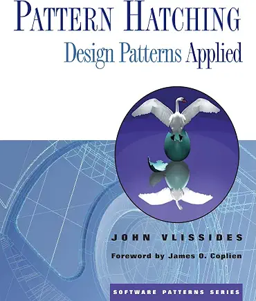

## 模式孵化：应用设计模式

 
John Vlissides · 1998

## 目录

- [序言](./foreword.md)
- [前言](./preface.md)
- [第 1 章 引言](ch1/0.md)
  - [1.1 十大误解](ch1/1.md)
  - [1.2 几点观察](ch1/2.md)
- [第 2 章 用模式做设计](ch2/0.md)
  - [2.1 基础](ch2/1.md)
  - [2.2 孤儿、收养与替身](ch2/2.md)
  - [2.3 "那替身到底归到哪一类？"](ch2/3.md)
  - [2.4 访问权](ch2/4.md)
  - [2.5 VISITOR 的告诫](ch2/5.md)
  - [2.6 单用户保护](ch2/6.md)
  - [2.7 多用户保护](ch2/7.md)
  - [2.8 收尾](ch2/8.md)
- [第 3 章 主题与变奏](ch3/0.md)
  - [3.1 杀死一只单例](ch3/1.md)
  - [3.2 OBSERVER 的麻烦](ch3/2.md)
  - [3.3 再访 VISITOR](ch3/3.md)
  - [3.4 GENERATION GAP](ch3/4.md)
  - [3.5 类型洗白](ch3/5.md)
  - [3.6 多谢内存泄漏](ch3/6.md)
  - [3.7 推我-拉你](ch3/7.md)
- [第 4 章 热爱之作](ch4/0.md)
- [第 5 章 高效模式写作者的七个习惯](ch5/0.md)
  - [5.1 习惯 1：留出反思的时间](ch5/1.md)
  - [5.2 习惯 2：遵循一套结构](ch5/2.md)
  - [5.3 习惯 3：尽早且频繁地具体化](ch5/3.md)
  - [5.4 习惯 4：保持模式互不重叠、彼此互补](ch5/4.md)
  - [5.5 习惯 5：有效地表达](ch5/5.md)
  - [5.6 习惯 6：不知疲倦地迭代](ch5/6.md)
  - [5.7 习惯 7：收集并采纳反馈](ch5/7.md)
  - [5.8 没有银弹](ch5/8.md)
- [参考书目](./biblio.md)

<!--
## 关于本译本

**底本**

- John Vlissides, *Pattern Hatching: Design Patterns Applied*, Addison-Wesley, 1998（The Software Patterns Series），ISBN 0-201-43293-5，xvi + 172 页。
- 电子底本为 Internet Archive 扫描件（带 OCR 文本层，共 196 页）。**正文：PDF 页码 = 印刷页码 + 20；前件（罗马数字页）：PDF 页码 = 印刷页码 + 2**，据此可回查原文。
- 扫描件缺页检查已做过：正文 1–172、前件 i–xvi、书目与索引均完整。
  空白页属正常排版：前件 **xii**（目录标 "Preface xii"，但 xii 是空白页，Preface 实际起于 **xiii**），正文 **12、60、122**（各章末尾）。
- 注意：OCR 文本层对**页眉、装饰性小体大写标题、图注**识别较差（如页眉 "To Kill a Singleton" 被识成 "To Killa Singleton"），引用原文时以扫描图像为准。

**文件约定**（与 [design-patterns](../design-patterns/) 译本保持一致）

- 每章一个目录 `chN/`；`0.md` 存**章首**（章题与导语），`N.md` 存该章第 N 节。
- 前件（序言、前言）、书目放在顶层：`foreword.md`、`preface.md`、`biblio.md`。
- 图片统一放 `img/`，**有图号的图直接用书中图号**：`fig-<章>-<图号>.png`（如 FIGURE 2.1 → `fig-2-1.png`）；
  **原书无编号的插图**按所在小节加字母后缀：`fig-<章>-<节><a|b>.png`（如 2.1 节的文件树示意图 → `fig-2-1a.png`）。封面为 `img/cover.webp`。
- 图注写在图片下一行的斜体里，沿用原书图号：`*图 2.1：COMPOSITE 结构*`；原书无编号的插图不加图注。
- 参考书目条目保留**英文原文**，每条带锚点，锚点名为标签小写、去掉 `+`（`BCC+96` → `id="bcc96"`）。
  章节正文引用写作 `[GoF95](../biblio.md#gof95)`（子目录文件用 `../`；同一文件内的锚点用 `[MRB98](#mrb98)`）。

**译文落笔规则**（ch1–ch5 按此执行）

- 书名、模式名保留原文：`《Design Patterns》`、`VISITOR`、`GENERATION GAP`，不译也不加注。
- 破折号统一为 `——`，**紧排、两侧不留空格**。注：`design-patterns` 译本目前多写作空格式 ` —— `（75 处）而非紧排（5 处），本书不跟随，一律紧排。
- 缩写仅在全书**首次出现**处括注一次，此后一律用缩写：`GoF（Gang of Four，四人组）`。
- 原文斜体（句内强调、被当作词谈论的术语、书名内文）一律译作 `*斜体*`。
- 用 `<ins>…</ins>` 标记**译者自选的重点句**（与原文是否强调无关）；多行重点句可用一对 `<ins>` 跨行包裹。
  两者分工：`*斜体*` 照应原文强调，`<ins>` 是译者额外加的着重标记。
- 脚注用 Unicode 上标索引，**不用** Markdown 的 `[^n]`。正文锚点紧贴标点（`……所示。²`）；
  注文另起一段，**紧随被注段落之后**（不集中到文末），写作 `²：内容`（全角冒号，冒号两侧不留空格）。
- `> 译注：……` 引用块用于译者的补充说明或小节要点，**按内容需要自行增加**，不强制每节都有；冒号后不留空格。
- 引号沿用「直引号 + 两侧留半角空格」写法（如 ` "模式" `），与 design-patterns 正文的主流写法一致（其正文直引号 812 处、弯引号 181 处）。
- 原书的分节装饰符 `❖ ❖ ❖` 写成 `
❖ ❖ ❖
`，**前后各留一个空行**；章末与章节内的话题转折处均保留，不删。
- 章、节的一级标题**只写中文，不附英文原文**（如 `# 2.1 基础`，不写 `# 2.1 基础（Fundamentals）`）。

**每章完成后的收尾动作**

- 每译完或校对完一章，同步更新 `README.md` 的「目录」：该章各条目同样**只留中文**，去掉英文括注。

**原书特殊之处**

- 第 3 章的章首与 3.1 起于同一页（p.61），`ch3/0.md` 仅含章首导语。
- 第 3 章分节与页码对照：`0.md`=p.61（章首）、`1.md`=p.61–72、`2.md`=p.72–79（p.79 上半页两段属 3.2）、`3.md`=p.79–85（p.85 上三段属 3.3）、`4.md`=p.85–101（GENERATION GAP 按模式模板分节：模式名称至相关模式）、`5.md`=p.102–110、`6.md`=p.110–114、`7.md`=p.114–121。
- 3.4 的「结构」一节带一张**无编号**结构图，按命名规则作 `img/fig-3-4a.png`；3.7 的 p.118 有**三张无编号**图，作 `img/fig-3-7a.png`、`fig-3-7b.png`、`fig-3-7c.png`，均不加图注。
- 第 4 章「热爱之作」原书**没有小节**（p.123–144，共 22 页），整章即 `ch4/0.md` 一个文件。
- 第 4 章有两张**无编号**的结构图（p.129 的 MULTICAST 结构、p.140 的 TYPED MESSAGE 结构，因本章无小节，不能按节号加后缀）：作 `img/fig-4-5.png`、`img/fig-4-6.png`，均不加图注；有编号的 FIGURE 4.1–4.4 依次为 `fig-4-1.png`–`fig-4-4.png`。
- 第 4 章 p.140 起 TYPED MESSAGE 的各字段（意图、动机、适用性、结构……）在原书中与 MULTICAST 的同名字段同级排印；中译把前者降为三级标题，以免与后者混淆。p.141–142 的「效果」「实现」各条目在原书中即以省略号收尾（作者当时未写完），照原样保留。
- 第 5 章分节与页码对照（本章节短、页界跨节）：`0.md`=p.145（章首）、`1.md`=p.146–147（p.147 前两段属习惯 1）、`2.md`=p.147–148、`3.md`=p.148–149（p.149 首段属习惯 3）、`4.md`=p.149、`5.md`=p.150、`6.md`=p.151（前两段）、`7.md`=p.151–152（p.152 首段属习惯 7）、`8.md`=p.152。
- 第 5 章无插图。
- 原书**索引**（p.157–172）按页码组织，译文页码必然失效，故暂不翻译、不设文件。
- 原书无附录；「参考书目」（p.153–156）对应 `biblio.md`。

**待定**

- 书名：暂作「模式孵化」，候选「模式孵育」「模式孕育」；定稿后需同步 `README.md` 标题行与 `foreword.md` 中"孵化的类比"一句。
- `Foreword` 的中文叫法：现作「序言」（与 design-patterns 一致），备选「推荐序」。
- 书名双关的译者注（`Pattern Hatching` ↔ `Pattern Matching`、蛋盒比喻）应放在 `ch1/0.md`（原书 p.2），不在前言。

-->
