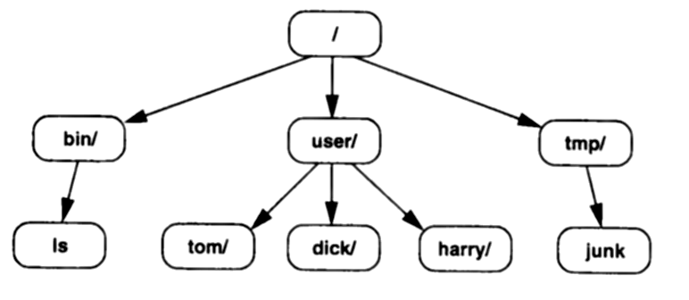
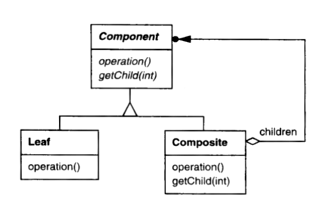

# 2.1 基础

从用户的角度看，文件系统应当能处理任意大小、任意复杂度的文件结构，不应对文件结构的宽度或深度施加人为的限制。
从程序员的角度看，文件结构的表示应当易于操作、易于扩展。

假定你要实现一个列出目录中文件的命令。
为了取得*目录*的名字而写的那段代码，不应当与为了取得*文件*的名字而写的代码有所不同——同一段代码应当对两者都管用。
换句话说，在请求名字时，你应当能把目录和文件一视同仁。
这样写出的代码更易编写、也易维护。
你还想容纳新的文件种类（比如符号链接），而又不必重写半个系统。

于是一开始就有两件事是清楚的：文件和目录是问题域中的关键元素；而且我们需要一种办法，在把设计定下来之后，还能引入这些元素的专门化版本。
一个显然的设计路子，是把这些元素表示为对象：

<br/>

这样的结构怎么实现？
既然有两类对象，那就提示我们两个类——一个给文件，一个给目录。
我们还想一视同仁地对待文件和目录，这意味着它们必须有一个公共接口。
这又意味着这些类必须派生自一个公共的（抽象）基类，我们称它为 *Node*。
最后但同样重要的是：我们知道目录要聚合文件。

这些约束基本上已经替我们把类层次定义好了：

```cpp
class Node {
public:
    // declare common interface here
protected:
    Node();
    Node(const Node&);
};

class File : public Node {
public:
    File();
    // redeclare common interface here
};
class Directory : public Node {
public:
    Directory();
    // redeclare common interface here
private:
    list<Node*> _nodes;
};
```

接下来要想的问题是：这个公共接口由什么构成？
哪些操作对文件和目录同样适用？

共同关心的属性各种各样，比如名字、大小、保护权限等等。
每个属性都可以有一组操作用来读取和修改它的值。
那些对文件和目录都有明确意义的操作，容易一视同仁地处理。
麻烦出在那些对两者似乎并不都那么清楚适用的操作上。

举例来说，用户经常做的一件事是列出目录里的文件。
这意味着 `Directory` 需要一个枚举其子节点的接口。
下面是个简单的版本，返回第 *n* 个子节点：

```cpp
virtual Node* getChild(int n);
```

`getChild` 必须返回 `Node*`，因为目录里既可能装 `File` 对象，也可能装 `Directory` 对象。
这个返回类型有个重要的后果：它迫使我们不仅在 `Directory` 类里定义 `getChild`，在 `Node` 类里也要定义。
为什么？因为我们希望能列出*子目录*的子节点。
事实上，用户常常想一路向下遍历文件系统的结构。
除非我们能对 `getChild` 返回的东西再调用 `getChild`、而且不做强制转换，否则就无法在静态类型安全的前提下办到这件事。
所以，跟那些属性操作一样，`getChild` 也是我们要一视同仁地对待的东西。

`getChild` 还是让我们能用递归方式定义 `Directory` 操作的关键。
假定 `Node` 声明一个 `size` 操作，返回该目录（子）树占用的总字节数。
`Directory` 可以把自己这个操作的版本定义成：调用各子节点的 `size` 操作，再把返回值加起来：

```cpp
long Directory::size () {
    long total = 0;
    Node* child;

    for (int i = 0; child = getChild(i); ++i) {
        total += child->size();
    }
    return total;
}
```

目录与文件正好体现了 COMPOSITE 模式的几个关键之处：它产出的树结构可以有任意复杂度，并且规定了如何一视同仁地对待这些结构中的对象。
COMPOSITE 的意图把这些关键之处又讲了一遍：

> 将对象组合成树结构以表示部分-整体层次结构。
> COMPOSITE 让客户端统一对待单个对象和对象组合。

"适用性" 一节指出，在下列情况下应当使用 COMPOSITE：

- 你想表示对象的部分-整体层次结构。
- 你希望客户端能够忽略对象组合与单个对象之间的区别。
  客户端将统一对待复合结构中的所有对象。

模式的 "结构" 一节给出的是经典 COMPOSITE 类结构的一张 OMT 改绘图。
说 *经典*，意思不过是：它表示的是我们 GoF 观察到的、最常见的类安排方式。
它不可能表示*确定的*那套类和关系，因为一旦考虑某些由设计或实现驱动的权衡，接口就可能变化。
（模式把这些权衡也讲清楚了。）

<a id="fig-2-1"></a>
<br/>
*图 2.1：COMPOSITE 结构*

图 2.1 展示了参与 COMPOSITE 的各个类及其静态关系。
Component 是抽象基类，对应于我们的 `Node` 类。
子类参与者是 Leaf（对应于 `File`）和 Composite（对应于 `Directory`）。
从 Composite 指向 Component、带箭头的连线表明：Composite 含有类型为 Component 的实例。
箭头末端的小圆点表示实例可以不止一个；如果省略圆点，那就意味着*恰好*一个实例。
箭头线根部的菱形表示：Composite 聚合了它的子实例，这暗示删除一个组合对象会连它的子节点一并删掉。
它还暗示各组件之间并不共享，从而保证了树形结构。
模式的 "参与者" 和 "协作" 两节，分别说明了这些参与者之间的静态关系与动态关系。

COMPOSITE 的 "效果" 一节总结了该模式的收益与代价。
好的一面是：COMPOSITE 支持任意复杂度的树结构。
这条性质的一个推论是：节点的复杂度对客户端隐藏了——客户端分不清自己面对的是叶节点还是组合组件，而且它也不必分清，这就使客户端代码更加独立于组件里的代码。
客户端也因此更简单，因为它可以一视同仁地对待叶节点和组合对象。
客户端再也不必根据组件的类型，在多条代码路径之间做选择。
最好的一点是：你可以新增组件类型，而不碰已有的代码。

然而 COMPOSITE 的坏处在于：它可能导致这样一个系统，其中每个对象的类看起来都跟别的对象的类一样。
显著的差别只在运行期才显现出来，而这就使代码难以理解——即便你能看到类的实现。
此外，如果把该模式用在较低的层次上，或者粒度过细，对象的数量就可能大到让人吃不消。

你可能已经猜到了，COMPOSITE 模式的实现问题一大堆。
它讨论了：

- 何时何地缓存信息以改善性能，
- Component 类应当分配多少存储，
- 用什么数据结构来存子节点，
- 添加和删除子节点的操作是否应当声明在 Component 类里，
- 以及许多别的问题。

在我们开发这个文件系统的过程中，会跟其中一些问题以及其他许多问题较较劲。
