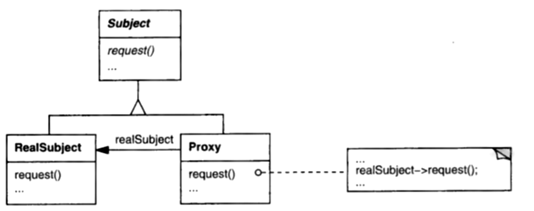

# 2.3 "那替身到底归到哪一类？"

问得好，因为现在正是该看看能不能添个新功能了——具体说，是符号链接（Mac Finder 的说法里叫 "别名"，Windows 95 里叫 "快捷方式"）。
*符号链接*基本上就是对文件系统中另一个节点的一处引用。
它是那个节点的 "替身 (surrogate)"；它不是那个节点本身。
删掉符号链接，它自己就消失了，对它所指的节点毫无影响。

符号链接有自己的访问权限，可能与该节点的权限不同。
不过，在大多数方面，符号链接的行为就跟着那个节点本身一样。
如果链接指向一个文件，客户端就可以拿链接当作那个文件来用：比如，客户端可以编辑文件，甚至可能通过链接把文件保存下来。
如果链接指向一个目录，客户端只要对链接执行操作，就能往这个目录里添加或删除节点，就好像链接就是目录本身一样。

符号链接很方便。
你不必移动或复制，就能访问远在天边的文件和目录；对于必须待在一处、却要在另一处派用场的节点，这再合适不过。
要是我们的设计不支持符号链接，那可就说不过去了。

于是，一个花大价钱买了《Design Patterns》的人该问的第一个问题是：有没有一个模式能帮我设计和实现符号链接？
其实还有个更大的问题：我怎样为手头的任务找到合适的模式？

《Design Patterns》的 1.7 节建议了下面六种做法：

1. 想一想设计模式是如何解决设计问题的。（换句话说，去研读 1.6 节。可你和我都清楚，在开发的火头上，我们真会去研读的几率有多大。）
2. 扫一遍各模式的 "意图" 一节，看有没有听起来对路的。（有点蛮干。）
3. 研究模式之间如何相互关联。（这活儿在此处对我们还是太重，但总算越来越靠谱了。）
4. 看那些目的（创建型、结构型、行为型）与你打算做的事相对应的模式。（嗯，给文件系统加符号链接，听上去是个结构型的目的。）
5. 考察一个相关的 "导致重新设计的原因"（列在《Design Patterns》从第 24 页开始的地方），然后应用那些帮你避开它的模式。（既然我们连*设计*都还没有，谈*重新设计*似乎早了点。）
6. 想想你的设计里哪些东西应当是可变的。对每个设计模式，《Design Patterns》第 30 页的表 1.2 都列出了一个或多个该模式允许你改变的设计侧面。

我们就顺着最后一条走。
看看表 1.2 里的结构型模式，会发现：

- ADAPTER 让你改变对象对外的接口。
- BRIDGE 让你改变对象的实现。
- COMPOSITE 让你改变对象的结构与构成。
- DECORATOR 让你在不用子类化的前提下改变对象的职责。
- FACADE 让你改变一个子系统对外的接口。
- FLYWEIGHT 让你改变对象的存储开销。
- PROXY 让你改变访问对象的方式，和/或对象的位置。

也许我有偏见，但听起来 [PROXY](../../design-patterns/ch4/7.md) 就是我们要找的那个模式。
翻到那里，我们看到这样的意图：

> 为另一个对象提供一个代理或占位符，以控制对它的访问。

模式的 "动机" 一节把这个模式用到了图像延迟加载的问题上（比如，跟你在 Web 浏览器里想要的效果差不多）。

但最终敲定这件事的是 "适用性" 一节。
它说，只要你需要对一个对象使用比简单指针更多功能、更精巧的引用，就可以用 PROXY。
接着它列出了适用的几种常见情形，其中就有一种控制对另一对象之访问的 "保护代理" ——正是我们要的东西。

好，那怎么把 PROXY 用到我们的文件系统设计上？
看该模式的结构图（图 2.2），你会看到三个关键类：抽象的 Subject 类、具体的 RealSubject 子类，以及另一个具体的 Proxy 子类。
由此我们可以推断：Subject、RealSubject 和 Proxy 三者的接口是相容的。
Proxy 子类还含有对 RealSubject 的引用。
模式的 "参与者" 一节解释说，Proxy 类提供与 Subject 完全相同的接口，这就使 Proxy 对象可以顶替任何 subject。
再者，RealSubject 就是代理所代表的那个对象的类型。

<br/>
*图 2.2：PROXY 结构*

把这些关系映射回我们的文件系统类，很清楚：我们要遵循的公共接口就是 `Node` 的。
（毕竟，这正是 COMPOSITE 模式教给我们的。）
这就提示 `Node` 类在模式里扮演 Subject 的角色。

接下来我们需要定义一个 `Node` 子类，对应模式里的 Proxy 类。我把它叫作 *Link*：

```cpp
class Link : public Node {
public:
    Link(Node*);
    // redeclare common Node interface here
private:
    Node* _subject;
};
```

`_subject` 成员提供对真实 subject 的引用。
但看起来我们跟模式的结构图有点偏离：那张图里，引用的类型是 RealSubject。
在我们的情形里，那就该对应类型为 `File` 或 `Directory` 的引用；可我们想让符号链接对这两种 `Node` 都能用。怎么办？

如果你去读模式里对 Proxy 这个参与者的描述，会发现这么几句：

> Proxy 维护一个引用，使代理能访问真实的 subject。
> 当 RealSubject 与 Subject 的接口相同时，Proxy 可以引用 Subject。

结合我们到目前为止谈的一切，`File` 与 `Directory` 确实共享 `Node` 接口。
因此 `_subject` 是一个指向 `Node` 的指针。
要是没有公共接口，要定义一个对文件和目录都管用的符号链接会难得多。
事实上，你多半会落到定义两种行为完全相同、只是其一给文件、其二给目录的符号链接。

要处理的最后一个大问题是：`Link` 如何实现 `Node` 接口。
粗略来看，它只是把每个操作委托给 `_subject` 上对应的操作。
`getChild` 的委托可能像这样：

```cpp
Node* Link::getChild (int n) {
    return _subject->getChild(n);
}
```

某些情况下，`Link` 也可能表现出独立于其 subject 的行为。
比如，`Link` 可能定义自己的保护权限操作，那样的话它可以像 `File` 那样实现这些操作。

<p align="center">❖ ❖ ❖</p>

Laurion Burchall 对这个应用里的 PROXY 模式有一些很敏锐的观察 [Burchall95](../biblio.md#burchall95)：

> 如果某个文件被删除，指向它的那些代理就成了悬空指针。
> 可以用 OBSERVER 模式在文件被删除时通知所有代理，但这样我们仍然无法把新文件搬到旧文件原来的位置上、同时让符号链接照常工作。
> <br/><br/>
> 在 UNIX 和 Mac 里，符号链接保存的是它所引用的文件的实际名字，而不是更实在的东西。
> 代理可以保存文件名，再加一个对文件系统根节点的引用。
> 不过，这会让通过代理访问文件变得昂贵，因为每次都得做一次名字查找。

这些话全都站得住——除了关于 OBSERVER 的那部分。
当代理所指的文件被替换时，没有理由说代理不能被通知、不能被重新挂接。
在这方面，替换与删除是类似的。

但 Laurion 的意见很中肯：只保留一个指向 subject 的指针虽然高效，若不加上别的机制，确实很可能不能令人满意。
要在替换 subject 的同时不让指向它的链接失效，就需要一层我们目前没有的间接。
改存文件名而不是指针能行得通，但可能得配上某种关联存储，以便高效地把名字映射回对象。
即便那样，比起存指针仍有额外开销；不过，除非有链接指向太多文件，或者链接的层数太多，这应当不成问题。
当然，每当文件被删除或替换，这个关联存储也得跟着更新。

<ins>我倾向于让常见情形变快，代价由不常见的情形承担。</ins>
如果通过链接访问文件比替换或删除文件更常见——我猜确实如此——那么基于 OBSERVER 的做法就优于名字查找。

<p align="center">❖ ❖ ❖</p>

像这样的设计在演化过程中，有一件事要当心：人们倾向于把基类当作垃圾场——随着时间推移，操作越积越多，它的接口也就越长。
每加一个新文件系统特性，就添上一两个操作。
今天是支持扩展属性；下周是计算一种新的大小统计；下个月是一个为图形用户界面返回图标的操作。
用不了多久，`Node` 就成了一个庞然大物——难以理解、难以维护、难以子类化。

接下来我就处理这个问题。
我们要看一种办法：完全不修改已有的类，就能给设计添加新操作。
