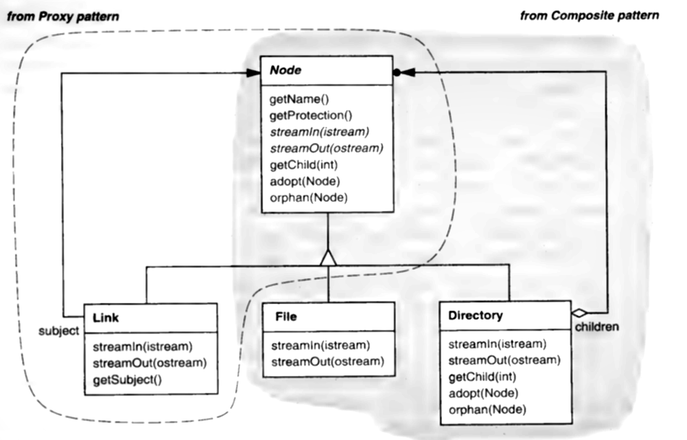

# 2.4 访问权

到目前为止我们用了两个设计模式：用 COMPOSITE 定义文件系统的结构，PROXY 则向我们展示了如何支持符号链接。
把到目前为止讨论的改动、再加上另外几处细节改进一并纳入，就得到图 2.3 所示的类层次。

<a id="fig-2-3"></a>

<br/>
*图 2.3：体现 COMPOSITE 与 PROXY 的类结构*

`getName` 和 `getProtection` 返回节点相应的属性。
`Node` 基类为这些操作给出了默认实现。
`streamIn` 和 `streamOut` 是把节点内容流进、流出文件系统的操作（我们假定文件就像 UNIX 里那样，建模为简单的字节流）。
`streamIn` 和 `streamOut` 是*抽象*操作，意思是基类只声明、未必实现它们，因此它们的名字在图中用斜体排印。
`getChild`、`adopt` 和 `orphan` 都有默认实现，这让定义叶组件稍微轻松一点。

说到叶组件，回想一下：`Node`、`File`、`Directory` 三个类来自 COMPOSITE。
PROXY 贡献了 `Link` 类，并且规定了 `Node` 类——这个我们本来就有的类。
结果，`Node` 类成了两个模式之间的某种枢纽：在 COMPOSITE 模式里它是 Component，在 PROXY 模式里它是 Subject。
这种双重身份，正是 Alexander 所说的模式 "稠密" 组合的标志——两个或更多模式占据系统里同一片类的 "空间"。

稠密有它的好处，也有坏处。
让多个模式共居于相对少的类里，会给设计带来某种深刻性：大量意义被压缩在很小的空间里，颇像好诗。
另一方面，这种稠密也可能让人联想到不那么高明的做法。
Richard Gabriel 是这么说的 [Gabriel95](../biblio.md#gabriel95)：

> 软件里的 [Alexandrian 式稠密] 至少部分对应于被高度榨干 (bummed) 的代码——那种每一部分都不止干一件事的代码。
> 就像你初稿写出来、体积是所需内存的两三倍时得到的代码，就像我们六十、七十年代不得不用汇编写的那种代码。

说得好——"深刻" 的代码未必就是好代码。
事实上，Richard 的担忧只是一个更大问题的症状：模式在实现之后可能会弄丢。
这里可谈的很多，但只好先搁下——我们的文件系统在召唤！

<p align="center">❖ ❖ ❖</p>

在一个操作系统里，绝大多数用户级命令都以某种方式跟文件系统打交道。
这也难怪：文件系统*正是*计算机里存放信息的仓库。
这么核心的部件，随着操作系统演化，注定会催生新的功能。

我们到目前为止定义的类，提供了一点点功能。
具体说，`Node` 类的接口只涵盖少数几个根本的操作，而所有 `Node` 子类都支持它们。
这些操作之所以根本，是因为它们让你取到只有节点才能提供的信息与行为。

自然，你还会想在这些类上做些别的操作。
考虑一个统计文件里词数的操作。
一旦意识到我们需要这么个东西，我们可能就忍不住往 `Node` 基类里加一个 "getWordCount" 操作。
而那可是件坏事，因为到头来我们至少要改动 `File` 类，很可能还要改动其他每一个类。
我们*真的非常*想避免修改（读作 "往里面加 bug"）已有的代码。
不过，这事不必惊慌：基类里已经有流操作，文件系统的客户端可以用它们来检查文件里的文本。
我们之所以用不着改动已有代码，是因为客户端可以借助现有的操作来实现词数统计。

<ins>其实我要断言：设计 `Node` 接口时的首要挑战，是想出一组最小的操作，好让客户端能在此基础上搭出开放式的功能。</ins>
另一条路——每添一个新能力就在 `Node` 及其子类上动一次手术——既具侵入性，又容易出错。
它还会让 `Node` 的接口演化成一个大杂烩，最终把节点对象的本质属性埋没掉。
这些类会变得难懂、难扩展、难用。
<ins>所以，专注找出一组足够的原语，才是定义一个简单、连贯的 `Node` 接口的关键。</ins>

可是，那些在不同种类的节点上应当表现不同的操作又怎么办——你怎样才能把它们挪到 `Node` 类之外？
以 UNIX 的 `cat` 命令为例：它只是把文件内容打印到标准输出。
但把它用在目录上时，它会报告该节点无法打印，这大概是因为目录的文本表示看上去不那么中看。

既然 `cat` 的行为取决于节点的类型，看起来就不得不定义一个由 `File` 和 `Directory` 各自做不同实现的基类操作。
于是说到底，我们还是改动了已有的类。

有没有别的办法？
假定我们坚持把这个功能从 `Node` 类里拿出来、放进某个客户端。
那么看来别无选择，只能引入某种向下强制转换，让客户端弄清自己面对的是哪种节点：

```cpp
void Client::cat (Node* node) {
    Link* l;

    if (dynamic_cast<File*>(node)) {
        node->streamOut(cout);   // stream out contents
    } else if (dynamic_cast<Directory*>(node)) {
        cerr << "Can't cat a directory." << endl;
    } else if (l = dynamic_cast<Link*>(node)) {
        cat(l->getSubject());    // cat the link's subject
    }
}
```

又一次，向下转换似乎躲不掉。
而且又一次，它使客户端更复杂了。
诚然，我们有意识地要把功能放进客户端、而不是 `Node` 类里。
可除了功能本身，我们还额外加进了类型测试和条件分支——这就等于多了一层方法分派。

如果嫌把功能放进节点本身不体面，那么求助于向下转换似乎就更不像话。
不过在轻率地把 `cat()` 操作硬塞进 `Node` 及其子类、好躲开向下转换之前，我们先来看看 [VISITOR](../../design-patterns/ch5/11.md) ——一个提供第三种选择的设计模式。
它的意图是这样说的：

> 表示一个作用于某对象结构中各个元素上的操作。
> VISITOR 让你能够定义一个新操作，而不必更改这些元素所属的类。

模式的 "动机" 一节讲的是一个把程序表示为抽象语法树的编译器。
那里的问题在于：要支持一套开放式的分析，比如类型检查、美化打印、代码生成，同时又不改动实现抽象语法树的那些类。
那个编译器的问题与我们这个问题类似，区别只在于我们操作的是文件系统结构而非抽象语法树；而且我们想在结构上做的事也大不相同。
（话又说回来，美化打印一个目录结构，也许并不那么离谱。）
无论如何，操作本身其实无关紧要。
<ins>真正要紧的是：把这些操作从 `Node` 类里分出去，而又不借助向下转换和多出来的控制路径。</ins>

VISITOR 做到这一点的办法，只给它所谓的 "Element" 参与者加了一个操作——在我们的语境里，就是 `Node` 类：

```cpp
virtual void accept(Visitor&) = 0;
```

`accept` 让一个 "Visitor" 对象去访问某个节点。
Visitor 对象把要施加在该节点上的操作封装起来。
所有具体的 Element 子类都以同样简单的方式实现 `accept`：

```cpp
void File::accept (Visitor& v)      { v.visit(this); }
void Directory::accept (Visitor& v) { v.visit(this); }
void Link::accept (Visitor& v)      { v.visit(this); }
```

这些实现看上去一模一样，但它们当然截然不同——每种情形里 `this` 的类型都不同。
从这些实现可以推想，Visitor 接口大致是这样：

```cpp
class Visitor {
public:
    Visitor();

    void visit(File*);
    void visit(Directory*);
    void visit(Link*);
};
```

此处的有趣之处在于：当一个节点的 `accept` 操作调用 Visitor 对象上的 `visit` 时，这个节点实际上向 Visitor 挑明了自己的类型。
反过来，被调用的那个 Visitor 操作，就可以针对该类型的节点做任何合适的事：

```cpp
void Visitor::visit (File* f) {
    f->streamOut(cout);
}

void Visitor::visit (Directory* d) {
    cerr << "Can't cat a directory." << endl;
}

void Visitor::visit (Link* l) {
    l->getSubject()->accept(*this);
}
```

最后一个操作值得解释一下。
它调用 `getSubject()`，返回链接所指的那个节点——也就是它的 subject。³
我们不能简单地叫 subject 把自己流出来，因为它可能是个目录。
于是我们叫它接受这个 visitor，就像我们对链接本身所做的那样。
这就让 visitor 能按 subject 的类型行事。
visitor 就这样一层层顺着链接走下去，直到抵达一个文件或一个目录，在那儿它终于能做点有用的事。

³：`getSubject()` 是 `Link` 类特有的；只有 `Link` 类声明并实现了它。所以当我们把链接当作节点来对待时，就访问不到那个操作。但用 Visitor 时这不是问题——它在访问节点时，实际上把类型信息又找回来了。

现在，我们只要创建一个 visitor、再叫节点接受它，就能 `cat` 任何节点：

```cpp
Visitor cat;
node->accept(cat);
```

节点对 visitor 的这次回调，会落到与该节点实际类型（`File`、`Directory` 或 `Link`）相对应的那个 `visit` 操作上，从而做出恰当的反应。
归根结底，这个 Visitor 能把 `cat` 命令这样的功能打包进单独一个类，而不必求助于类型测试。

把 `cat` 操作封装进 Visitor 挺漂亮，可是看起来，只要我们想做点 `cat` 文件之外的事，还是得改动已有的代码。
假定我们想实现另一个命令，列出目录中各个子节点的名字，就像 UNIX 的 `ls` 命令那样。
而且，输出的名字后面还该带上后缀：如果该节点是目录，就加一个斜杠（`/`）；如果它是符号链接，就加一个 at 号（`@`）。

我们需要再给一个类以访问 `Node` 的 "访问权"，可我们不想再往 `Node` 基类里添一个 `accept` 操作。
而我们也不必那么做。
任何 `Node` 对象都能接受任何类型的 Visitor 对象。
只不过眼下我们只有一种 Visitor。
而在 VISITOR 模式里，Visitor 其实是个抽象类：

```cpp
class Visitor {
public:
    virtual ~Visitor() { }

    virtual void visit(File*) = 0;
    virtual void visit(Directory*) = 0;
    virtual void visit(Link*) = 0;

protected:
    Visitor();
    Visitor(const Visitor&);
};
```

每加一个新能力，你就派生出 Visitor 的一个子类，针对每一种可能被访问的节点把各 `visit` 操作实现得当。
比如 `CatVisitor` 子类，就照原样实现那些操作。
我们还可以定义一个 `SuffixPrinterVisitor`，为节点打印恰当的后缀：

```cpp
class SuffixPrinterVisitor : public Visitor {
public:
    SuffixPrinterVisitor() { }
    virtual ~SuffixPrinterVisitor() { }

    virtual void visit(File*)      { }
    virtual void visit(Directory*) { cout << "/"; }
    virtual void visit(Link*)      { cout << "@"; }
};
```

我们可以在实现 `ls` 命令的客户端里使用 `SuffixPrinterVisitor`：

```cpp
void Client::ls (Node* n) {
    SuffixPrinterVisitor suffixPrinter;
    Node* child;

    for (int i = 0; child = n->getChild(i); ++i) {
        cout << child->getName();
        child->accept(suffixPrinter);
        cout << endl;
    }
}
```

一旦我们通过给 `Node` 类加上 `accept(Visitor&)` 确立了访问权，此后无论定义多少 Visitor 子类，都不必再改动那些类。

我们用的是函数重载，让 Visitor 的各个操作同名。
另一种做法是把节点类型编进 `visit` 操作的名字里：

```cpp
class Visitor {
public:
    virtual ~Visitor() { }

    virtual void visitFile(File*) = 0;
    virtual void visitDirectory(Directory*) = 0;
    virtual void visitLink(Link*) = 0;

protected:
    Visitor();
    Visitor(const Visitor&);
};
```

对这些操作的调用会稍微清楚一点，代价是更啰嗦：

```cpp
void File::accept (Visitor& v) { v.visitFile(this); }

void Directory::accept (Visitor& v) {
    v.visitDirectory(this);
}

void Link::accept (Visitor& v) { v.visitLink(this); }
```

更实在的好处，出现在有合理的默认行为、而子类往往只覆写其中少数操作的时候。
用重载时，子类必须覆写*全部*函数；否则你那友好的 C++ 编译器多半会抱怨：你这选择性的覆写把基类的某个操作给藏起来了。
给 Visitor 的各操作起不同的名字，就能绕开这个问题。
子类于是可以放心大胆地只重定义其中一部分操作。

基类的这些操作可以为每种节点类型实现默认行为。
当默认行为对两种或更多类型通用时，我们可以把共有功能放进一个 "兜底" 的 `visitNode(Node*)` 操作，让其他操作默认调用它：

```cpp
void Visitor::visitNode (Node* n) {
    // common default behavior
}

void Visitor::visitFile (File* f) {
    Visitor::visitNode(f);
}

void Visitor::visitDirectory (Directory* d) {
    Visitor::visitNode(d);
}

void Visitor::visitLink (Link* l) {
    Visitor::visitNode(l);
}
```
