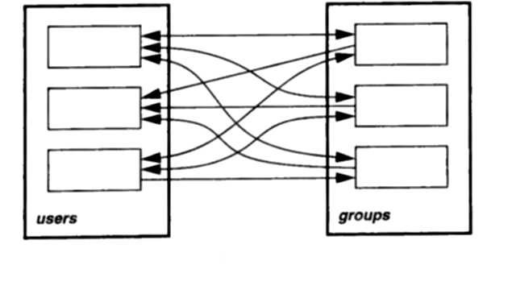
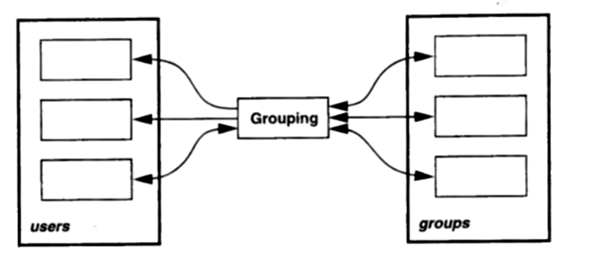

# 2.7 多用户保护

我们已经看过如何给这个演化中的文件系统设计加上简单的单用户保护。
我答应过要把这个概念扩展到多用户环境——也就是用户们共享同一个文件系统的情形。
如今多用户能力已是必不可少：无论你身处传统的、文件系统集中式的时间共享系统，还是身处更当代的网络文件系统。
就连当初按单用户环境设计的个人计算机操作系统（比如 OS/2 和 Windows NT），现在也支持多用户了。
不论在哪种语境下，多用户支持都给保护问题添了一个新的维度。

我还是走阻力最小的设计路线：参照一套现成的方案来塑造我们的多用户保护机制，也就是 UNIX 的那套。
UNIX 文件系统里的节点与某个 "用户" 相关联。
默认情况下，节点的用户就是创建它的人。
从节点的角度看，这种关联把所有用户分成两个阵营：该节点的用户，以及其余所有人。
UNIX 对 "其余所有人" 的正式叫法（有时颇为别扭）是 *other*。⁷

⁷：UNIX 行家会立刻指出还有第三个阵营："group"（用户组）。我们稍后再考虑它。

把节点的用户与其他人区分开，就能给每一方设定独立的保护级别。
比如，一个文件可以只让它的用户读、别人一概不许；这时我们说该文件 "对用户可读"，但 "对其他人不可读"。
可写性，以及我们可能提供的其他任何保护模式（比如可执行、自动归档等等），做法都类似。

用户必须有一个*登录名*，它既向系统、也向其他用户唯一地标识一个用户。
对系统而言，"用户" 与 "登录名" 不可分割，尽管现实中一个人可能拥有多个登录名。
要紧的是：一个人不能把自己与任何不属于他的登录名关联起来（假定他有一个自己的）。
这就是为什么登录 UNIX 系统时，你不仅要提供登录名，还得提供验证你身份的密码。
这个过程叫*鉴别*（authentication）。
UNIX 花大力气防范冒名顶替，因为冒充者能访问合法用户能访问的一切。

好，该具体一点了。我们怎样给用户建模？
作为面向对象的人，答案很明显：用一个对象。
对象有类，于是我们定义 `User` 类。

接下来要考虑 `User` 类的接口。
客户端到底能用 `User` 对象做什么？
其实在这个阶段，更要紧的是客户端*不能*用它做什么。
具体说，不能允许客户端随意创建 `User` 对象。

要弄清为什么，先假定 `User` 对象与登录名一一对应。
（二者在概念上不可分割，也没有明确的需要允许同一个登录名有多个 `User` 对象。）
再假定 `User` 对象永远关联着一个合法的登录名。
这是合理的，因为从系统的角度看，一个没有登录名的用户讲不通。
最后但同样重要的是：不能让客户端在既不提供登录名、*又不*提供密码的情况下实例化用户。
否则，一个胡作非为的应用只要用合适的登录名实例化 `User` 对象，就能访问敏感的文件和目录。

`User` 对象的存在本身就代表一个鉴别单元。
那么很清楚，`User` 的实例化必须是一个小心受控的过程。
如果应用给出的是非法的登录名或密码，这次实例化就该失败。
而且失败时不该留下半生不熟的 `User` 对象——也就是因为缺少必需信息而生来就不管用的 `User` 对象。
这就基本上排除了用常规的 C++ 构造函数来实例化用户。

我们需要一种安全的方式来创建 `User` 对象，而又不把构造函数暴露在客户端接口里。
说*安全*，我的意思是：客户端不该有任何办法非法地实例化 `User` 对象。
这种安全，用面向对象的说法怎么表达？

想想面向对象的三个基本概念：继承、封装、多态。
与安全关系最大的，大概要算封装。
*封装*实际上就是一种安全机制。
按定义，被封装的代码与数据保证客户端访问不到。⁸
那么在这个例子里，我们要封装的究竟是什么？
嘿，正是整个鉴别过程——它始于用户输入，终于 `User` 对象的创建。

⁸：Doug Schmidt 正确地指出，这样的定义在 C++ 里很难强制实施 [Schmidt96a](../biblio.md#schmidt96a)。比如，只要用 `#define private public`，就能把所有私有成员变成公有的。避免这类颠覆的一个办法是：根本不在头文件里声明成员变量，而是把它们连同其他敏感的、不宜示人的实现细节一起，声明在单独的、不对外发布的头文件里。这里一个高度相关的模式是 BRIDGE；不过套用 Fermat 的话说，这里的证明太长，放不进这条脚注。

我们已经锁定了问题。
现在得找出解法，并用对象把它表达出来。
也许该去看看模式了。

到这一步，我得承认：在选择模式这件事上，我们手头的指引不多。
但我们确实知道，对象的创建在这里很吃重，封装也一样。
为了缩小搜索范围，回想一下《Design Patterns》里的模式是按三种目的分组的：创建型、结构型、行为型。
三者之中，与这里最相关的看来是创建型：ABSTRACT FACTORY、BUILDER、FACTORY METHOD、PROTOTYPE 和 SINGLETON。
既然只有五个，我们不妨一个个快速看过去，判断有没有哪个合适。

ABSTRACT FACTORY 着眼于在不指明具体类的前提下创建一族对象。
这挺好，可我们的设计问题里没有对象 "族" 这个概念，而且我们并不反对实例化某个具体类——也就是 `User`。
所以 ABSTRACT FACTORY 出局。
接下来是 BUILDER，它关心的是创建复杂对象：让你用同一套多步过程构造出表示各不相同的对象……这也不太沾边。
FACTORY METHOD 的意图与 ABSTRACT FACTORY 类似，只是不强调 "族"，所以它只是稍微不那么不相干而已。

那 PROTOTYPE 呢？
它把要实例化的对象种类参数化。
你不必写代码去对某个类名调用 `new`（类名在运行期改不了），而是对一个原型实例调用拷贝操作（原型实例在运行期可以替换）。
想改实例化出来的对象类，换个原型实例就是了。

可这也不对。
我们关心的不是改变*实例化什么*，而是要控制客户端*怎样*实例化 `User` 对象。
因为谁都能拷贝原型实例，跟一个老老实实的构造函数相比，我们得到的控制力少得可怜。
何况，让一个原型 `User` 对象搁在那儿，本身就危害了我们的鉴别模型。

那就只剩 [SINGLETON](../../design-patterns/ch3/5.md) 了。
它的意图是确保一个类只有一个实例，并为该实例提供一个全局访问点。
该模式要求有一个无参数的静态成员函数，名叫 *Instance*，返回该类唯一的实例。
所有构造函数都受保护，免得客户端直接使用它们。

乍看之下，这似乎同样不合适——一个程序可能需要不止一个 `User` 对象，对吧？
可尽管我们不想把实例数目限制为只有一个，我们确实想禁止*每个用户*有不止一个实例。
这两种情况其实都是在限制实例的数目。

所以 SINGLETON 也许终究还是适用的。
再仔细看看 SINGLETON 的 "效果" 一节，我们会发现：

> [SINGLETON] 允许实例数目可变。
> 该模式让你改变主意、允许多个 Singleton 类的实例，变得很容易。
> 此外，你可以用同样的做法来控制应用所用实例的数目。
> 需要改变的，只是那个授予 Singleton 实例访问权的 [*Instance*] 操作。

这就对了！
在我们这个模式的变体里，我们可以把 *Instance* 操作改名为 "logIn"，并给它加上两个参数：

```cpp
static const User* User::logIn(
    const string& loginName, const string& password
);
```

`logIn` 确保每个登录名只创建一个实例。
为此，`User` 类可以维护一张私有的静态散列表，以登录名为索引存放 `User` 对象。
`logIn` 在表里查 `loginName` 参数：若找到对应的 `User` 条目，就返回它；否则 `logIn` 做下面这些事：

1. 创建一个新的 `User` 对象，用密码对它做鉴别。
2. 把这个 `User` 对象登记进散列表，供日后访问。
3. 返回这个 `User` 对象。

下面是 `User::logIn` 性质的汇总：

- 它是全局可访问的。
- 它阻止每个登录名有不止一个 `User` 对象被实例化。
- 与构造函数不同，登录名或密码任一无效时，它可以返回 `0`。
- 应用无法通过子类化 `User` 来改变 `logIn`。

不可否认，这是 SINGLETON 的一个不那么正统的用法。
客户端可以创建不止一个 `User` 实例这件事，意味着我们并没有逐字遵循该模式的意图。
何况，模式的 "实现" 一节花了大量篇幅讨论如何子类化 Singleton 类——而这恰恰是我们在这个应用里*绝对不*想允许的。⁹

⁹：要禁止子类化 `User`，只要把它的构造函数声明为私有即可。

不过，我们确实在控制实例的数目，而 SINGLETON 给出了基本的做法。
要知道，模式并不是用来称王称霸的。
好的模式不止于描述某个问题的解法；它还会给你洞见与理解，让你能把解法裁剪到自己的情形上。

不过 SINGLETON 并没有把话说尽。
比如，既然我们有了 `logIn` 操作，那按理说也该有个相应的 "logOut" 操作，把用户从系统上注销。
`logOut` 引出了 Singleton 对象内存管理方面的一些重要问题——而 SINGLETON 对这些问题的沉默颇堪玩味。
我会在第 3 章展开这些话题。

<p align="center">❖ ❖ ❖</p>

下一个问题：客户端怎样 "使用" 一个用户——可以这么说？
为了弄清这一点，我们考虑几个用例。

第一个，考虑登录过程。
假定有一个登录程序，当用户想访问系统（至少是系统受保护的部分）时就会运行它。
登录程序会调用 `User::logIn` 取得一个 `User` 对象。
然后这个程序设法让别的应用也能用上该对象，这样用户就不必反复登录。

第二个，想想一个应用怎样访问几天前由登录名为 "johnny" 的人创建的一个文件。
假定这个应用的用户登录名是 "mom"，而该文件对用户可读、对其他人不可读。
那么就不该允许 "mom" 访问这个文件。
在单用户系统里，应用会调用文件的 `streamOut` 操作、并提供一个流，来请求文件内容：

```cpp
void streamOut(ostream&);
```

理想情况下，我们希望多用户情形下的调用看起来一模一样，可我们缺一个引用，指向正在访问该文件的那个用户。
没有这个引用，就无从确保该用户拥有访问权限。
这个引用要么作为参数显式提供……

```cpp
void streamOut(ostream&, const User*);
```

……要么通过登录过程隐式确立。
常见情形下，应用在整个生命周期里都只代表唯一一个用户行事，这时每次都把 `User` 对象当参数传来传去，纯属添乱。
不过，一个协作型的应用也可能合法地、也说得通地让多个用户同时访问。
在那种情形下，每个操作都指明用户就成了必需。

所以，`Node` 接口里的每个操作都需要加一个 `const User*` 参数——但不该*强迫*客户端提供它。
默认参数给了我们从容二选一的灵活性：

```cpp
const string& getName(const User* = 0);
const Protection& getProtection(const User* = 0);

void setName(const string&, const User* = 0);
void setProtection(const Protection&, const User* = 0);

void streamIn(istream&, const User* = 0);
void streamOut(ostream&, const User* = 0);

Node* getChild(int, const User* = 0);

void adopt(Node*, const User* = 0);
void orphan(Node*, const User* = 0);
```

在用户隐式的常见情形里，我们需要一个全局可访问的操作，来取回那个唯一的 `User` 实例。
这就等于一个 Singleton——不过为了灵活，我们应当让 Singleton 实例可由应用设定。
于是我们不用单个静态的 `User::instance` 操作，而用一对静态的 get 与 set 操作：

```cpp
static const User* User::getUser();
static void User::setUser(const User*);
```

`setUser` 让应用把隐式用户设为它取得的任何一个 `const User*`——想必是通过合法途径取得的。
现在登录程序就可以调用 `setUser`，设定其他应用应当使用的全局 `User` 实例：¹⁰

```cpp
extern const int maxTries;
// ...
const User* user = 0;

for (int i = 0; i < maxTries; ++i) {
    if (user = User::logIn(loginName, password)) {
        break;
    } else {
        cerr << "Log-in invalid!" << endl;
    }
}

if (user) {
    User::setUser(user);
} else {
    // too many unsuccessful log-in attempts;
    // lock this login name out!
    // ...
}
```

¹⁰：这意味着 `User` 对象存于共享内存，或者能以别的方式在程序之间传递。这确实是个重要细节，但实现它既不影响我们已定义的接口，也不影响我们的做法。

到这里一切都还直截了当。
但我一直在回避一个基本问题：这一切如何影响 `streamOut` 以及 `Node` 接口里其他模板方法的实现？
更尖锐地说，*它们*怎样使用 `User` 对象？

与单用户设计相比，关键差别不在模板方法本身，而在那些返回布尔值的原语操作上。
比如，`streamOut` 变成：

```cpp
void Node::streamOut (ostream& out, const User* u) {
    User* user = u ? u : User::getUser();

    if (isReadableBy(user)) {
        doStreamOut(out);

    } else {
        doWarning(unreadableWarning);
    }
}
```

第二行有个明显的差别：局部变量 `user` 被初始化为传进来的用户，若没传，就初始化为那个单例 `User` 对象。
但更醒目的是第三行的差别：`isReadableBy` 取代了 `isReadable`。
`isReadableBy` 根据节点里存放的信息，检查该节点是对用户可读、还是对其他人可读。

```cpp
bool Node::isReadableBy (const User* user) {
    bool isOwner = user->getLoginName() == getOwner();

    return
        isOwner && isUserReadable() ||
        !isOwner && isOtherReadable();
}
```

`isReadableBy` 显露出两项需求：一是 `User::getLoginName`——返回与 `User` 对象关联的登录名；二是一个取回节点所有者登录名的接口：

```cpp
const string& Node::getOwner();
```

`Node` 还需要 `isUserReadable`、`isOtherReadable` 这样的原语操作，就用户与其他人两方，提供关于可读性、可写性的更细信息。
`Node` 基类可以把这些操作实现为对标志位的访问器（标志位存在实例变量里），也可以把存储上的具体做法留给子类。

<p align="center">❖ ❖ ❖</p>

细节，细节。
眼下这些细节已经够了。
我们跳回设计层面，好不好？

你记得我们把世界分成了两个阵营——用户与其他人。
可这种划分有时太一刀切了。
比如，你正和同事一起做一个项目，那多半你会想访问彼此的文件。
同时你也可能想防着组外那些爱窥探的眼睛。
这也是 UNIX 提供第三个保护阵营的原因：用户组。
*用户组*是一组有名字的登录名。
让节点对组可读或可写，能让你对访问权限有更细的控制——而这种控制恰好贴合协作式的工作环境。

要往设计里加进 "组" 这个概念，需要做些什么？
关于组，我们知道两件事：

1. 组有零个或多个用户。
2. 一个用户可以是零个或多个组的成员。

第 2 条意味着引用而非聚合：删除一个组，不会删除构成它的用户。

听我谈组谈到现在这个地步，它们简直就是在央求着被表示为一等公民的对象。
问题是：我们这是要另起一套新的类层次，还是干脆扩展现有的某一套？

我认为，唯一说得过去的扩展候选者是 `User` 类。
另一个方案是把 `Group` 类定义成一种 `Node`，那既无益也无意义。
那就来看看 `Group` 与 `User` 之间的继承关系能给我们带来什么。

我们已经熟悉 COMPOSITE 模式了。
它描述的是 Leaf 节点（比如 `File`）与 Composite 节点（比如 `Directory`）之间的递归关系。
它给二者相同的接口，好让我们一视同仁地对待它们、并按层次把它们组合起来。
也许我们想要的正是用户与组之间的 COMPOSITE 关系：`User` 作 Leaf 类，`Group` 作 Composite 类。

再来看 COMPOSITE 的 "适用性" 一节。
它说，在下列情况下适用该模式：

- 你想表示对象的部分-整体层次结构。
- 你想让客户端忽略对象组合与单个对象之间的区别。
  客户端将统一对待复合结构中的所有对象。

按这些标准，我们可以放心地说：这个模式在这里*不*适用。理由如下：

- 这个关系不是递归的。
  UNIX 文件系统不允许组里再有组、一层层套下去，等等，所以我们没有这种能力上的需求。
  仅仅因为模式规定了递归关系，并不意味着我们的应用就需要它。
- 一个用户可能属于多个组，因此这个关系不是严格的层次结构。
- 一视同仁地对待用户与组，价值可疑。
  把 "一个组" 登录进来、或者把它传来传去用于鉴别，是什么意思？

这些理由都反对 `User` 与 `Group` 之间的 COMPOSITE 关系。
但我们依然需要用户与组之间的关联，因为系统得记住哪些用户在哪些组里。

事实上，为了性能最大化，我们需要一个*双向*映射。
用户很可能远多于组。
因此必须能在不逐个检查系统里每个用户的前提下，确定一个组里的所有用户。
反过来，找出一个用户所属的所有组也很重要，这能让组成员资格的检查变快。

实现双向映射的一个显然做法，是往 `Group` 和 `User` 类里各加一个集合：`Group` 里放一组节点，`User` 里放一组组。
可这个做法有两个明显的缺点：

1. 这个映射难以改变。
   我们至少得改一个、可能得改两个基类。
2. 所有对象都背上这个集合的代价。
   没有用户的组照样要付，不属于任何组的用户也一样。
   至少每个对象都要多存一个指针。

> 译注：原文此处两处均写作 Node（想想看："往 Group 和 Node 类里各加一个集合，Group 里放一组节点，Node 里放一组组"），与下文 "不属于任何组的用户" 不合；按上下文应当是 `User`，译文已径改。

组与用户之间的映射既复杂，又可能变化。
那个显然的做法把映射的责任分散出去，于是就有了我刚提到的那些缺点。
而一个不那么显然的做法，则靠把责任*集中*起来避开这些缺点。

[MEDIATOR](../../design-patterns/ch5/5.md) 模式把对象间的交互提升为一等公民。
它通过不让对象显式地互相引用，促成了松散耦合，从而让你能独立地改变它们之间的交互。

下面是应用该模式之前的典型情形。
有一组相互交互的对象——模式笼统地把它们叫作*同事*（colleague）——其中每一个都直接引用（几乎）其他每一个：

<br/>

下面是应用该模式之后的结果：

<br/>

模式的核心是一个 Mediator 对象，它对应第二张图里的 `Grouping` 对象。
同事之间不再显式地互相引用，而是各自只引用中介者。

在我们的文件系统里，`Grouping` 对象定义了用户与组之间的双向映射。
为了让映射便于改变，模式要给 Mediator 对象用一个抽象基类，再从中派生出针对具体映射的子类。
下面是一个简单的 `Grouping` 中介者接口，让客户端登记与注销用户和组之间的关联：

```cpp
class Grouping {
public:
    virtual ~Grouping();

    static const Grouping* getGrouping();
    static void setGrouping(
        const Grouping*, const User* = 0
    );

    virtual void register(
        const User*, const Group*, const User* = 0
    ) = 0;
    virtual void unregister(
        const User*, const Group*, const User* = 0
    ) = 0;

    virtual const Group* getGroup(
        const string& loginName, int index = 0
    ) = 0;
    virtual const string& getUser(
        const Group*, int index = 0
    ) = 0;

protected:
    Grouping();
    Grouping(const Grouping&);
};
```

这个接口首先要注意的是那对静态 get 与 set 操作，它们与 `User` 上因应用 SINGLETON 模式而定义的那对操作类似。
我在这里也应用了那个模式，理由相同：这个映射需要全局可访问，并且可被设定。

通过在运行期替换 `Grouping` 对象，可以一举改变整个映射。
比如，超级用户也许能为管理目的重新定义这个映射。
顺便说一句，改动映射应当是个严密看守的操作，所以客户端调用 `setGrouping` 时必须带上一个有授权的 `const User*`。
同样，传给 `register` 与 `unregister` 的用户，也必须有权建立或解除这个映射。

最后两个操作 `getGroup` 和 `getUser` 用于查出一组相关联的组和用户。
可选的 `index` 参数给客户端提供了一个遍历多个值的简便办法。
具体子类可以为这些操作定义不同的实现。
注意，这些操作不直接处理 `User` 对象，而是处理与登录名对应的字符串。
这就让任何客户端都能看见这些关联，而不必取得或提供它无权过问的 `User` 对象。

<p align="center">❖ ❖ ❖</p>

MEDIATOR 的一个陷阱是：Mediator 类容易变得铁板一块。
由于 Mediator 封装了可能很复杂的交互，它可能长成一头笨重的巨兽，难以维护、难以扩展。
应用其他模式，有助于防范这种结局。
比如，你可以用 TEMPLATE METHOD 在子类里改变中介者行为的一部分。
STRATEGY 让你以更大的灵活性做同样的事。
COMPOSITE 则让你通过递归组合，用更小的部件拼出一个中介者。
