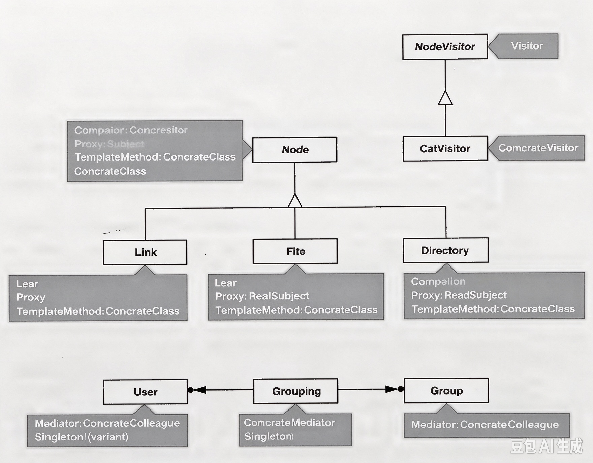

# 2.8 收尾

我们已经把模式用到了文件系统设计的许多方面。
COMPOSITE 贡献了作为系统骨干的递归树结构。
PROXY 在这副骨架上增补了对符号链接的支持。
VISITOR 给了我们得体的手段，能不露痕迹地添加新的、类型特定的功能。

至于保护，TEMPLATE METHOD 在很基础的层面上提供了它——单个操作这一层。
对单用户保护来说，这差不多就是我们所需要的全部；但要照顾多用户，就需要额外的抽象——对登录、用户和用户组的支持。
SINGLETON 在两个层面上帮了我们：一是封装并控制敏感的登录过程，二是确立一个隐式的用户，系统里任何对象都能访问它、替换它。
最后，MEDIATOR 提供了一种灵活而不具侵入性的办法，把用户与他们所属的组关联起来。

 
*图 2.4：文件系统设计汇总*

图 2.4 汇总了我们用过的模式，以及体现它们的那些类。
这套记法是 Erich 几年前想出来的，他称之为 "pattern:role annotation"（模式:角色标注）。
它给类挂上带底纹的方框，里面写着相关的模式名和/或参与者名。
为简洁起见，当模式很明显、不会产生歧义时，就只写参与者名。
通过省去额外的连线、以及使用背景有对比的方框，杂乱与干扰被降到最低——模式标注看上去仿佛占据着与类结构不同的一个平面。
事实上，这套记法实际上还*减少*了线条的数目，因为有些标注构件 (notational artifacts) 是某个模式所固有的，可以省略。
比如，注意我把 `Directory` 与 `Node` 之间的聚合关系省掉了，因为它是 COMPOSITE 里 Component-Composite 关系所固有的。

我发现 Erich 的记法可读性高、信息量大，而且可伸缩，尤其是跟我自己那套受 Venn 图启发的记法（见第 [29](4.md) 页的 [图 2.3](4.md#fig-2-3) ）相比。
我见过的唯一缺点是：灰色底纹扫描效果不太好。
*Caveat scanner!*

> 译注：*Caveat scanner!* 是拉丁文 *caveat*（"让……当心"）加英文 *scanner* 的混搭，仿的是常见拉丁语警示语 *caveat emptor*（买者当心），这里意为 "扫描者当心！"——调侃原书这张图的灰色底纹在复印、扫描时容易糊成一片。
