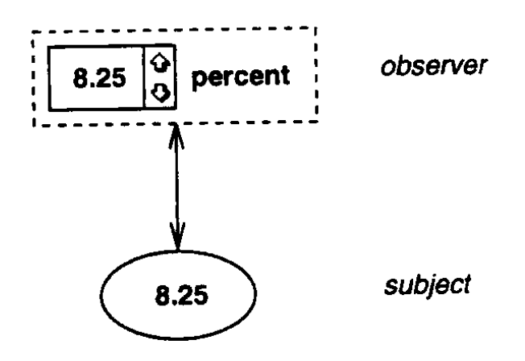
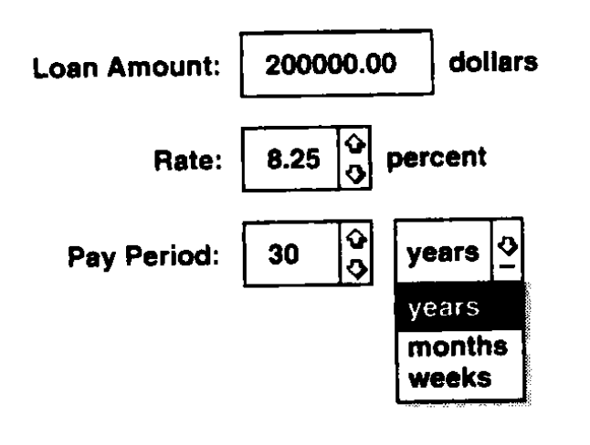
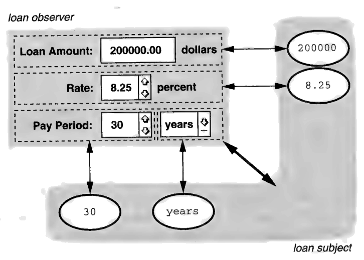
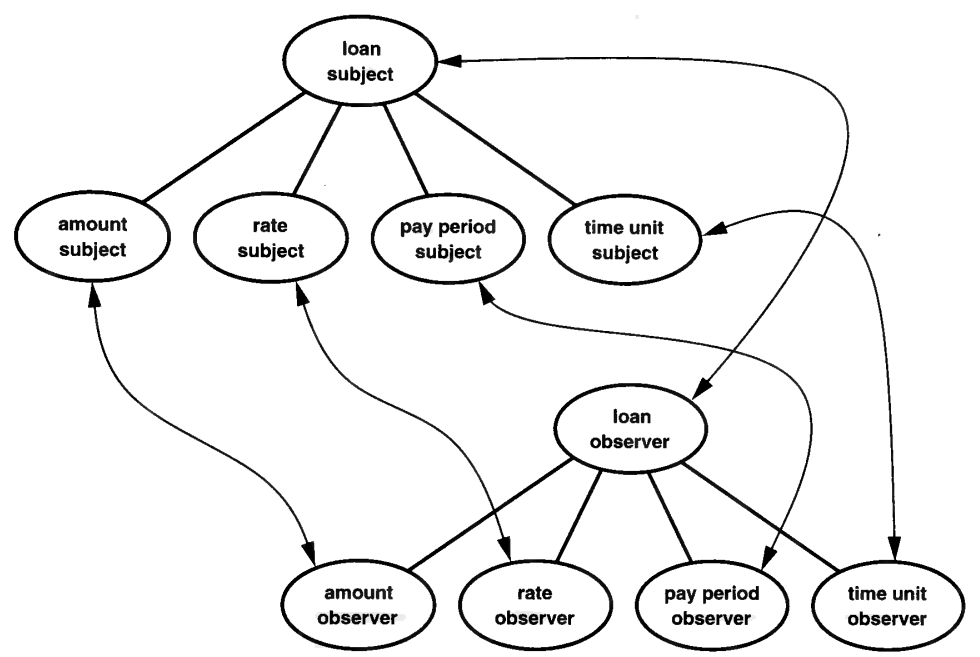
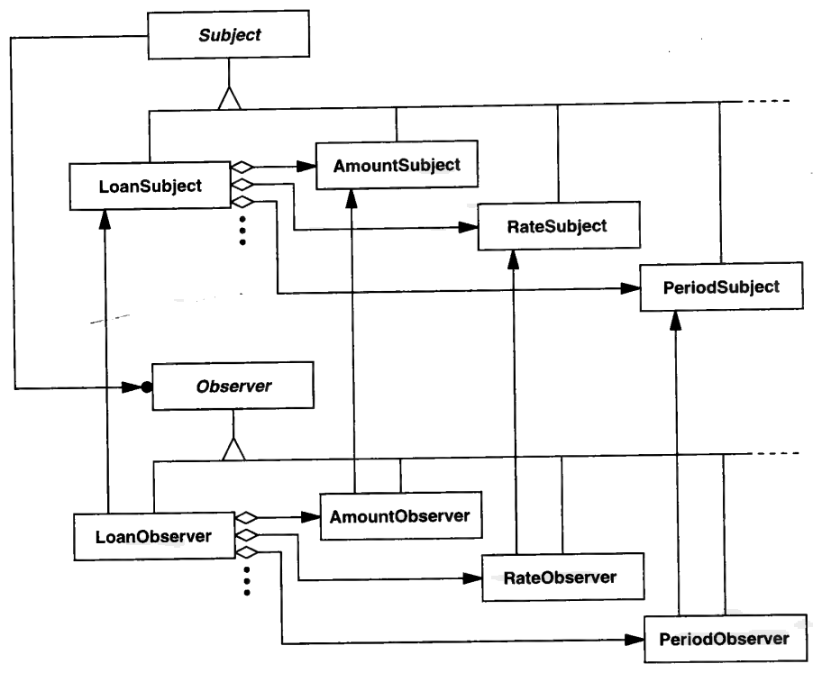

# 3.2 OBSERVER 的麻烦

软件业以滥发免责声明而臭名昭著。
开发者几乎可以对自己造出的任何东西推得一干二净。
那么，本着平等参与的精神：

> 警告：本节包含推想性的设计，按 "现状" 提供。
> 作者与出版者对这些设计不作任何明示或默示的担保。
> 不过，你尽可以拿自己的饭碗去赌它们。

我在这里做的，是把一个困扰了我将近十年的设计问题拿出来想一想——因为常见的疗法往往比疾病本身更糟。

假设你在为一套业务应用搭框架，这类应用处理的是美元金额、姓名、地址、百分比之类的原始数据。
它们通过一个或多个用户界面来呈现这些数据：不变的字串数据用固定文本；可编辑的数据用文本输入框；约束更多的输入用按钮、滑块或弹出菜单；还有一些可视化呈现，比如饼图、柱状图、各种曲线图——你明白我的意思。

你认定：让用户界面的改动不去干扰应用功能、反之亦然，这件事很重要。
于是你把用户界面与底层的应用数据分开。
事实上，你考虑的是在两者之间做一套完整的、类似 Smalltalk 的模型-视图-控制器（MVC）划分 [KP88](../biblio.md#kp88)。
MVC 不但把应用数据与用户界面分开，还允许同一份数据有多个用户界面。

翻翻《Design Patterns》，你会瞄见 OBSERVER 模式，它讲的正是如何实现这种划分。
OBSERVER 把原始数据与其可能数量众多的呈现之间的关系捕捉如下：

1. 每份数据都被封装在一个 Subject 对象里（相当于 MVC 中的模型）。
2. 每个针对某个 subject 的独立用户界面都被封装在一个 Observer 对象里（相当于 MVC 中的视图）。
3. 一个 subject 可以同时拥有多个 observer。
4. 只要 subject 发生变化，它就通知它的 observer 们。
5. 反过来，observer 向自己的 subject 查询会影响自身外观的信息，然后相应地更新自己。

subject 保存着权威信息，只要 subject 的信息变了，observer 就会得到更新。
用户保存自己的工作成果时，被保存的是 subject；observer 无须保存，因为它们显示的信息本就来自它们的 subject。

举个例子。
为了让用户能改一个数值（比如利率），应用可以提供文本输入框加上一对上下按钮，如图 3.1 所示。
当保存利率的那个 subject 发生变化（比方说，用户按下 "上" 按钮把利率调高一档），它就通知自己的 observer——那个文本输入框。
文本输入框作为响应，重绘自己，以反映新的利率。

 
*图 3.1*

再说，除了原始数据，使用我们框架的应用还需要更高级的抽象，比如贷款、合同、业务伙伴和产品。
为了最大程度地复用，你会想用细粒度的 subject 和 observer 把这些抽象组合出来。

看看图 3.2，它展示了一个录入贷款信息的用户界面。
这个界面是作为某个 subject 的 observer 实现的。
图 3.3 则表明：这个 observer 实际上是由若干原始 observer *组合*而成的，而那个 subject 也是由相应的原始 subject 组合而成的。

 
*图 3.2*

 
*图 3.3：贷款 subject 与 observer 的组合*

这个设计有四个漂亮的性质：

1. 你可以独立于 observer 来定义、修改和扩展 subject，反之亦然——这对维护与增强是莫大的福音。
2. 你的应用可以只包含它需要的功能。
当框架提供一大堆功能时，这一点尤其重要。
比方说，如果某个应用不需要以图形方式呈现应用数据，它就不必包含绘制饼图或柱状图的 observer。
完全是按需付费。
3. 你可以把任意数目的 observer 挂到同一个 subject 上。
文本输入框和上下按钮很可能会被实现成各自独立的 observer。
（为了让图简单些，我没把这一点画出来。）你甚至可以有不参与显示的 observer。
比如，你可以定义一个对象，只记录 subject 数据的变化，而不必改动 subject 的实现。
4. 你可以用现有的 subject 和 observer 来实现新的 subject 和 observer，从而促进复用。

听起来美妙极了，事实也确实如此。
唉，可它有阴暗面。

图 3.4 提供了看这些对象组合的另一个角度：把它们看作**包含**层次结构。
`loan subject` 包含它的原始成员，`loan observer` 则包含相应的原始 observer。
注意那些数量可观的对象（带标签的椭圆）和对象引用（连线）。
不但 `loan subject` 与 `loan observer` 之间有连线，每个原始 subject 与它对应的 observer 之间也有连线。

一句话，OBSERVER 模式在运行期造成了大量冗余。
如果你是白手起家写`loan subject` 和 `loan observer`，这些连线大多可以轻松去掉，更别说许多对象本身也可以去掉。
它们全都算在我们为复用付出的价钱里。

 
*图 3.4：贷款 subject 与 observer 的对象结构*

且慢——还有呢！
运行期冗余只是问题的一部分；我们还有静态冗余。
想想那些实现这些对象结构的类吧。
OBSERVER 规定了两套彼此独立的类层次——Subject 一套、Observer 一套，二者的抽象基类分别定义通知协议以及挂接 (attach)、摘除 (detach) observer 的接口。
ConcreteSubject 的子类实现具体的 subject，并添加上自己的具体 observer 所需的、用来弄清 "什么变了" 的接口。
与此同时，ConcreteObserver 的子类定义针对各自 subject 的不同呈现，其中的 `Update` 操作则规定它们如何更新自己。

图 3.5 归纳了这些静态关系。
够复杂的吧？
并列的层次结构往往如此。
除了编写和维护这些层次结构的机械性开销之外，还有概念上的开销。
程序员得去理解两倍的类、两倍的接口、两倍的子类化问题。

 
*图 3.5：Loan subject 与 observer 的类结构*

要是我们只用一套类层次、一套实例层次就能过关，岂不是*更*美妙？
麻烦在于：我们不想放弃由相互独立的类层次和对象层次换来的、应用数据与用户界面之间那份干净的划分。
怎么办？

想一分钟。
subject-observer 划分的一大运行期代价是什么？
当然是那些伴随对象与链接的内存开销。
并列的对象层次要求对象数目翻倍、层次内部的链接翻倍，此外还要加上层次*之间*的链接。
要搁在那儿的信息可真不少。
事实上，我们该质疑这一切有多必要。
我们真的那么频繁地去访问这些信息吗？
把用户界面与应用数据分开是一回事，可我们非得不停维护两者之间成堆的链接吗？

假定这些问题都带着预设立场、且答案都是 "不"，那替代方案是什么？
把自己限制在一套对象层次里，肯定能同时削掉对象和链接。
诀窍在于保住冗余带来的好处。
我们必须找到一种呈现 subject 信息的办法，既不维护一套并列的 observer 层次，也不把两套层次草草合并成一坨。

<ins>既然这里的关键是内存，那就来琢磨一下空间与时间之间的经典权衡。
与其把信息*存*起来，何不在需要时*算*出来？
凡是能按需重建的信息，我们都不必存储——前提是我们并不经常按需重建。</ins>
多经常算 "经常"？
经常到对性能造成不可接受的影响。

幸运的是，observer 真正起作用的情形相当少，至少在我们的应用里是如此。
基本上，它们只在三种情况下活过来：

1. subject 发生变化时。
2. 有用户输入时。
3. 用户界面（的某部分）必须被（重新）绘制时。

这些情形就是 observer 代码会被执行的时刻。
如果我们把 observer 对象去掉，那么这些时刻就正是我们必须临场想出该怎么办的时刻。

别误会。
我不是说我们完全不用对象来做 observer 的活儿。
对象当然还是会用；我们只是希望用的对象数目比 OBSERVER 要求的少得多——最好是个常数，而不是与 subject 层次的规模成正比。
我们也不想存一大堆指向 subject 的链接。
我们想*算*出链接，而不是*存*下链接。

我描述的那三种情形，通常都会引发对 observer 结构或 subject 结构（而且常常是两者）的遍历。
比如，subject 的一次变化以及由此导致的 observer 的相应变化，可能需要遍历整个 observer 结构，以便重绘受影响的用户界面元素。
同样，判定用户点击了哪个界面元素的那段计算，至少也要部分遍历 observer 结构。
重绘也是同样。

既然在这些情形下我们多半都要做一次遍历，那么遍历也许正是计算那些本来要存储的东西的大好时机。
事实上，遍历能提供足够的上下文，去做一些 subject 单方面做不了的事情。

举例来说，我们可以遍历 subject 结构、把用户界面整个儿重绘一遍，从而更新某个被改动的 subject 的外观。
这种头脑简单的做法无疑不如我们希望的那样高效，因为大概只有用户界面的一小部分需要改变。
所幸补救办法也同样头脑简单：让各个 subject 维护一个 "脏位 (dirty bit)" ²，用以表明自己是否变过。
遍历时顺带把脏位重置掉。
这样遍历时我们就可以只理会脏了的 subject，从而让这个做法的效率比较接近 OBSERVER。

²：其实现应隐藏在 set/get 接口之后，以便实际所需的存储量可以变化。

"嗨，" 这时候有人可以理直气壮地插话， "遍历的每一步该干什么，我们到底怎么知道？" 还有， "这份知识实现在哪里？"

有 Observer 对象的时候，每个 observer 都知道自己那部分呈现该怎么画。
呈现某个特定 ConcreteSubject 的代码，住在相应的 ConcreteObserver 类里。
subject 最终把自己的呈现委托给了它的 observer 们。
正是这种委托带来了大量额外的对象和引用。

既然甩掉了 observer，我们就得给 subject 的呈现代码另找个安身之处。
我们必须假定呈现是在遍历过程中逐 subject 增量地画出来的，而且必须根据 subject 的类型让呈现有所变化。
遍历的每一点上究竟执行哪段代码，取决于两件事：subject 的种类和呈现的种类。
倘若我们手里只有一套 subject 层次，那我们怎样把各个 subject 区分开，又怎样让正确的代码得到执行？

这类含混不清，正是把呈现功能从 subject 里移除的后果。
但我们既不想退回到把 subject 和 observer 揉成一坨，也不想在能避免的情况下动用那种上不了台面的运行期类型测试。
