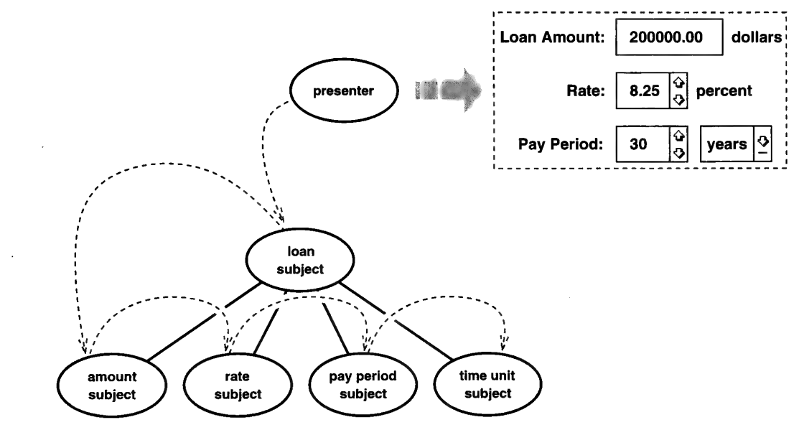

# 3.3 再访 VISITOR

这类问题我们以前碰到过，确切地说是在第 [2](../ch2/4.md) 章，当时我们正埋头设计文件系统。
我们想让文件系统对象（例如文件和目录）能做的事情五花八门。
可我们不想一直往 `Node` 上加操作——那是文件系统对象的抽象基类。
每加一个新操作都得给现有代码动手术，`Node` 接口里闹出 K-S³ 综合征的风险也就水涨船高。

³：Kitchen-Sink（"厨房水槽"，喻指什么都往里塞）。

那时我引入了 VISITOR 模式。
新功能实现在各自独立的 Visitor 对象里，从而免除了改动 `Node` 基类的必要。
visitor 的关键之处在于：它们从所访问的对象那里把类型信息找回来。
举例来说，我们可以定义一个名为 `Presenter` 的 Visitor 类，由它承担呈现一个给定 subject 所需的全部工作，包括绘制、输入处理等。
它的接口大致如下：

```cpp
class Presenter {
public:
    Presenter();

    virtual void visit(LoanSubject*);
    virtual void visit(AmountSubject*);
    virtual void visit(RateSubject*);
    virtual void visit(PeriodSubject*);
    // 用于其他 ConcreteSubject 的 visit 操作

    virtual void init(Subject*);
    virtual void draw(Window*, Subject*);
    virtual void redraw(Window*, Subject*);
    virtual void handle(Event*, Subject*);
    // 其他涉及遍历的操作
};
```

你大概还记得，VISITOR 要求每一种可被访问的对象都提供一个 `accept` 操作。
这些操作的实现方式全都一样。
例如：

```cpp
void LoanSubject::accept (Presenter& p) {
    p.visit(this);
}
```

要为某个 subject 生成呈现，遍历的每一站都会调用 `subject->accept(p)`，其中 `subject` 的类型是 `Subject*`，`p` 是一个 `Presenter` 实例。
VISITOR 的魔法正在这里：对 presenter 的那记回调会**静态**地解析到正确的、针对具体子类的 `Presenter` 操作，从而把具体 subject 的身份有效地告知 presenter——运行期类型测试根本用不上。

你要是想问 "遍历是谁做的"，再看一眼 `Presenter` 的接口：它除了 VISITOR 规定的东西之外，还有 `init`、`draw`、`redraw` 和 `handle` 这些操作。
它们响应某种刺激——比如用户输入、subject 状态的变化，或者前面描述过的任何会促成遍历的场合——执行一次或多次遍历。
这些操作给客户端一个简单的接口，用来让呈现活着、且保持最新。
图 3.6 用图形描绘了遍历的过程。
把它里面对象与链接（*实线*）的数目，跟第 [75](2.md#fig-3-4) 页图 3.4 的比一比。
减少得相当可观吧？

<a id="fig-3-6"></a>

<br/>
*图 3.6：Presenter 的遍历*

VISITOR 的发烧友再清楚不过：一旦你访问的类结构不稳定，这个模式就垮了；而这个弱点对我们的业务应用框架可不是好兆头。
理想情况下，我们的 Subject 子类库足够完备，程序员永远不必自己定义子类。
但我们这个世界并不那么理想，而且必须有可能（哪怕不容易）在不改动框架的前提下为新的 Subject 子类定义呈现。
尤其是，我们不希望为了支持新的 Subject 子类而不得不往 `Presenter` 类里加新的 `visit` 操作。

第 [2](../ch2/4.md) 章里，我在 Visitor 接口中引入了一个包罗万象的 `visit` 操作（第 [36](../ch2/4.md#example-2-4-1) 页），用来安放默认行为。
在这里如法炮制，就要往 `Presenter` 接口里加上

```cpp
virtual void visit(Subject*);
```

如果存在所有 `visit` 操作都该实现的默认行为，你就可以把它放进 `visit(Subject*)`，再让其他 `visit` 操作在默认实现里调用它。
这样你就避免了重复实现默认功能。

但这个包罗万象的操作提供的可不只是偶尔的复用。
它简直是一扇暗门，可以借它去访问未曾预见的 Subject 子类。

假设我是个应用开发者（我确实是），刚刚定义了 `Subject` 的一个新子类 `RebateSubject`。
我尽责地实现了它的 `accept` 操作，和其他所有的一样：

```cpp
void RebateSubject::accept (Presenter& p) {
    p.visit(this);
}
```

你要是没明白这个包罗万象的操作为何重要，这个场景应该能说清楚。
当 `RebateSubject::accept` 以自己为实参调用 `visit` 时，编译器必须在 `Presenter` 接口里找到一个对应的操作。
假如没有 `Presenter::visit(Subject*)` 这么个包罗万象的操作，编译器就会两手一摊，吐出一条错误消息。
有了它就大不一样了。
编译器聪明得足以知道 `RebateSubject` 是个 `Subject`，就类型相容性而言，一切顺顺当当。

可我们讨好了编译器，却没取得多少实质进展。
`Presenter::visit(Subject*)` 早在 `RebateSubject` 类存在之前就已经实现了。
这意味着它除了自身实现的默认行为之外什么也做不了——而那默认行为大概压根儿什么都不做。

那接下来怎么办？

回想一下我们想避免的是什么：改动 Visitor（也就是 `Presenter`）接口的必要。
为什么？
因为应用开发者改不了框架定义的接口。
不过，没有什么能阻止程序员去**继承** `Presenter`。
我们要加呈现 `RebateSubject` 的代码，靠的正是这条路。

我们来定义一个 `NewPresenter` 子类。
除了继承来的 `Presenter` 功能之外，它通过覆写那个包罗万象的操作，加上了呈现 `RebateSubject` 的代码：⁴

```cpp
void NewPresenter::visit (Subject* s) {
    RebateSubject* rs = dynamic_cast<RebateSubject*>(s);

    if (rs) {
        // 呈现该 RebateSubject
    } else {
        Presenter::visit(s); // 执行默认行为
    }
}
```

⁴：一个 C++ 的怪癖：因为我把 `visit` 操作做了重载，为了堵住编译器的抱怨，我们必须把 `NewPresenter` 里的**所有** `visit` 都覆写一遍。
要绕开这个问题，就别用重载，而是把具体 subject 的名字嵌进 `visit` 操作的名字里；或者采用 Kevlin Henney 建议的 `using` 写法（见第 [37](../ch2/5.md#example-2-5-1) 页）。
关于这个问题，我在前面从第 35 页开始有更完整的讨论。

现在你看到这个做法见不得人的小秘密了：那个运行期类型测试，用来确保我们访问的 subject 确实是个 `RebateSubject`。
如果我们百分之百确定 `NewPresenter::visit(Subject*)` 只可能由访问某个 `RebateSubject` 触发，那我们就可以把 `dynamic_cast` 换成 `static_cast`。
不过这么干终究风险不小。
再说，如果可访问、可呈现的新 Subject 子类不止一个，你就**非**用动态转换不可。

显然，这是为了绕开 VISITOR 模式的一个缺陷。
如果你在不停地添加新的 Subject 子类，那么整套 VISITOR 做法就退化成 "打标签 + case 语句" 式的编程。
但如果应用只定义少数几个新子类——在一个偏爱组合的设计里本就该如此——那么 VISITOR 模式的大部分好处仍然保得住。

你们当中过分爱分析的人会琢磨：既然我能把向下转型放进 `RebateSubject::accept`，为什么偏要放进 `visit` 操作里？
就像这样：

```cpp
void RebateSubject::accept (Presenter& p) {
    NewPresenter* np = dynamic_cast<NewPresenter*>(&p);

    if (np) {
        np->visit(this);
    } else {
        Subject::accept(p); // 执行默认行为
    }
}
```

事实证明，短期内这两种写法一样好使，但后者更难维护。
总有一天，我们会积累出足够多的新 Subject 子类，形成一个临界规模。
到那时，我们就准备咬牙改动 `Presenter`，为 `RebateSubject` 这类此前不受支持的子类添上对应的 `visit` 操作。
于是 `Presenter` 接口将再次反映 presenter 所能访问的所有类，我们也就能把那些向下转型的障眼法一扫而光。

现在想一想：如果此前我们一直把向下转型放在新的 ConcreteVisitor 的 `visit` 操作里，这么做要牵动什么？
当然要改 `Presenter` 类，而且应当把 `NewPresenter::visit(Subject*)` 这类操作里的向下转型去掉。
但也就到此为止——改动被限制在一套类层次里。
我们不必去碰 Subject 层次，因为那里所有 `accept` 操作本来就都好好的。
例如

```cpp
void RebateSubject::accept (Presenter& p) {
    p.visit(this);
}
```

照旧编译得欢，只不过现在 `visit` 调用会静态解析到新加的 `Presenter::visit(RebateSubject*)`。⁵

⁵：注意，假如我们此前没有重载 `visit`——也就是说，如果把被访问 subject 的类型嵌进了 `visit` 操作的名字里——那我们终究还是得回过头去改 `accept`。
因为每个新 Subject 子类的 `accept` 都会显式调用那个包罗万象的操作：

```cpp
void RebateSubject::accept (Presenter& p) {
    p.visitSubject(this);
}
```

只要你的语言支持重载，仅凭这一条理由就足够让你用它。

反过来说，如果我们此前一直把向下转型放在 `accept` 操作里，那要干的活就多了：每个 `accept` 都得改成前面 `RebateSubject` 那个样子。
这显然不可取，因为当初采用 VISITOR 的一大动机，恰恰就是避免改动你所访问的 Element 层次。

再说一遍，如果你在不停地定义 Element 子类，那你本就不该采用 VISITOR。
但即便你不定义它们，审慎也要求你至少**允许**新子类的存在——除非有充分理由不这么做。
因此才需要这样一个包罗万象的操作。当你提供它时，务必把向下转型放在那里，并且尽可能重载 `visit` 操作。

<p align="center">❖ ❖ ❖</p>

这个替代 OBSERVER 的 VISITOR 方案还有几个问题。
第一个问题关乎我们 `Presenter` 类的体量。
我们把好几个 ConcreteObserver 类的功能都堆进了这一个 Visitor 里，我们可不希望结果是一块庞然大物。
到了某个时候，我们就该着手把 `Presenter` 分解成更小的 Visitor，也许可以借助别的模式来缩减它的体量。
例如，我们可以用 STRATEGY 让 `visit` 操作把活儿委托给 Strategy 对象。
不过你记得，当初采用 VISITOR 的理由之一就是减少我们所用的对象数目。
往 Visitor 里塞进更多对象，会削弱这个模式的收益。
话虽如此，我们最终用到的对象（和链接）不太可能多到 OBSERVER 要求的那个地步。

另一个问题涉及 observer 的状态。
名义上，VISITOR 做法用**一个** visitor 取代了**一大堆** observer。
可要是每个 observer 都存着自己独有的状态，而其中有些并不能临场算出来——那这些状态到哪里去了？
既然我们假定 observer 状态可以算出来而不必存起来，这就不该成为问题。
最坏的情况下，如果那些算不出来的状态确实因对象而异，那 visitor 可以把它们放进一个私有的关联存储（例如哈希表），以 subject 为键。
哈希表与 OBSERVER 各实现之间在运行期开销上的差别应当可以忽略不计（他这么说）。

好吧，也许这一整套东西听着有点异想天开，我也不保证它不是。
纸上设计的好处就在于：它们不必编译、不必运行，更不必养家糊口。
但假如这里面哪怕有一丁点儿有用的想法，那就请拿去用。
要是最后发现没有——或者更糟——那也没什么，免责声明不就是干这个用的吗！
