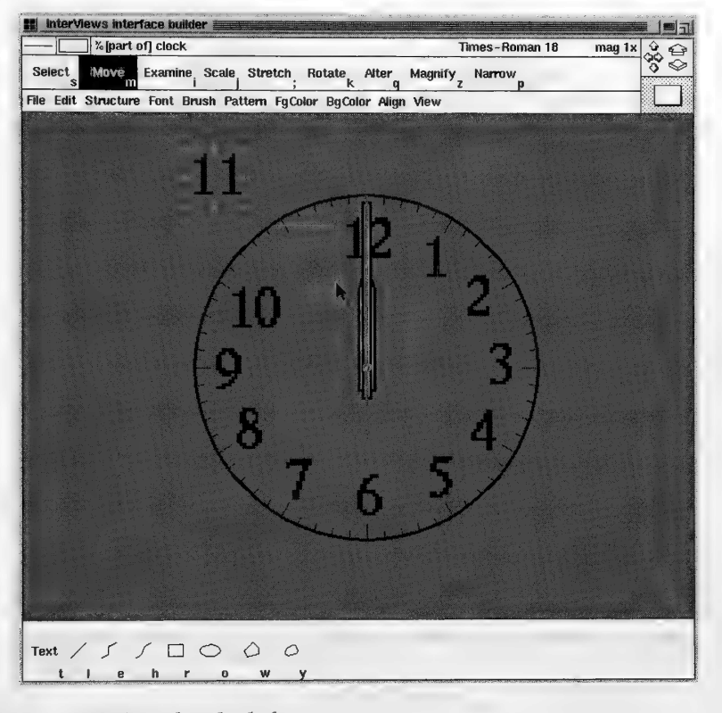
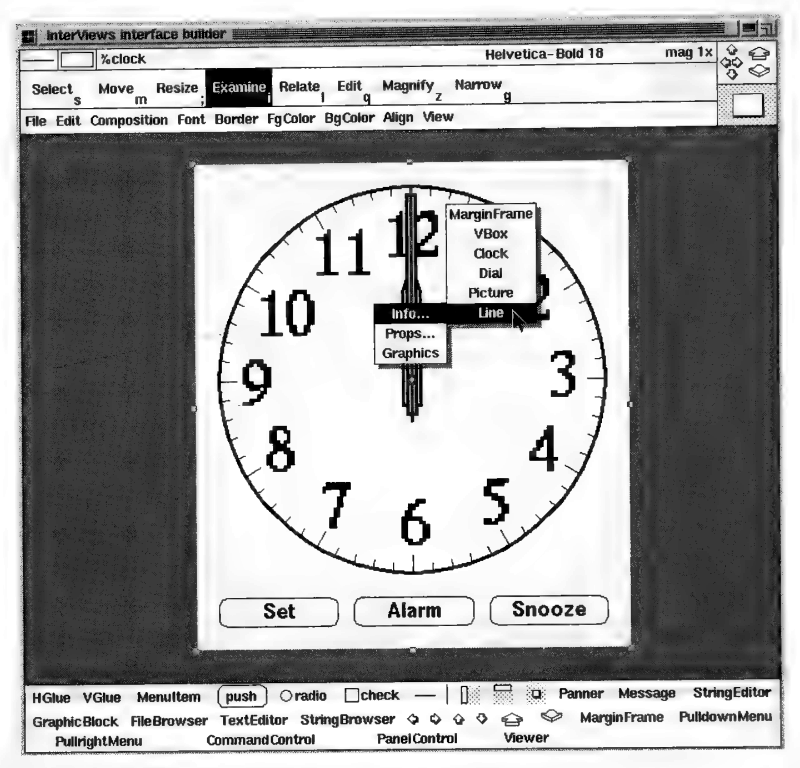
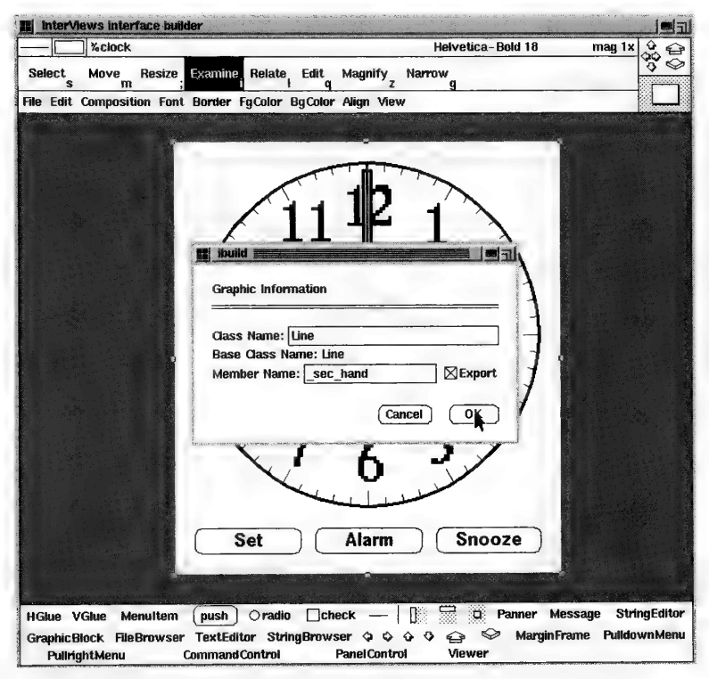
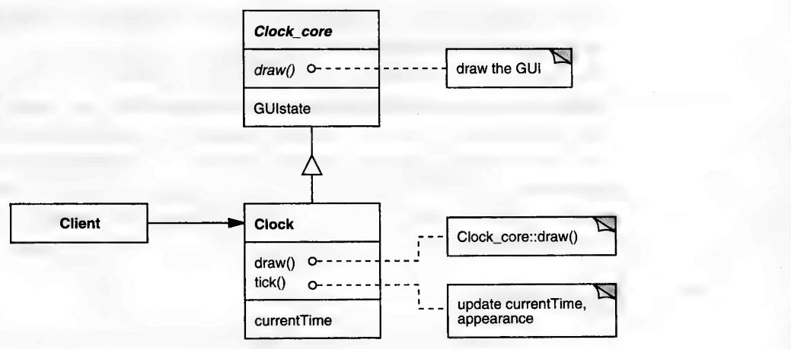
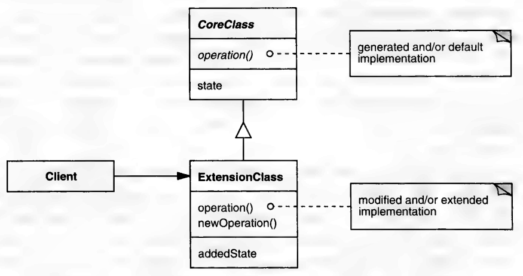

# 3.4 GENERATION GAP

要是每次有人问我 "你们什么时候出模式第二卷" 我都能得五分钱，那我早就发财了。
《Design Patterns》里提到 "有一两个模式从模式的集合里被拿掉了"，理由是 "它们似乎不够重要" ——这话可帮不上忙。
其实这些年来，我们封存起来的模式少说也有半打，理由从 "似乎不够重要"，到 "已知应用不够多"，再到 "这玩艺儿没救了"。

GENERATION GAP 就是那种因已知应用匮乏而长期无精打采的模式之一。
我最后还是把它发表了 [Vlissides96](../biblio.md#vlissides96)，同时点明了这一短处，并公开征集更多例子。
我收到了若干回应，都收在这个更新过的版本里。

## 模式名称

Generation Gap

## 分类

类结构型

## 意图

无论生成代码被重新生成多少次，修改或扩展它都只需做一次。

## 动机

让计算机替你生成代码，通常比自己动手写要好，*前提*是它生成的代码

- 正确
- 足够高效
- 功能完整
- 可维护

许多代码生成工具（比如用户界面构建器、语法分析器生成器、 "向导" 和 4GL 编译器）生成正确而高效的代码不成问题。
事实上，人们在学习一套新的编程接口时，往往宁可研读计算机生成的代码，也不愿去翻卷帙浩繁的文档。
但要生成*功能完整且可维护*的代码，可就是另一码事了。

通常情况下，你用这类工具没法自动造出一个完工的、非平凡的应用；有些功能还得用老办法——在某种编程语言里手工实现。
这是因为赋予工具力量的那套高层隐喻，很少能精确到足以指明每个（不那么）细枝末节的细节。
工具的抽象必然有别于编程语言的抽象。
由此产生的 "混合隐喻"，会对应用的可扩展性和可维护性造成严重破坏。

设想一个用户界面构建器，它不但让你拼装按钮、滚动条、菜单这类用户界面元素（也就是 "控件"），还让你用 "线条、圆、多边形、文本" 这类更原始的图形对象来作画。⁶
构建器让你用这些对象画出图形，再给它们关联上行为。
于是，你能在工具里指定应用的大部分内容，这是只提供控件的工具做不到的。

⁶：这类构建器的一个例子是 *ibuild*，它是 InterViews 工具包的一部分 [VT91](../biblio.md#vt91)。

<a id="fig-3-7"></a>

<br/>
*图 3.7：画出钟面*

你可以用这样一个构建器，为一个闹钟应用造出完整的用户界面。
你可以像图 3.7 所示那样，把线条、多边形和文本拼装起来，画出钟面。
然后再加上几个按钮，用来设置当前时间、闹铃时间，以及关掉闹铃。
构建器让你把所有这些元素组合成一个完整的应用用户界面。

然而，构建器不让你指定的是：这些元素在应用运行时**如何行事**。
具体地说，你需要为按钮以及时针、分针、秒针的行为编程。

<a id="fig-3-8"></a>

<br/>
*图 3.8：挑出秒针以备导出*
你能做的最基本的一件事，就是在代码里引用这些对象。
这个构建器让你把对象挑出来 "导出" ——也就是说，你可以给它们起名字，好在程序里通过名字引用它们。
图 3.8 里，用户正把秒针——一个 `Line` 类的实例——挑出来导出。
构建器随即弹出一个对话框（图 3.9），让你为这个 `Line` 实例敲入一个像 `_sec_hand` 这样能说明问题的名字。

<a id="fig-3-9"></a>

<br/>
*图 3.9：为秒针命名并导出*

构建器还能造出闹钟用户界面的其他元素，比如让用户指定当前时间和闹铃时间的那些对话框。
界面做完之后，构建器会生成代码，把各个图形组件组装起来、按指定方式排布；它也会把对话框组装好，并为所有按钮实现默认动作。
但和大多数应用构建器一样，这个工具能替你做的也就这些了。
你得转回去编程，指定按钮被按下时到底做什么、闹钟如何走时、又如何维持正确的显示。
大部分行为仍有待手工编程。
怎么编？

最直白的做法，是把构建器生成的代码拿来改，改成合你意的样子。
举例来说，你会加上一段代码，每秒产生一个某种事件；再写一个对应的事件处理器，每秒把秒针、也许连同分针和时针，旋转适当的角度（对秒针而言是 6° 的整数倍）。⁷
还要有更多新代码来实现按钮的行为。
你就这样一直手改生成的代码，直到捣鼓出一个能跑的应用。

⁷：想必线条之类的图形对象都有一个接口，能让自身按给定角度旋转。

接下来的麻烦是维护。
假设你想调整用户界面，让按钮出现在钟面的*上方*而不是下方。
换句话说，你只想改外观，不想改行为。
任何像样的构建器都会让这种表面改动变得容易。
麻烦在于：构建器对你早先对它生成的代码所做的修改一无所知。
盲目地重新生成代码，会把你做的改动拍平，至少也会逼着你重新来一遍。

对付这个问题有几种路子。
构建器可以把自己生成的代码标记为 "用户可改" 或 "用户不可改"，通常是在里面写上 "严禁修改" 之类的严厉警告。
但这个办法不能令人满意，理由至少有两个：

1. *这样很乱。
*虽然比零敲碎打地改要好，但手写的代码终究和生成的代码混在一起。
结果往好里说也是乱糟糟的，乱到人们会转而去用工具，让它按需隐藏或高亮不同的部分，好使代码更易读。
然而这类工具很少能把问题彻底掩盖住。
2. *这样容易出错。
*因为改动只靠约定来管，编译器没法检查出违规的改动。
你一旦犯错、改错了地方，生成器可能在后来把你那些改动一举抹掉。

更精巧的一个办法，是计算改过的代码与原先生成的代码之间的差异，然后试着把差异合并进重新生成的代码里。
不用说，一旦手工改动很多——或者有时候只是不算简单——这就是个靠不住的命题。

理想的方案会比这更可靠，而且为了可维护性，它会把生成的代码与手工编程的改动**分开**。
但严格的分离很难做到，因为改动往往需要访问生成代码里那些不该公开的部分。
比如，代表秒针的那个 `Line` 对象，大概不该让闹钟之外的对象访问，因为那条线只是个实现细节。
就连一个 "推进秒针" 的更高层接口，大概也不该做成公开的——毕竟现实生活中的钟大多没有这个本事。

<a id="fig-3-10"></a>

<br/>
*图 3.10：扩展核心类*

GENERATION GAP 正是靠类继承来解决这个问题的模式。
它把生成代码封装在一个基类里，把改动封装在相应的子类里。

在我们的闹钟例子里，构建器会把它生成的代码封装在一个名为 `Clock_core` 的**核心类**里。
按照构建器里的指定来实现这个钟的所有代码——包括图形对象、控件以及它们的组合方式——都住在这个类里。
没有人会实例化核心类。
要实例化的类是 `Clock`，它也被泛称为**扩展类**。
构建器在生成核心类的同时，也生成扩展类。

正如 "扩展类" 这名字所示，`Clock` 是 `Clock_core` 的子类。
但它是个*平凡*子类：既没有增加、也没有删除或修改核心类的状态或行为。
它做的既不比超类多，也不比超类少。
尽管如此，创建 `Clock` 对象的代码*总是*实例化 `Clock` 这个扩展类——而不是 `Clock_core` 这个核心类。

那么改动往哪放？
你可以修改核心类，让它与其他应用代码协作，但此后在构建器里编辑并重新生成，就会又落回前面描述过的代码合并问题。
所以，你要改的是**扩展**类——永远不是核心类——来增加、改变或移除功能。
你可以定义新的成员函数，也可以重定义或扩展虚函数（图 3.10）。
只要把导出的实例声明为 C++ 里的 protected 成员变量，扩展类就能访问它们，而又不会把它们暴露给客户端。

如果你以后想改界面的外观，构建器可以*只*重新生成核心类，而核心类是你没改过的；于是你对扩展类所做的原始改动不受影响。
然后重新编译应用，它就会反映出外观上的变化。
只有当你对界面做了根本性的改动（比如去掉秒针，或去掉改动所引用的任何其他实例）时，才需要修改你原先的改动。

## 适用性

当*下列条件全部*成立时，适用 GENERATION GAP：

- 代码是自动生成的。
- 生成的代码可以封装在一个或多个类里。
- 重新生成的代码通常保留上一代的接口和实例变量。
- 生成的类通常不会被整合进既有的类层次。
如果会，而你的实现语言又不支持多接口继承，那么代码生成器必须允许你指定它所生成的任何基类的超类。

## 结构

<a id="fig-3-4a"></a>

<br/>

## 参与者

**CoreClass**（`Clock_core`）

- 一个包含工具所生成实现的抽象类。
- 从不被手工修改。
- 重新生成时会被工具覆盖。

**ExtensionClass**（`Clock`）

- CoreClass 的平凡子类。
- 实现对 CoreClass 的扩展或修改。
程序员可以改动 ExtensionClass，以增加状态，和/或扩展、修改、覆写 CoreClass 的行为。
- 在历次重新生成之间保留扩展和修改。

**Client**

- 只实例化和引用 ExtensionClass。

## 协作

- ExtensionClass 从 CoreClass 继承工具生成的行为，并覆写或扩展之。
- CoreClass 把选定的功能暴露给、和/或委托给 ExtensionClass，以便其行为可被修改或扩展。

## 效果

GENERATION GAP 带来以下四项好处：

1. *改动与生成的代码解耦。
*所有手工改动都进入 ExtensionClass，从而被封装起来、与生成的代码保持分离。
附带的好处是：ExtensionClass 的接口能通过指出哪些操作被覆写或新增，让人一窥改动的内容。
2. *改动可以享有访问实现细节的特权。
*CoreClass 与 ExtensionClass 之间的继承关系意味着，程序员和工具构建者可以动用实现语言的全部表达力，来控制对生成代码内部结构的访问。
3. *后续的重新生成不需要重做改动。
*工具只重新生成 CoreClass，不重新生成 ExtensionClass，从而让改动跨越世代得以保留。
虽然改动本身无须重做，但若下列任一情形成立，改动自己可能也需要修改：
- 改动引用了不再存在的成员（"语法不兼容" 的一个例子）。
- 重新生成的代码在语义上与其上一代不同，以致操作不再是原来的意思（"语义不兼容"）。
   语法不兼容通常比语义不兼容容易改正。
   两种不兼容都会削弱模式的效力，因此它们不能是所生成代码的固有属性。
4. *CoreClass 和 ExtensionClass 可以独立开发、独立测试。
*软件开发项目越大，就越可能涉及各种专业人员。
有领域专长的人也许专注于建模或分析，另一些人则专精于设计、实现、测试或文档。
这里的挑战在于确保这些小组高效协作、产出顺利整合。
各组越独立，能并行完成的工作就越多，但集成阶段往往也越难。

   GENERATION GAP 通过把 CoreClass 与 ExtensionClass 的功能解耦，促成了无冲突的协作与整合。
   回到动机里的例子：用户界面专家可以用构建器开发 `Clock_core`，而领域专家则把 `Clock` 整合进底层的应用框架。
   一旦开发者就 `Clock_core` 的接口达成一致，两人就可以各自独立工作了。

   这个模式还让开发者能分别测试核心类和扩展类。
   在未作修改之前，`Clock_core` 是可实例化的，而且有些用处。
   用户界面专家可以用构建器的产物来评估外观、人机工程、性能，以及其他 `Clock` 不太会影响的界面方面。
   与此同时，领域专家可以通过修改 `Clock` 并编程调用它——也就是说，不组装甚至不实例化任何控件——来测试用户界面底下的各个子系统。
   等各方对自己的类都满意了，把它们整合起来应当很容易。

这个模式有两个主要的不利之处：

1. *类的数目翻倍。
*本来用多少个类，模式就引入多少对 CoreClass/ExtensionClass。
它还可能引入本来一个都没有的类——比如生成的代码本质上是过程式的场合。
系统里每个类都要你付出代价，如果不是存储或执行速度，那至少是概念上的负担。
2. *把生成的类整合进既有类层次可能很难。
*让*扩展*类继承某个既有类，需要多重继承。
你也可以让 CoreClass 继承那个既有类来达到同样效果，但那牵涉到改动 CoreClass 的接口，也就挫败了模式的本意。
这个问题可以在代码生成器里解决：让用户为核心类指定父类。

## 实现

GENERATION GAP 的实现很大程度上取决于编程环境和编程语言。
请考虑以下四个问题：

1. *禁止对核心类的修改。
*GENERATION GAP 的根本要求是程序员永不修改核心类。
可惜，要确保这一点可能相当不容易。

   在基于文件的编程语言和环境里，防止这类改动最可靠的办法，是把类的声明和实现放进一个或多个写保护的文件里。
   然而，这些文件又不能保护到工具重新生成代码时无法覆盖它们的地步。
   你可能需要给工具独立于其用户权限的特殊权限。

   在那种用某种数据库来存放程序信息的编程环境里，事情也许容易些。
   这类环境对程序源码的访问控制通常比传统文件系统更精细。

2. *控制对核心类内部结构的访问。
*正如我们在动机一节所看到的，扩展类可能需要访问核心类的内部功能。
核心类与扩展类之间的继承关系让这件事变得容易，因为在大多数面向对象语言里，子类可以访问它从父类继承来的一切。

   不过要记住：CoreClass 向子类暴露的信息越多，重新生成代码时打断对 ExtensionClass 的改动就越可能。
   C++、Java、Eiffel 这类语言提供了若干级访问控制，用以对子类隐藏信息。
   通过控制对核心类内部的访问，代码生成器可以把扩展类对其核心类所做的假定压到最少。

3. *命名约定。
*因为这个模式常常把一个类拆成两个，由此产生的核心类与扩展类的名字应当体现它们的来源和亲密关系。
不过，这个拆分对客户端来说无关紧要。
因此 ExtensionClass 应当保留原类的名字，而 CoreClass 应当从它的子类派生出名字——这与常规恰好相反。
在构建器的例子里，是把 "`_core`" 附加到扩展类的名字后面，得到核心类的名字。

4. *CoreClass 操作的粒度。
*代码生成的主要好处在于它提升了编程的层次。
代码生成器往往必须产出大量代码来实现一套高层隐喻。
结果，想要修改或扩展生成代码的程序员，对其中的大部分繁复之处会一无所知。
那我们怎能指望他去改它？

   这个问题的关键在 CoreClass 的接口。
   操作必须足够精细，好让程序员能精确地覆写他感兴趣的那部分功能，而复用其余部分。
   举例来说，如果 CoreClass 把一切都实现在一个硕大的操作里，那程序员哪怕只想做点小改动，也不得不重新实现整个操作。
   反过来，如果 CoreClass 把那个操作拆成一个由若干小而精挑细选的原始操作（比如工厂方法）构成的模板方法，那程序员就更有可能只修改或扩展他想要的那部分功能。

## 示例代码

下面是由 *ibuild* 图形用户界面（GUI）构建器所生成的 `Clock_core` 类的真实声明 [VT91](../biblio.md#vt91)：

```cpp
class Clock_core : public MonoScene {
public:
    Clock_core(const char*);
protected:
    Interactor* Interior();

    virtual void setTime();
    virtual void setAlarm();
    virtual void snooze();
protected:
    Picture* _clock;
    SF_Polygon* _hour_hand;
    SF_Rect* _min_hand;
    Line* _sec_hand;
};
```

`MonoScene` 是 InterViews GUI 工具包中用于控件的 Decorator 类 [LVC89](../biblio.md#lvc89)。
`Interactor` 是 InterViews 中控件的基类，因此 `MonoScene` 是个 `Interactor`。
InterViews 还提供了 `SF_Polygon`、`SF_Rect`、`Line` 和 `Picture` 这些实现图形对象的类。
`Picture` 是 COMPOSITE 模式中的 Composite 类，而其他几个类在该模式中充当 Leaf 类。
*ibuild* 的用户导出了这些实例，使它们可被扩展类访问。

虽然 `Clock_core` 看起来只定义了寥寥几个成员函数，它的接口其实相当庞大，主要因为 `Interactor` 的接口很大。
`Clock_core` 从 `Interactor` 和 `MonoScene` 两处继承了大量默认行为。
在 `Clock_core` 新增的操作中，真正干活的只有 `Interior`：它把各个控件和图形对象（导出的与未导出的）组装起来，形成用户界面。
`Interior` 不是虚函数，因为组装完全是在构建器里指定的，永远没有覆写它的必要——你只要在构建器里重画用户界面就行了。

但我们的确需要用编程方式加上一些行为。
要加行为，我们就修改扩展类。
修改前它长这样：

```cpp
class Clock : public Clock_core {
public:
    Clock(const char*);
};
```

构造函数什么也不做。
可由于 `Clock` 继承了所有生成的代码，它已经是完全可实例化的类，能显示出一个钟面，只不过没有任何行为。
我们只需覆写一些操作。

`setTime`、`setAlarm` 和 `snooze` 是在构建器里指定的。
它们就是相应按钮被按下时调用的操作。
默认情况下它们什么也不做；我们在 `Clock` 里覆写它们，让它们干正经活。
我们还需要加上代码，响应 InterViews 的定时器事件来旋转指针——这个钟需要每秒接收一次这种事件。

把这个类变成一个像模像样的应用，改动很直截了当：

```cpp
class Clock : public Clock_core {
public:
    Clock(const char*);

    void run();

    virtual void setTime();
    virtual void setAlarm();
    virtual void snooze();

    virtual void Update();

private:
    void getSystemTime(int& h, int& m, int& s);
    void setSystemTime(int h, int m, int s);
    void alarm();

private:
    float _time;
    float _alarm;
};
```

改过的构造函数把存放闹铃时间的 `_alarm` 和存放上次更新时间的 `_time` 都初始化为零。
`run` 实现事件循环：它最多等 1 秒的输入事件，然后按 `getSystemTime` 报告的时间更新钟的外观。

`run` 是个模板方法，它把 `alarm` 和 `Update` 当作原始操作：该响铃时调用 `alarm`，而调用 `Update`（顺带一提，它是从 `Interactor` 继承来的）来更新钟的外观。
为了尽量减少重绘，`Update` 依据当前时间与上次更新时间之差，算出每根指针需要旋转的角度。
这样它只旋转非动不可的那部分。

`setTime`、`setAlarm` 和 `snooze` 被覆写，各自干活。
尤其是 `setTime` 和 `setAlarm`，必须弹出对话框——当然是用 *ibuild* 造的——好从用户那里收集数据。
`getSystemTime` 和 `setSystemTime` 只是辅助函数，封装了取得和设置系统时间的系统调用。

## 已知应用

*ibuild* [VT91](../biblio.md#vt91) 在用户界面构建器中率先使用了 GENERATION GAP。

<p align="center">❖ ❖ ❖</p>

原稿就停在这里，我还颇为不好意思地补了一句：其他已知应用的匮乏，正是这个模式没被收进《Design Patterns》的深层原因。
我也借机向读者征集例子，回应纷至沓来。
David Van Camp 写道 [VanCamp96](../biblio.md#vancamp96)：

> 读到你这个模式时，我忽然想起一个随 Symantec C++ 6.0 for Windows/DOS 一起发布的工具，叫作 Visual Programmer，出自 Blue Sky Software。
> Blue Sky 的工具一直让我印象深刻，这个也不例外。
> 据我记忆，Visual Programmer 会自动生成两套源文件——一套是生成的代码，另一套是一组空类，供用户按需修改（例如按 GENERATION GAP 的做法）。
> 手册上的版权年份是 1993，可见这是很久以前的事了。
> 我从没真正用过这个工具，但我记得它让我大为叹服。

David 还提供了一个线索：Forté Express，一个面向分布式环境的应用构建器 [Forté97](../biblio.md#forte97)。
Express 使用了 GENERATION GAP 的一个变体，让你能在 Forté 的库代码与 Express 生成的代码之间插入自定义代码。

你要是觉得这个模式只对构建器有用，Chris Clark 和 Barbara Zino [CZ96](../biblio.md#cz96) 提供了一个反例：

> 我们在 Yacc++ 和 Language Objects Library 里用了 [GENERATION GAP] 的一个变体。
> 顾名思义，我们的工具从语言描述生成词法分析器和语法分析器。
> 更重要的是，这个工具随附一个库，其中体现了典型编译器前端的框架。
> 实际的转换表由工具生成，需要与合适的 [词法分析和语法分析] 引擎对接*（这是 STRATEGY 的一个例子——J.V.）*。
> 因此，工具在生成用户指定的类时，会生成一个派生自相应引擎类的类。
> 这种分离与你所说的 GENERATION GAP 拆分相似。
> 实现代码和实例变量都在库类里。
> 派生类可以自由覆写任何需要定制的成员函数。

好几个人提出 CORBA 桩（stub）生成作为例子。
Gerolf Wendland 在这方面尤其详尽 [Wendland97](../biblio.md#wendland97)，他甚至从 Jon Siegel 的 *CORBA Fundamentals and Programming* 里摘了大段代码（我已省略）[Siegel96](../biblio.md#siegel96)。
Gerolf 写道：

> Orbix 的 CORBA 实现采用了类似的模式（也许完全相同）。
> 我会寄给你一段取自该书的示例代码。
>
> [假]定采用的是（符合 CORBA 的）BOA 方式。
> 我们以接口 `StoreAccess` 为例。
> 它由 IDL 编译器编译，后者进而生成 `StoreAccessBOAImpl` 类。
> 这个类包含与 Orbix 运行时系统协作所需的一切功能，当然也包含先前在 IDL 描述里指定的那些操作。
>
> 要提供你自己的操作，你得子类化 `StoreAccessBOAImpl`，并覆写来自 IDL 描述的那些操作。
> 程序员在给子类命名时可以随意；Orbix 建议采用 `StoreAccess_i`（`i` 代表 implementation，实现）这一约定。
>
> Orbix 的 IDL 编译器提供了为 `StoreAccess_i` 生成代码骨架的手段。
> 然而，一旦你用过并扩展了这些骨架，你就不能再重新生成它们而不丢失全部改动。
> 但把包含 `StoreAccessBOAImpl` 类的定义与实现的那两个文件按你的需要重新生成任意多次，是可行的。

你的命名方案映射到 Orbix 的命名方案，是这样的：

```
StoreAccessBOAImpl              ⇔  StoreAccess_core
StoreAccessBOAImpl_i (e.g.)     ⇔  StoreAccess
```

有意思。
从这封以及其他所有反馈来判断，我现在可以放心地认定：GENERATION GAP 已经拥有足够多的已知应用，形成了临界规模。

收尾之前，还有一节要交代。

## 相关模式

核心类常用模板方法来让生成的代码灵活、可复用。
工厂方法可以让扩展类控制核心类内部所使用的对象，比如 Strategy。

<p align="center">❖ ❖ ❖</p>

我对 GENERATION GAP 一直情有独钟，哪怕它当初没能成为公认的正牌模式。
它把 *ibuild* 从一个只能生成高度可用却难以维护、仅适合打第一版界面的代码的工具，变成了一个真正挑大梁的应用构建工具，不但支持 GUI，还支持一部分行为。
我们也许不知道别人是否用过这个模式，但听说很多人都用过时，我一点也不惊讶。

如果你在做任何面向对象意义上的代码生成，不妨试试 GENERATION GAP。
也请告诉我你是怎么用它的，尤其是用在我未曾描述过的方式上。
已知应用这回事就是这样——多多益善。
