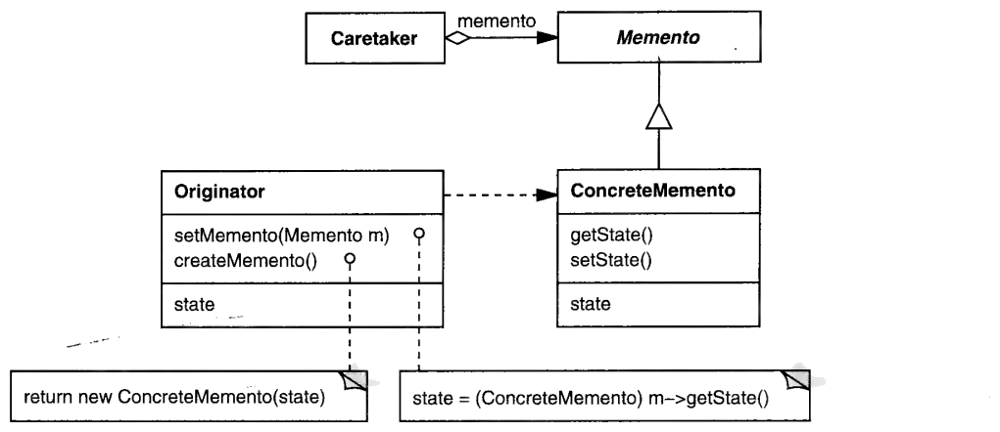

# 3.5 类型洗白

有什么地方不对劲。
事情正在变得难看。

你为了找回丢失的类型信息，正跳着一个个火圈。
一遍又一遍，你发现自己用着那个 D 字头的词——`dynamic_cast`。
可你别无选择，因为你正在用的那个笨框架不知道你对它的接口做了哪些扩展。
这类痛苦是设计缺陷的确凿征兆。
好消息是：缺陷自有一种变成特性的门道，这一回就变成了一种相当有用的特性。

设想一个实时控制框架，它定义了一个抽象基类 `Event`。
基于这个框架的应用，用 `Event` 的子类来建模领域特有的事件。
不同的应用需要不同种类的事件：比方说，巡航导弹产生的事件和自动售货机产生的事件就大不一样——除非那台售货机是专为特别凶险的街区设计的。

鉴于领域特有事件的多样性，框架的设计者压根没打算拿出一个包打天下的 Event 接口。
Event 只定义了两个对任何种类事件都说得通的操作：

```cpp
virtual long timestamp() = 0;
virtual const char* rep() = 0;
```

`timestamp` 定义事件发生的精确时刻，`rep` 返回事件的一种低层表示，也许是直接从网络或受控设备上取来的一包字节。
定义并实现更具体、更贴近应用的操作，是子类的事。

拿自动售货机来说。
它的 `CoinInsertedEvent` 子类增加了一个 `Cents getCoin()` 操作，返回顾客投入硬币的面值。
另一种事件 `CoinReleaseEvent`，在顾客想把钱要回来时被实例化。
`getCoin` 以及类似的操作会用 `rep` 来实现。
这些事件的客户端当然可以直接使用 `rep`，如果它是 public 的话。
但把它设成 public 实在没什么道理：`rep` 几乎不提供任何抽象，还会逼着客户端费好大劲才拿到它需要的信息。
更可能的是把 `rep` 设为 protected——它只与子类有关，子类用它来实现更专门的接口。

然而这里潜伏着一个问题，它源于无法为事件定义一个通用的接口。
框架并不知道、也不可能知道任何关于领域特有 Event 子类的事。
毕竟，它们是由应用开发者在框架被设计、开发、刻进 CD-ROM 很久之后才定义的。
框架关于事件所知道的一切，就是它们实现了一个仅由 `timestamp` 和 `rep` 两个操作构成的骨干接口。

这就引出两个问题：

1. 框架如何**创建**领域特有子类的**实例**？
2. 当应用代码从框架那里只能拿到 `Event` 类型的对象时，它如何**访问子类特有的操作**？

第一个问题的答案，就在《Design Patterns》所描述的若干创建型模式中的任意一个里。
举例来说，框架可以定义工厂方法（来自 FACTORY METHOD 模式），由它们返回领域特有 Event 子类的实例。
每当框架需要一个新实例，它就用工厂方法，而不是调用 `new`。
应用覆写这些工厂方法，让它们返回领域特有的实例。

如果你不想仅仅为了返回领域特有的事件就非子类化不可，那就用 PROTOTYPE 模式。
PROTOTYPE 为 FACTORY METHOD 提供了另一种基于组合的选择。
只要往 Event 基类里加一个

```cpp
virtual Event* copy()
```

操作，框架代码就能让事件自己复制自己。
这样我们不必写

```cpp
Event* e = new CoinReleaseEvent;
```

（框架根本不可能这么写，因为它引用了一个领域特有的子类），而是写

```cpp
Event* e = prototype->copy();
```

其中 `prototype` 指向一个框架所知的类型——也就是 `Event`——的实例。
因为 `copy` 是个多态操作，`e` 可以是*任何* Event 子类的实例，领域特有的也好，不是的也好。
框架实现者只需确保 `prototype` 在被使用之前已经初始化好，具体地说，被初始化成某个恰当的 Event 子类的实例。
这件事应用可以在自己的初始化阶段做，也可以在框架调用 `prototype->copy()` 之前的任何方便时机做。

创建子类特有的实例，就说到这里。
现在说第二个问题：有没有什么模式，能把类型信息从实例里找回来？
更确切地说，如果框架提供了这样一个操作：

```cpp
virtual Event* nextEvent();
```

应用怎么知道 `nextEvent` 返回的是哪种事件，从而调用正确的子类特有操作？

办法总是有的，那就是蛮干：

```cpp
Event* e = nextEvent();
CoinInsertedEvent* ie;
CoinReleaseEvent* re;
// 其他种类事件的类似声明

if (ie = dynamic_cast<CoinInsertedEvent*>(e)) {
    // 对 ie 调用 CoinInsertedEvent 特有的操作
} else if (re = dynamic_cast<CoinReleaseEvent*>(e)) {
    // 对 re 调用 CoinReleaseEvent 特有的操作
} else if (...) {
    // ……你懂我的意思
}
```

要是应用里每处理一个来自框架的事件都得来这么一遍，那可真是苦不堪言。
这还不是全部：往后一旦我们定义了 `Event` 的新子类，痛苦就会加剧。
一定有更好的办法。

VISITOR 是我们找回丢失类型信息而又不必求诸动态转换的标准技术。
在这里应用这个模式，第一步是往 Event 基类里加一个 `void accept(EventVisitor&)` 操作，其中 `EventVisitor` 是能访问事件的那些对象的基类。
既然框架定义了 `Event` 类，它也就必须定义 `EventVisitor` 类——于是我们又撞上另一道关：`EventVisitor` 的接口长什么样？

我们知道，抽象的 Visitor 接口必须为 visitor 所能访问的每一种对象定义一个 `visit` 操作。
可要是这些对象的类型框架并不知道呢？
我们那个访问售货机事件的 visitor 会需要这样的操作：

```cpp
virtual void visit(CoinInsertedEvent*);
virtual void visit(CoinReleaseEvent*);
// 依此类推，为每个领域特有事件各一个 visit 操作
```

显然，这些操作没法由 `EventVisitor` 这样的框架类来定义。
看来连 VISITOR 也救不了我们，还是躲不开那个可怕的 `dynamic_cast`。
唉。

<p align="center">❖ ❖ ❖</p>

别被表象骗了：这里的要点不是哀叹类型信息的丢失，而是反过来拿它为我所用。
先把 Event 放到一边，来看看 MEMENTO 模式里一个看似无关的问题。
（别担心——稍后我会考察 Event 困境的一种截然不同的解法。）

MEMENTO 的意图是捕捉并外化一个对象的状态，好让该对象日后能恢复到这个状态。
这听着也许容易，但我漏掉了一个重要的约束：外化状态必须**不破坏对象的封装**。
换句话说，对象的内部状态对其他对象应当*可用*但*不可见*。
这不自相矛盾吗？

一点也不矛盾。
一个简单的例子就能说明这个区别。
正如我们在 ITERATOR 里所描述的，*游标*就是一种迭代器，它除了标记遍历中的某个位置之外什么都不做。
遍历过程中，被遍历的结构会 "推进" 游标，使它指向遍历中的下一个元素。
结构还可以代表客户端 "解引用" 游标（也就是返回它所指的元素），就像这样：

```cpp
Structure s;
Cursor c;

for (s.first(c); s.more(c); s.next(c)) {
    Element e = s.element(c);
    // 使用 Element e
}
```

游标没有任何客户端可访问的操作。
只有被遍历的结构才能访问游标的内部。
这个结构配得上这份专有特权，因为游标里的信息实际上是结构内部状态的一部分。
既是内部状态，就必须保持封装——这正是游标是一个 Memento 的原因。
至于模式里的其他参与者，那个结构就是 memento 的 Originator，而客户端充当 Caretaker。

能做到这一点的关键，是实现一个相当于 "两面人" 的东西。
结构看到的是一个宽接口，可以访问状态信息。
其他客户端看到的则是一个狭窄、甚至根本不存在的 Memento 接口；让它们访问 memento 内部的任何状态，都会损害结构的封装。
可我们在 C++ 里怎么给一个对象两副不同的面孔？

MEMENTO 模式建议动用 `friend` 关键字。
Originator 是 Memento 的友元，从而获准访问宽接口，同时又不让其他类访问。

```cpp
class Cursor {
public:
    virtual ~Cursor();

private:
    friend class Structure;

    Cursor () { _current = 0; }
    ListElem* getCurrent () const { return _current; }
    void setCurrent (ListElem* e) { _current = e; }

private:
    ListElem* _current;
};
```

这个场景里，`Cursor` 只揣着一个小小的指针。
它指向一个 `ListElem`——`Structure` 内部用来表示双向链表节点的类。
`ListElem` 对象既持有指向表中前驱和后继的指针，也持有指向某个 `Element` 对象的指针。
`Structure` 的各个操作摆弄 `_current`，以此来跟踪遍历到了哪一点：

```cpp
class Structure {
public:
    // ...

    virtual void first (Cursor& c) {
        c.setCurrent(_head);
        // _head 是链表的表头，
        // 由 Structure 内部持有
    }

    virtual bool more (const Cursor& c) {
        return c.getCurrent()->_next;
    }

    virtual void next (Cursor& c) {
        c.setCurrent(c.getCurrent()->_next);
        // 把当前置为下一个 ListElem*
    }

    virtual Element& element (const Cursor& c) {
        return *c.getCurrent()->_element;
    }
    // ...
};
```

总之，MEMENTO 让结构把恰到好处的那点敏感信息藏进 `Cursor` 这个 Memento 里，用来标记遍历当前进行到哪一步。

熟悉 `friend` 的行家也许会发现这个做法有一个可能很严重的短处。
由于友元关系不被继承，`Structure` 的子类 `Substructure` 并不享有父类的访问特权。
换句话说，`Substructure` 的代码访问不了 `Cursor` 的秘密接口。

如果 `Substructure` 只是从 `Structure` 继承了那些游标处理操作，这其实无所谓。
可一旦 `Substructure` 需要覆写这些操作，或者必须实现其他依赖游标的功能，它就用不上 `Cursor` 的私有操作了。
举例来说，假设 `Substructure` 自己维护着一份子元素链表，这些子元素也应当纳入遍历。
当 `next` 走到 `Structure` 链表的末尾时，它要不动声色地转到 `Substructure` 那份链表的表头。
这就得覆写 `next`，并相应地设置游标的 `_current` 成员。

一种变通办法是在 `Structure` 里定义一组与 `Cursor` 接口平行的 protected 操作，只不过把实现委托给游标：

```cpp
class Structure {
    // ...

protected:
    ListElem* getCurrent (const Cursor& c) const {
        return c.getCurrent();
    }
    void setCurrent (Cursor& c, ListElem* e) {
        c.setCurrent(e);
    }
    // ...
};
```

这实际上把 `Structure` 的特权扩展给了它的子类。
可平行的接口通常是个错误。
它们难看、冗余，还会让修改接口这件事成倍地费事。
要是我们能避开它们——更好的是，干脆避开 `friend`——长远来看我们大概会感谢自己。

下面就是我们把设计缺陷变成特性的地方。
我甚至给它起了个名字：*类型洗白*。
办法是把 `Cursor` 定义成一个抽象基类，其中只包含其接口里该公开的那部分，而在这里就只剩析构函数：

```cpp
class Cursor {
public:
    virtual ~Cursor () { }

protected:
    Cursor();
    Cursor(const Cursor&);
};
```

我们把默认构造函数和复制构造函数设为 protected，以禁止实例化——也就是确保 `Cursor` 表现得像个抽象类。
要做到这一点，只把析构函数声明为纯虚也行，但那样会逼着子类去定义析构函数，哪怕它们并不需要。
两种做法都让子类来定义那个享有特权的接口：

```cpp
class ListCursor : public Cursor {
public:
    ListCursor () { _current = 0; }

    ListElem* getCurrent () const { return _current; }
    void setCurrent (ListElem* e) { _current = e; }

private:
    ListElem* _current;
};
```

在这种安排下，`Structure` 里那些以 `Cursor` 为参数的操作必须先把它向下转型为 `ListCursor`，才能访问扩展出来的接口：

```cpp
class Structure {
public:
    // ...

    virtual void first (Cursor& c) {
        ListCursor* lc;

        if (lc = dynamic_cast<ListCursor*>(&c)) {
            lc->setCurrent(_head);
            // _head 是链表的表头，
            // 由 Structure 内部持有
        }
    }
    // ...
};
```

动态转换确保这个结构只会访问和修改 `ListCursor` 对象，而且只访问 `ListCursor` 对象。

这个设计的最后一笔，是游标如何被实例化。
显然，客户端再也不能直接实例化 `Cursor` 或它的子类了——只有 `Structure`（的子类）知道自己用的是哪种游标。
于是我们改用 FACTORY METHOD 的一个变体，把实例化过程抽象掉：

```cpp
class Structure {
public:
    // ...

    virtual Cursor* cursor () { return new ListCursor; }
    // ...
};
```

因为 `cursor()` 返回的是 `Cursor*` 类型的东西，客户端访问不到那些子类特有的操作——除非它们四处胡乱地做（动态）转换去猜类型；而要是 `ListCursor` 没有导出在头文件里，连这条路都走不通。
与此同时，`Structure` 的子类则可以自由地重定义 `more`、`next`、`element` 这些操纵游标的操作。

图 3.11 归纳了这个基于类型洗白的实现。
把它和《Design Patterns》第 285 页 MEMENTO 的结构图比一比。
这里的主要差别是引入了一个 ConcreteMemento 子类，它把那个享有特权的接口加到骨感的 Memento 接口之上。
Originator 知道自己打交道的是具体的 memento（毕竟就是它们实例化的）。
可 Caretaker 拿 memento 几乎什么也做不了，因为它们看到的只有那副骨架。
虽然这张图画不出来，但类型洗白让 C++ 实现既不必动用 `friend`，也不必再去绕着它的短处打补丁。

<a id="fig-3-11"></a>

<br/>
*图 3.11：采用类型洗白的 MEMENTO 修订结构图*

小小的类型洗白竟能这么干净地收拾你的设计，真叫人称奇。
（咳咳！）
