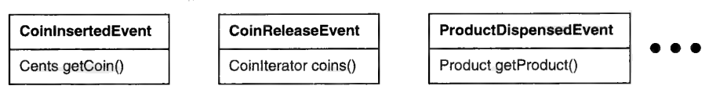
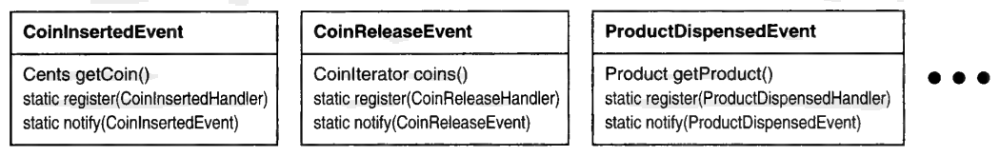
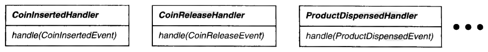
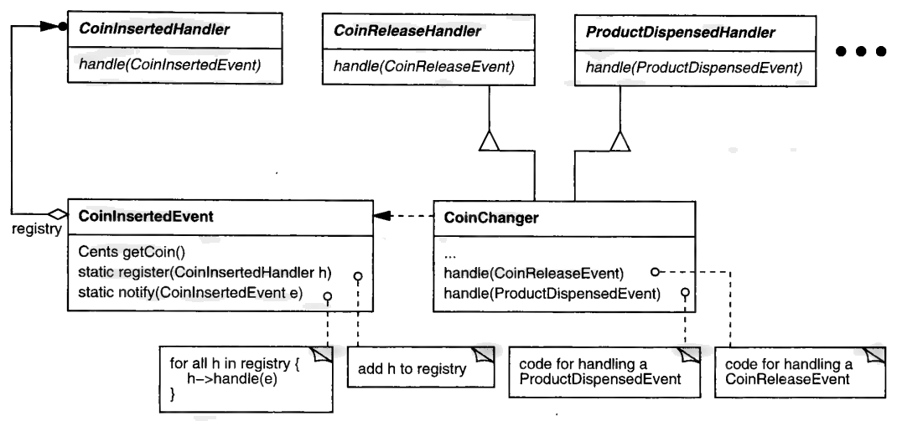

# 3.7 推我-拉你

实时控制那个例子里，我留了一个问题没有解决，它关涉框架如何把事件提供给应用代码。
在标准的做法里，框架定义一个

```cpp
virtual Event* nextEvent();
```

操作，应用想在哪里、想在什么时候处理事件，就调用它。
不幸的后果是：返回值必须无一例外地向下转型成应用定义的类型。
在售货机的例子里，这就酿出了下面这段代码：

```cpp
Event* e = nextEvent();
CoinInsertedEvent* ie;
CoinReleaseEvent* re;
// 其他种类事件的类似声明

if (ie = dynamic_cast<CoinInsertedEvent*>(e)) {
    // 对 ie 调用 CoinInsertedEvent 特有的操作
} else if (re = dynamic_cast<CoinReleaseEvent*>(e)) {
    // 对 re 调用 CoinReleaseEvent 特有的操作
} else if (...) {
    // ……你懂我的意思
}
```

框架只认识基类 `Event`。
所以每当框架处理一个事件，它实际上就把 `Event` 所声明的之外的一切类型信息——包括子类所定义扩展的全部痕迹——都 "洗" 了出去。
类型信息因此丢失，而我们得费好大劲才能把它找回来。

在接口扩展成为常态的场合，这可不是小麻烦。
事件处理代码不是类型安全的。
动态转换的结果没法在编译期检查，于是与类型相关的编程错误只能等到崩溃时才被发现。
此外还有 "打标签 + switch" 式编程的经典缺点：代码笨拙，难以扩展，而且低效。

在应用 VISITOR 也没能补救局面之后，我答应要描述一种截然不同的做法。
这就奉上。

新做法之所以不同，一部分在于事件如何被送达。
目前，`nextEvent` 是应用获得事件的*唯一*途径。
应用代码在自己方便、且准备好了去处理下一个事件时才调用它。
如果它在并没有待处理事件的时候调用了 `nextEvent`，就会发生两件事之一：调用线程阻塞，或者 `nextEvent` 返回空值，那大概会导致忙等。
究竟会是哪一种，由框架设计者决定。⁸
无论哪种，都是事件的消费者主动发起对事件的处理。
这就是事件驱动编程的**拉**（pull）模型，因为事件的消费者（例如应用）才是主动的一方，它从事件生产者——在这里就是框架——那里把信息 "拉" 过来。

⁸：许多框架同时提供 `nextEvent` 的阻塞与非阻塞变体，以支持这两种选择。
有些还允许带超时的阻塞。

这个拉模型的阴阳对面，毫不意外地叫作**推**（push）模型。
在推模型里，消费者被动地等待事件到来的通知。
由于生产者必须把信息推送给任意多个消费者，这种模型要求消费者事先向那些应当通知它们的生产者登记注册。⁹

⁹：推模型是 "好莱坞原则" 的又一个例子（第 45 页）。
关于这两种模型的深入讨论，见 Schmidt 与 Vinoski 的精彩文章 [SV97](../biblio.md#sv97)。

就我们而言，推与拉的问题归结为：在这个框架里把控制权放在哪一端。
推模型倾向于以生产者为代价来简化消费者，拉模型则反过来。
所以，重要的是考虑生产者代码与消费者代码的相对多寡。
如果生产者少、消费者多，那么推模型可以说是更好的选择。
举例来说，在电路仿真里，可能只有一个全局时钟，而依赖它的子电路有很多。
那么，与其把每个子电路都搞复杂，不如要一个本身带着相应复杂度的推模型时钟。

这可不是什么铁律；也许有些考虑与生产代码、消费代码的处所数目无关，却偏向拉模型。
但在我们的实时控制框架里，可以合理假定消费事件的代码处所会多于产生事件的处所。
既然没有反方论据，推就成了首选模型。

这种做法的另一个关键差别，在于事件来源的集中化——或者更确切地说，在于如何避免它。
目前，`nextEvent` 把事件送达机制集中在框架里，使它成了类型洗白的那道瓶颈。
那么，如果问题出在集中化，某种形式的*去中心化*不正是显而易见的解法吗？

毫无疑问，但凡事得一步步来。
如果我们的理想（没错，就是理想）是一套可扩展、类型安全的事件送达机制，那我们就该谨慎选择把向应用代码送达事件的接口——至少是送达*应用特有*事件的接口——放在哪里。
它根本不能栖身于框架之中，否则我们又得回到 `dynamic_cast` 的炼狱里去。
我们必须以类型安全的方式送达事件，*同时*让应用能定义新的事件而不必改动代码——无论是框架里的代码还是应用里的代码。
这些约束，加上从拉到推的转变，都要求让 `nextEvent` 作为事件送达的唯一接口寿终正寝。

接下来，我们得弄清把这份责任转移到哪里去。
既然可扩展性是关注点，迟早得考虑 "扩展系统时会变的是什么"。
那就早点来考虑吧，并且假定在此语境下最让应用操心的变化，是*新事件的定义*。
框架当然可以预定义一些通用事件，比如 `TimerEvent` 或 `ErrorEvent`。
但大多数应用会在更高的抽象层次上定义自己的事件——例如售货机的 `CoinInsertedEvent` 和 `CoinReleaseEvent` 类。

因此，变化的粒度就是事件的种类。
我之所以这么说，是因为把*变化*的粒度与*扩展*的粒度对齐，是在扩展面前把动荡降到最低的关键。
功能上有多大的变化，实现上就该有多大的变化。
你显然不希望一个小小的功能改动激起大面积的代码修改。
可反过来呢？
为什么重大的功能变化就不该只要求对代码做小小的改动？

这听起来也许令人向往，可实际上是乌托邦。
要做到它，通常意味着二者之一：要么系统在功能上不稳定、因而容易出错；要么（更可能的是）变化并不表达在系统本身之中，而是表达在另一份通常是解释执行的规格说明里——例如脚本语言之于 C++。
后一种情形下，系统不太可能需要修改，只是因为 "系统" 指的是那个解释器。
这理所当然：如果增加功能意味着改动解释器，那必定是某个人在某处惨败了。

如果你接受这条 "对齐原则" 是有效的，那它对我们这个设计意味着什么？
我们把每个变化的粒度——事件的种类——显式地建模成一个类。
一个类同时定义了实现和接口。
那么按对齐原则，扩展功能的代码就该同时包含实现代码*和*客户端为类型安全访问所需的那些专门接口。
换句话说，一种新事件应当只产生*一个*新类，仅此而已。
其他代码都不该增删或改动。

回顾一下——新设计应当：(1) 以推的方式把事件送达给它们的消费者；(2) 每个应用特有的事件至多只要求新增一个类，且不改动既有代码。
我知道这是高难度动作，但我们差不多真能做到。

首先，把事件的公共基类忘掉。
子类特有的接口才是常态。
基类的功能几乎没有。
不再有一个要求多态返回值的 `nextEvent` 操作。
总之，公共基类带来的麻烦多过它的价值。
所以我们改为定义彼此独立的事件类，其接口恰好是客户端所需——不多也不少。

<a id="fig-3-7a"></a>

<br/>

接下来，这些类各自获得一个专属的注册接口：

<a id="fig-3-7b"></a>

<br/>

与注册相关的操作有两个：`register` 和 `notify`。
二者都是静态的。
举例来说，任何想获得 `CoinInsertedEvent` 的实例，都必须把自己注册给 `CoinInsertedEvent` 类。
任何对象都可以通过调用 `CoinInsertedEvent::notify`、以某个 `CoinInsertedEvent` 实例为实参，来宣告这样一个新实例的降临。

你也许注意到了：你没法把随便什么旧对象注册给某个事件类，它必须是特定类型的。
如果你不明白，看看每个 `register` 操作的实参。
对 `CoinInsertedEvent` 来说，注册者必须是 `CoinInsertedHandler` 类型；对 `CoinReleaseEvent` 来说就是 `CoinReleaseHandler`，依此类推。
这些类型定义在各自独立的 mixin 类里，而那些类存在的唯一目的就是定义一个事件处理接口：

<a id="fig-3-7c"></a>

<br/>

对处理这些事件之一（或更多）感兴趣的类，必须实现相应的接口。
举个例子，假设有个 `CoinChanger` 类负责售货机里找零子系统的行为。
找零器想知道用户何时按下退币按钮，好按需退出零钱。
它还想知道商品何时被成功送出，好为下一笔生意重置自己。
因此，`CoinChanger` 必须**同时**实现 `CoinReleaseHandler` 和 `ProductDispensedHandler` 两个接口，如图 3.12 所示。

<a id="fig-3-12"></a>

<br/>
*图 3.12：CoinChanger 同时实现了 CoinReleaseHandler 与 ProductDispensedHandler 接口*

最后，找零器还负责把投币的情况通知其他子系统。
当底层硬件感知到一枚硬币，`CoinChanger` 就创建一个 `CoinInsertedEvent` 实例作为响应（如图 3.12 里那条带箭头的虚线所示）。
用必要的信息把事件初始化好之后，它调用 `CoinInsertedEvent::notify`，把新实例作为实参传进去。

反过来，`notify` 会遍历 `CoinInsertedHandler` 接口的所有已注册实现者——也就是所有表达过 "想收到投币通知" 的对象——调用它们的 `handle` 操作，并把 `CoinInsertedEvent` 对象一并传过去。
与此同时，`CoinChanger` 对象（大概是在实例化的过程中）也注册给了 `CoinReleaseEvent` 和 `ProductDispensedEvent` 类。
于是，每当售货机里其他子系统产生 `CoinReleaseEvent` 或 `ProductDispensedEvent`，`CoinChanger` 实例都会得知。
没有类型测试，没有向下转型，没有 switch 语句——绝无虚言。

扩展也很容易。
假设新款售货机配了个纸币器，那就得把一个新的 `BillAcceptedEvent` 整合进控制软件。
所需做的不过是定义一个 `BillAcceptedEvent` 类，再加一个对应的 `BillAcceptedHandler` mixin。
然后，任何关心这个新事件的子系统要做三件事：

1. 向 `BillAcceptedEvent` 注册。
2. 继承 `BillAcceptedHandler`。
3. 实现 `BillAcceptedHandler::handle` 来处理该事件。

不错，这离 "只定义一个类、不改动任何既有代码" 的目标还差一点。
我们多引入了一个接口（`BillAcceptedHandler`），但那算不上多少活。
而对既有代码的改动被限制在应用里，不在框架里——框架可以从容地守着一组固定的预定义事件类和处理器接口。
生活*确实*变好了。

<p align="center">❖ ❖ ❖</p>

Mark Betz 来信说 [Betz97](../biblio.md#betz97)：

> 你把 "类型洗白" 问题在控制框架的事件处理这方面解决掉了。
> 去中心化是一种解法，但它有个效果我没见你直接承认：你这番去中心化，不是一直去到了把事件处理赶出框架的地步吗？

既是也不是。
框架仍然可以为公共事件定义事件类和处理器。
我提到过两个：`TimerEvent` 和 `ErrorEvent`。
去中心化并不排斥复用；这两件事是彼此独立的。

如果事件处理要做到类型安全——而这正是这番折腾的要点——那么框架就必须避免把某一特定类型的事件与对该事件的处理绑定在一起。
这正是去中心化的目标。
当框架把唯一的事件处理接口定义成 "事件绑定处理器" 时，它就只能假定一个 "最小公分母" 式的事件类型。
应用必须靠动态手段去补齐差的那部分。

顺便说一句，那也许是个合理的权衡。
在许多场合下，静态类型与其说是帮助，不如说是障碍——毕竟，五万名 Smalltalk 程序员不可能都错！
但系统越大、活得越久，它从静态类型中获益的可能性就越大。

顺便再说一句：你在这里目睹的，是 MULTICAST 的一个应用——这个模式我们反复摆弄过很多次。
下一章我会细看它。
