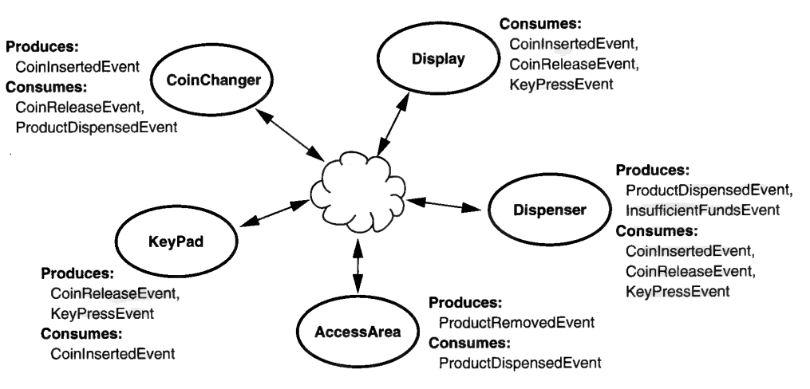
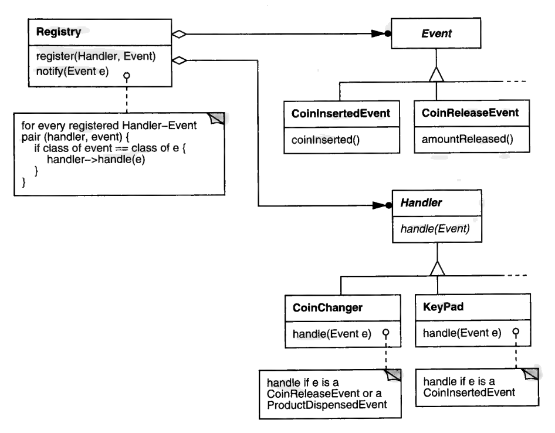
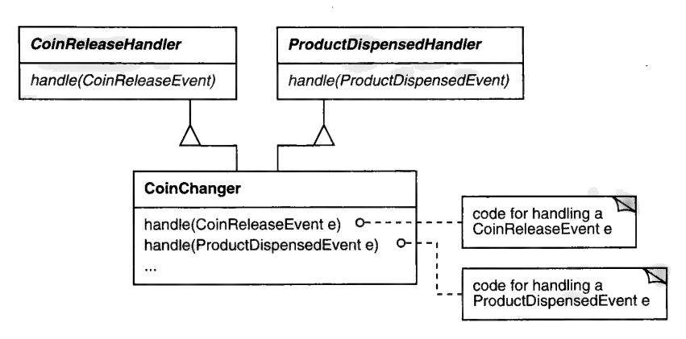
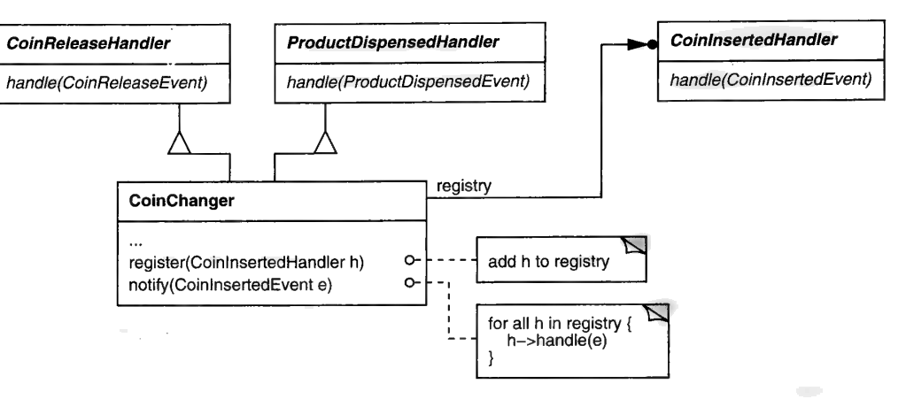
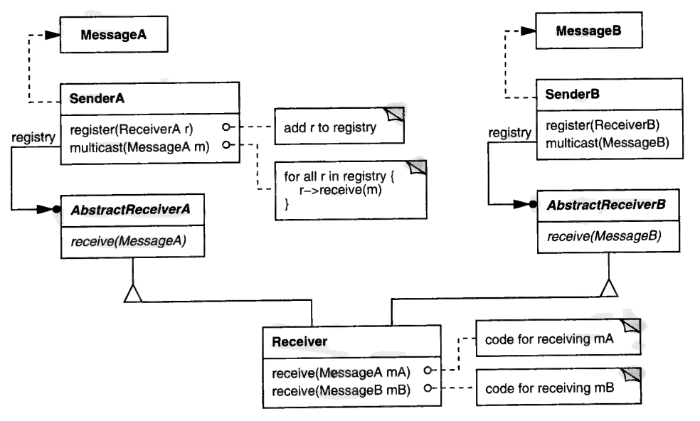
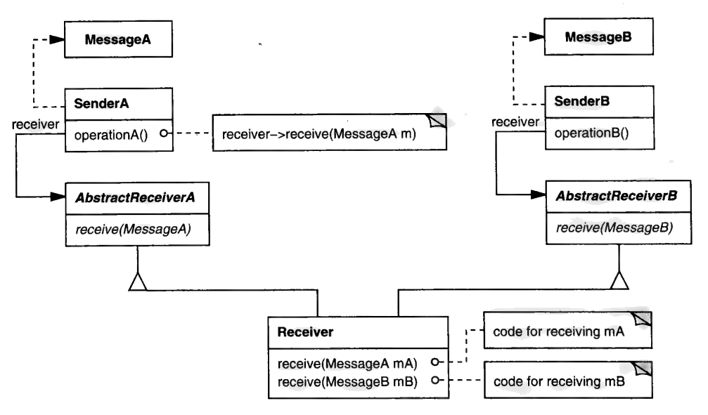

# 第 4 章 热爱之作

如果说 MULTICAST 算得上一个模式，那它也一直是个进行中的模式。
即便如此，我还是觉得，把它那副半生不熟、衣冠不整的 "尊容" 原样摊出来挺有意思。
我甚至把我们就它往返讨论的许多信件也附上了，那应该更有意思。
也许*太*有意思了。
毕竟，人们会意识到我们一点也不比别人更有先见之明。
那些把 GoF 四人奉若神明的人，看到我们开发模式的过程大体上如此混乱，怕是要惊骇不已。
我大概会戳破一两个神话泡泡——不过转念一想，这是件好事。

那个关键的意图一节，我先按下不表（它向来是争议的焦点），直接跳到动机。
这里的情景跟我一直用的自动售货机例子相似，但并不相同。

## 动机

如果一个程序的控制流由外部的刺激所主导，而这些刺激称为**事件**，那么这个程序就是**事件驱动**的。
事件驱动的设计在实时控制类应用里很常见。
一个关键的设计难题在于：怎样让这类系统*同时*做到可扩展与类型安全。

设想一台现代的、由数字电路控制的自动售货机。
它有几个子系统，包括零食出货器、硬币找零器、选购商品的键盘、一块字符显示屏，还有一个 "黑箱" ——一台统管全局的小计算机。
这些子系统与顾客之间的交互相当复杂。
你可以把这些子系统、以及它们之间的交互都建模成对象，以此控制复杂度。

比方说，顾客投入一枚硬币时，`CoinChanger` 对象（它监视着硬币找零器子系统）会产生一个 `CoinInsertedEvent` 对象。
该对象记录这次事件的细节，包括投入的时刻以及以美分为单位的金额。
另有一些类对其它值得关注的事件建模。
`KeyPressEvent` 表示键盘上某个键被按下。
`CoinReleaseEvent` 的实例记录顾客要求退钱。
`ProductDispensedEvent` 与 `ProductRemovedEvent` 对象则标志一包零食交付的最后阶段。
事件类的数量可能很多，而且可以说是开放的：加装一台纸币兑换器及与之相关的事件（比如 `BillInsertedEvent`），对既有代码的改动应当尽量小。

事件产生之后会怎样？
哪些对象会用到它？
它又怎样到达这些对象手里？
这些问题的答案取决于事件的种类（见图 4.1）。
投币之后发生的任何 `CoinReleaseEvent`，`CoinChanger` 都关心。
可是，它自己为其它对象产生的 `CoinInsertedEvent`，`CoinChanger` 并不想收到。

<a id="fig-4-1"></a>

<br/>
*图 4.1：售货机的事件，以及它们的生产者与消费者*

同样地，`Dispenser` 对象会产生 `ProductDispensedEvent` 的实例，却不想接收这些实例。
但它对 `KeyPressEvent` 对象则极为关切，因为这些对象决定了该出哪种零食。
不同子系统对象所关心的事件各不相同，甚至可能动态地变。

照这样发展下去，事件对象、事件的产生者与消费者之间会缠成一团乱麻般的依赖关系。
复杂的依赖要不得，因为它让系统更难理解、更难维护、更难修改。
改变一个对象所关心的事件，不仅应当在静态时容易，在运行期也应当容易。

常见的解法是用一个**事件登记表**来追踪这些依赖。
客户端就某个特定事件向登记表登记自己的兴趣。
对象产生事件之后，把它交给登记表，由登记表把它送达有关对象。
这种做法要求两套标准接口——一套给事件，另一套给那些想处理事件的对象（图 4.2）。

<a id="fig-4-2"></a>

<br/>
*图 4.2：事件登记表方案*

当 `Handler` 的某个子类（比如 `CoinChanger`）通过自己的 `handle` 操作（它实现 `CoinChanger` 对该事件的处理）收到一个事件时，事件的具象类型在静态时是未知的。
这一点很要紧，因为不同种类的事件记录的信息不同；没有哪一个 `Event` 接口能预见到每个子类的需要。
所以每个 `Event` 子类都在基本的 `Event` 接口上扩展出子类特有的操作。
为了用上这些操作，`CoinChanger` 必须试着把事件向下转换成它处理得了的类型：

```cpp
void CoinChanger::handle (Event* e) {
  CoinReleaseEvent* cre;
  ProductDispensedEvent* pde;
  // similar declarations for other events of interest

  if (cre = dynamic_cast<CoinReleaseEvent*>(e)) {
    // handle a CoinReleaseEvent
  } else if (
    pde = dynamic_cast<ProductDispensedEvent*>(e)
  ) {
    // handle a ProductDispensedEvent
  } else if (...) {
    // etc.
  }
}
```

这种做法有一个问题：它不是类型安全的。
要用上子类特有的操作，就得做动态转换，而转换的结果无法在编译期检查。
这意味着某些与类型有关的编程错误可能一直藏着，直到运行期才暴露。
这段代码还带齐了 "打标签 + switch" 式编程的全部缺点：笨拙、难扩展、效率低。

MULTICAST 模式展示了怎样以可扩展、且在静态上类型安全的方式把信息送达有关对象。
这个模式不要求 `Event` 或 `Handler` 的层次结构有单一根类。
反过来，你为每个具象事件类定义一个抽象的处理器类——比如为 `CoinReleaseEvent` 定义一个 `CoinReleaseHandler`。
任何想处理 `CoinReleaseEvent` 的类，都必须继承自 `CoinReleaseHandler` 类。
处理其它类型的事件也是同理：有关各方必须继承相应的处理器类。

图 4.3 中，`CoinChanger` 同时继承 `CoinReleaseHandler` 与 `ProductDispensedHandler`，因为它对 `CoinReleaseEvent` 和 `ProductDispensedEvent` 都关心——这两种情况下它都可能要退币。
和前面一样，每个处理器类都定义一个 `handle` 操作，由子类在其中实现对事件的处理。
但与最初的登记表做法不同，`handle` 的形参给出了确切的具象事件类型，因此无需向下转换——这个操作在静态上是类型安全的。

<a id="fig-4-3"></a>

<br/>
*图 4.3：在 CoinChanger 中实现 Handler 接口*

可是，事件究竟怎样*送达*有关对象——也就是说，谁来调用 `handle`？
你可以像先前那样定义一个带 `register` 与 `notify` 操作的 `Registry` 类，只不过现在有多种互不继承的处理器类。
于是需要的不止一个、而是好几个 `register` 操作，每种处理器一个。
而且每当你定义一种新事件，都得给 `Registry` 类加一个 `register` 操作。
换句话说，你得改动既有代码。

去中心化提供了绕过这一困难的办法。
客户端不必向一个庞大的登记表登记，而是可以直接向产生事件的对象登记自己的兴趣。
比如，客户端若关心 `CoinInsertedEvent`，就向产生这类事件的 `CoinChanger` 类登记这份兴趣（见图 4.4）。

<a id="fig-4-4"></a>

<br/>
*图 4.4：CoinChanger 的登记接口与实现*

每当 `CoinChanger` 产生一个 `CoinInsertedEvent`，它就调用自己的 `notify` 操作，把事件送达所有已登记的 `CoinInsertedHandler`。
编译器保证它们收到的对象正是它们所关心的那种：`CoinInsertedEvent`。
同样，关心 `ProductDispensedEvent` 的客户端向 `Dispenser` 登记自己。
一般来说，你向某个事件类的实例化者登记对该类事件的兴趣。
这样把登记去中心化，能提升可扩展性。
定义一种新事件时，你改动的代码仅限于产生该事件的那个（些）类；而集中式的做法还要求你改登记表的接口与实现。

<p align="center">❖ ❖ ❖</p>

MULTICAST 的设计与上一章那个设计的主要差别在于：这里，客户端向实例化事件的类登记事件兴趣——本例中是 `CoinChanger`。
原来的设计则是让客户端向事件类本身登记。
其实我最初写的动机一节也是这么做的，但 Erich 反对：

> 在我看来，你不该向事件登记兴趣，而该向事件的*发送者*登记。
> 在本例中，售货机应当有 `addCoinReleaseHandler`、`addCoinInsertedHandler` 之类的操作。

而我认为，有必要为 "把登记接口放进事件类" 这种做法给出充分的动机论证。
动力来自扩展的便利。
你希望在定义新事件时避免大动干戈。
如果登记机制放在一个既有的类里，你就得改动它，才能容纳新的登记操作。
把登记接口放进事件本身，则更容易容纳新事件。

然而从建模的角度看，Erich 是对的，因为向一个事件类发通知，怎么看都别扭。
虽说我们说的是类上的静态操作、而不是某个实例，可看上去仍然像是在通知一个事件关于它自己的事！
由于 Erich 的偏好覆盖的是更一般的情形，我们同意以它作为代表性设计。
因此结构、参与者、协作三节把登记接口放在发送者身上。
如果我坚持自己的偏好，结果就是在动机一节鼓吹一种设计、其后各节又换成略有不同的另一种设计，把读者搅糊涂。

<p align="center">❖ ❖ ❖</p>

## 结构

<a id="fig-4-5"></a>

<br/>

## 参与者

**Message**（`ProductDispensedEvent`）

- 封装需要从 sender 传送到 receiver 的信息。

**Sender**（`Dispenser`）

- 维护一份 Receiver 对象的登记表。
- 定义用于登记 Receiver 对象的接口。
- 定义并实现把消息送达已登记 Receiver 对象的接口。

**AbstractReceiver**（`ProductDispensedHandler`）

- 定义接收 Message 对象的接口。

**Receiver**（`CoinChanger`）

- 实现一个或多个 AbstractReceiver 接口。

## 协作

- 客户端通过 Sender 的登记接口，把 receiver 登记到 sender 那里。
- sender 实例化消息，并把它们送达已登记的 receiver。

<p align="center">❖ ❖ ❖</p>

于是，结构、参与者、协作三节说明的是一般情形。
我早先那些例子只是把 Sender 与 Message 两个类合并成 `Event` 类而已。
顺便说一句，这仍然是个可行的选择，所以我们把它下放到实现一节。
到目前为止，我们四个人对内容大体上没有分歧；但分歧的种子出现在适用性一节。

## 适用性

当*下列条件全部*成立时，适用 MULTICAST：

- 某些类别的对象可能关心从其它对象发来的信息。
- 这些信息在结构与复杂度上不受限制，并且可能随软件的演进而变化。
- 信息的传送应当静态上类型安全。

这几点本身倒没有招来什么反对意见，但最后一点也许正是我们分歧的要害。
不过，先让我解释一下我们各自的偏见。
Erich、Richard 和我都是喝 C++ 的奶长大的，而 C++ 的类型系统相对较强。
Ralph 则是 Smalltalk 出身——Smalltalk 里根本没有静态类型检查这回事。
所以，我们其余几个人认为 MULTICAST 够得上模式的地位，而 Ralph 认为它不过是 OBSERVER 模式的一个变体——这大概不是巧合。
既如此，他认为它应当作为新版、扩充版 OBSERVER 的一部分写进去。

就目前的构想而言，OBSERVER 与 MULTICAST 之间有明显的相似之处。
两者都在对象之间维护依赖，都在对象之间传递信息，也都在诸多方面强调可扩展性。
然而我们多数人觉得，二者之间存在本质差别。
Erich 很早就表达过这种感受：

> MULTICAST 离 OBSERVER 非常近，但区别很微妙。

确实微妙。
我跟这个区别较了半天劲，最后立了个稻草人：

> 在 OBSERVER 里，你谈的是一对多的依赖。
> 在应用该模式之前，subject 与它的 observer 大概会被揉进同一个对象。
> OBSERVER 把这个对象切开，好让你获得灵活性等等。
> OBSERVER 不太在意它们之间传递的信息，也不太在意这些信息可否扩展——它关注的是通知，以及 subject 与 observer 的一致性。
> <br/><br/>
> MULTICAST 关注的则是 sender 与 receiver 之间传递的信息——它的可扩展性与类型安全。
> 此外，sender 与 receiver 在建模对象上通常毫无关系，它们之间的连接也远更难预料，而且大概也更具动态性。

Ralph 呢——老天保佑他——并不买账：

> 一旦你实现 OBSERVER，你肯定会*非常*在意来回传递的东西！书里那个模式对此讲得不够。
> 它对推模型与拉模型之类只给了些提示，含糊而没什么信息量。
> 它需要具体得多，并且讨论使用 OBSERVER 时可能出现的问题。
> 依我看，你讨论的那些话题，是任何在大型项目里使用 OBSERVER 的人都得想一想的东西。
> 我不相信（关于 MULTICAST 的 sender 与 receiver 在建模对象上彼此无关的那一点）。也许我漏掉了什么。
> <br/><br/>
> 但在（VisualWorks 的 Smalltalk 环境）里，sender 与 receiver 往往互不相关，连接也可以非常动态。
> 既然 VisualComponents（典型的 Observer）与 ValueModels（典型的 Subject）都极其可复用、而且通常是混搭使用的，那么它们之间的连接同样相当难以预料。

考虑到 Smalltalk 连一丁点儿多接口继承的影子都没有，Ralph 认为 MULTICAST 不过是 OBSERVER 身上的一个疣子、或者一个变异的 OBSERVER，也就不足为奇了。
你难道不觉得，MULTICAST 更像是强类型语言里的一种惯用法，而不是一个设计模式？

在后来的一封信里，Ralph 追问我们其余几人为什么认定 MULTICAST 是一个独立堪当的模式：

> 我认为，你们觉得 MULTICAST 重要的那些理由中，有一条没明说的是静态类型检查。
> 你们在设法避免类型转换。
> 避免它有两条不同的路：一条是传一个可以据以分派的事件，另一条是造出若干彼此分离的 Handler 层次。
> 在我看来，如果做了前一条，就不需要做后一条，所以我不明白 MULTICAST 为什么两条都要。
> 也许是因为你想把行为放在 Observer（也就是 Handler）里，而不是放在 Event 里。
> 但在我看来很清楚的是：OBSERVER 需要谈一谈静态类型检查如何把事情弄复杂。
> 总而言之，OBSERVER 划定了一片丰富的设计变体空间。
> 我看不出 MULTICAST 跟其它变体有什么实质不同。
> 这正是 OBSERVER 之所以是*模式*、而不是某种可复用机制的原因：它每被用一次就变一次。
> 你说 MULTICAST 的时候，其实说的是 OBSERVER 某一些常见而有用的变体。
> 但你打包的是特定的一组变体，而其它组合同样有意思，你却把它们忽略了。
> 我认为更好的做法是探索整片空间。

这里面有很多我不得不同意，而从大家的沉默来看，其余人也一样。
可是，你不能没完没了地往一个模式里塞东西。
所以 Erich 没有反驳这些论点，而是提出了一个新的、不同的问题：

> 把一个模式的重要精化与变体提升为一个独立的模式，有那么糟吗？
> 与其在实现一节塞上 20 条要点，我更愿意把它单列成一个模式。

这里牵出一个我们一直绕着走的重要问题：模式的可伸缩性（scalability）。
它会不会是要害中的要害？
我觉得有可能：

> 在让模式更具伸缩性这件事上，有一片肥沃的新天地。
> 我们的每一个模式，我都留了一个文件，用来记评论、反馈和我们获得的任何新洞见。
> 其中不少文件已经相当大了。
> 假如我们把关于某个模式（比方说 SINGLETON）所学到的一切全都塞进 SINGLETON 模式里，结果会臃肿不堪。
> 我们有几个模式——我想起 OBSERVER 和 COMPOSITE——照现样看就已经太长了。
> 怎样提升 "伸缩性"？把每个模式写成一门模式语言是一种可能。
> 但我得承认，以这个名字写出来的（许多东西）并不让我兴奋。
> 真能做成的话，是造出某种超级结构：它容纳现有这些模式，同时为新洞见、新扩展、新变体留出位置。
> 如果说我从 MULTICAST 学到了什么，那就是：我们的模式不可能永远长大下去。

我也觉得需要浮上水面透口气，问几个根本性的问题：

1. （MULTICAST 与 OBSERVER）是什么关系？
2. 二者是否相互依赖？若是，是否必须把它们并成一个模式？
3. OBSERVER 的一对多依赖，本身有用吗？
4. 每次应用 OBSERVER，是否也都在应用 MULTICAST？

Ralph 对第 1 个问题的想法是：MULTICAST 要么是 OBSERVER 的 "特例/扩展"，要么是一个把 OBSERVER 包含在内的 "组合" 模式。¹

¹：此处的 "组合" 指多个模式的结合，不是 COMPOSITE 模式。

两种说法都意味着二者存在依赖，至少在一定程度上如此。
他对后两个问题的回答强化了这一印象：

> *OBSERVER 的一对多依赖，本身有用吗？*在简单系统里有用。
> 事情变复杂以后，应对的办法有好几种，其中有些比 MULTICAST 更简单。
> 比如 ValueModels 就免掉了大量 case 语句，而且不必让事件变成对象。
> <br/><br/>
> *每次应用 OBSERVER，是否也都在应用 MULTICAST？*我认为真正的问题是："如果你打算用 MULTICAST，那么不用 MULTICAST 而单用 OBSERVER 值不值得？"我觉得可以说 "不值得"，因为在系统的一部分里用更简单的机制所带来的好处，大概会被 "同时有两套做差不多同样事情的机制" 这一复杂度抵消——那设计师就得挑用哪一套。
> 只用一套，他们就不必选了。
> 日子会好过些。

若果真如此，那么一个号称可伸缩的 GUI 框架也许就该用 MULTICAST，因为大型应用会需要它。
这就成了处处用 MULTICAST 取代 OBSERVER 的理由。
主要的反驳是：对简单系统而言 OBSERVER 已经足够好用，而且有许多系统就是靠它成功搭起来的。

显然 Ralph 认为 OBSERVER 与 MULTICAST 是有区别的、相关的，并且在一定意义上有依赖。
我心里 "啊哈" 一声：ABSTRACT FACTORY 与 FACTORY METHOD 之间不也有类似的关系吗？
ABSTRACT FACTORY 用到了 FACTORY METHOD，可二者仍是彼此独立的模式。
但他不以为然：

> 模式之间相互依赖的方式有很多。
> 你完全可以做出一个不用 FACTORY METHOD 的抽象工厂，但我断言：不可能有一个不用 OBSERVER 的 MULTICAST。
> 我乐于被证明说错了。

好吧，我可以设想用 MULTICAST 去实现多对一的依赖——这恰恰与 OBSERVER 声明的意图（一对多依赖）相反。
这一点我们始终没能辩出个结果，但我预料他会宣称这也属于 OBSERVER 的一例。
多对一的依赖可以看成该模式的多个退化应用；也就是说，多对一不过是一组 subject–observer 对，它们共享同一个 observer。
瞧！
我说：呸。

要绕开我这个反例，还有另一条路：宣称 OBSERVER 的意图本身就错了——一对多并不是对 OBSERVER 的有效约束。
那当然。
只要能改一个模式，我们就能证明关于它的任何结论。
倒不是说我以为模式是什么神圣不可侵犯的东西；我只是更愿意一次只改一个变量，而眼下这个变量叫 "MULTICAST"，不叫 "OBSERVER"。

这就把我们引向另一整罐虫子——MULTICAST 的意图。

## 意图

在任意时刻，通过可扩展的接口把信息送达有关对象。

Erich 和我认为，这很好地概括了该模式的意图。
然而 Ralph 认为它几乎什么也没说。
他主张 MULTICAST 与 OBSERVER 在意图上不应有任何差别——这也许是把二者合为一个模式的最佳论据。

> 我主张，MULTICAST 与 OBSERVER 是用于*完全相同的用途*的。
> 换句话说，二者的意图相同。
> 我认为 MULTICAST 现在的意图有误导性，因为它把这个事实藏了起来。
> 另一方面，FACTORY METHOD 与 ABSTRACT FACTORY 的意图则不同。
> 依我看，MULTICAST 是 OBSERVER 的一个特例，而且是更复杂的那个特例。
> 这并不证明目录里不该有两个模式，只是在你要决定目录里*应当*有什么时，这是个需要考虑的点。

<p align="center">❖ ❖ ❖</p>

Ralph 的评论概括了围绕 MULTICAST 的争议中的一个阵营。
对立阵营则坚持：MULTICAST 与 OBSERVER 确实相关，但差别足够大，值得分别对待。
这条战线也划出了类型哲学上的分野：一边是弱类型语言的拥趸，另一边是偏好强类型的人。
强类型派倾向于让 MULTICAST 自成模式；弱类型派则认为它是 OBSERVER 的合理延伸。
GoF 四人里，Ralph 是唯一的弱类型派。

主张 MULTICAST 独立的、日渐式微的论据来自 Richard：

> 我仍然认为 OBSERVER 与 MULTICAST 是两个不同而相关的模式。……
> 想一想在变的是什么概念：在 OBSERVER 里，变的是具象的 observer，可能还有 subject 的各个侧面²。
> 在 MULTICAST 里，变的是事件的类型。
> 在我看来这就是两个模式的关键差别。
> 因此我不认为 MULTICAST 是 OBSERVER 的扩展，反之亦然。……
> <br/><br/>
> 注意两个模式共有的是登记与通知这个*解法*概念。
> 但这本质上只是一种让 sender 与 receiver 在运行期绑定的机制。
> 它并非各模式所解决的*问题*本身所固有，而只源于这样的事实：这些模式在对象之间建立关系，而登记/通知是做这件事的一种基础机制（或模式？）。
> <br/><br/>
> （还要想一想）作用范围与变体。从这个角度看，我认为 MULTICAST 的变体包括：
> <br/><br/>
> 1. M<sub>a</sub>：全局通知，向 Event 类登记；例如 `MyEvent::register(MyEventHandler)`——即 John 所说的 "广播"。
> 2. M<sub>b</sub>：局部通知，向 sender 登记；例如 `Sender::registerMyEventHandler(MyEventHandler)`——即 Erich 的偏好，也更接近我所谓的 "窄播"。
> 3. M<sub>c</sub>：局部通知，向 sender 登记，并使用单一的 Event 类；例如 `Event`。
> <br/><br/>
> 同样，OBSERVER 的变体包括：
> <br/><br/>
> 1. O<sub>a</sub>：通知笼统的变更（朴素的 OBSERVER）；例如 `Observer::update()`。
> 2. O<sub>b</sub>：通知半具体的变更；例如提示——`Subject::register(Aspect, Observer)`。
> 3. O<sub>c</sub>：通知具体的变更；例如某个事件——`Subject::registerMyEvent(MyEventHandler)`。
> <br/><br/>
> 注意 M<sub>b</sub> 与 O<sub>c</sub> 非常相似，O<sub>a</sub> 与 M<sub>c</sub> 也是如此。
> <br/><br/>
> 从这个视角看，(a) OBSERVER 是 MULTICAST 的精化；但同样地，(b) MULTICAST 也是 OBSERVER 的精化。
> 区别只在于：(a) 是你把事件的范围越收越窄，从而得到一个特化的 OBSERVER；(b) 是你把 OBSERVER 中 Subject 变更的范围越放越宽，从而得到一个特化的 MULTICAST。
> 两种看法都成立。
> 当你把遍历推进 VISITOR 时，（出现的）正是同一现象，（得出的东西）接近 ITERATOR；或者你把 STRATEGY 扩展一下，就得到 BUILDER。

²：*侧面*（aspect）是一个精确指明变更内容的对象。通知时附带一个侧面，能让 observer 的更新容易得多。《Design Patterns》在第 298 页第 7 条提到过侧面。

我总喜欢从最朴素的模式出发，看看要做怎样的改动才能到达另一个模式。
从上文看，要从 MULTICAST 走到 OBSERVER，你得从 M<sub>a</sub> 到 M<sub>b</sub>、到 M<sub>c</sub>、再到 O<sub>a</sub>。
我一直坚持一个看法：关于模式的智慧，来自模式与模式之间的空隙。

这番话说得博学，Ralph 却几乎全都不认同。
细节无关紧要；只能说我们陷入了僵局。
每当我们的讨论达到这种准数学的层次，我就知道终局已近，只是不知会往哪个方向。
而我是对的：友好的解决方案就在拐角处——不过我这是把话说到前头了。

除了 "永远达不成结论" 这个幽灵之外，最让我不安的是这场辩论中的意见样本太小。
所以，当 Bob Martin 主动把这些想法发给我时 [Martin97]，我还没读就已经很高兴了，因为我知道他多么坚定地站在强类型一边：

> 我想回应你（在 MULTICAST 讨论中）提出的问题：MULTICAST 只是 OBSERVER 的一个变体吗？我认为不是。
> 我认为不是的理由是：observer 认识它的 subject，而 MULTICAST 的 handler 不必认识它的事件源。
> 在 OBSERVER 里，你想知道某个东西的状态何时改变，于是你在那个东西上登记一个 observer。
> 但在 MULTICAST 里，你关心的是某个特定事件是否发生。
> 你并不在乎该事件的来源。
> （顺带说一句，这正是我喜欢你那个 "把登记函数放进 Event" 的想法、而不喜欢 Erich 把登记接口放在事件源上的主张的原因。）³
> <br/><br/>
> 想想键盘事件。一个系统里可能同时有键盘和键盘（keypad），这两个设备都产生键盘事件。
> 软件并不关心来源。
> 它不关心 "3" 这个键是敲在 keypad 上还是敲在键盘上；它只想知道敲了哪些键。
> 用鼠标和操纵杆，或者任何可能有多个事件源的东西，都能作同样的论证。
> <br/><br/>
> 我认为这就是 MULTICAST 与 OBSERVER 的根本差别。
> 在 MULTICAST 里，我们仍然在观察某个东西，但我们不知道自己在观察什么。
> 我们向其登记的那个东西，并不是产生我们所关心的刺激的那个东西。

³：为澄清 Erich 的立场：他并不反对把登记接口放进 Event 类，他只是希望动机一节的阐述能反映其后各节所述的一般情形。

键盘与数字键盘（keyboard 对 keypad）的例子尤其切题。
它强化了我先前的一个论点：当时我把 MULTICAST 与 OBSERVER 的关系比作 ABSTRACT FACTORY 与 FACTORY METHOD 的关系（第 134 页）。
ABSTRACT FACTORY 最常见的实现方式是为每个产品用一个工厂方法，但这并不意味着我们要把 ABSTRACT FACTORY 说成 FACTORY METHOD 的扩展。
它们是不同的模式，因为二者的意图有根本差别。
同样，把 MULTICAST 视为 OBSERVER 的扩展，与二者各自的目的相悖。
OBSERVER 在对象之间维护一对多的依赖，而 MULTICAST 讲的是以类型安全而又可扩展的方式，把封装好的信息送达对象。
为了强调这个差别，我提出可以用 MULTICAST 实现多对一的依赖——这正是 Bob 那个例子，显然超出了 OBSERVER 的意图。
证毕——我原以为如此。
结果还是让 Erich 从胜利的边缘抢走了失败。

> 在我那门 "设计模式与 Java" 的课上，我得讲 JDK 1.1 新的事件处理模型，于是这些事又都回来了。
> 结果发现，讲这个设计时，把它（介绍）成一种 OBSERVER 关系非常容易，因为大家都熟悉那个。
> 下一步，我再讲类型化事件与兴趣登记这些精化。
> 所以我认为，重要的是说明 "MULTICAST 是 OBSERVER 的精化" 以及（描述）它精化的是什么，而不是去争 MULTICAST 与 OBSERVER 有没有差别。
> 这并没有回答 "一个精化是否配得上独立模式" 的问题。
> 我仍然认为它配。
> <br/><br/>
> 其实 GoF 书里还有一例：我们曾在某个时候争论过，BUILDER 难道不就是用来创建东西的 STRATEGY 吗？
> 结果 BUILDER 显然是以独立模式的身份进入了书中。
> <br/><br/>
> 至于名字：读完那些关于类型的论证之后，我渐渐被 "typed message" 这个名字吸引了。

可以说 Erich 是在讲异端邪说——尽管他第一段末尾仍断言 "这个精化配得上独立模式"。
回头看来，那是我们所熟悉的 MULTICAST 的最后一次喘息。
我本人吃了一惊——不过是好的那种。
事情总算像是咬合上了。
但像我这样一个谨慎的人，在面对一百八十度转弯时，又总免不了要算总账：我想确认自己听懂了这顿悟的含义：

> 所以，你主张把登记与送达从 MULTICAST 里剥出来、放进 OBSERVER，剩下的留给 TYPED MESSAGE？

回答来得异常快。

> 对，我想就是这么回事。
> 别忘了，我们在 OBSERVER 里已经讨论过兴趣的登记（见《Design Patterns》第 298 页第 7 条）。
> 我越想越喜欢这个方案。……

免得你没掂出这句话的分量：素来温和、好脾气的 Erich 在这里表达了兴奋——这是个吉兆。
没过多久，Ralph 也点头放行了：

> 如果按 Erich 说的那样来呈现，我会对 MULTICAST 与 TYPED MESSAGE 满意得多。
> 它与 OBSERVER 的关系如此明显，我们若不强调它，反倒让我觉得我们是在遮掩什么。

写那本书的时候，我们*确实*在遮掩什么。
我们当时想避开 "一个模式是另一个模式的特化"、或 "一个模式把另一个模式当作构件包含在内" 这类话题。
我们不想进入元层次，只想谈模式本身。
这也是我们没有把 "抽象类" 写成一个模式的部分原因——因为大多数模式都会把它包含在内。
我认为对第一本模式目录来说，那是个好决定；但如今世道不同了。
人们想知道模式之间的关系，而我们需要告诉他们。
这里的关系如此明显，我们需要强调它，而不是只在末尾的相关模式一节里把它塞到角落里。

这下好了，那些由来已久的战线突然显得古怪而无关紧要了。
我们只需在必要之处扩充 OBSERVER，以便容纳一个新模式：TYPED MESSAGE。
两者的协同会让独立的 MULTICAST 模式变得多余。
这个新模式长什么样？其实跟 MULTICAST 相当接近——至少截至写作本书时如此。
我们承认，离一个打磨好的 TYPED MESSAGE 还差得远。
不过眼下，先给出当前这个稻草人的草稿。

### 意图

把信息封装在一个对象里，以便其类型安全地传送。
客户端可以扩展该对象以添加信息，而不损害类型安全。

### 动机

（基本上就是 MULTICAST 那个自动售货机的例子，只做了少许改动：强调事件的封装与扩展，淡化通知过程。部分更细的代码已移入示例代码一节。）

### 适用性

当*下列条件全部*成立时，适用 TYPED MESSAGE：

- 某些类别的对象可能关心从其它对象发来的信息。
- 这些信息在结构与复杂度上不受限制，并且可能随软件的演进而变化。
- 信息的传送应当静态上类型安全。

（与 MULTICAST 完全一样。）

### 结构

<a id="fig-4-6"></a>

<br/>

### 参与者

**Message**（`ProductDispensedEvent`）

- 封装需要从 sender 传送到 receiver 的信息。

**Sender**（`Dispenser`）

- 维护一个指向 Receiver 对象的引用。
- 实现一个或多个把消息发往 receiver 的操作。

**AbstractReceiver**（`ProductDispensedHandler`）

- 定义接收 Message 对象的接口。

**Receiver**（`CoinChanger`）

- 实现一个或多个 AbstractReceiver 接口。

### 协作

- sender 实例化一个消息，并把它送达自己的 receiver。
- 消息是被动的——它不会主动与 sender 或 receiver 通信。

### 效果

1. 无需向下转换、也无需 switch 语句，就能以类型安全且可扩展的方式传递信息……
2. 与 OBSERVER 结合时，支持隐式调用……
3. 缺少（接口）多重继承会使应用变得困难……
4. 可能导致曲折纠结的继承图……

### 实现

1. Message 类与 AbstractReceiver 接口之间不必是一一对应的关系……
2. 把 Message 与 Sender 合并可提升可扩展性，但更难看出某个 Message 是谁发出的……
3. 在弱类型、或缺少多重继承的语言里实现 TYPED MESSAGE……
4. 把 TYPED MESSAGE 与 OBSERVER 结合起来……
5. 为 Message 定义一个公共基类时的权衡……

> 译注：效果与实现两节的条目，在原书里就是逐条以省略号收尾的——作者当时只列了要点，尚未写完。本节各字段的排列次序也不同于通常的模式模板（意图排在适用性之后），原因见本章开头：作者有意先跳过意图。此处 TYPED MESSAGE 的各字段，原书与 MULTICAST 的同名字段同级排印；中译为了区分两个模式，把后者的字段降了一级标题。

### 示例代码

（代码片段摘自 "动机" 一节的自动售货机例子。
其中包括若干变体实现，例如前面（第 130 页）描述的把 Sender 与 Message 合并的设计，以及用组合取代多重继承的实现。）

### 已知应用

Java 的 JDK 1.1 [Java97] 在其 "基于委派的事件模型" 中把 TYPED MESSAGE 与 OBSERVER 结合使用，正如 Erich 所说。
我在 IBM 研究院至少有一个项目用过它，但那项工作尚未发表。
照例，其它已知应用极受欢迎！

### 相关模式

（OBSERVER 当然相关，不过等你读到这一节时，这一点早已不言自明。）

类型化消息可能被误认为命令（见 COMMAND [GoF95]）。
这里同样，差别在于意图。
命令封装的是一个操作，而类型化消息封装的是状态。
一个是主动的，另一个是被动的。
TYPED MESSAGE 还强调了 COMMAND 所没有的类型安全扩展。

TYPED MESSAGE 也许看起来更接近那个常与 COMMAND 合用的模式，即 MEMENTO。
但 MEMENTO 的意图与 TYPED MESSAGE 正相反：memento 必须*避免*把信息传送给其它对象。
它封装的信息只给它的 originator 看。

<p align="center">❖ ❖ ❖</p>

说来也巧。
就在我们定下 TYPED MESSAGE 前后，Paul Pelletier（并不知情地）把 Cope 的循环模板模式（curiously recurring template pattern）[Coplien95] 用到了 MULTICAST 上，并且（同样不知情地）弄出了一条实现我们这个新模式的精简路径 [Pelletier97]。

> 读了（你那个基于 MULTICAST 的设计）之后，我想："嘿，大概可以造一个漂亮的模板，把新事件的创建简化得更多……"
> 揣着这个想法玩了一阵，我得出了下面这段代码。
> 我不太有把握的地方是模板的用法——拿我们正在创建的派生类当实参：

`class CoinInsertedEvent : public TEvent<CoinInsertedEvent>`

这种模板用法我从没见过，不过我现在看出来了：这可以成为让类型检查在编译期完成的一个有用办法。
这种模板用法有专门的名字吗？

用这个模板还有一样好处：Handler 接口作为 `TEvent` 类自身的一部分自动生成出来，于是添加新事件就更省事了：

```cpp
#include <iostream.h>
#include <stdio.h>
#include <list>

using namespace std;

template <class T>
class TEvent {
public:
  class Handler {
  public:
    Handler () { TEvent<T>::register(this); }
    virtual int handleEvent(const T& t) = 0;
  };

  typedef list<Handler*> HandlerList;

  static void register (Handler* aHandler) {
    registry.push_back(aHandler);
  }

  static void notify (TEvent<T>* t) {
    HandlerList::iterator i;
    for (
      i = registry.begin(); i != registry.end(); i++
    ) {
      (*i)->handleEvent(*(T*) t);
    }
  }

  void Notify () { T::notify(this); }

private:
  static HandlerList registry;
};

class CoinInsertedEvent :
  public TEvent<CoinInsertedEvent> { };
class CoinReleaseEvent :
  public TEvent<CoinReleaseEvent> { };
class ProductDispensedEvent :
  public TEvent<ProductDispensedEvent> { };

class CoinChanger :
  public CoinReleaseEvent::Handler,
  public ProductDispensedEvent::Handler {
public:
  int handleEvent (const ProductDispensedEvent& event) {
    cout << "Changer::Coin dispensed." << endl;
    return 0;
  }
  int handleEvent (const CoinReleaseEvent& event) {
    cout << "Changer::Coin released." << endl;
    return 0;
  }
};

TEvent<CoinInsertedEvent>::HandlerList
  TEvent<CoinInsertedEvent>::registry;
TEvent<CoinReleaseEvent>::HandlerList
  TEvent<CoinReleaseEvent>::registry;
TEvent<ProductDispensedEvent>::HandlerList
  TEvent<ProductDispensedEvent>::registry;

int main (int, char**) {
  CoinReleaseEvent coinReleaseEvent;
  CoinChanger coinChanger;
  ProductDispensedEvent productDispensedEvent;

  coinReleaseEvent.Notify();
  productDispensedEvent.Notify();
}
```

请注意，除了这套实现里的登记与通知机制之外，TYPED MESSAGE 覆盖了其余全部内容。
（嗯，这又给实现与示例代码两节多添了些素材。保罗，好样的！）
