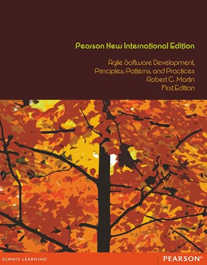

# 敏捷软件开发：原则、模式与实践

 
Robert C. Martin  · 2014

## 目录

* [第 1 部分 敏捷开发](section1.md)
  - [1 敏捷实践](ch1.md)
  - [2 极限编程概述](ch2.md)
  - [3 规划](ch3.md)
  - [4 测试](ch4.md)
  - [5 重构](ch5.md)
  - [6 编程片段](ch6.md)
* [第 2 部分 敏捷设计](section2.md)
  - [7 什么是敏捷设计？](ch7.md)
  - [8 SRP：单一职责原则](ch8.md)
  - [9 OCP：开闭原则](ch9.md)
  - [10 LSP：里氏替换原则](ch10.md)
  - [11 DIP：依赖倒置原则](ch11.md)
  - [12 ISP：接口隔离原则](ch12.md)
* [第 3 部分 薪资案例研究](section3.md)
  - [13 COMMAND 与 ACTIVE OBJECT](ch13.md)
  - [14 TEMPLATE METHOD & STRATEGY: 继承与委托](ch14.md)
  - [15 FACADE 和 MEDIATOR](ch15.md)
  - [16 SINGLETON 和 MONOSTATE](ch16.md)
  - [17 NULL OBJECT](ch17.md)
  - [18 薪资案例研究：第一次迭代开始](ch18.md)
  - [19 薪资案例研究：实现](ch19.md)
* [第 4 部分 打包薪资系统](section4.md)
  - [20 包设计原则](ch20.md)
  - [21 FACTORY](ch21.md)
  - [22 薪资案例研究（第二部分）](ch22.md)
* [第 5 部分 气象站案例研究](section5.md)
  - [23 COMPOSITE](ch23.md)
  - [24 OBSERVER：演化出模式](ch24.md)
  - [25 ABSTRACT SERVER、ADAPTER 与 BRIDGE](ch25.md)
  - [26 PROXY 与 STAIRWAY TO HEAVEN：管理第三方 API](ch26.md)
  - [27 案例研究：气象站](ch27.md)
* [第 6 部分 ETS 案例研究](section6.md)
  - [28 Visitor](ch28.md)
  - [29 State](ch29.md)
  - [30 The ETS Framework](ch30.md)
* [附录 A UML 记法 I：CGI 示例](appendix-a.md)
* [附录 B UML 记法 II：STATMUX](appendix-b.md)
* [附录 C 两家公司的讽刺剧](appendix-c.md)
* [附录 D 什么是软件设计？](appendix-d.md)

## 排版约定

- `<ins>…</ins>` 标记**译者自选的重点句**，与原文是否斜体、加粗无关；多行重点句可用一对 `<ins>` 跨行包裹。
- `*斜体*` 用于照应原书的斜体强调。
- `> 译注：……` 引用块用于译者的补充说明；冒号后不留空格。
- 代码清单（listing）中的注释不翻译，保留英文原文。

## 复核清单

每章复核按以下顺序逐项排查：

1. **结构与完整性** —— 对照原书，确认无整段/整句遗漏、无重复、无译者擅自增补。
2. **代码清单逐字一致** —— 清单中的类名、方法名、方法数量、方法顺序、修饰符必须与纸书完全相同；
   不得增删方法，不得“顺手补全”原书省略的代码。
3. **逻辑与数量关系** —— `more than` / `less than` / 前者后者、成本与收益、因果与让步等关系词，
   译后必须回验方向是否译反（方向译反常因中文自相矛盾才露馅）。
4. **术语一致** —— 同一英文词全章（及跨章）译法统一。
5. **指代清晰** —— 无悬空代词、无残缺句。
6. **中文表达** —— 无语序拗口、无生硬直译。
7. **格式** —— 无行尾空格、中文标点前无空格、`<ins>` 标签配对。

> 第 2 项仅靠读译文无法发现，须逐行比对纸书（可用 `pdftotext -layout` 抽取对应页后对照）。

## 目录结构

- 每章一个文件：`chN.md`（如 `ch14.md`）；部分导言为 `sectionN.md`，附录为 `appendix-x.md`。
- 若某章日后内容过多需要拆节，再建 `chN/` 目录，章内文件命名 `0.md`、`1.md`…（参照本仓库 `ddd/`、`distalled/` 的做法）。

## 待办

- **未译**：无。全书已译完（第 28~30 章、附录 A~D 均已完成）。
- **已译、待复核**（按上文「复核清单」逐项对照纸书）：`ch1.md`～`ch6.md`、`ch18.md`、`ch19.md`、`ch22.md`、`section1.md`、`section3.md`、`appendix-d.md`，以及第 6 部分与附录：`section6.md`、`ch28.md`、`ch29.md`、`ch30.md`、`appendix-a.md`、`appendix-b.md`、`appendix-c.md`。
  已完成复核：`section2.md`、`ch7.md`～`ch17.md`、`ch20.md`、`ch21.md`、`ch23.md`～`ch27.md`。
- 注：`ch8.md` 原有的 `#todo` 占位链接已改为指向 `ch6.md`/`ch4.md`；`ch9.md` → `ch29.md`、`ch19.md` → `ch28.md`、`ch1.md` → `appendix-c.md`、`ch26.md` 脚注、`ch29.md`/`ch30.md` → `appendix-b.md` 等跨章链接均已落实。
