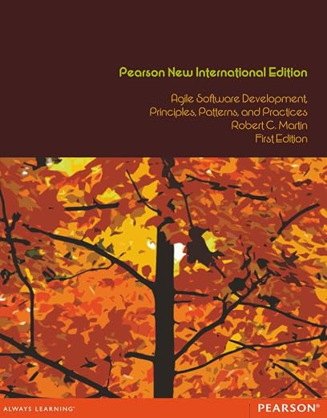

# 敏捷软件开发：原则、模式与实践

 
Robert C. Martin  · 2014

## 目录

* [第 1 部分 敏捷开发](section1.md)
  - [1 敏捷实践](ch1.md)
  - [2 极限编程概述](ch2.md)
  - [3 规划](ch3.md)
  - [4 测试](ch4.md)
  - [5 重构](ch5.md)
  - [6 编程片段](ch6.md)
* [第 2 部分 敏捷设计](section2.md)
  - [7 什么是敏捷设计？](ch7.md)
  - [8 SRP：单一职责原则](ch8.md)
  - [9 OCP：开闭原则](ch9.md)
  - [10 LSP：里氏替换原则](ch10.md)
  - [11 DIP：依赖倒置原则](ch11.md)
  - [12 ISP：接口隔离原则](ch12.md)
* [第 3 部分 薪资案例研究](section3.md)
  - [13 COMMAND 与 ACTIVE OBJECT](ch13.md)
  - [14 TEMPLATE METHOD & STRATEGY: 继承与委托](ch14.md)
  - [15 FACADE 和 MEDIATOR](ch15.md)
  - [16 SINGLETON 和 MONOSTATE](ch16.md)
  - [17 NULL OBJECT](ch17.md)
  - [18 薪资案例研究：第一次迭代开始](ch18.md)
  - [19 薪资案例研究：实现](ch19.md)
* [第 4 部分 打包薪资系统](section4.md)
  - [20 包设计原则](ch20.md)
  - [21 FACTORY](ch21.md)
  - [22 薪资案例研究（第二部分）](ch22.md)
* [附录 D 什么是软件设计？](appendix-d.md)

## 排版约定

- `<ins>…</ins>` 标记**译者自选的重点句**，与原文是否斜体、加粗无关；多行重点句可用一对 `<ins>` 跨行包裹。
- `*斜体*` 用于照应原书的斜体强调。
- `> 译注：……` 引用块用于译者的补充说明；冒号后不留空格。

## 目录结构

- 每章一个文件：`chN.md`（如 `ch14.md`）；部分导言为 `sectionN.md`，附录为 `appendix-x.md`。
- 若某章日后内容过多需要拆节，再建 `chN/` 目录，章内文件命名 `0.md`、`1.md`…（参照本仓库 `ddd/`、`distalled/` 的做法）。

## 待办

- **未译**：第 5 部分（23 Composite、24 Observer、25 Abstract Server/Adapter/Bridge、26 Proxy、27 Weather Station）、第 6 部分（28 Visitor、29 State、30 The ETS Framework）、附录 A（UML I）、附录 B（UML II）、附录 C（A Satire of Two Companies）。
- **悬空链接**：`ch1.md` → `appendix-c.md`（待附录 C 译完）；`ch9.md` → `ch29.md`；`ch19.md` → `ch28.md`；`ch21.md` → `ch26.md`。
- 注：`ch8.md` 原有的 `#todo` 占位链接已改为指向 `ch6.md`/`ch4.md`。
