# 附录 A UML 记法 I：CGI 示例

软件的分析与设计，是一个亟需某种记法的过程。
人们曾多次尝试创造这样的记法：流程图、数据流图、实体–关系图，等等。

面向对象编程的出现，带来了记法的大爆炸。
用来表示面向对象分析与设计的竞争性记法，实实在在有几十种。

其中最流行的有下面这些：

- Booch 94。¹
- OMT（Object Modeling Technique，对象建模技术），见 Rumbaugh 等人的描述。²
- RDD（Responsibility Driven Design，职责驱动设计），见 Wirfs-Brock 等人的描述。³
- Coad/Yourdon，见 Peter Coad 与 Ed Yourdon 的描述。⁴

¹ [BOOCH94]。

² [RUMBAUGH91]。

³ [WIRFS90]。

⁴ [COAD91A]。

在这些记法之中，Booch 94 和 OMT 是迄今为止最重要的两个。
Booch 94 被誉为一种强有力的**设计**记法，而 OMT 则被认为在**分析**记法方面更强。

这种二分法很有意思。
在 20 世纪 80 年代末、90 年代初，人们曾认为面向对象的好处之一，就是分析与设计可以用同一种记法来表达。
这也许是对“结构化分析”与“结构化设计”两套记法之间那种强烈分隔的一种反弹。
众所周知，从结构化分析跨越鸿沟到结构化设计，是很困难的。

当面向对象记法最初爆发式出现时，人们觉得同一种记法会同时服务于分析与设计。
然而随着这个十年的推进，分析人员和设计人员开始各自迁移到自己偏爱的记法上。
分析人员倾向于偏爱 OMT，设计人员倾向于偏爱 Booch 94。
于是，看起来一种记法并不真的够用。
为分析调校过的记法不适合设计，反之亦然。

UML 是一种单一的记法，但它有广泛的适用性。
记法的一部分可用于分析，另一部分可用于设计。
于是，分析人员和设计人员都可以使用 UML。

本章中，我们将从这两个视角来呈现 UML 记法。
先描述一次分析，然后接着描述一次设计。
这个描述将以一个微型案例研究的形式展开。

请注意，先分析、后设计的这个顺序是人为的，并不打算作为一种推荐做法。
事实上，本书中其他案例研究都不对二者做这种区分。
我在这里这样呈现，只是为了演示 UML 如何在不同抽象级别上被使用。
在真实项目中，所有抽象级别都是并发产生的——而不是依次产生。

## 课程报名系统：问题描述

假设我们为一家提供面向对象分析与设计职业培训课程的公司工作。
这家公司需要一个系统，用来跟踪正在讲授的课程以及已报名的学员。
见“课程报名系统”侧边栏。

> **课程报名系统**
>
> 用户必须能够查看可开课程清单的菜单，并选择他希望报名的课程。
> 一旦选定，应弹出一个表单，允许用户输入以下信息：
>
> - 姓名
> - 电话号码
> - 传真号码
> - 电子邮件地址
>
> 应当有一种方式让用户选择他支付课程费用的方式。这些方式可能是下列之一：
>
> - 支票
> - 采购订单
> - 信用卡
>
> 如果用户希望以支票支付，表单应提示他输入支票号码。
> 如果用户希望以信用卡支付，表单应提示他输入信用卡号、有效期，以及卡上显示的姓名。
> 如果用户希望以采购订单支付，表单应提示他输入采购订单号（PO#）、公司名称，以及应付账款部门某人的姓名和电话号码。
>
> 所有这些信息填写完毕后，用户将点击 “submit”（提交）按钮。
> 另一个屏幕将弹出，汇总用户输入的所有信息。
> 它将指示用户打印该屏幕、在打印件上签名，并传真到报名中心的号码。
> 它还应当把一份报名摘要通过电子邮件发给我们的报名专员，以及用户本人。
>
> 系统会知道每个班级的最大学员人数，并在达到该上限后自动把该班次标记为 “Sold Out”（售罄）。
>
> 报名专员能够通过调出专用表单并选定课程，向某门课的全体已报名学员发送电子邮件消息。
> 这个表单允许专员键入一条消息，然后按下一个按钮，把它发送给所选课程当前已报名的全体学员。
>
> 报名专员还能调出一个表单，显示已经讲授过的班级中全体学员的状态。
> 该状态将指示学员是否出勤，以及是否已收到该学员的付款。
> 这个表单可以按课程逐门调出。
> 或者，报名专员可以要求查看一份所有尚有未结清账款学员的清单。

### 识别参与者与用例

需求分析的任务之一，是识别参与者和用例。
应当指出，在真实系统中，这些未必是最先适合着手的任务。
但就本章的目的而言，我选择从这里开始。
现实中，你从哪里开始，比不上“开始”这个动作本身重要。

#### 参与者

参与者（actor）是与系统交互、但位于系统之外的实体。
它们常常是系统使用者所扮演的角色。
不过有时它们也可以是其他系统。
在这个例子里，所有参与者都对应人类使用者。

**报名人（Enroller）。**
这个参与者为学员报名某门课程。
它与系统交互，以选择合适的课程，并输入关于学员的信息和支付方式。

**报名专员（Enrollment Clerk）。**
这个参与者接收每次报名的电子邮件通知。
他还向学员发送电子邮件通知，并接收关于报名和付款的报告。

**学员（Student）。**
这个参与者接收报名的电子邮件确认，以及来自报名专员的电子邮件通知。
学员参加他所报名的课程。

#### 用例

确定了参与者之后，我们具体说明这些参与者与系统的交互。
这些说明叫做“**用例（use case）**”。
用例从参与者的视角描述参与者与系统之间的交互。
系统的内部运作一律不谈，用户界面也不做任何细节描述。

**用例 #1：查看课程菜单。**
报名人请求一份课程目录中当前可开的课程清单。
系统显示课程清单。
该清单包括课程的名称、时间、地点和费用。
清单还将显示该课程允许的学员人数，以及该课程当前是否已售罄。

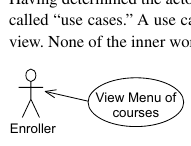<br/>

**用例记法。**
上图展示了一个用例图中参与者和用例的样子。
参与者就是那个小小的火柴人，用例则是椭圆。
两者由一条关联连在一起，表示数据流动的方向。

**用例 #2：报名某门课程。**
报名人首先查看课程菜单（用例 #1）。
报名人从菜单中选择一门要报名的课程。
系统提示报名人输入学员的姓名、电话号码、传真号码和电子邮件地址。
系统还提示报名人选择首选的支付方式。

扩展点：填写支付方式

报名人提交报名表单。
学员和报名专员收到确认报名的电子邮件。
报名人看到报名的确认信息，并被要求打印该确认、签名，并传真到指定的传真号码。

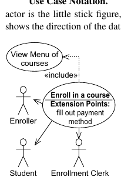<br/>

**扩展与使用用例。**
用例 #2 有一个扩展点。
这意味着其他用例将扩展这个用例。
这些扩展用例在下面以 #2.1、#2.2 和 #2.3 给出。
它们的描述被插入到前一个用例的扩展点处。
它们描述根据所选支付方式而需要输入的可选数据。

用例 #2 还与用例 #1“查看课程菜单”之间存在 «include» 关系。
这意味着用例 #1 的描述被插入到用例 #2 的适当位置。

注意“扩展”与“包含”之间的区别。
当一个用例**包含**另一个用例时，包含方用例引用了被包含的用例。
然而，当一个用例**扩展**另一个用例时，两个用例都不引用对方。
相反，扩展用例是根据上下文被选中的，并在适当的点上被插入到被扩展用例之中。

当我们想通过把重复的操作收缩成一些可供许多其他用例共享的小用例，从而使用例的结构更高效时，我们使用 «include» 关系。
目标是管理变更、消除冗余。
把许多用例的公共部分移进单个被包含的用例之后，当那个公共部分的需求发生变化时，只有那一个被包含的用例需要改动。

当我们知道一个用例内部存在许多备选或可选项时，我们使用 «extend» 关系。
我们把用例中不变的部分与可变的部分分离开。
不变的部分成为被扩展的用例，可变的部分成为扩展用例。
目标仍然是变更管理。
在当前的例子中，如果添加了新的支付选项，就必须创建新的扩展用例，但不需要修改任何既有用例。

**«include» 关系的记法。**
用例 #2 的图显示，“报名某门课程”用例与“查看课程菜单”用例由一条以空心箭头结尾的虚线相连。
箭头指向被包含的用例，并带有 «include» 立体类型。

**用例 #2.1：以采购订单支付。**
报名人被提示输入 PO#、公司名称，以及应付账款部门某人的姓名和电话号码。

**用例 #2.2：以支票支付。**
报名人被提示输入支票号码。

**用例 #2.3：以卡支付。**
报名人被提示输入信用卡号、有效期，以及卡上显示的姓名。

**用例扩展的记法。**
上面展示的扩展用例，通过 «extend» 关系连接到被扩展的用例。
这个关系画成一条连接两个用例的线。
它同样是虚线，带空心箭头。
箭头指向被扩展的用例，并带有 «extend» 立体类型。

**用例 #3：向学员发送电子邮件消息。**
报名专员选定一门课程，并输入一条消息的正文。
系统把该消息发送到该班当前已报名全体学员的电子邮件地址。

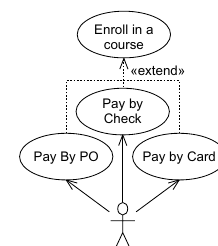<br/>
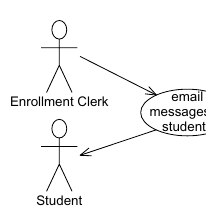<br/>

**用例 #4：设置出勤。**
报名专员选定一个班级和一名当前已报名该班的学员。
系统呈现该学员，并显示该学员是否出勤、以及该学员的付款是否已收到。
报名专员随后可以更改出勤状态或付款状态。

**用例 #5：获取学员状态。**
报名专员选定他所关心的学员。

扩展点：“选择关心的学员”

系统在一份报告中呈现所选学员的出勤与付款状态。

**扩展。**
有两个用例扩展“获取学员状态”。

**用例 #5.1：选择某门课中的学员。**
系统显示所有课程的清单。
报名专员选定一门课程。
系统选出该课程中的所有学员。

**用例 #5.2：选择未付款的学员。**
报名专员指示系统应选出所有未付款学员。
系统选出所有被标记为出勤、且付款状态表明尚未收到付款的学员。

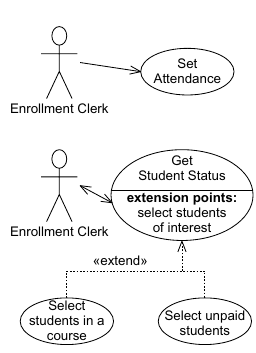<br/>

**用例回顾。**
我们在这里创建的用例，描述了用户期望系统如何行事。
注意，它们没有谈及用户界面的细节。
它们没有提到图标、菜单项、按钮或滚动列表。
事实上，连最初的那份规格说明，对用户界面的描述都比用例更多。
这是有意为之的。
<ins>我们希望用例保持轻量、易于维护。</ins>
就目前所写的样子，这些用例对极大的一组可能实现都是有效的。

**系统边界图。**
整个用例集合可以用 Fig A-1 中的系统边界图来汇总展示。
这张图把系统中的所有用例都放在一个表示系统边界的矩形里。
参与者被置于系统之外，并通过显示数据流动方向的关联连接到用例上。

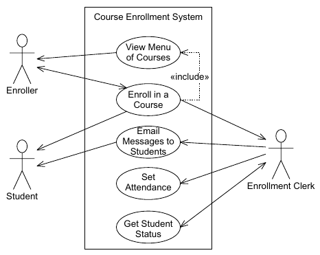<br/>
*Fig A-1 系统边界图*

**我们用这些图做什么？**
用例图（包括系统边界图）不是软件结构图。
它们完全不能给我们任何关于“待建系统的软件元素如何划分”的信息。
这些图是用于人与人之间交流的，主要是分析人员与干系人之间的交流。
它们帮助按不同种类的系统使用者来组织系统的功能。

此外，在向不同种类的使用者呈现系统描述时，这些图可以相当有帮助。
每一类不同的使用者，主要关心他自己的那些用例。
参与者到用例的连接，有助于把每一类使用者的注意力集中在他或她将要使用的那些用例上。
在非常大的系统中，你也许希望按参与者类型来组织系统边界图，使所有不同的使用者类型都能看到与他相关的那部分用例。

最后，请记住 Martin 的文档第一定律：**除非文档的需求是即时且重要的，否则不要产出文档。**

这些图可以有用，但它们常常是不必要的。
你不应该把它们视为必需的或必不可少的。
如果你有需要，那就画；否则，等到你有需要时再说。

## 领域模型

领域模型是一组图，用来帮助定义用例中所出现的术语。
这些图展示问题中的关键对象及其相互关系。
曾经有过很多痛苦和折磨，源自一种倾向：假定这个模型同时也是待建软件的模型。
<ins>对分析人员和设计人员来说，重要的是认识到：领域模型是一种描述性工具，用来帮助人记录他们的决定并相互交流。</ins>
领域模型中的对象未必与软件的面向对象设计相对应，即便对应，也不会带来什么了不起的好处。⁵

⁵ [JACOBSON]，第 133 页：“我们并不认为最好的（最稳定的）系统是仅通过使用与现实世界实体相对应的对象建造出来的……”

另见第 167 页：“在[其他]方法中，这个[领域]模型也会构成实际实现的基础；也就是说，在实现期间对象被直接映射到类上。然而，在 OOSE 中情况并非如此，[…]。我们在这种方法上的经验告诉我们，事情不是这样。相反，我们开发一个分析模型，它在面对未来变化时更为健壮、更易维护，而不是用一个问题领域模型来充当设计与实现的基础。”

[BOOCH96]，第 108 页：“……在不成熟的项目中有一种倾向，把分析所得的领域模型视为可以直接编码[…]，从而跳过任何进一步的设计。健康的项目认识到还有相当多的工作要做，涉及并发、序列化、安全、分布等等问题，并且设计模型最终可能在若干微妙的方面看起来相当不同。”

在 Booch 94 和 OMT 中，领域模型图与表示软件结构和设计的图无法区分。
在最糟糕的情况下，领域模型图被当作高层设计文档，并因此被用来设定软件本身的高层结构。

为帮助避免这类错误，我们可以利用 UML 的特性，在领域模型中使用一种叫 «type»（类型）的特殊实体。
«type» 表示一个对象可以扮演的角色。
«type» 可以有操作和属性，也可以与其他 «type» 实体建立关联。
然而，«type» 并不代表设计意义上的类或对象。
它不代表某个软件元素，也不直接映射到代码。
它表示一个在问题描述中使用的概念性实体。

**课程目录。**
我们要考虑的第一个领域抽象是课程目录。
这个抽象表示所有已开课程的清单。
我们在领域模型中（见 Fig A-2）通过描绘两个表示领域中抽象的实体来展示它：`CourseCatalog` 实体和 `Course` 实体。
`CourseCatalog` 实体提供许多 `Course` 实体。

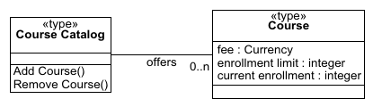<br/>
*Fig A-2 课程目录实体的领域模型*

**领域模型的记法。**
Fig A-2 中使用的记法，把这两个领域抽象描绘成带 «type» 立体类型的 UML 类。（见侧边栏“UML 类记法与语义概览”。）
这表明这些类是问题领域中的概念性元素，与软件类没有直接关系。
注意 `CourseCatalog` 实体有两个操作：`AddCourse` 和 `RemoveCourse`。
在 «type» 中，操作对应**职责**。
于是，`CourseCatalog` 具有添加和移除课程的职责。
再次强调，这些是概念，而不是真实类中成员函数的规格说明。
我们用它们与用户交流，而不是用来规定软件结构。

同样，`Course` 实体中显示的属性也是概念。
它们表明 `Course` 实体应当负责记住它的费用、报名人数上限和当前报名人数。

> **UML 类记法与语义概览**
>
> 在 UML 中，类画成一个带三个分区的矩形。
> 第一个分区规定类的名字。
> 第二个规定它的属性，第三个规定它的操作。
>
> 在名字分区内，名字可以被立体类型和性质（property）修饰。
> 立体类型出现在名字上方，用角引号（法文引号 «»）括起来。
> 性质出现在名字下方偏右，用花括号括起来。（见下图。）
>
> 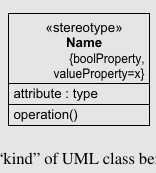<br/>
>
> 立体类型是指代被表示的 UML 类“种类”的名字。
> 在 UML 中，类不过是一个可以有属性和操作的具名实体。
> 缺省的立体类型是 «implementation class»（实现类），此时 UML 类直接对应 C++、Java、Smalltalk 或 Eifel 这类语言中的软件的类概念。
> 属性对应成员变量，操作对应成员函数。
>
> 然而，在 «type» 立体类型下，UML 类完全不对应软件实体。
> 相反，它对应问题领域中存在的一个概念性实体。
> 属性表示逻辑上属于该概念性实体的信息，操作表示该概念性实体的职责。
>
> 本章后面还会讨论其他若干预定义立体类型。
> 你也可以自由创建自己的立体类型。
> 不过，立体类型不只是注释。
> 它规定了 UML 类的所有元素应当如何被解释。
> 所以，如果你造了一个新立体类型，就把它定义好。
>
> 性质主要是结构化的注释。
> 性质在花括号内用逗号分隔的列表规定。
> 每个性质是一个用等号（=）分隔的 name = value 对。
> 如果省略等号，则该性质被认为是布尔型，并取值为“true”。
> 否则，值的类型是字符串。
>
> 本章后面会讨论若干预定义的性质。
> 不过，你随时可以自由添加自己的性质。
> 例如，你可能会创建这样的性质：`{author=Robert C. Martin, date=12/6/97, SPR=4033}`

**概念与实现之别，以及云朵图标的使用。**
我一直在强调概念层面的类（即 «type»）与设计或实现层面的类之间的区别。
我觉得这样做是恰当的，因为存在一种危险：概念图可能被误当作软件结构与架构的规格说明。
记住，概念图是为了帮助与干系人交流，因此与软件结构的一切技术问题无关。

用立体类型来区分这些种类的图，可能会被忽略。
领域模型的 UML 类看起来非常像设计与实现的 UML 类。
幸运的是，UML 允许我们为不同的立体类型替换不同的图标。
因此，为进一步加强这些图之间的差异，从现在起我们将用云朵图标来表示 «type» 类。
这使 Fig A-2 中课程目录实体的领域模型变成 Fig A-3 的样子。

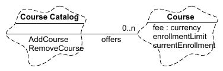<br/>
*Fig A-3 使用云朵图标的课程目录领域模型*

**补全领域模型。**
到目前为止，领域模型展示了一个包含所有已开课程的课程目录。
但这里有个问题。
我们说的“一门课程”是什么意思？
同一门课程可以在许多不同的时间和地点开设，也可以由许多不同的讲师来讲授。
显然我们需要两个不同的实体。
我们把第一个叫 `Course`。
它表示课程本身，但不表示日期、地点或讲师。
我们把第二个叫 `Session`（班次）。
它表示某一门课程的日期、地点或讲师。（见 Fig A-4。）

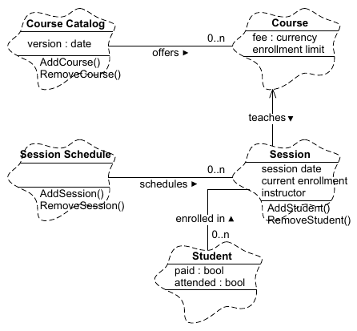<br/>
*Fig A-4 课程与班次*

**记法。**
连接实体的线叫做**关联（association）**。
Fig A-4 中的所有关联都有名字，尽管这并不是一条规则。
注意这些名字是动词或动词短语。
名字旁边的黑色小三角指向由两个实体和关联所构成的句子的谓语。
于是，“课程目录提供许多课程”“班次计划表安排许多班次”，以及“许多学员报名一个班次”。

在上面的句子里，凡是对应关系上出现 “0..*” 图标的地方，我都用了“许多”这个词。
这个图标是可以放在关联端点上的若干**多重性（multiplicity）**图标之一。
它们表示参与该关联的实体数量。
缺省的多重性是“1”。（见题为“多重性”的侧边栏。）

> **多重性**
>
> 可以用来装饰关联的多重性图标有若干种，包括下面这些：
>
> - `0..*` 零到多
> - `*` 零到多
> - `1..*` 一到多
> - `0..1` 零或一
> - `6` 恰好六
> - `3..6` 三到六之间
> - `3,5` 三或五
>
> 点之间、或用逗号分隔的位置，可以使用任何非负整数。

除非出现箭头，否则关联被假定为双向的。
双向关联允许两个实体彼此知晓。
例如，`CourseCatalog` 实体显然应当知道它的那些 `Course`，而每个 `Course` 实体知道它被列在哪个 `CourseCatalog` 中，看起来也是合理的。
`SessionSchedule` 与 `Session` 之间同样如此。

箭头的出现把知识限制在所指的方向上。
于是，`Session` 知道 `Course`，但 `Course` 对 `Session` 一无所知。

**用例迭代。**
这张图立刻告诉了我们两件事。
第一，用例在一些地方用错了词。
凡是提到课程目录和课程的地方，它们本应谈论班次计划表和班次。
第二，有相当多的用例被遗漏了。
`CourseCatalog` 和 `SessionSchedule` 需要被维护。
课程需要被添加进 `CourseCatalog`、并从其中移除；班次需要被添加进 `SessionSchedule`、并从其中移除。

于是，通过创建领域模型，我们更好地理解了手头的问题。
这种更好的理解有助于我们改进和扩充用例。
二者之间的这种迭代是自然且必要的。

如果我们要把这个案例研究追到结论，就会展示上面隐含的那些改动。
但为了高效地呈现记法，我们跳过用例的这次迭代。

## 架构

现在我们来谈设计软件这件事。
架构表示构成应用骨架的那些软件结构。
架构中的类与关系非常贴近地映射到代码。

**决定软件平台。**
不过在开始之前，我们必须明白这个应用将运行在什么样的软件平台上。
我们有若干选择。

1. 一个基于 Web 的 CGI 应用。报名表单及其他表单将通过 Web 浏览器访问。数据将存放在 Web 服务器上，CGI 脚本将由 Web 浏览器调用来访问和操作这些数据。
2. 一个数据库应用。我们可以买一个关系数据库，然后用它的表单包和 4GL 来编写应用。
3. Visual XXX。我们可以买一个可视化编程语言。人机界面可以用可视化构建工具来做。这些工具将调用存储、检索和操作数据所需的软件函数。

当然，还有其他选择。
我们可以完全用 C 来写整套东西，除编译器之外不要任何库或工具支持。
但那很傻。
工具就在那里，而且它们管用。
我们应该使用它们。

就我们这个例子的目的而言，我们将假定这是一个基于 Web 的应用。
这是合理的，因为这样一来报名人可以位于世界上任何地方；而报名服务可以在 Internet 上提供。

**Web 架构。**
我们需要决定这个 Web 应用的整体架构。
将有多少个 Web 页面，它们将调用哪些 CGI 程序？
Fig A-5 展示了我们可以如何着手规定这一点。

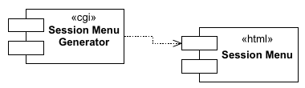<br/>
*Fig A-5 班次菜单的架构*

**记法。**
Fig A-5 是一张**组件图（component diagram）**。
这些图标描绘物理的软件组件。
我们用立体类型来规定组件的种类。
这张图显示：班次菜单（Session Menu）显示为一个 HTML Web 页面，它由一个名为班次菜单生成器（Session Menu Generator）的 CGI 程序生成。
两个组件之间的虚线箭头是**依赖关系**。
依赖关系表示哪些组件对哪些其他组件有所知。
在这个情形中，班次菜单生成器程序创建班次菜单 Web 页面，因此对它有所知。
另一方面，班次菜单 Web 页面对生成器本身一无所知。

**自定义图标。**
Fig A-5 中有两种不同的组件。
为了让它们在视觉上可区分，我们用两个新图标扩展 UML——一个用于 CGI 程序，一个用于 HTML 页面。
Fig A-6 展示了用例 #2“报名某门课程”所涉及的组件。
Web 页面画成其中带一个 ‘W’ 的页面。
CGI 程序画成其中写有 “CGI” 的圆圈。

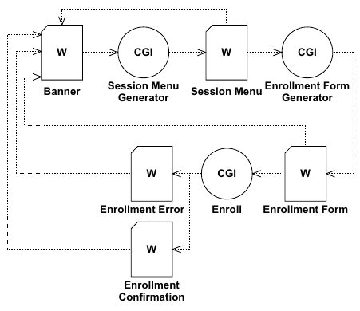<br/>
*Fig A-6 报名相关组件*

**组件流。**
Fig A-6 引入了两个新 Web 页面和一个新 CGI 程序。
我们决定这个应用应当以一个某种形式的横幅页面开始。
据推测，这个页面会有指向用户可执行的各类操作的链接。
班次菜单生成器由横幅页面调用，并生成班次菜单页面。
据推测，班次菜单页面上会有链接或按钮，允许用户报名某门课程。
班次菜单调用报名表单生成器（Enrollment Form Generator）CGI，以创建报名所选课程所需的表单。
用户填好这个表单之后，报名（Enroll）CGI 被调用。
这个程序校验并记录表单上的信息。
如果表单数据无效，它就生成报名错误（Enrollment Error）页面；否则它生成确认页面，并发送必要的电子邮件消息。（回到用例 #2。）

**增强灵活性。**
敏锐的读者会看出，这个组件模型里固着着一种相当讨厌的不灵活性。
CGI 程序生成了大多数 Web 页面。
这意味着 Web 页面里的 HTML 文本必须包含在 CGI 程序之中。
这就使修改 Web 页面变成修改并重新构建 CGI 程序的事。
我们更希望大部分被生成的 Web 页面，是用一个漂亮的 HTML 编辑器创建出来的。

于是，CGI 程序应当读入它们将要生成的 Web 页面的模板。
模板应当用特殊的标记标注出来，这些标记将被 CGI 程序必须生成的 HTML 替换。
这意味着这些 CGI 程序有一个共同点。
它们都读取模板 HTML 文件，并把各自的那点 HTML 加进去。⁶

⁶ 本章写于 XSLT 出现之前很久。如今，我们很可能会让 CGI 脚本（或 servlet）生成 XML，然后调用一个 XSLT 脚本来把它翻译成 HTML，以此解决这个问题。另一方面，用 XSLT 生成 HTML 仍然不能让我们用一个漂亮的所见即所得编辑器来设计 Web 页面。有时我觉得，本章勾画的模板方案在许多场合会更好。

Fig A-7 展示了由此得到的组件图。
注意我加了一个 WT 图标。
它表示一个 HTML 模板。
它是一个 HTML 格式的文本文件，带有特殊标记，CGI 程序用这些标记作为它们所生成 HTML 的插入点。
还要注意 CGI 程序与 HTML 模板之间依赖关系的方向。
在你看来它们可能是反的。
但记住它们是依赖关系，不是数据流。
CGI 程序知道（依赖）HTML 模板。

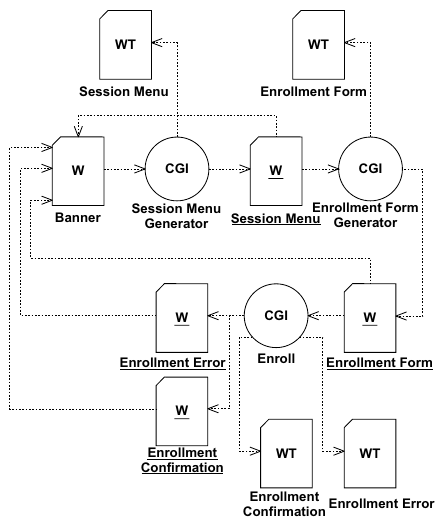<br/>
*Fig A-7 把 HTML 模板加入报名组件图*

**规格与实例的二分。**
在 Fig A-7 中，被生成的 Web 页面的名字带下划线。
这是因为这些页面只在运行时刻存在。
它们是 HTML 模板的实例。
在 UML 中，惯例是给实例加下划线。
**实例**是由某种**规格**（源文档）生成的软件元素。
关于这一点我们后面还会说更多。
眼下只需认识到：名字未加下划线的元素，表示必须手写、并充当规格的元素。
名字加下划线的元素，则是某个从那些规格生成它们的流程的产物。

**使用 HTML 模板。**
HTML 模板为这个应用的架构提供了很大的灵活性。
它们如何工作？
CGI 程序如何把自己生成的输出放到 HTML 模板中正确的位置上？

我们可能考虑在 HTML 模板文件中放一个特殊的 HTML 标签。
这样的标签会标记出 CGI 程序插入其输出的位置。
然而，这些被生成的 Web 页面可能有若干个区段，每个区段都可能需要自己的插入点，供 CGI 插入 HTML。
于是，每个 HTML 模板可以有不止一个插入标签，而 CGI 将必须能够以某种方式规定哪段输出与哪个标签相配。

标签可以长这样：`<insert name>`，其中 “name” 是一个标识插入点的任意字符串，供 CGI 使用。
像 `<insert header>` 这样的标签，将允许 CGI 规定名字 ‘header’，然后用生成的输出完全替换该标签。

显然，每个标签都被替换成一串字符，所以每个标签表示一种具名的字符流。
我们可以想象 CGI 中可能存在的 C++ 代码大致如下：

```cpp
HTMLTemplate myPage(“mypage.htmp”);
myPage.insert(“header”,
              “<h1> this is a header </h1>\n”);
cout << myPage.Generate();
```

这将把由模板 `mypage.html` 生成的 HTML 送到 `cout`，其中标签 `<insert header>` 被替换为字符串 `“<h1> this is a header </h1>\n”`。

Fig A-8 展示了我们可以如何设计 `HTMLTemplate` 类。
这个类把模板文件的名字作为一个属性持有。
它还有若干方法，允许为具名的插入点插入替换字符串。
`HTMLTemplate` 的实例将包含一个映射，把插入点名字关联到替换字符串。

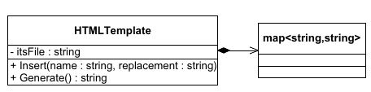<br/>
*Fig A-8 HTMLTemplate 的设计*

**记法。**
这是我们第一张真正的**类图**。
它向我们展示了用**组合**关系相连的两个类。
`HTMLTemplate` 类和 `map<string,string>` 类所用的图标对我们来说并不陌生。
它已在第 473 页题为“UML 类记法与语义概览”的侧边栏中解释过。
属性和操作的语法在下面题为“属性与操作”的侧边栏中描述。

> **属性与操作**
>
> 属性和操作可以用下列封装说明符来装饰：
>
> - `+` 公有
> - `-` 私有
> - `#` 受保护
>
> 属性的类型可以规定为一个跟在属性之后的标识符，与属性之间用冒号分隔（例如 `count : int`）。
>
> 同样，函数各参数的类型也用同样的冒号记法规定（例如 `SetName (name : string)`）。
>
> 最后，操作的回返类型可以规定为一个跟在操作的名字和参数列表之后的标识符，用冒号与之分隔（例如 `Distance(from : Point) : float`）。

Fig A-8 中连接两个类的关联上的箭头表明：`HTMLTemplate` 知道 `map<string,string>`，但那个 map 不知道 `HTMLTemplate`。
关联中最靠近 `HTMLTemplate` 类的黑色菱形，把它标识为关联的一种特例，叫做**组合**。（见题为“关联、聚合与组合”的侧边栏。）
它表明 `HTMLTemplate` 对那个 map 类的生命周期负责。

> **关联、聚合与组合**
>
> **关联**是两个类之间的一种关系，它允许由这些类创建出来的实例相互发送消息（即，类相关联的对象之间可以存在链接）。
> 它用一条连接两个类的线来表示。
> 关联最常被实现为一个类中指向或引用另一个类的实例变量。
>
> 关联（Association）
>
> 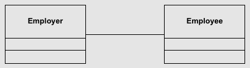<br/>
>
> 关联的**可导航性**可以通过给关联加箭头来限制。
> 当箭头存在时，关联只能沿着箭头方向导航。
> 这意味着箭头所指的那个类不知道它的关联者。
>
> 可导航关联（Navigable Association）
>
> 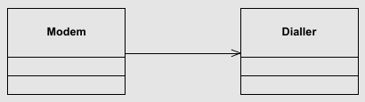<br/>
>
> **聚合（aggregation）**是关联的一种特殊形式。
> 它在聚合类一端用白色菱形表示。
> 聚合意味着一种“整体/部分”关系。
> 紧邻白色菱形的类是“整体”，另一个类是它的“部分”。
> “整体/部分”关系纯粹是内涵性的；它与关联在语义上没有差别。ᵃ
>
> 聚合（Aggregation）
>
> 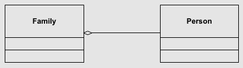<br/>
>
> **组合（composition）**是聚合的一种特殊形式。
> 它用黑色菱形表示。
> 它意味着“整体”对它的“部分”的生命周期负责。
> 这个责任并不意味创建或删除的责任。
> 相反，它意味着“整体”必须设法让“部分”以某种方式被删除。
> 这可以通过直接删除“部分”来实现，也可以把“部分”交给另一个承担其责任的实体来实现。
>
> 组合（Composition）
>
> 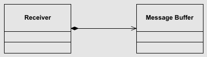<br/>
>
> ᵃ 有一个例外。不允许对象之间存在自反的或循环的聚合关系。也就是说，实例不能参与一个聚合环。如果没有这条规则，环中的所有实例都会成为自身的一部分。也就是说，一个部分可以包含它的整体。
> 注意，这条规则并不阻止类参与聚合环；它只是限制它们的实例。

**数据库接口层。**
每个 CGI 程序还必须能访问表示课程、班级、学员等的数据。
我们把这称为培训数据库。
这个数据库的形式尚无定论。
它可以是存放在一个关系数据库中，也可以是存放在一组平文件中。
我们不希望应用的架构依赖于数据存储的形式。
我们希望当数据库的形式发生变化时，每个应用的大部分保持不变。
于是，我们通过在中间插入一个**数据库接口层（database interface layer，DIL）**，把应用与数据库隔开。

为能有效，DIL 必须具有 Fig A-9 所示的特殊依赖特征。
DIL 依赖应用，DIL 依赖数据库。
应用和数据库彼此之间一无所知。
这允许我们更换数据库而不必更换应用。
它也允许我们更换应用而不更换数据库。
我们可以完全替换掉数据库的格式或引擎，而不影响应用。

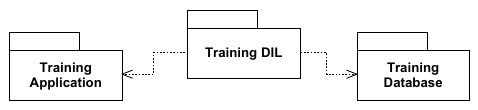<br/>
*Fig A-9 数据库接口层的依赖特征*

**记法。**
Fig A-9 展示了一种特殊的类图，叫做“**包图（package diagram）**”。
这些图标表示**包**。
它们的形状令人想起文件夹。
就像文件夹一样，包是一个容器。（见“包与子系统”侧边栏。）
Fig A-9 中的包包含类、HTML 文件、CGI 主程序文件等软件组件。
连接这些包的虚线箭头表示依赖关系。
箭头指向依赖的目标。
包之间的依赖意味着：被依赖的包若不存在，依赖方包就无法使用。

> **包与子系统**
>
> 包画成一个大矩形，在大矩形左上方带一个小矩形的“标签”。
> 通常，包的名字放在大矩形中。
>
> 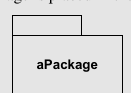<br/>
>
> 包也可以画成把包名放在“标签”里、把包的内容放在大矩形里。
> 内容可以是类、文件或其他包。
> 每个都可以加上（`-`、`+`、`#`）封装图标作前缀，表示它们在包内是私有、公有还是受保护的。
>
> 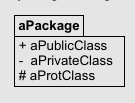<br/>
>
> 包可以用两种不同关系之一连接。
> 虚线箭头叫做**导入依赖（import dependency）**。
> 它是一种带 «import» 立体类型的依赖关系。
> 当依赖用于包时，这个立体类型是缺省的。
> 箭头的基端连着导入方包，箭头接触被导入的包。
> 导入依赖意味着：导入方包对导入包的任何公有元素都具有可见性。
> 这意味着导入方包的元素可以使用导入包的任何公有元素。
>
> 包之间也可以用**泛化（Generalization）**关系连接。
> 空心三角箭头接触一般包或抽象包，关系的另一端接触实作包。
> 实作包对抽象包的任何公有或受保护元素都具有可见性。
>
> 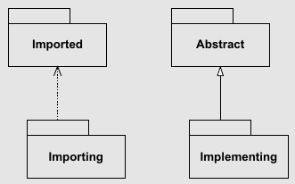<br/>
>
> 包的立体类型有若干已定义的种类。
> 缺省的是 «package»，表示一个不带任何特殊约束的容器。
> 它可以装下任何能用 UML 建模的东西。
> 典型情况下，它用来表示一个物理的、可发布的单位。
> 这样的包会被配置管理与版本控制系统跟踪。
> 它可能由文件系统中的子目录表示，或由语言的模块系统表示（例如 Java 的包或 JAR 文件）。
> 包表示系统的一种划分，这种划分增强它的可开发性和可发布性。
>
> 包的 «subsystem» 立体类型表示一个逻辑元素：除包含模型元素之外，它还规定它们的行为。
> 子系统可以被赋予操作。
> 这些操作必须由包内的用例或协作来支撑。
> 子系统表示系统或应用的一种行为划分。
>
> 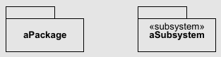<br/>
>
> 这两类包彼此正交。
> 那种增强可开发性和可发布性的划分，几乎从不与基于行为的划分相似。
> 前者常被软件工程师用作配置管理和版本控制的单位。
> 后者更多被分析人员使用，以便以直观的方式描述系统，并在特性变化或被添加时进行影响分析。

**数据库接口。**
培训应用（Training Application）包中的那些类需要某种方式访问数据库。
这将通过培训应用包内部的一组接口来完成。（见 Fig A-10。）
这些接口代表 Fig A-4（第 475 页）领域模型中的那些类型。
这些接口由 DIL 包中的类实现。
它们将被培训应用包内的其他类用来访问数据库中的数据。
注意，Fig A-10 中依赖的方向，与 Fig A-9 中各包之间导入关系的方向相对应。

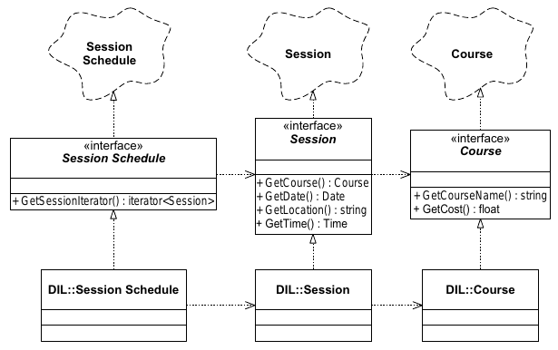<br/>
*Fig A-10 培训应用包中的数据库接口类*

**记法。**
当一个类的名字写成斜体时，表示这个类是抽象的。⁷
由于接口是完全抽象的类，把它们的名字排成斜体是恰当的。
操作也以斜体显示，表示它们是抽象的。
DIL 中的类通过**实现（realizes）**关系绑定到这些接口上；实现关系画成虚线，带指向接口的空心三角箭头。
在 Java 中，这些将代表 “implements” 关系。
在 C++ 中，它们将代表继承。

⁷ 抽象类至少有一个纯（或抽象）方法。

接口是物理结构。
在 C++ 和 Java 这样的语言中，它们有源代码对应物。
而类型不是物理的，也不代表任何有源代码等价物的东西。
在 Fig A-10 中，我们画了从接口到它们所表示类型的实现关系。
这不表示一种物理关系，也没有任何对应的源代码。
在这个情形中，实现关系展示的是物理设计实体与领域模型之间的对应。
这种对应很少像这里描绘的那样清晰明确。

Fig A-9 中各包之间的导入关系，在 Fig A-10 中通过双冒号的使用表现出来。
`DIL::Session` 类是一个名为 `Session` 的类，它存在于 DIL 包中，并对培训应用包可见（已被导入到其中）。
有两个都叫 `Session` 的类是可以接受的，因为它们位于不同的包中。

**班次菜单生成器。**
回到 Fig A-7，我们看到第一个 CGI 程序是 `SessionMenuGenerator`。
这个程序对应[第 469 页](appendix-a.md) 上文中的第一个用例。
这个 CGI 程序的设计长什么样？

显然，它必须构建出班次计划表的 HTML 表示。
于是，我们需要一个 `HTMLTemplate`，把班次菜单的样板与来自班次计划表的实际数据合并起来。
此外，程序将使用 `SessionSchedule` 接口，访问数据库中的 `Session` 和 `Course` 实例，以取得它们的名称、时间、地点和费用。
Fig A-11 展示了一张描述这个过程的序列图。

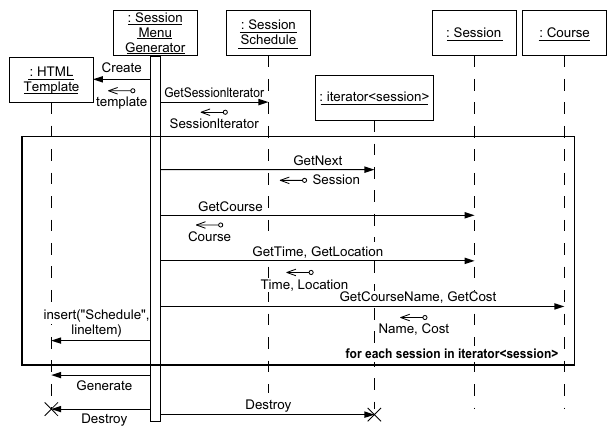<br/>
*Fig A-11 SessionMenuGenerator 序列图*

`SessionMenuGenerator` 对象由 `main` 创建，并控制整个应用。
它创建一个 `HTMLTemplate` 对象，把模板文件的名字传给它。
然后它从 `SessionSchedule` 接口取来一个 `iterator<Session>`⁸ 对象。
它遍历 `iterator<Session>` 中的每一个 `Session`，向每个 `Session` 询问它的 `Course`。
它从 `Session` 对象取得课程的时间与地点，从 `Course` 对象取得课程的名称与费用。
循环中的最后一个动作，是用所有这些信息创建一条行项，并在 `Schedule` 插入点处把它 `Insert` 到 `HTMLTemplate` 对象中。
循环结束后，`SessionMenuGenerator` 调用 `HTMLTemplate` 的 `Generate` 方法，然后销毁它。

⁸ 本章写于 STL 普及之前。当时我使用的是自己的容器库，它带有模板化的迭代器。

**记法。**
Fig A-11 序列图上各矩形内的名字带下划线。
这表明它们表示对象而非类。
对象名由两个元素构成，用冒号分隔。
冒号之前是对象的简单名字。
冒号之后是对象所实现的某个类或接口的名字。
在 Fig A-11 中，简单名字全部省略了，所以所有名字都以冒号开头。

从对象垂下的虚线叫做**生命线（lifeline）**，它们表示对象的生存期。
Fig A-11 中除 `HTMLTemplate` 和 `iterator<Session>` 之外的所有对象，其生命线都从顶部开始、到底部结束。
按惯例，这意味着这些对象在本场景开始前就已存在，并在场景结束时仍然存在。
另一方面，`HTMLTemplate` 由 `SessionMenuGenerator` 显式创建并销毁。
这从两处可以看出：一个以 `HTMLTemplate` 终止的箭头（从而创建它），以及底部终止其生命线的 “X”。
`SessionMenuGenerator` 也销毁了 `Iterator<Session>`；不过，是哪个对象创建它并不清楚。
创建者大概是 `SessionSchedule` 的一个派生类。
于是，尽管 Fig A-11 没有显式展示 `Iterator<Session>` 对象的创建，该对象生命线起点的位置暗示它大约是在 `GetSessionIterator` 消息被发送给 `SessionSchedule` 对象的时候创建的。

连接各生命线的箭头是**消息**。
时间自上而下推进，所以这张图展示了对象之间传递消息的次序。
消息用靠近箭头处的标签命名。
末端带小圆圈的短箭头叫做**数据令牌（data token）**。
它们表示在消息上下文中传递的数据元素。
如果它们指向消息的方向，就是消息的参数。
如果它们与消息方向相反，就是消息的回返值。

`SessionMenuGenerator` 生命线上那个细长的矩形叫做**激活（activation）**。
激活表示一个方法或函数执行的持续时间。
在这个情形中，启动该方法的那个消息没有展示出来。
Fig A-11 中其他生命线没有激活，因为这些方法都很短，且不发出其他消息。

Fig A-11 中围住某些消息的粗矩形框定义了一个**循环**。
循环的完成条件写在该框的底部。
在这个情形中，被围住的消息将重复执行，直到 `iterator<Session>` 内的所有 `Session` 对象都被检查过。

注意有两条消息箭头被重载了不止一条消息。
这只是一种简写，用以尽量减少箭头的数量。
这些消息按所述的顺序发送，回返值也按同样的顺序返回。

**序列图中的抽象类与接口**

敏锐的读者会注意到，Fig A-11 中有些对象是从接口实例化而来的。
例如，`SessionSchedule` 就是那些数据库接口类之一。
这看起来可能违反了“对象不能从抽象类或接口实例化”的原则。

序列图中对象的类名不必是该对象实际类型的名字。
只要对象符合该具名类的接口就足够了。
在 C++、Java 或 Eifel 这样的静态语言中，该对象应当属于序列图中所命名的类，或者属于从序列图中所命名的类或接口派生的类。
在 Smalltalk 或 Objective-C 这样的动态语言中，只要对象符合序列图中所命名的接口就足够了。⁹

⁹ 如果你不懂这一点，不用担心。在 Smalltalk 和 Objective-C 这样的动态语言中，你可以向任何对象发送任何消息。编译器不会检查该对象能否接受那条消息。如果在运行时刻向一个不认识该消息的对象发送消息，就会发生运行时刻错误。于是，两个完全不同、彼此无关的对象有可能接受相同的消息。这样的对象被说成符合同一个接口。

于是，Fig A-11 中的 `SessionSchedule` 对象，指的是这样一个对象：它的类实现或派生自 `SessionSchedule` 接口。

**班次菜单生成器的静态模型。**
Fig A-11 所示的动态模型，隐含了 Fig A-12 所示的静态模型。
注意这些关系全都是依赖或带立体类型的关联。
这是因为图中所示的类都没有持有指向其他类的实例变量。
所有这些关系都是瞬态的，即它们都不会长过 Fig A-11 中 `SessionMenuGenerator` 生命线上那个激活矩形的执行期。

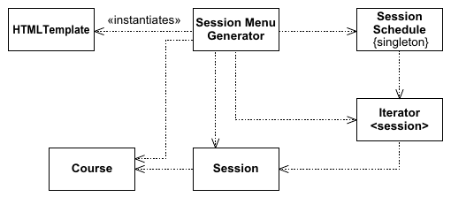<br/>
*Fig A-12 班次菜单生成器应用的静态模型*

`SessionMenuGenerator` 与 `SessionSchedule` 之间的关系值得特别一提。
注意 `SessionSchedule` 带有 `{singleton}` 性质。
这表示在这个应用中只能存在一个 `SessionSchedule` 对象，并且它在全局作用域可访问。（见[第 178 页](ch16.md) 的 SINGLETON。）

`SessionMenuGenerator` 与 `HTMLTemplate` 之间的依赖带有 «creates» 立体类型。
这简单地表示 `SessionMenuGenerator` 实例化 `HTMLTemplate` 的实例。

带 «parameter» 立体类型的关联表明：这些对象通过方法参数或回返值相互认识。

**SessionMenuGenerator 对象如何获得控制？**
Fig A-11 中 `SessionMenuGenerator` 生命线上的激活矩形，没有展示它是如何被启动的。
据推测，某个更高层的实体（比如 `main()`）调用了 `SessionMenuGenerator` 上的一个方法。
我们可以把这个方法叫 `Run()`。
这很有意思，因为我们还有其他几个 CGI 程序要写，而它们都需要以某种方式由 `main()` 启动。
也许有一个叫 `CGIProgram` 的基类或接口定义了 `Run()` 方法，而 `SessionMenuGenerator` 从它派生。

**把用户输入读入 CGI 程序。**
`CGIProgram` 类还会帮我们解决另一个问题。
CGI 程序通常是在用户在浏览器屏幕上填好表单之后，由浏览器调用的。
用户输入的数据随后通过标准输入被传给 CGI 程序的 `main()` 函数。
于是，`main()` 可以把标准输入流的引用传给 `CGIProgram` 对象，后者再让这些数据方便地供其派生类使用。

从浏览器传给 CGI 程序的数据是什么形式？
是一组名–值对。
用户在表单中填写的每个字段都有一个名字。
概念上，我们希望 `CGIProgram` 的派生类能够简单地用名字来询问某个特定字段的值。
例如：

```cpp
string course = GetValue(“course”);
```

于是，`main()` 创建 `CGIProgram`，并通过把标准输入流传给它的构造函数来为它备好所需数据。
然后 `main()` 函数在 `CGIProgram` 上调用 `Run()`，让它开始。
`CGIProgram` 的派生类调用 `GetValue(string)` 来访问表单中的数据。

但这留给我们一个两难。
我们想让 `main()` 函数是通用的，可它必须创建 `CGIProgram` 的适当派生类，而这样的派生类有很多。
我们如何避免有多个 `main()` 函数？

我们可以用**链接期多态**来解决这个问题。
也就是说，我们在 `CGIProgram` 类的实现文件（即 `cgiProgram.cc`）中实现 `main()`。
在 `main()` 的函数体中，我们声明一个名为 `CreateCGI` 的全局函数。
但我们不实现这个函数。
相反，我们将在 `CGIProgram` 派生类的实现文件（例如 `sessionMenuGenerator.cc`）中实现它。（见 Fig A-13。）

CGI 程序的作者不再需要编写 `main()` 程序。
相反，在 `CGIProgram` 的每个派生类中，他们必须提供全局函数 `CreateCGI` 的实现。
这个函数把派生类回返给 `main()`，后者随后可以按需要操纵它。

Fig A-13 展示了我们如何用带 «function» 立体类型的组件来表示自由的全局函数。
该图还演示了用性质来显示这些函数实现在哪些文件中。
注意 `CreateCGI` 函数被标注了性质 `{file=sessionMenuGenerator.cc}`。

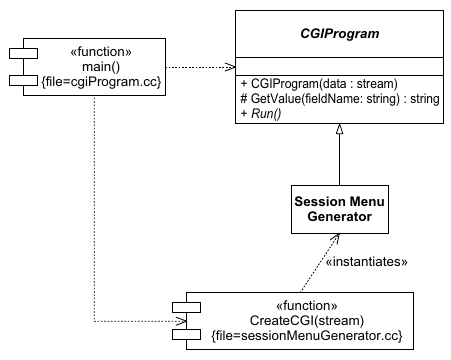<br/>
*Fig A-13 CGI 程序的架构*

## 小结

本章中，我们借助一个简单的例子，走过了 UML 记法的很大一部分。
我们展示了软件开发不同阶段所使用的各种记法惯例。
我们展示了如何用用例和类型来分析一个问题，从而形成一个应用领域模型。
我们展示了如何把类、对象和组件组合成静态与动态的图，来描述软件的架构与构造。
我们展示了每一个这些概念的 UML 记法，并演示了记法可以如何使用。
而且（这一点绝非最不重要）：我们展示了所有这些概念和记法如何参与软件设计的推理。

关于 UML 和软件设计，还有更多要学。
下一章将用另一个例子来探讨更多的 UML，以及不同的分析与设计权衡。

## 参考文献

1. Booch, Grady. Object Oriented Analysis and Design with Applications, 2nd ed. Benjamin Cummings: 1994.
2. Rumbaugh, et al. Object Oriented Modeling and Design. Prentice Hall: 1991.
3. Wirfs-Brock, Rebecca, et al. Designing Object-Oriented Software. Prentice Hall: 1990.
4. Coad, Peter, and Ed Yourdon. Object Oriented Analysis. Yourdon Press: 1991.
5. Jacobson, Ivar. Object Oriented Software Engineering a Use Case Driven Approach. Addison–Wesley, 1992.
6. Cockburn, Alistair. Structuring Use Cases with Goals. http://members.aol.com/acockburn/papers/usecass.htm.
7. Kennedy, Edward. Object Practitioner’s Guide. http://www.zoo.co.uk/~z0001039/PracGuides. November 29, 1997.
8. Booch, Grady. Object Solutions. Addison–Wesley, 1995.
9. Gamma, et al. Design Patterns. Addison–Wesley, 1995.
