# 附录 B UML 记法 II：STATMUX
<!-- markdownlint-disable MD033 -->
<!-- markdownlint-disable MD045 -->
<center>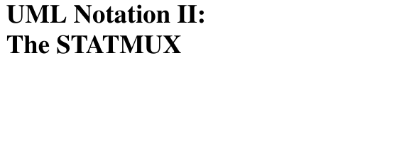</center><br/>

本章我们继续对 UML 记法的探索，这次聚焦于它一些更偏细节的方面。
作为这次探索的上下文，我们将研究一个统计多路复用器（statistical multiplexor）的问题。

## 统计多路复用器的定义

统计多路复用器是一种允许把多条串行数据流承载在单条电信线路上的设备。
例如，考虑一个内含单个 56K 调制解调器、并有 16 个串口的设备。
当两个这样的设备通过一条电话线相连时，从一端设备的 1 号口送入的字符，会从另一端设备的 1 号口出来。
这样的设备可以支持 16 路同时的全双工通信会话，而只用一个调制解调器。

Fig B-1 展示了 20 世纪 80 年代这类设备的一个典型应用。
在芝加哥，我们有一批 ASCII 终端和打印机，想把它们连到在底特律的一台 VAX 上。
我们有一条租用的 56K 线路连接这两个地点。
统计多路复用器在两个地点之间创建出 16 个虚拟串行通道。

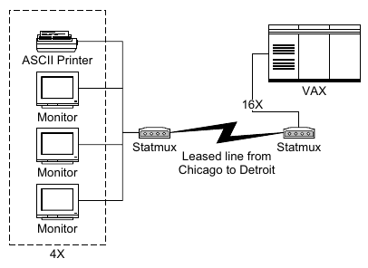<br/>
*Fig B-1 典型的统计多路复用器应用*

显然，如果全部 16 个通道同时运行，它们将分摊这 56K 的吞吐量，从而每个设备的有效比特率略低于每秒 3500 比特。
然而，大多数终端和打印机并非百分之百地忙碌。
事实上，在许多应用中占空比远低于 10%。
于是，尽管线路是共享的，但从统计上看每个用户都会感受到接近 56K 的性能。

本章我们将要研究的问题，是 statmux 内部的软件。
这套软件控制调制解调器和串口硬件。
它还决定用来在所有串口之间共享通信线路的多路复用协议。

### 软件环境

Fig B-2 是一张方块图¹，展示了软件在 statmux 中的位置。
它位于 16 个串口与调制解调器之间。

¹ 方块图是 Kent Beck 的 GML（galactic modeling language，星系建模语言）的一种形式。GML 图由直线、矩形、圆、椭圆，以及任何其他为把意思表达清楚所必需的形状组成。

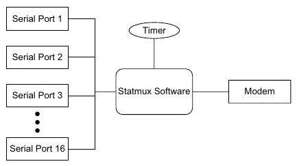<br/>
*Fig B-2 Statmux 系统方块图*

每个串口向主处理器产生两个中断——一个在它准备好发送字符时，一个在字符已被接收时。
调制解调器也产生类似的中断。
于是，进入系统的中断有 34 个。
调制解调器的中断优先级高于串口中断。
这确保调制解调器可以以全速 56K 运行，即使其他串口必须忍受休眠期。

最后，有一个定时器，每毫秒产生一次中断。
这个定时器让软件能把事件排定在特定时刻。

### 实时约束

稍作计算就能说明这个系统面临的问题。
在任何给定时刻，34 个中断源可能以每秒 5600 次中断的速率要求服务——再加上定时器每秒多出来的一千次中断。
这合计达到每秒 191,400 次中断。
于是，软件在服务每次中断上花费的时间不能超过 5.2 µs。
这非常紧张，我们需要一个相当快的处理器，以确保不丢掉任何字符。

更糟的是，这个系统要做的事不止是服务中断。
它还必须管理跨调制解调器的通信协议，从串口收集传入的字符，并分配需要发送到串口的字符。
所有这些都需要一些处理，而它们必须设法塞进中断之间的空隙里。

幸运的是，系统的最大持续吞吐量只有每秒 11,200 个字符（即调制解调器可以同时发送和接收的字符数）。
这意味着，平均而言，我们在字符之间有将近 90 µs。²

² 一段永恒。

既然我们的 ISR（中断服务例程）持续时间不能超过 5.2 µs，那么在中断之间我们至少还有 94% 的处理器可供使用。
这意味着在 ISR 之外，我们无需过分担心效率问题。

### 输入中断服务例程

这些例程也许不得不用汇编语言来写。
输入 ISR 的首要目标，是从硬件取出字符，并把它存到某个地方，让非 ISR 软件可以在闲暇时处理它。
处理这件事的典型方式是使用环形缓冲区。

Fig B-3 呈现了一张类图，展示输入 ISR 及其环形缓冲区的结构。
我们发明了几个新的立体类型和性质，用来描述中断服务例程所涉及的相当独特的问题。

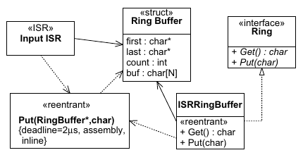<br/>
*Fig B-3 输入服务中断例程*

首先我们有 `InputISR` 类。
这个类带有 «ISR» 立体类型，表示这个类是中断服务例程。
这样的类用汇编语言编写，并且只有一个方法。
这个方法没有名字，只在中断发生时被调用。

`InputISR` 与它特定的 `RingBuffer` 之间有一个关联。
`RingBuffer` 类上的 «struct» 立体类型表示这是一个没有方法的类。
它不过是一个数据结构。
我们这样做，是因为预计它将由汇编语言函数访问，而那些函数本来无法访问类的方法。

`Put(RingBuffer*, char)` 函数被展示在一个带 «reentrant» 立体类型的类图标里。
这样使用的立体类型，表示一个编写得可以安全地被中断打断的自由函数。³
这个函数把字符加入环形缓冲区。
当字符被收到时，`InputISR` 就调用它。

³ 可重入性是一个复杂的主题，超出本章范围。读者可参阅关于实时与并发编程的优秀著作，
例如 Doug Lea 的 Concurrent Programming in Java，Addison–Wesley，1997。

这个函数上的性质表明：它有 2 µs 的实时截止期，应当用汇编语言编写，并且应当在每一处调用它的地方内联编码。
后两个性质是为满足第一个所做的努力。

`ISRRingBuffer` 类是一个常规类，它的方法在中断服务例程之外运行。
它利用 `RingBuffer` 结构，并为之提供一个类的 façade（外观）。
它的方法全部符合 «reentrant» 立体类型，因此是中断安全的。

`ISRRingBuffer` 类实现 `Ring` 接口。
这个接口允许中断服务例程之外的客户访问存放在环形缓冲区中的字符。
这个类代表中断与系统其余部分之间的接口边界。

> **列表框中的立体类型**
>
> 当立体类型出现在类的列表分区中时，它们具有特殊含义。
> 出现在某个立体类型之下的那些元素，都符合那个立体类型。
>
> 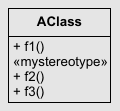<br/>
>
> 在这个例子中，函数 `f1()` 没有显式立体类型。
> 不过，函数 `f2()` 和 `f3()` 都符合 «mystereotype» 立体类型。
>
> 像这样的列表框中可以出现的立体类型数量没有限制。
> 每个新立体类型都会覆盖前一个。
> 出现在两个立体类型之间的所有元素，都符合它们上方的那个立体类型。
>
> 空的立体类型 «» 可以用在列表中间，表示其后的元素没有显式立体类型。

**环形缓冲区的行为。**
环形缓冲区可以用 Fig B-4 所示的“简单”状态机来描述。
这个状态机展示了在 `ISRRingBuffer` 类的对象上调用 `Get()` 和 `Put()` 方法时会发生什么。

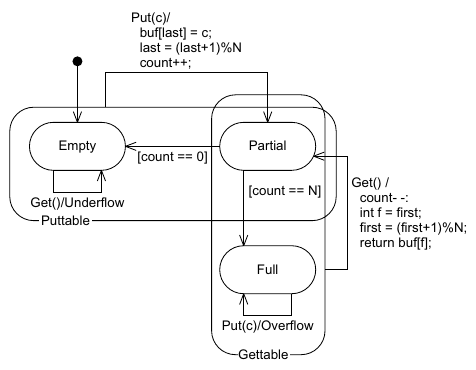<br/>
*Fig B-4 环形缓冲区状态图*

这张图展示了环形缓冲区可能处于的三个状态。
机器从 Empty 状态开始。
在 Empty 状态下，环形缓冲区里没有字符。
在这个状态下，`Get()` 方法将导致下溢（underflow）。
我们在这里尚未定义下溢或溢出期间会发生什么——那些决定留待日后。
Empty 和 Partial 两个状态是 Puttable 超状态的子状态。
Puttable 超状态代表那些 `Put()` 方法在其中运作而不会溢出的状态。
每当从某个 Puttable 状态调用 `Put()` 方法时，传入的字符被存进缓冲区，计数与索引被相应调整。
Partial 和 Full 两个状态都是 Gettable 超状态的子状态。
Gettable 超状态代表那些 `Get()` 函数在其中运作而不会下溢的状态。
在这些状态下调用 `Get()` 时，下一个字符被从环中取出，并回返给调用者。
计数与索引被相应调整。
在 Full 状态下，`Put()` 函数将导致一次溢出（Overflow）。

离开 Partial 状态的两条转移由**监护条件（guard condition）**支配。
每当 `count` 变量变为零，机器就从 Partial 状态转移到 Empty 状态。
同样，每当 `count` 变量达到缓冲区的容量（N），机器就从 Partial 状态转移到 Full 状态。

> **状态与内部转移**
>
> 在 UML 中，状态用一个圆角矩形表示。
> 这个矩形可以有两个分区。
>
> 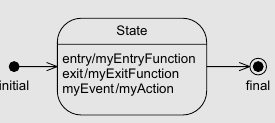<br/>
>
> 顶部那个分区只是给状态命名。
> 如果没有规定名字，那么这个状态是匿名的。
> 所有匿名状态彼此都不同。
>
> 底部分区列出该状态的**内部转移**。
> 内部转移记作 `eventName/action`。
> `eventName` 必须是机器处于给定状态时可能发生的事件名。
> 机器对这个事件的响应是留在该状态中，并执行规定的动作。
>
> 有两个特殊事件可用于内部转移。
> 它们就描绘在上图中。
> **entry**（进入）事件在状态被进入时发生。
> **exit**（退出）事件在状态被退出时发生（即使对于立即回到该状态的转移也是如此）。
>
> 一个动作可以是另一台既有初始状态又有终止状态的有限状态机的名字。
> 或者，动作可以是用某种计算机语言或伪代码写成的一段过程式表达式。
> 这段过程可以使用包含该状态机的对象（如果有的话）的操作和变量。
> 或者，动作可以写成 `^object.message(arg1, arg2, ...)` 的形式，此时该动作导致指定的消息被发送给指定的对象。
>
> 上图中还展示了两个特殊的**伪状态**图标。
> 左边我们看到表示初始伪状态的黑色圆点。
> 右边我们看到表示终止伪状态的靶心。
> 当一台有限状态机最初被调用时，它从初始伪状态转移到它所连接的那个状态。
> 于是，初始伪状态只能有一条离开它的转移。
> 当一个事件导致向终止伪状态的转移时，状态机就关闭，不再接受任何事件。
<br/>
> **状态之间的转移**
>
> 有限状态机是由转移连接起来的状态网络。
> 转移是连接一个状态到另一个状态的箭头。
> 转移上标注着触发它的那个事件的名字。
>
> 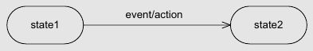<br/>
>
> 这里我们看到由一条转移连接的两个状态。
> 如果机器处于 state1 且该事件发生，这条转移就会被“触发”。
> 转移被“触发”时，state1 被退出，任何退出动作被执行。
> 然后转移上的动作被执行。
> 然后 state2 被进入，它的进入动作被执行。
>
> 转移上的事件可以用一个监护条件来限定。
> 只有在该事件发生**且**监护条件为真时，转移才会被触发。
> 监护条件是出现在事件名之后方括号中的布尔表达式（例如 `myEvent[myGuardCondition]`）。
>
> 转移上的动作与状态内部转移上的动作完全相同。（见“状态与内部转移”。）
<br/>
> **嵌套状态**
>
> 当一个状态图标完全包围了另一个或另一些状态图标时，被包围的状态被称为包围它的超状态的**子状态**。
>
> 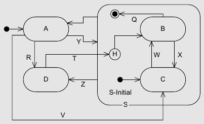<br/>
>
> 在上图中，状态 B 和 C 是超状态 S 的子状态。
> 状态机从状态 A 开始，如初始伪状态所示。
> 如果转移 V 被触发，那么超状态 S 内的子状态 C 将变为活动。
> 这将导致 S 和 C 两个的进入函数都被调用。
>
> 如果在处于状态 A 时转移 Y 被触发，机器就进入超状态 S。
> 进入超状态的转移必须导致它的某一个子状态变为活动。
> 如果一条转移终止在超状态的边界上，就像转移 Y 那样，那么在超状态内部就有一条从初始伪状态出发的转移。
> 于是，转移 Y 触发从 S-Initial 伪状态到子状态 C 的转移。
>
> 转移 Y 被触发时，超状态 S 和子状态 C 都被进入。
> S 和 C 的任何进入动作都在那时被调用。
> 超状态的进入动作先于子状态的进入动作被调用。
>
> 现在转移 W 和 X 可以被触发，在 B 和 C 两个子状态之间移动机器。
> 退出与进入动作将照常执行，但由于超状态 S 并未被退出，它的退出函数不会被调用。
>
> 最终，转移 Z 会被触发。
> 注意 Z 离开超状态的边界。
> 这意味着，无论子状态 B 还是 C 是活动的，转移 Z 都把机器移到状态 D。
> 这等价于两条分开的转移：一条从 C 到 D，另一条从 B 到 D，两者都标注为 Z。
> Z 被触发时，相应子状态的退出动作被执行，然后超状态 S 的退出动作被执行。
> 然后 D 被进入，它的进入动作被执行。
>
> 注意转移 Q 终止在一个终止伪状态上。
> 如果转移 Q 被触发，那么超状态 S 就终止。
> 这将导致从 S 到 A 的那条无标签转移被触发。
> 终止超状态还会重置任何历史信息，后面会描述。
>
> 转移 T 终止在 S 超状态内的一个特殊图标上。
> 这叫做**历史标记（history marker）**。
> 当转移 T 被触发时，S 内最后活动的那个子状态重新变为活动。
> 于是，如果转移 Z 曾在 C 活动时发生，那么转移 T 将使 C 重新变为活动。
>
> 如果转移 T 在历史标记未活动时被触发，那么从历史标记到子状态 B 的那条无标签转移被触发。
> 这表示在没有可用历史信息时的一个缺省。
> 如果 S 从未被进入过，或者 S 刚被转移 Q 终止，历史标记就是未活动的。
>
> 于是，事件序列 Y-Z-T 将使机器停留下子状态 C。
> 但 R-T 与 Y-W-Q-R-T 都会使机器停留下子状态 B。

### 输出中断服务例程

输出中断的处理与输入中断的处理非常相似。
不过，有一些差别。
系统的非中断部分把要发送的字符装入输出环形缓冲区。
串口每当准备好接收下一个字符时就产生一次中断。
中断服务例程从环形缓冲区抓取下一个字符，并送给串口。

如果串口就绪时环形缓冲区中没有等待的字符，那么中断服务例程就无事可做。
串口已经发过信号表示它准备好接受新字符，而在被交给一个字符并把它发送完毕之前，它不会再次发出信号。
于是，中断的流动就停止了。
因此我们需要一种策略，在新字符到达时重启输出中断。
Fig B-5 展示了输出 ISR 的结构。
它与 Fig B-3 中输入 ISR 的相似性一目了然。
不过，注意从 `ISRRingBuffer` 到 `OutputISR` 的 «calls» 依赖。
这表明 `ISRRingBuffer` 对象可以让 `OutputISR` 执行，就像收到了一次中断一样。

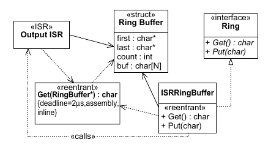<br/>
*Fig B-5 输出中断服务例程*

Fig B-6 展示了对输出环形缓冲区的有限状态机所做的必要修改。
把它与 Fig B-4 对照。
注意 Puttable 超状态已被移除，并且有两条 Put 转移。
第一条 Put 转移从 Empty 状态到 Partial 状态。
这将导致 Gettable 超状态的进入动作被执行，从而向 `OutputISR` 产生一次人为中断。⁴
第二条 Put 转移是 Partial 状态内部的转移。

⁴ 产生这种人为中断的机制强烈依赖于平台。在某些机器上，可以像调用函数那样直接调用 ISR。另一些机器则需要更繁复的协议来人为触发 ISR。

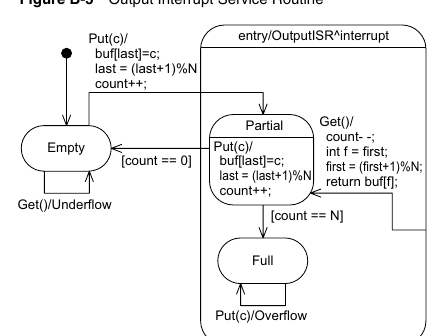<br/>
*Fig B-6 输出服务中断状态机*

## 通信协议

两个 statmux 通过各自的调制解调器通信。
每一个都通过一条电信线路向另一个发送数据包。
我们必须假定线路是不完美的，错误和中断可能发生。
字符在传输中可能丢失或错乱，电气放电或其他电磁干扰也可能造出虚假字符。
因此，必须在两个调制解调器之间建立一套通信协议。
这套协议必须能够核实数据包是完整且准确的，并且必须能够重传错乱或丢失的数据包。

Fig B-7 是一张**活动图**。（见第 498 页的“活动图”侧边栏。）
它展示了我们的 statmux 将使用的通信协议。
这套协议是一个相对直截了当的、带流水线（pipelining）与捎带（piggybacking）的滑动窗口协议。⁵

⁵ 关于这类通信协议的更多信息，见 Computer Networks, 2d. ed.
Tanenbaum, Prentice Hall, 1988，第 4.4 节。

协议从初始伪状态开始，先初始化一些变量，然后创建三个独立的线程。
这些变量将在后面讲述依赖它们的那些线程的各节中解释。
“定时线程”用来在允许的时间段内没有收到确认时重传数据包。
它还用来确保对正确收到的数据包的确认被及时发出。
“发送线程”用来发送已排入队列待传的数据包。
“接收线程”用来接收、校验和处理数据包。
我们逐一考察。

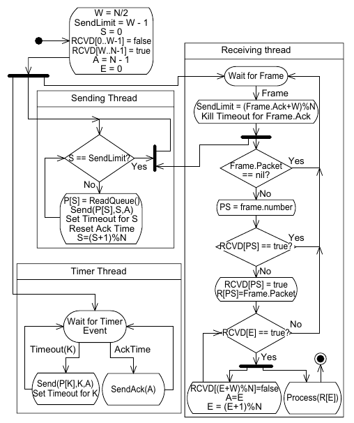<br/>
*Fig B-7 通信协议活动图*

**发送线程。**
变量 S 存放将盖在下一个发出数据包上的序号。
每个数据包都打上 0..N 范围内某个序号的标记。
发送线程会持续发送数据包，不等待它们被确认，直到有 W 个已发出但未确认的数据包为止。
W 被设为 N/2，这样在任何给定时刻都不会有超过一半的序号在流转。
`SendLimit` 变量通常存放窗口之外（W）那个数据包的序号，因此它是尚不能发送的最小序号。

发送线程继续发送数据包时，按模 N 递增 S。
当 S 到达 `SendingLimit` 时，线程阻塞，直到 `SendingLimit` 被接收线程改变。
如果 S 尚未到达 `SendingLimit`，那么 `ReadQueue()` 函数从队列中取下一个新数据包。
该数据包被放进 P 数组的 S 位置。
我们把这个数据包留在该数组中，以备需要重传。
然后该数据包连同它的序号（S）以及捎带的确认（A）一起被发送。
A 是我们最后收到的那个数据包的序号。
这个变量由接收线程更新。

发出数据包之后，我们为它启动一个超时。
如果这个超时在数据包被确认之前到期，定时线程就判定：要么数据包丢了，要么确认丢了，于是重传该数据包。

此时，我们还会重置确认计时器。
当确认计时器到期时，定时线程判定距上次发出确认已过了太多时间，于是对最后已知良好收到的数据包发出确认。

**接收线程。**
这个线程先初始化几个变量。
`RCVD` 是一个按序号索引的布尔标志数组。
数据包被收到时，它们在 `RCVD` 中被标记为真。
一个数据包被处理之后，越过它 W 位置的那个序号被标记为假。
E 是我们正期待、并即将被处理的那个数据包的序号；它将始终是 A+1 对 N 取模。
作为初始化的一部分，我们把 `RCVD` 的后一半设为真，以表示那些序号位于允许窗口之外。
如果它们被收到，就会作为重复数据包被丢弃。

接收线程等待一个**帧（frame）**。
一个帧可能是一个数据包，也可能只是一个纯确认。
无论哪种情况，它都将包含对最后一个良好数据包的确认。
我们更新 `SendLimit` 并触发发送线程。
注意 `SendLimit` 被设为越过了最后被确认帧的 W 位置。
于是，发送方只被允许使用从最后被确认数据包开始的一半序号空间，这样发送方和接收方就协商好了当前哪一半序号空间是有效的。

如果帧中包含一个数据包，那么我们取出该数据包的序号，并检查 `RCVD` 数组，看是否已经收到过具有该序号的数据包。
如果是，就作为重复包丢弃。
否则，我们更新 `RCVD` 数组表示该数据包现在已被收到，并把该数据包保存进 R 数组。

尽管数据包是按序号顺序发送的，它们却可能乱序到达。
这很简单，因为数据包可能丢失并重传。
于是，即使我们刚收到 PS 号数据包，它也可能不是我们期待的那个（E）。
如果不是，我们就一直等到 E 被收到。
然而，如果 PS == E，我们就派生出（spawn）一个单独的线程来处理该数据包。
我们还会把 `RCVD` 数组的 E+W 槽设为假，从而移动允许的序号窗口。
最后，我们把 A 设为 E，以表示 E 是最后良好收到的序号，并递增 E。

**定时线程。**
定时器只是等待一个定时器事件。
可能发生两种事件。
`Timeout(K)` 事件表示发送线程发出过一个数据包，但从未收到确认。
于是，定时线程重传 K 号数据包，并重启它的计时器。

`AckTime` 事件由一个重复的、可重触发的计时器产生。
这个计时器每 X 毫秒发出一次 `AckTime` 事件。
不过，它可以被重新触发而从 X 重新开始。
发送线程每发送一个数据包就重新触发这个计时器。
这是恰当的，因为每个数据包都带有捎带的确认。
如果 X 毫秒内没有发出任何数据包，那么 `AckTime` 事件就会发生，定时线程将发出一个确认帧。

呼！你也许觉得这段讨论读起来有点费劲。
想想如果没有那些解释性文字会是什么样子。
图或许表达了我的意图，但那些额外的文字确实帮了大忙。
<ins>图很少能独立站得住脚。</ins>

我们怎么知道这张图是正确的？
我们并不知道！
如果若干读者在其中挑出毛病，我一点儿也不会感到意外。
<ins>图通常无法像代码那样被直接测试。</ins>
所以我们只能等代码写出来，才知道这个算法是否真的正确。

这两个问题使这类图的实用性值得怀疑。
它们可以是很好的教学工具，但不应被认为足够有表现力、足够准确，以致可以作为设计的唯一规格说明。
文字、代码和测试同样都是必需的。

> **活动图**
>
> 活动图是状态转移图、流程图和 Petri 网的一种混合体。
> 它们特别擅长描述事件驱动的多线程算法。
>
> 活动图是一种状态图。
> 它仍然是由转移连接起来的状态的图。
> 然而，在活动图中，存在特殊种类的状态和转移。
>
> **动作状态**
>
> 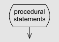<br/>
>
> 动作状态画成一个上下平齐、两侧圆润的矩形。
> 这个图标与常规状态图标不同：它的角是尖的，而常规状态图标的角是圆润的。（见第 493 页“状态与内部转移”。）
> 动作状态的内部包含一条或多条过程式语句，表示它的进入动作。（这就像流程图中的处理框。）
> 当动作状态被进入时，它的进入动作立即被执行。
> 这些动作完成后，动作状态就被退出。
> 出去的转移不得带有事件标签，因为那个“事件”不过是进入动作的完成。
> 不过，可以有多条出去的转移，每条带一个互斥的监护条件。
> 所有监护条件的并集必须始终为真（即不可能“卡”在一个动作状态里）。
>
> **判定**
>
> 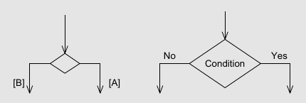<br/>
>
> 动作状态可以有多条带监护条件的出去转移这一事实，意味着它可以充当判定步骤。
> 不过，明确地标出判定往往更好，为此菱形图标是传统做法。
> 一条转移进入菱形，N 条带监护条件的转移离开它。
> 同样，所有出去监护条件的布尔并集必须为真。
>
> 在 Fig B-7 中，我们使用了菱形的一种更接近流程图的变体。
> 一个布尔条件写在菱形内，两条出去的转移标注为 “Yes” 和 “No”。
>
> **复杂转移**
>
> 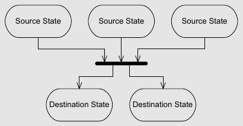<br/>
>
> 复杂转移展示多条控制线程的分叉与汇合。
> 它们用那条叫做**异步棒（asynchronization bar）**的深色粗棒表示。
> 箭头把状态连接到异步棒。
> 通向粗棒的状态叫做**源状态**，离开粗棒的状态叫做**目的状态**。
>
> 通向粗棒和离开粗棒的整组箭头构成单独一条转移。
> 这些箭头既不标注事件，也不标注监护条件。
> 这条转移在所有源状态都被占据时触发（即三个独立的线程都处于相应的状态时）。
> 而且，源状态必须是真正的状态，而不是动作状态（即它们必须能够等待）。
>
> 触发时，所有源状态都被退出，所有目的状态都被进入。
> 如果目的状态比源状态多，那么我们就派生出了新的控制线程。
> 如果源状态更多，那么一些线程已经汇合。
>
> 每当一个源状态被进入，这次进入就被计数。
> 每当复杂转移被触发，它的各源状态中的计数器就递减。
> 只要计数器非零，源状态就被认为是被占据的。
>
> 作为记法上的一种便利，一条真正的转移或一个动作状态可以被用作异步棒的源。（见 Fig B-7。）
> 在这种情况下，假定该转移实际上终止在一个真正的无名状态上，而这个状态是粗棒的一个源状态。
>
> 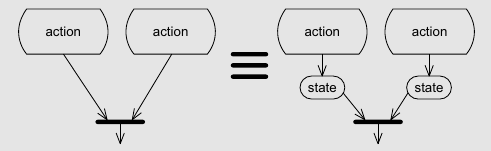<br/>

**通信协议软件的结构。**
这三条控制线程共享同一批变量。
于是，这些线程所调用的函数大概应当是同一个类的方法。
然而，如今大多数线程系统把一个线程等同于一个对象。
也就是说，每个线程都有一个控制它的对象。
在 UML 中，这些叫做**主动对象（active object）**。（见第 502 页“主动对象”。）
于是，容纳协议方法的那个类，还需要创建控制这些线程的主动对象。

定时线程在协议之外的地方也会有用，所以它的线程大概应当在系统的另一部分创建。
这就留下发送线程和接收线程，由协议对象来创建。

Fig B-8 展示了一张**对象图**（见第 501 页“对象图”），描绘 `CommunicationsProtocol` 对象刚被初始化之后的状况。
`CommunicationsProtocol` 创建了两个 `Thread` 对象，并对其生命周期负责。
这些 `Thread` 对象采用 COMMAND⁶ 模式，以便新创建的执行线程得以启动。
每个 `Thread` 持有一个符合 `Runnable` 接口的对象的实例。（见第 502 页“接口棒棒糖”。）
随后用 ADAPTER⁷ 模式把 `Thread` 绑定到 `CommunicationsProtocol` 对象的相应方法上。

⁶ [第 151 页](./ch13.md)。

⁷ [第 317 页](./ch25.md)。

`Timer` 与 `CommunicationsProtocol` 之间可以看到类似的安排。
不过在这个情形中，`Timer` 对象的生命周期并不由 `CommunicationsProtocol` 对象控制。

«friend» 关系的存在，是因为我们希望适配器所调用的那些方法对 `CommunicationsProtocol` 保持私有。
我们不希望它们被适配器之外的任何东西调用。⁸

⁸ 还有若干其他方式可以做到这一点。我们可以使用 Java 的内部类。

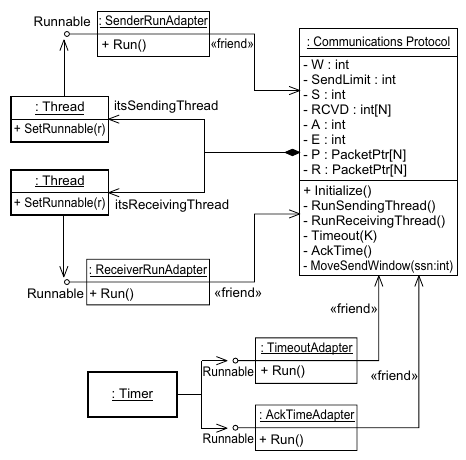<br/>
*Fig B-8 对象图：协议对象刚被初始化之后*

> **对象图**
>
> 对象图描绘在某个特定时刻，一组对象之间存在的静态关系。
> 它们与类图有两点不同。
> 第一，它们描绘的是对象而非类，是对象之间的链接而非类之间的关系。
> 第二，类图展示源代码层面的关系与依赖，而对象图只展示在对象图所定义的那个瞬间存在的运行时刻关系与依赖。
> 于是，对象图展示了当系统处于某个特定状态时存在的对象与链接。
>
> 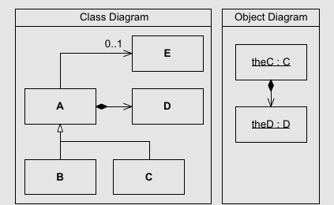<br/>
>
> 上图中我们看到一张类图和一张对象图，它们表示由类图中的类与关系派生出的对象与链接的一种可能状态。
> 注意，对象的画法与序列图中的画法相同。
> 它们是带下划线、双成分名字的矩形。
> 还要注意，对象图上的关系与类图上的关系画法相同。
>
> 两个对象之间的关系叫做**链接（link）**。
> 链接允许消息沿可导航性的方向流动。
> 在这个情形中，消息可以从 `theC` 流向 `theD`。
> 这个链接之所以存在，是因为 A 类与 D 类之间存在组合关系，并且 C 类派生自 A 类。
> 于是，C 类的实例可以拥有从其基类派生出来的链接。
>
> 还要注意，A 类与 E 类之间的关系没有在对象图上表示出来。
> 这是因为该对象图描绘的是系统的一个特定状态，在此状态下 C 对象不与 E 对象相关联。
<br/>
> **主动对象**
>
> 主动对象是对单条执行线程负责的对象。
> 执行线程不需要在主动对象的方法内部运行。
> 事实上，主动对象典型地会调出到其他对象。
> 主动对象不过是执行线程在其中发源的那个对象。
> 它同时也是提供线程管理接口（如 `Terminate`、`Suspend` 和 `ChangePriority`）的那个对象。
>
> 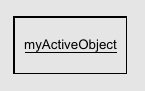<br/>
>
> 主动对象画成普通对象的样子，但带粗轮廓。
> 如果主动对象还拥有在其线程控制下执行的其他对象，你可以把这些对象画在主动对象的边界之内。
<br/>
> **接口棒棒糖**
>
> 接口可以展示为带 «interface» 立体类型的类，也可以用一种特殊的**棒棒糖（lollipop）**图标展示。
>
> 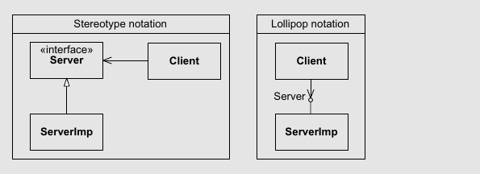<br/>
>
> 这个框里的两张图解释完全相同。
> `Client` 类的实例使用 `Server` 接口。
> `ServerImp` 类实现 `Server` 接口。
>
> 连接到棒棒糖的两条关系中的任何一条都可以省略，如下图所示：
>
> 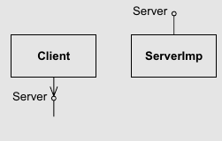<br/>

**初始化过程。**
用于初始化 `CommunicationsProtocol` 对象的各个处理步骤展示在 Fig B-9 中。
这是一张**协作图（collaboration diagram）**。（见第 504 页“协作图”。）

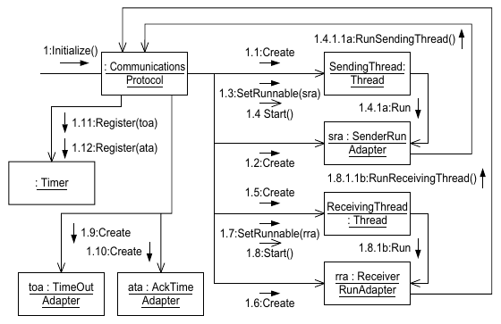<br/>
*Fig B-9 协作图：初始化 CommunicationsProtocol 对象*

初始化过程从 1 号消息开始。
`CommunicationsProtocol` 从某个未知来源收到 `Initialize` 消息。
它在 1.1 和 1.2 号消息中响应：创建 `SendingThread` 对象及其关联的 `SenderRunAdapter`。
然后，在 1.3 和 1.4 号消息中，它把适配器绑定到线程上，并启动该线程。

注意 1.4 号消息是异步的，所以初始化过程继续以 1.5 到 1.8 号消息进行，它们只是重复创建 `ReceivingThread` 的过程。
与此同时，一条单独的执行线程在 1.4.1a 号消息中开始，它调用 `SenderRunAdapter` 中的 `Run` 方法。
于是，适配器向 `CommunicationsProtocol` 对象发送 1.4.1.1a:`RunSendingThread` 消息。
这启动了发送线程的处理。
一条类似的事件链启动了接收线程。
最后，1.9 到 1.12 号消息创建定时器适配器，并把它们注册到定时器上。

> **协作图**
>
> 协作图与对象图相似，区别在于它们展示系统的状态如何随时间演化。
> 对象之间发送的消息被展示出来，连同它们的参数和回返值。
> 每条消息都标注一个序号，以显示它相对于其他消息的次序。
>
> 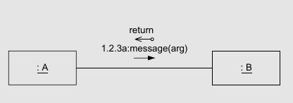<br/>
>
> 消息画成放在两个对象之间链接附近的小箭头。
> 箭头指向接收该消息的对象。
> 消息被标注上消息的名字和序号。
>
> 序号与消息名之间用冒号分隔。
> 消息名之后跟一对圆括号，其中是用逗号分隔的消息参数列表。
> 序号是用点分隔的一组数字，后面跟一个可选的线程标识符。
>
> 序号中的数字既表示消息的次序，也表示它在调用层次中的深度。
> 1 号消息是第一个被发送的消息。
> 如果 1 号消息所调用的过程又调用了另外两条消息，它们将分别编号为 1.1 和 1.2。
> 一旦它们返回、1 号消息完成，下一条消息将是 2 号。
> 通过使用这种点的方案，就有可能完整地描述消息的次序和嵌套关系。
>
> 线程标识符是该消息在其内执行的那个线程的名字。
> 如果省略线程标识符，就表示该消息在无名线程中执行。
> 如果 1.2 号消息派生出一个名为 “t” 的新线程，那个新线程的第一条消息将编号为 1.2.1t。
>
> 回返值和参数可以用数据令牌符号（末端带圆圈的小箭头）来显示。
> 或者，回返值可以用消息名中的赋值语法来显示，如下所示：
>
> ```txt
> 1.2.3 : c:=message(a,b)
> ```
>
> 在这个情形中，“message” 的回返值将存放在一个名为 “c” 的变量中。
>
> 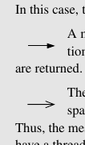<br/>
>
> 使用实心箭头的消息（如左侧所示）表示一次**同步**函数调用。
> 在它的过程所调用的所有其他同步消息返回之前，它不会返回。
> 这是 C++、Smalltalk、Eiffel 或 Java 等语言中的常规消息种类。
>
> 使用小棍形箭头的消息（如左侧所示）表示一条**异步**消息。
> 这样的消息派生一条新的控制线程来执行被调用的方法，然后立即返回。
> 于是，该消息在被执行的方法执行之前就返回了。
> 该方法发出的消息应当带线程标识符，因为它们在一个与被调用时不同的线程中执行。

**协议中的竞争条件。**
如 Fig B-7 所述，这套协议有许多有趣的**竞争条件（race condition）**。
当两个单独事件的次序无法预测、而系统的状态又对该次序敏感时，就出现竞争条件。
系统的状态于是取决于哪个事件在竞争中获胜。

程序员努力确保无论这些事件的次序如何，系统都正常行事。
然而，竞争条件很难识别。
未被发现的竞争条件可能导致间歇性、难以诊断的错误。

作为竞争条件的一个例子，考虑发送线程发出一个数据包时会发生什么。（见 Fig B-10。）
这类图叫做**消息序列图（message sequence chart）**。（见第 506 页“消息序列图”。）
本地发送方发出 S 号数据包并启动一个超时。
远程接收方收到这个数据包，并让远程发送方知道 S 被正确收到。
远程发送方要么发出一个显式 ACK，要么在下一个数据包上捎带一个 ACK。
本地接收方收到这个 ACK 并撤销超时。

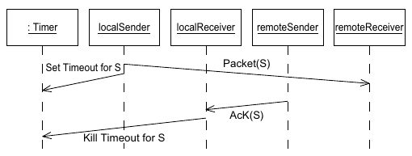<br/>
*Fig B-10 数据包被确认：正常情形*

有时 ACK 没能返回。
在这种情况下超时到期，数据包被重传。
Fig B-11 展示了会发生什么。

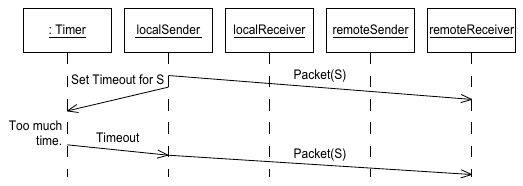<br/>
*Fig B-11 确认丢失：重传*

在这两个极端之间存在一个竞争条件。
有可能定时器恰好在 ACK 正被发出时到期。
Fig B-12 展示了这个场景。
注意交叉的线。
它们表示这场竞争。
S 号数据包被完整地发出并收到了。
而且，一个 ACK 被传了回来。
然而，这个 ACK 在超时已经发生之后才到达。
于是，尽管 ACK 已被收到，该数据包还是被重传了。

Fig B-7 的逻辑正确地处理了这场竞争。
远程接收方会意识到 S 号数据包的第二次到达是一个重复包，并将其丢弃。

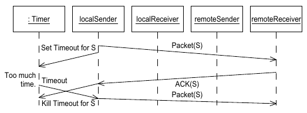<br/>
*Fig B-12 ACK ／ 重传的竞争条件*

> **消息序列图**
>
> 消息序列图是序列图的一种特殊形式。
> 主要的区别在于，消息箭头向下倾斜，以表示消息的发送与接收之间可以经过时间。
> 序列图的其他所有组成部分都可以出现，包括激活和序号。
>
> 消息序列图的主要用途，是发现并记录竞争条件。
> 这些图非常擅长展示某些事件的相对时序，以及两个独立的进程如何可能对事件的次序有不同的看法。
>
> 考虑 Fig B-12。
> `Timer` 对象认为 `Timeout` 事件发生在 `Kill Timeout` 事件之前。
> 然而，`localSender` 感知到这两个事件的次序却相反。
>
> 这种对事件次序感知的差异，可能导致对时序极其敏感、并且极难复现和诊断的逻辑缺陷。
> 消息序列图是很好的工具，可以在这类情况于现场造成严重破坏之前发现它们。

## 结论

本章中，我们呈现了 UML 的大多数动态建模技术。
我们看到了状态机、活动图、协作图和消息序列图。
我们也看到了这些图如何处理单线程与多线程控制的问题。

## 参考文献

1. Gamma, et al. Design Patterns. Reading, MA: Addison–Wesley, 1995.
